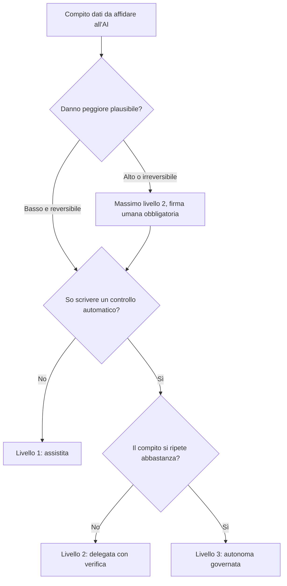

Scenario costruito: lunedì mattina un analista chiede a un assistente AI il fatturato settimanale per canale. La query torna in venti secondi, i numeri sembrano ragionevoli, il grafico è pulito. Nessuno si accorge che la join con la tabella dei coupon ha moltiplicato alcune righe: il totale è gonfiato del 3% e a metà settimana un responsabile marketing sposta budget sul canale sbagliato. L'errore non era nel modello, era nell'assenza di un controllo che costasse meno dell'ottimismo.

Questa pagina è la scheda da tenere aperta quando devi decidere quanta automazione concedere a un compito, che cosa scrivere prima di aprire il prompt e quali test far passare prima di firmare un risultato. Non sostituisce le lezioni del modulo: le condensa in criteri, soglie e due controlli eseguibili.

## Una regola che decide quasi tutto

> **Idea chiave:** delega all'AI soltanto ciò che sai verificare in meno tempo di quanto impiegheresti a farlo da solo; tutto il resto resta assistito oppure non parte.

La regola funziona perché sposta la domanda dal modello alla verifica. Un output imperfetto che si controlla in due minuti fa risparmiare tempo anche quando sbaglia. Un output quasi giusto che richiede di ricostruire la logica riga per riga costa più dell'esecuzione manuale, e in più contamina ciò che viene dopo perché supera i controlli superficiali.

Il flusso decisionale si riduce a tre domande poste in ordine.



Se il danno è alto, il livello 3 resta chiuso a prescindere dalle risposte successive. È una scelta deliberata: l'autonomia si guadagna con guardrail, baseline e rollback, non con la fiducia nel prototipo.

## I tre livelli di automazione in una tabella

Ogni compito dati ricade in uno dei tre livelli. La tabella associa tipi di lavoro frequenti al livello consigliato e al motivo, così la decisione richiede trenta secondi invece di una riunione.

| Tipo di compito | Livello consigliato | Perché |
|---|---|---|
| Bozza SQL esplorativa | 1, assistita | Gli errori emergono subito nei risultati |
| Documentazione di una pipeline esistente | 2, delegata con review | Il codice sorgente fa da verità |
| Definizione di una metrica di business | Umana, AI come sparring | L'ambiguità è semantica, non sintattica |
| Feature per un modello in produzione | 2 con test automatici pesanti | Il leakage è silenzioso e costoso |
| Report ricorrente con schema stabile | 3, autonoma governata | I controlli sono codificabili una volta sola |
| Analisi ad hoc per una decisione urgente | 1, verifica mirata | Contesto ricco, poco tempo |

Il livello 1 significa che l'AI propone e tu disponi: la verifica è la tua lettura critica, il setup costa quasi nulla e ogni output richiede attenzione piena. Al livello 2 l'AI lavora dentro un perimetro e una suite di test giudica il risultato; tu rivedi solo le eccezioni. Al livello 3 il workflow gira da solo, ma dentro input validati, confronto con una baseline, monitoraggio del drift, rollback pronto e un proprietario con nome e cognome.

L'errore ricorrente è saltare dal livello 1 al 3 perché il prototipo funzionava. Funzionava con te presente come controllo implicito. Industrializzarlo significa esplicitare tutto ciò che facevi a occhio, ed è lavoro di ingegneria, non un cambio di configurazione.

## Il contratto del compito prima del prompt

Gli output deludenti nascono più spesso da specifiche vaghe che da modelli deboli. Prima di scrivere il prompt fissa quattro elementi: l'artefatto atteso con il suo grain, il contesto minimo, il controllo che giudicherà il risultato e la decisione che il risultato deve supportare. "Analizza le vendite" è un auspicio. "Query che restituisce il fatturato settimanale per canale, settimane ISO da lunedì a domenica, resi esclusi, ultimi 12 mesi" è un compito, perché contiene grain, filtri, finestra e formato.

| Elemento | Domanda a cui risponde | Esempio per un modello di churn |
|---|---|---|
| Compito | Quale artefatto, con quale grain? | Probabilità di abbandono a 30 giorni per `user_id` |
| Contesto | Che cosa il modello non può indovinare? | Tabella eventi con `event_date`, utenti con almeno 7 giorni di anzianità |
| Controllo | Come capirò che l'output è sbagliato? | Holdout temporale sopra soglia, calibrazione entro banda |
| Decisione | Che cosa farò del risultato e chi risponde? | Test A/B sulla retention, owner il responsabile crescita |

Il contesto minimo comprende cinque pezzi: lo schema delle sole tabelle coinvolte con tipi e chiavi, il grain dichiarato, le definizioni di business copiate dal glossario ufficiale, le trappole note come timezone miste o soft delete e un campione di 5-20 righe reali che includa nulli, stringhe vuote, date future e importi negativi. Il campione deve coprire più periodi, altrimenti il modello non vede mai stagionalità e cambi di schema.

Una verifica empirica del contratto: cancella il prompt elaborato e lascia le quattro righe. Un analista competente dovrebbe produrre qualcosa di riconoscibilmente simile. Se non ci riesce, il contratto è incompleto e va sistemato prima di coinvolgere l'AI.

Sul piano dei costi, passare tutto il catalogo a ogni richiesta è un errore doppio: diluisce il segnale e può esporre dati personali. Anonimizza o sintetizza prima di inviare, e manda schema e campione, mai intere tabelle.

## Controlli in codice: quadratura e validazione di dominio

Ogni output AI su dati va trattato come codice non testato. La rete di controlli ha tre maglie: test meccanici, confronto con una baseline indipendente e revisione mirata sui punti dove i modelli sbagliano di più. Le prime due si scrivono una volta e girano su ogni output, umano o artificiale.

La query seguente verifica che la somma per canale ricostruisca il totale e che la `GROUP BY` non abbia perso o duplicato righe.

```sql
-- Quadratura dopo una query generata dall'AI: somma dei canali contro totale indipendente
WITH dettaglio AS (
  SELECT canale, SUM(importo) AS fatturato_canale, COUNT(*) AS righe_canale
  FROM vendite
  WHERE data_ordine >= DATE '2026-01-01'  -- finestra dichiarata nel contratto
    AND reso_flag = FALSE                  -- esclusione concordata
  GROUP BY canale
),
totale AS (
  SELECT SUM(importo) AS fatturato_totale, COUNT(*) AS righe_totali
  FROM vendite
  WHERE data_ordine >= DATE '2026-01-01'
    AND reso_flag = FALSE
)
SELECT 'quadratura_fatturato' AS test,
  ABS(SUM(d.fatturato_canale) - (SELECT fatturato_totale FROM totale))
    / (SELECT fatturato_totale FROM totale) AS scostamento_relativo
FROM dettaglio d
UNION ALL
SELECT 'completezza_righe',
  ABS(SUM(d.righe_canale) - (SELECT righe_totali FROM totale)) * 1.0
    / (SELECT righe_totali FROM totale)
FROM dettaglio d;
-- Lettura: scostamento_relativo > 0.01 in un test qualsiasi, indaga prima di usare i dati
```

Un esempio numerico mostra come leggere il risultato. Il totale indipendente di fonte contabile è 86.000 €. Il dettaglio per canale riporta 41.200 € per il paid, 28.500 € per l'organico e 15.300 € per l'email. La somma è 41.200 + 28.500 + 15.300 = 85.000 €. La differenza è 86.000 − 85.000 = 1.000 €, quindi lo scostamento relativo vale 1.000 / 86.000 = 1,16%. Supera la soglia dell'1%, perciò l'output viene scartato e si indaga. Qui la causa è un canale mancante nella mappatura, non un errore di calcolo: il test ha fatto il suo mestiere.

Il secondo controllo riguarda i valori inventati. L'AI produce spesso codici prodotto inesistenti o importi fuori range che sembrano giusti a colpo d'occhio. La funzione Python raccoglie tutte le violazioni in una sola passata.

```python
# Validazione di dominio su output AI: elenca le violazioni invece di propagarle
import pandas as pd

def valida_output_ai(df: pd.DataFrame, catalogo_prodotti: set) -> list[str]:
    violazioni = []
    # 1) le chiavi referenziate devono esistere nel catalogo
    codici_ignoti = set(df["codice_prodotto"].dropna()) - catalogo_prodotti
    if codici_ignoti:
        violazioni.append(f"codici non a catalogo: {sorted(codici_ignoti)[:10]}")
    # 2) importi negativi in un report vendite sono quasi sempre un errore
    if (df["importo"] < 0).any():
        violazioni.append(f"importi negativi: {(df['importo'] < 0).sum()} righe")
    # 3) grain dichiarato: una riga per utente e mese
    if df.duplicated(subset=["user_id", "mese"]).any():
        violazioni.append("duplicati su (user_id, mese): grain violato")
    return violazioni  # lista vuota = output accettabile
```

La terza maglia è la revisione umana mirata: definizioni di metrica contro il glossario, direzione delle join contro il grain dichiarato, finestre temporali contro il leakage, segmenti piccoli dove la varianza esplode. Il principio comune è l'indipendenza: un controllo che riusa la logica della query sotto esame, o che chiede allo stesso modello se è corretta, è teatro.

## Rischi tipici da riconoscere

Quattro famiglie coprono quasi tutti i fallimenti dei workflow AI sui dati. Tre di esse compaiono qui come anti-pattern con sintomo, causa e rimedio; la quarta, l'automazione senza permessi governati, chiude la sezione.

### Leakage temporale

Il sintomo è una metrica sospettosamente buona in validazione e un crollo in produzione. Succede perché il modello vede informazioni che alla data di scoring non esistevano: la data di chiusura dentro le feature di churn, gli ordini futuri nella media mobile, il target travestito da variabile. Sembra ragionevole perché la metrica è alta e nessuno la contesta. Si corregge con uno split temporale rigoroso, mai uno shuffle casuale su dati con dipendenza temporale, e con un audit che per ogni feature pone la domanda "questo campo esisteva alla data di scoring?". Una media mobile a 7 giorni è legittima se esclude il giorno corrente; calcolata includendolo, o normalizzata sull'intero dataset, è leakage.

### Allucinazioni silenziose

Il sintomo è un valore plausibile ma falso: un codice prodotto che non esiste, una data fuori range, una join su colonne omonime ma semanticamente diverse. Succede perché il modello completa lo schema con la convenzione più comune del suo addestramento, che raramente è la tua. Si corregge con vincoli di dominio codificati, cioè chiavi esterne, valori ammessi e range validi, verificati su ogni output come nella funzione Python sopra.

### Costi e privacy fuori controllo

Il sintomo è una fattura che cresce o un log che contiene dati personali. Succede con contesti gonfiati, agenti in loop, AutoML che esplora spazi enormi per guadagni marginali, schema e campioni inviati a servizi esterni senza minimizzazione. Si corregge con un budget esplicito per esecuzione e per riga, con alert prima del tetto. Esempio numerico: 4.000 righe per 800 token ciascuna fanno 3,2 milioni di token a esecuzione; a 3 € per milione sono 9,60 €, per 30 esecuzioni al mese 288 €. Se la decisione supportata vale 150 € al mese, il workflow non va schedulato. Sul fronte privacy, se il contratto dati vieta l'esportazione, il workflow gira dentro il perimetro, senza eccezioni "solo questa volta".

La quarta famiglia è l'automazione non governata: un agente con permessi di scrittura su tabelle produttive o invio diretto agli stakeholder. Permessi di lettura per default, ogni scrittura approvata esplicitamente o sostituita da una suite di controlli formale, log immutabile di chi ha fatto cosa.

## Dal prototipo al workflow: gate, log e promozione

Il salto tra "l'AI mi ha aiutato una volta" e "abbiamo un workflow affidabile" è fatto di artefatti noiosi. Il template di richiesta è il contratto del compito archiviato con il contesto stabile, versionato nel repository e non nella cronologia di una chat. Il quality gate è la porta che ogni output attraversa: test verdi, quadratura entro tolleranza, baseline superata, revisione umana dove prevista; è binario, il suo esito si registra con l'output e in caso di fallimento blocca e avvisa, mai lascia passare dati dubbi per non rompere la pipeline. Il log decisionale conserva input, versione di prompt e modello, controlli con esiti, decisione e owner.

La maturità si misura su tre assi indipendenti. Riproducibilità: rieseguendo oggi con gli stessi input ottengo lo stesso output, o so spiegare la differenza? Osservabilità: vedo token, chiamate, tempi e controlli, o solo il risultato finale? Reversibilità: se trovo un errore tra una settimana, so quali output ne sono contaminati? Un punteggio basso su un solo asse esclude il livello 3, per quanto brillante sia la demo.

Il criterio di promozione di un report ricorrente non è "ha funzionato tre volte". Le prime 3-5 esecuzioni girano con revisione umana completa e ogni discrepanza viene annotata con la sua causa; si passa alla revisione per eccezione quando sai elencare tutti i modi in cui il workflow può rompersi e hai un controllo per ciascuno.

Il caso Zillow mostra il prezzo dell'autonomia senza gate. Nel 2021 l'azienda chiuse il programma di acquisto automatico di case dopo svalutazioni per centinaia di milioni di dollari e tagliò circa un quarto della forza lavoro, intorno alle 2.000 persone. L'algoritmo di pricing aveva continuato a comprare mentre il mercato cambiava, senza un controllo umano capace di fermarlo. La pipeline funzionava; il governo della pipeline no.

## Controllo prima di firmare un output

1. Quali tre domande, poste in ordine, assegnano un compito al livello di automazione giusto?

<details>
<summary>Mostra risposta</summary>

Prima il danno peggiore plausibile e la reversibilità: se è alto, non si supera il livello 2 senza firma umana. Poi se sai scrivere un controllo automatico che cattura quel modo di sbagliare: se no, resti al livello 1. Infine se il compito si ripete abbastanza da ammortizzare controlli e monitoraggio: solo un sì giustifica il livello 3.

</details>

2. Il dettaglio per canale somma 85.000 € e il totale contabile è 86.000 €. Con soglia dell'1%, accetti l'output?

<details>
<summary>Mostra risposta</summary>

No. Lo scostamento è 1.000 / 86.000 = 1,16%, sopra la soglia. L'output si scarta e si cerca la causa, per esempio un canale non mappato o una join che perde righe, prima di usare i numeri.

</details>

3. Perché chiedere allo stesso modello "questa query è corretta?" non è un controllo?

<details>
<summary>Mostra risposta</summary>

Perché non è indipendente dal processo che ha generato l'output: condivide le stesse convenzioni implicite e gli stessi errori. Un controllo valido usa una fonte diversa, come un totale contabile, un calcolo manuale su campione o vincoli di dominio codificati.

</details>

4. Quando un report che ha funzionato bene per tre esecuzioni merita di passare a pipeline schedulata?

<details>
<summary>Mostra risposta</summary>

Quando puoi elencare tutti i modi in cui può rompersi e hai un controllo automatico per ciascuno, con proprietario nominato, baseline e rollback. Il numero di esecuzioni riuscite da solo non basta, perché finora il controllo implicito eri tu.

</details>
