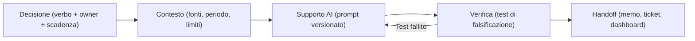

Scenario costruito: il lunedì mattina la direzione chiede perché il fatturato di maggio è sceso e un analista incolla la domanda in un assistente AI. La risposta arriva in dieci secondi, articolata e piena di cause plausibili: stagionalità, pressione dei competitor, calo del segmento enterprise. Nessuno può dire quali tabelle abbia immaginato, quale periodo abbia confrontato, quale metrica abbia usato. La plausibilità non è una prova.

Il prompting analitico chiude questo scarto. Trasforma la conversazione libera in una specifica di lavoro che un collega, un auditor o tu stesso tra un mese potete ricostruire, criticare e rifare.

## Perché le risposte convincenti non bastano

> **Idea chiave:** un prompt analitico è una specifica scritta con contesto, compito, formato e vincoli; l'output deve lasciare tracce che un revisore può ricostruire e contestare.

I modelli linguistici sono ottimizzati per produrre continuazioni coerenti, non per dire "non ho i dati per rispondere". Davanti a una domanda vaga colmano i vuoti: inventano un denominatore ragionevole, scelgono un confronto temporale comodo, ignorano un cambio di tracking avvenuto tre settimane prima. Il risultato suona professionale perché segue le convenzioni del linguaggio manageriale, ma la frase "il calo è trainato dal segmento enterprise" potrebbe essere vera, falsa o parzialmente vera senza che la forma cambi di una virgola.

Nel lavoro sui dati l'errore si propaga. Una segmentazione sbagliata diventa una slide, la slide una priorità di roadmap, la priorità budget. Il controllo delle domande inverte l'ordine: prima si fissa che cosa conta come evidenza, poi si chiede all'AI di aiutare a produrla. La domanda analitica non è "che cosa è successo" ma "quale confronto, su quale popolazione, con quale metrica e con quale soglia decisionale".

C'è anche un costo organizzativo. Quando ogni analista conversa con il modello in privato, la logica decisionale si frammenta in thread non tracciati: due persone pongono la stessa domanda con parole diverse, ottengono risposte diverse e portano in riunione due verità incompatibili. Il prompting analitico sposta la conversazione dal thread privato al documento condiviso: prompt versionato, contesto dichiarato, output salvato accanto al codice che lo ha generato.

## Prompt come specifica di esperimento

Scrivere un prompt analitico somiglia a scrivere la specifica di un esperimento: input, trasformazioni, output atteso e criterio di falsificazione. Il criterio dice in anticipo che cosa ti farebbe scartare l'output, per esempio una soglia mancata, una quadratura fallita o una baseline divergente. Un prompt generico dice all'AI che cosa produrre; uno analitico dice anche che cosa non deve fare, su che cosa deve appoggiarsi e come deve mostrare il lavoro.

La richiesta "analizza il calo della conversione" diventa quattro blocchi.

| Blocco | Funzione | Contenuto nel caso della conversione |
|---|---|---|
| Contesto | Fissa il perimetro dei fatti | Tabelle `orders` e `sessions`, dal 1 gennaio al 30 giugno, granularità giornaliera, web contro app |
| Compito | Fissa l'operazione | Scomponi il tasso in traffico, add-to-cart e checkout completion, con variazioni assolute e relative sulle quattro settimane precedenti |
| Formato | Rende l'output confrontabile | Tabella con numeratore, denominatore e numerosità per cella, poi tre ipotesi ordinate per impatto |
| Vincoli | Dichiara i limiti | Nessun dato oltre il 30 giugno, celle sotto 200 sessioni segnate come non conclusive, assunzioni non verificate elencate |

Senza il quarto blocco, i primi tre producono comunque testo sicuro di sé su basi fragili. Con il quarto, l'AI è costretta a dire "questa cella non regge", che spesso è l'informazione più preziosa della tabella.

Un corollario pratico: chiedi sempre di separare osservato, calcolato e ipotizzato. Osservato è un conteggio diretto sulle tabelle indicate, calcolato è una derivazione con formula esplicita, ipotizzato è tutto il resto. Quando le tre categorie si mescolano in un paragrafo la revisione diventa impossibile; etichettate, indicano al revisore dove colpire.

## Dalla domanda vaga alla specifica revisionabile

La maggior parte delle domande che arrivano a un data team non è analizzabile così com'è: "come sta andando il prodotto", "il churn peggiora", "questo test ha funzionato". Il lavoro comincia prima del prompt, riformulando la domanda finché non è misurabile, con un owner e una soglia.

La riscrittura in tre righe funziona bene. Riga uno, decisione: quale scelta concreta cambia secondo la risposta, come spegnere una campagna, correggere una pipeline o estendere un esperimento. Riga due, evidenza: quale confronto osservabile la sostiene, come la differenza di conversione tra due coorti. Riga tre, stop: che cosa invalida tutto, come un cambio di definizione a metà periodo o una copertura di tracking sotto soglia. Se una riga resta vuota non è il momento di promptare ma di chiarire con lo stakeholder.

Poi fissa per iscritto metrica, popolazione e baseline. La metrica richiede numeratore, denominatore e gestione dei casi limite: il tasso di conversione è ordini su sessioni o ordini su utenti unici? Come tratti sessioni rimbalzate, ordini annullati, traffico interno? La popolazione va delimitata con filtri espliciti, come solo traffico non bot o solo ordini fatturati. La baseline va scelta prima di vedere i numeri: media delle quattro settimane precedenti, stesso periodo dell'anno scorso, gruppo di controllo. Chi sceglie la baseline dopo aver visto il risultato fa cherry-picking, con o senza AI.

Infine imponi la granularità del controllo. Un numero aggregato non si verifica, una tabella sì. Chiedi scomposizioni che sommano al totale per canale, segmento o settimana, così il revisore ricontrolla le somme. Se le parti non sommano, c'è un filtro nascosto o un errore di join, e lo scopri in trenta secondi.

## Il ciclo decisione, contesto, supporto, verifica, handoff

Un prompt isolato non regge un workflow. Serve un ciclo in cinque fasi che lega ogni richiesta a una decisione e a un passaggio di consegne; ogni fase produce un artefatto e, se manca, la fase non è stata fatta.



Nella decisione scrivi una frase con verbo operativo e owner: "decidere se estendere l'esperimento di checkout al 100% entro venerdì, owner la PM checkout". Il verbo costringe a dire che cosa cambia nel mondo; senza owner la decisione evapora. Il contesto elenca fonti, granularità, periodo e limiti noti: tabella `events` aggiornata a ieri ore 6, tracking app rotto dal 12 al 15 maggio, segmento enterprise escluso perché migrato su un nuovo CRM. Si scrive una volta e si riusa come data contract leggero.

Nel supporto AI vale la delega selettiva: bozze di query, elenchi di segmenti da controllare, prima stesura del memo; mai giudizi su dati che il modello non ha visto né scelte con conseguenze economiche. La verifica allega a ogni output il test che potrebbe ribaltarlo, e se non è superato l'output resta bozza. L'handoff consegna a chi decide nel formato che usa davvero, cioè un memo di mezza pagina con evidenza, ipotesi e raccomandazione separate, non il thread di chat.

| Fase | Artefatto minimo | Chi firma |
|---|---|---|
| Decisione | Frase con verbo, owner e scadenza | Stakeholder |
| Contesto | Fonti, periodo, filtri, limiti noti | Analista |
| Supporto AI | Prompt versionato e output grezzo salvato | Analista |
| Verifica | Test superato o fallito, con numeri | Revisore |
| Handoff | Memo, ticket o dashboard con definizioni | Owner della decisione |

## Controlli che separano evidenza e narrazione

Quattro famiglie di controlli coprono la maggior parte dei fallimenti nell'analisi assistita.

La prima è la coerenza dimensionale: le parti devono sommare all'intero. Esempio numerico: il fatturato totale è 1,2 milioni di euro, ma la somma per canale fa 1,05 milioni. La differenza è 1,20 − 1,05 = 0,15 milioni, pari a 0,15 / 1,20 = 12,5%, molto oltre la soglia dell'1%. Esiste un canale "altro" senza etichetta, un filtro diverso o un join che perde righe. Chiedi sempre una riga di totale e una di quadratura.

La seconda è la stabilità alla segmentazione. Ricalcola la metrica togliendo il segmento più favorevole, spostando la finestra di una settimana per lato, escludendo gli outlier sopra il 99° percentile. Se il segno dell'effetto cambia, l'evidenza è fragile e il memo deve dirlo.

La terza è il confronto con una baseline indipendente: il calcolo manuale precedente, il report del finance, lo stesso periodo dell'anno scorso. Uno scostamento oltre la banda predefinita, per esempio cinque punti su una metrica di volume, fa partire l'indagine, non la celebrazione.

La quarta riguarda leakage e freschezza. Nel reporting, leakage significa usare informazione disponibile solo dopo l'evento misurato: ordini annullati il giorno dopo contati come vendite del giorno prima. Il controllo è una domanda nel prompt: per ogni campo usato, indica quando diventa disponibile rispetto all'evento. Ogni output porta il timestamp dei dati; numeri di martedì calcolati su dati fermi a domenica vanno etichettati.

Il funnel della conversione mostra i controlli in azione. Su 48.000 sessioni web di maggio gli ordini sono 1.200, quindi la conversione è 1.200 / 48.000 = 2,5%. La baseline delle quattro settimane precedenti è 1.440 ordini su 48.000 sessioni, cioè 3,0%. Il calo è 0,5 punti percentuali, pari a −16,7% in termini relativi. La scomposizione dice dove: le sessioni sono invariate, gli add-to-cart sono 6.000 in entrambi i periodi (12,5%), mentre la checkout completion scende da 1.440 / 6.000 = 24% a 1.200 / 6.000 = 20%. Il problema sta nel checkout, non nel traffico, e la prima ipotesi da verificare riguarda il rilascio avvenuto in quella finestra.

## Prompt, SQL e codice che un revisore può criticare

Il codice generato dall'AI va trattato come il codice di un junior veloce e instancabile: utile, ma da rivedere riga per riga prima del merge. La prima convenzione è che ogni query dichiari popolazione, filtri e gestione dei null in commenti leggibili. Niente `SELECT *` su tabelle di eventi, niente join senza deduplica esplicita, niente funzioni di data senza timezone. Il prompt lo impone: "commenta ogni CTE con popolazione in ingresso e in uscita, righe attese e trattamento dei null".

```sql
-- Conversione per canale, settimane 20-23; baseline: media delle 4 settimane precedenti
-- Popolazione: sessioni web non-bot, ordini fatturati (stato = 'paid')
WITH sessioni_valide AS (
  -- Una riga per sessione: esclude bot e traffico interno
  SELECT session_id, canale, data_sessione
  FROM sessions
  WHERE is_bot = FALSE
    AND is_interno = FALSE
    AND data_sessione BETWEEN DATE '2026-05-11' AND DATE '2026-06-07'
),
ordini_validi AS (
  -- Solo ordini fatturati; i rimborsati entro 24 ore restano ma marcati
  SELECT session_id, importo
  FROM orders
  WHERE stato = 'paid'
)
SELECT
  s.canale,
  COUNT(DISTINCT s.session_id) AS n_sessioni,   -- denominatore
  COUNT(DISTINCT o.session_id) AS n_ordini,     -- numeratore
  -- Tasso = ordini unici / sessioni uniche; celle sotto 200 sessioni da ignorare
  COUNT(DISTINCT o.session_id) * 1.0
    / NULLIF(COUNT(DISTINCT s.session_id), 0) AS tasso_conversione
FROM sessioni_valide s
LEFT JOIN ordini_validi o USING (session_id)
GROUP BY s.canale;
```

La seconda convenzione è che una decisione non poggi mai su una sola query. Chiedi due query indipendenti che rispondono per strade diverse, per esempio una con `sessions LEFT JOIN orders` e una con conteggi separati riconciliati, e confronta i totali. Se divergono oltre la soglia, almeno una contiene un'assunzione nascosta. La terza è un criterio di accettazione nel prompt di generazione, che rende la review meccanica invece che impressionistica. Una forma compatta è la specifica in formato strutturato, archiviabile accanto al codice.

```json
{
  "criteri_accettazione": [
    "totale ordini entro il 2% dal report finance del giorno",
    "somma per canale uguale al totale entro l'1%",
    "nessuna cella con meno di 200 sessioni usata nelle conclusioni"
  ],
  "baseline": "media giornaliera delle 4 settimane 16-19",
  "budget": {"query_massime": 5, "tabelle": ["sessions_daily", "orders_daily"], "scansione_gb_max": 100}
}
```

Lo stesso vale per il Python di feature engineering o i suggerimenti AutoML: ogni colonna proposta arriva con definizione, momento di disponibilità e motivazione. Una feature senza timestamp di disponibilità è un leakage in attesa del primo backtest onesto.

## Errori tipici nel prompting analitico

### Baseline scelta dopo aver visto i numeri

Il sintomo è un memo in cui il confronto "regge" sempre. Succede perché, a risultati noti, è facile trovare il periodo di riferimento che racconta la storia desiderata, e il modello assecondato lo fa volentieri. Si evita scrivendo la baseline nel prompt prima di eseguire qualsiasi query. Il caso più noto di analisi senza controlli allegati è quello di due economisti di Harvard che nel 2010 sostennero che un debito oltre il 90% del PIL frenasse la crescita: nel 2013 tre ricercatori dell'Università del Massachusetts trovarono nel foglio di calcolo righe escluse, pesi dei paesi discutibili ed errori di formula, e la conclusione non resse alla replica.

### Una sola query per una decisione

Il sintomo è un totale che non coincide con il report finance e nessuno sa spiegare perché. Succede perché una join molti-a-uno applicata al contrario duplica le righe e la query sembra comunque corretta. Si corregge con la seconda query indipendente e con la quadratura entro l'1%.

### Consegnare il thread di chat

Il sintomo è un decisore che non agisce o agisce su una riga isolata. Succede perché la conversazione contiene esplorazioni, correzioni e ipotesi scartate, ed è sembrato più veloce inoltrarla. Si corregge con un memo firmato: evidenza, ipotesi e raccomandazione separate, definizioni della metrica accanto ai numeri, link al prompt versionato.

## Quando non delegare e come tenere il metodo in produzione

Tre categorie restano umane: la scelta della metrica che orienta gli incentivi, l'interpretazione di risultati ambigui con conseguenze economiche e ogni uso di dati personali oltre il perimetro autorizzato. Su questi punti l'AI propone e l'umano dispone, e la firma è umana.

I costi sono un secondo vincolo. Cicli agentici che iterano decine di volte su un warehouse a pagamento trasformano una domanda da pochi centesimi in una fattura visibile, soprattutto su tabelle di eventi non partizionate. Il prompt maturo include un budget: "massimo 5 query, solo tabelle aggregate giornaliere, stop se la scansione stimata supera 100 GB". La privacy è il terzo: mai incollare dati identificativi quando bastano schema, distribuzioni e un campione anonimizzato, e per dati sanitari o finanziari il perimetro si concorda prima con la compliance. Il quarto è l'automazione non governata: a basso impatto e alta reversibilità l'AI opera con controlli automatici; per report al board, comunicazioni ai clienti o deploy di modelli ogni output passa da un owner.

Per rendere il metodo stabile archivia tre cose per ogni analisi: il prompt esatto, il contesto dati con timestamp e versioni, l'output grezzo con l'esito del test. Un repository di prompt versionati accanto al codice diventa la memoria operativa del team. Il monitoraggio chiude il cerchio: se un template che funzionava comincia a fallire i test di quadratura, perché è cambiato lo schema o il modello sottostante, lo scopri prima che i numeri sbagliati raggiungano una slide.

Il metodo rallenta la prima bozza, perché scrivere contesto, vincoli e test costa più che lanciare una domanda in chat. Il guadagno arriva dopo, in meno riunioni per chiarire numeri incompatibili e meno retromarce. Per una risposta usa e getta senza conseguenze la cerimonia completa è spreco: applicala in proporzione al costo dell'errore, con bozza leggera per esplorare, specifica completa per decidere e gate umano per pubblicare.

## Controllo sulle tue domande

1. Quali quattro elementi rendono una domanda analitica misurabile prima di aprire il prompt?

<details>
<summary>Mostra risposta</summary>

Il confronto da fare, la popolazione su cui farlo, la metrica con numeratore e denominatore e la soglia decisionale. Con la riscrittura in tre righe si aggiungono la decisione con il suo owner e la condizione di stop.

</details>

2. Perché la baseline va scelta prima di vedere i numeri e che cosa rischi se la scegli dopo?

<details>
<summary>Mostra risposta</summary>

A risultati noti si può selezionare il riferimento che conferma la tesi, e il modello assecondato aiuta a farlo. Il rischio è un'evidenza costruita su misura, non verificabile da chi rivede il lavoro.

</details>

3. Il totale è 1,2 milioni di euro e la somma per canale fa 1,05 milioni. Supera la soglia dell'1%?

<details>
<summary>Mostra risposta</summary>

Sì. La differenza è 0,15 milioni e 0,15 / 1,20 = 12,5%, molto oltre l'1%. Si cerca un canale non etichettato, un filtro diverso o una join che perde righe prima di usare la tabella.

</details>

4. Che cosa consegni al decisore e perché il thread di chat non basta mai?

<details>
<summary>Mostra risposta</summary>

Un memo firmato con evidenza, ipotesi e raccomandazione separate, definizioni della metrica e riferimento al prompt versionato. Il thread contiene tentativi e correzioni, non è firmato da nessuno e nessun decisore lo leggerà per intero.

</details>
