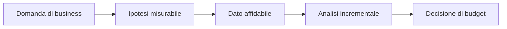

# Analisi end-to-end con UTM


Il report finale dice che paid search ha convertito bene, ma metà delle sessioni arriva con UTM incoerenti, newsletter duplicate e campagne rinominate a metà mese. Prima di discutere ROAS serve capire se la tassonomia racconta davvero il percorso. **Analisi end-to-end con UTM e parametri di campagna** parte da questa disciplina: nominare, normalizzare e riconciliare il traffico prima di attribuirgli valore.

## Una scena da cui partire

Leggi questa lezione come una revisione della catena di misurazione, non come un elenco di parametri. Ogni nome campagna, sorgente, mezzo e contenuto deve essere abbastanza stabile da collegare acquisizione, funnel e revenue senza nascondere eccezioni.

- **Contesto:** Quale convenzione UTM rende confrontabili campagne e canali?
- **Metodo:** Quale controllo intercetta parametri mancanti o varianti duplicate?
- **Applicazione:** Quale trade-off accetteresti tra granularità di tracciamento e leggibilità del reporting?

## I 5 parametri UTM e la tassonomia

| Parametro | Significato | Obbligatorio | Esempio | Valori standard |
|-----------|-------------|---------------|---------|-----------------|
| **utm_source** | Piattaforma/sito origine | **Sì** | `google`, `facebook`, `linkedin` | Definire lista chiusa |
| **utm_medium** | Canale marketing | **Sì** | `cpc`, `social`, `email`, `display`, `affiliate` | Lista: cpc, social, email, display, organic, referral, affiliate |
| **utm_campaign** | Campagna specifica | **Sì** | `black_friday_2024` | Formato: `&#123;tema&#125;_&#123;anno&#125;` o `&#123;quarter&#125;_&#123;iniziativa&#125;` |
| **utm_content** | Variante creatività | No | `cta_button_A`, `hero_image_2` | Per A/B test su creatività |
| **utm_term** | Keyword (search ads) | No | `data+analytics+course` | Solo per search |

## Regole di implementazione

1. **Tassonomia centralizzata**: un documento unico (Google Sheets o Git) che elenca tutti i valori consentiti per ogni parametro. Chi crea URL deve scegliere da menu a tendina, non scrivere liberamente.

2. **URL Builder obbligatorio**: foglio Google Sheets con formule che generano URL validati. O un form interno che produce l'URL finale con validazione in tempo reale.

```javascript
// Esempio validatore UTM
const VALID_SOURCES = ['google', 'facebook', 'instagram', 'linkedin', 'twitter', 'tiktok'];
const VALID_MEDIUMS = ['cpc', 'social', 'email', 'display', 'affiliate', 'referral'];

function validateUTM(url) {
  const params = new URLSearchParams(new URL(url).search);
  const errors = [];
  if (!VALID_SOURCES.includes(params.get('utm_source')))
    errors.push('Invalid utm_source');
  if (!VALID_MEDIUMS.includes(params.get('utm_medium')))
    errors.push('Invalid utm_medium');
  if (!params.get('utm_campaign'))
    errors.push('utm_campaign is required');
  return errors;
}
```

3. **Case sensitive? Mai.** Standardizza tutto lowercase e converti automaticamente. `Google` e `google` sono due sorgenti diverse senza standardizzazione.

4. **Niente PII**: mai email, nomi o dati personali negli UTM. Violazione GDPR e termini di servizio di Google Analytics.

5. **Niente spazi**: usa trattini o underscore. `utm_campaign=black-friday-2024`, non `black friday 2024`.

## Tracciare il primo UTM nel customer journey

Salva il primo UTM di ogni utente nel warehouse come `acquisition_source` e `acquisition_medium`. Anche se l'utente torna via direct 20 volte, saprai sempre come è arrivato la prima volta. Questo è fondamentale per l'attribuzione e la misurazione del CAC per canale.

```sql
-- First-touch attribution nel warehouse
INSERT INTO customer_acquisition (customer_id, first_source, first_medium, first_campaign, first_touch_date)
SELECT user_pseudo_id AS customer_id,
       FIRST_VALUE(traffic_source.source) OVER (PARTITION BY user_pseudo_id ORDER BY event_timestamp) AS first_source,
       FIRST_VALUE(traffic_source.medium) OVER (...) AS first_medium,
       FIRST_VALUE(traffic_source.name) OVER (...) AS first_campaign,
       MIN(TIMESTAMP_MICROS(event_timestamp)) OVER (...) AS first_touch
FROM `project.analytics.events_*`
WHERE event_name = 'first_visit' OR event_name = 'session_start'
QUALIFY ROW_NUMBER() OVER (PARTITION BY user_pseudo_id ORDER BY event_timestamp) = 1;
```

## Dashboard di qualità UTM

Monitora la salute della strategia UTM:

```sql
-- % traffico con UTM mancanti o invalidi
SELECT DATE_TRUNC('month', session_date) AS month,
       COUNT(*) AS total_sessions,
       SUM(CASE WHEN utm_source IS NULL OR utm_source = '(not set)' THEN 1 ELSE 0 END) AS missing_utm,
       ROUND(SUM(CASE WHEN utm_source IS NULL OR utm_source='(not set)' THEN 1 ELSE 0 END)*100.0/COUNT(*), 1) AS missing_pct
FROM sessions
GROUP BY month ORDER BY month DESC;
```

Target: &lt;5% di traffico con UTM mancanti. Ogni punto percentuale sopra = dati persi = decisioni al buio.

## Caso reale: la UTM strategy di N26

N26, banca digitale con 8M clienti, ha standardizzato la strategia UTM dopo aver scoperto che il 34% del traffico paid non era tracciabile. Hanno creato un "Campaign URL Builder" interno che obbliga marketing team, agenzie e partner a seguire la tassonomia. Ogni URL generato è loggato e validato. Dopo 6 mesi: traffico non tracciabile &lt;3%, accuratezza attribuzione migliorata del 40%.

## Controllo di qualità

Prima di usare analisi end-to-end con utm e parametri di campagna in una decisione, controlla sempre completezza, duplicati, timezone, definizioni cambiate e segmenti esclusi. Molte analisi apparentemente sofisticate falliscono perché il dato di partenza misura un comportamento diverso da quello che il team crede di osservare.


## Interpretazione per segmenti

La media aggregata è solo il punto di partenza. Segmenta per canale, coorte, piano, paese, device e maturità dell'utente. Se due segmenti si muovono in direzioni opposte, la media non rappresenta nessuno dei due e può portare a una decisione sbagliata.

## Problema reale

Nel lavoro su marketing analytics, **Analisi end-to-end con UTM e parametri di campagna** serve a risolvere un problema concreto: trasformare budget, canali, creativita e audience in decisioni misurabili senza confondere volume, attribuzione e incrementalita. La domanda non è se il concetto sia interessante in astratto, ma quale decisione migliora quando lo applichi con dati affidabili e con una soglia di errore esplicita.

Questa lezione va studiata come uno strumento operativo: entro la fine devi saper Comprendere il problema analitico e il contesto decisionale; Applicare esempi, metriche e controlli a casi reali. Se non riesci a collegare il concetto a una scelta reale, la conoscenza resta decorativa e non diventa competenza.

## Modello concettuale



Il modello mentale e sequenziale: prima si formula la domanda, poi si traduce in unità osservabili, quindi si valuta la qualità del dato e solo alla fine si decide. Saltare un passaggio produce analisi eleganti ma fragili.

| Passaggio | Domanda guida | Output atteso |
|---|---|---|
| Framing | Quale decisione deve cambiare? | Una scelta concreta, non una curiosità |
| Misura | Quale segnale rappresenta il fenomeno? | Metrica, fonte e granularità |
| Confronto | Rispetto a quale baseline interpreto il risultato? | Benchmark o controfattuale plausibile |
| Azione | Che cosa faccio se il segnale supera la soglia? | Decisione, owner e prossimo controllo |

## Formalizzazione rigorosa

Formalizza **Analisi end-to-end con UTM e parametri di campagna** come una relazione tra quattro elementi: unità di analisi, segnale, baseline e decisione. Nel contesto di questa lezione l'unità principale e **campagna, coorte, touchpoint o segmento cliente**. Il segnale da osservare deve essere collegato a **margine incrementale, CAC payback, conversion rate corretto, lift o retention generata**, mentre la baseline deve essere scelta tra **periodo precedente, gruppo holdout, mercato comparabile o benchmark storico**.

Una formulazione robusta segue questa logica:

| Elemento | Definizione operativa per questa lezione |
|---|---|
| Unità | campagna, coorte, touchpoint o segmento cliente |
| Segnale | margine incrementale, CAC payback, conversion rate corretto, lift o retention generata |
| Baseline | periodo precedente, gruppo holdout, mercato comparabile o benchmark storico |
| Decisione | spostare risorse, cambiare messaggio, fermare una tattica o scalare un esperimento |
| Rischio | Confondere correlazione, qualità del dato e causalità decisionale |

La regola pratica e semplice: una misura e utile solo se riduce l'incertezza su una decisione specifica. Se non cambia una scelta, e documentazione; se cambia una scelta senza controlli, e rischio.

## Esempio o caso studio

Un team growth deve decidere se aumentare il budget su un canale che mostra CPA basso ma vendite marginali deboli. La lezione aiuta a separare il segnale utile dal rumore operativo, collegando metrica, modello mentale e decisione economica.

Applicando **Analisi end-to-end con UTM e parametri di campagna**, il team costruisce una lettura in tre colonne: cosa sappiamo, cosa assumiamo e quale decisione prendiamo. Questo formato impedisce di presentare un numero come se fosse una conclusione autosufficiente.

| Evidenza | Interpretazione prudente | Decisione conseguente |
|---|---|---|
| Segnale positivo ma non isolato | Il fenomeno esiste, ma la causa e ancora incerta | Cercare baseline o holdout |
| Segmento con risposta diversa | L'effetto medio nasconde eterogeneita | Analizzare coorti o sottogruppi |
| Costo operativo crescente | Il risultato va valutato sul margine | Applicare soglie economiche |

## Lab / esercizio

### Livello base

Prendi una decisione reale collegata a **Analisi end-to-end con UTM e parametri di campagna** e scrivi in cinque righe: obiettivo, metrica primaria, baseline, rischio principale e azione prevista. Non usare più di una metrica primaria.

### Livello intermedio

Costruisci una tabella con almeno tre segmenti o scenari. Per ciascuno indica segnale, possibile spiegazione alternativa e controllo necessario prima di decidere.

### Livello research-grade

Disegna un piano di validazione: ipotesi, dati necessari, criterio di esclusione, soglia decisionale e controllo post-decisione. Specifica anche che cosa ti farebbe cambiare idea.

### Dataset e materiali consigliati

Usa export campagne, costi media, eventi web o app, CRM, transazioni, survey brand e log di consenso. Se non hai dati reali, crea un dataset sintetico con 200-500 righe e almeno una colonna temporale, una colonna segmento, una metrica di outcome e una variabile di esposizione.

## Errore tipico da evitare

L'errore più frequente e trattare **Analisi end-to-end con UTM e parametri di campagna** come una definizione da ricordare invece che come un protocollo decisionale. In pratica succede quando si presenta una metrica senza baseline, un grafico senza ipotesi, o una raccomandazione senza costo dell'errore.

Un controllo utile è chiedersi: "se questo risultato fosse falso o instabile, quale decisione sbaglierei?". Se la risposta non è chiara, la lezione non è ancora stata applicata davvero.

## Quiz o checkpoint

1. Qual è la decisione concreta che questa lezione dovrebbe migliorare?
2. Quale baseline rende interpretabile il risultato?
3. Quale assunzione, se sbagliata, cambierebbe la conclusione?
4. Quale controllo minimo useresti prima di presentare la raccomandazione?

## Riepilogo operativo

**Analisi end-to-end con UTM e parametri di campagna** e una competenza utile quando collega concetto, dato e decisione. Studiala partendo da un problema reale, formalizza il segnale, cerca una baseline credibile, costruisci un esempio e chiudi con un controllo pratico. Categoria: Tecnico. Difficoltà: advanced. Tempo stimato: 22 min.

## Approfondimento di pratica

Per consolidare **Analisi end-to-end con UTM e parametri di campagna**, trattala come una piccola prova di lavoro dentro una review marketing con budget, canali, tracking e marginalita da riconciliare. Non basta dire di aver capito la lezione: devi produrre un memo che collega canale, metrica, segmento, costo e raccomandazione. Questo passaggio serve a rendere la conoscenza trasferibile, perché obbliga a separare contesto, misura, azione e limite.

### Esempio operativo

Parti da una domanda semplice: quale scelta diventerebbe migliore se applicassi bene questa lezione? Nel modulo analisi marketing, la risposta deve sempre collegare un problema reale a un output osservabile. Se stai studiando una lezione di tipo Tecnico, costruisci un esempio con tre righe: il contesto in cui nasce la domanda, il dato o il modello che useresti per leggerla, e la decisione che prenderesti dopo aver controllato i rischi.

Un esempio valido non deve essere grande. Può essere una tabella con una baseline e due segmenti, una query che verifica una definizione, un disegno di esperimento, un controllo su un modello o un memo di dieci righe. La qualità non dipende dalla complessità tecnica, ma dalla tracciabilità del ragionamento: chi legge deve capire perché hai scelto quella metrica, quale alternativa hai scartato e quale evidenza ti farebbe cambiare idea.

### Checkpoint di lavoro

- Scrivi la decisione che questa lezione dovrebbe migliorare, usando un verbo operativo: allocare, fermare, correggere, lanciare, misurare, priorizzare o investigare.
- Definisci il segnale principale e almeno un guardrail. Il segnale dice dove guardi; il guardrail evita che una scelta localmente buona rovini il sistema.
- Aggiungi una baseline. Senza baseline non sai se il numero e alto, basso, stabile, anomalo o solo raccontato male.
- Esplicita il rischio più probabile: scambiare correlazione di campagna per impatto incrementale o decisione di budget. Scrivilo prima della raccomandazione, non dopo.
- Chiudi con un output consegnabile: dashboard, query, schema, memo, esperimento, notebook o checklist. Deve essere qualcosa che un reviewer possa aprire e criticare.

### Riepilogo di padronanza

Hai davvero assimilato **Analisi end-to-end con UTM e parametri di campagna** quando riesci a usarla in tre modi: spiegare il concetto senza gergo inutile, applicarlo a un caso piccolo ma realistico, e difendere una raccomandazione includendo limiti e prossimi controlli. Se manca uno di questi tre elementi, torna al modello concettuale e riduci l'ambizione dell'esempio. Meglio una prova piccola ma rigorosa di un grande progetto che non rende verificabile la decisione.
