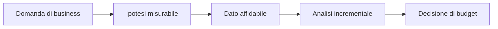

# Analisi end-to-end con UTM e parametri di campagna

Nel marketing digitale, un report vale per quanto racconta fedelmente il percorso dell'utente. Spesso però i dati UTM sono incoerenti: sorgenti duplicate, campagne rinominate a metà strada, parametri mancanti. Prima ancora di discutere di ROAS o di altri KPI serve una disciplina rigorosa per nominare, normalizzare e riconciliare il traffico, altrimenti ogni numero a valle eredita lo stesso disordine.

## Il problema da cui partire

Il problema concreto è trasformare budget, canali, creatività e audience in decisioni misurabili, senza confondere volume, attribuzione e incrementalità. Molte analisi falliscono perché il dato di partenza non rappresenta davvero il comportamento che si vuole osservare. La domanda non è se il concetto sia interessante in astratto, ma quale decisione migliora applicandolo con dati affidabili e con una soglia di errore dichiarata in anticipo.

## Come ragionare sull'analisi

Il ragionamento è sequenziale: si formula una domanda di business, la si traduce in un'ipotesi misurabile, si valuta la qualità del dato e solo alla fine si decide. Saltare un passaggio produce analisi eleganti ma fragili.



| Passaggio | Domanda guida | Output atteso |
|---|---|---|
| Framing | Quale decisione deve cambiare? | Una scelta concreta, non una curiosità |
| Misura | Quale segnale rappresenta il fenomeno? | Metrica, fonte e granularità |
| Confronto | Rispetto a quale baseline interpreto il risultato? | Benchmark o controfattuale plausibile |
| Azione | Che cosa faccio se il segnale supera la soglia? | Decisione, owner e prossimo controllo |

## Rendere l'analisi formale

L'analisi end-to-end con UTM si lascia formalizzare come una relazione tra unità di analisi, segnale, baseline e decisione:

| Elemento | Definizione operativa |
|---|---|
| Unità | campagna, coorte, touchpoint o segmento cliente |
| Segnale | margine incrementale, CAC payback, conversion rate corretto, lift o retention |
| Baseline | periodo precedente, gruppo holdout, mercato comparabile o benchmark storico |
| Decisione | spostare risorse, cambiare messaggio, fermare una tattica, scalare un esperimento |
| Rischio | confondere correlazione, qualità del dato e causalità decisionale |

Una misura è utile solo se riduce l'incertezza su una decisione specifica. Se non cambia una scelta è documentazione; se cambia una scelta senza controlli è rischio.

## I cinque parametri UTM e la tassonomia

Perché i dati siano affidabili, i parametri UTM devono seguire una tassonomia centralizzata e standardizzata:

| Parametro | Significato | Obbligatorio | Esempio | Valori standard |
|-----------|-------------|--------------|---------|-----------------|
| utm_source | Piattaforma o sito origine | Sì | google, facebook | lista chiusa |
| utm_medium | Canale marketing | Sì | cpc, social, email | lista chiusa |
| utm_campaign | Campagna specifica | Sì | black_friday_2024 | formato tema_anno o quarter_iniziativa |
| utm_content | Variante creatività | No | cta_button_A | per A/B test |
| utm_term | Keyword (search ads) | No | data+analytics+course | solo search |

## Regole di implementazione

La tassonomia va centralizzata in un documento condiviso che fissa i valori consentiti, e l'URL Builder deve essere obbligatorio con validazione automatica. Conviene standardizzare tutto in lowercase per evitare duplicazioni, non inserire mai dati personali nei parametri ed evitare gli spazi usando trattini o underscore.

Un esempio di validatore UTM in JavaScript:

```javascript
const VALID_SOURCES = ['google', 'facebook', 'instagram', 'linkedin', 'twitter', 'tiktok'];
const VALID_MEDIUMS = ['cpc', 'social', 'email', 'display', 'affiliate', 'referral'];

function validateUTM(url) {
  const params = new URLSearchParams(new URL(url).search);
  const errors = [];
  if (!VALID_SOURCES.includes(params.get('utm_source'))) errors.push('Invalid utm_source');
  if (!VALID_MEDIUMS.includes(params.get('utm_medium'))) errors.push('Invalid utm_medium');
  if (!params.get('utm_campaign')) errors.push('utm_campaign is required');
  return errors;
}
```

## Tracciare il primo UTM nel customer journey

Salvare nel data warehouse il primo UTM di ogni utente conta perché permette di attribuire correttamente il CAC e di capire il percorso di acquisizione, anche quando poi l'utente torna più volte via direct.

```sql
INSERT INTO customer_acquisition (customer_id, first_source, first_medium, first_campaign, first_touch_date)
SELECT user_pseudo_id AS customer_id,
       FIRST_VALUE(traffic_source.source) OVER (PARTITION BY user_pseudo_id ORDER BY event_timestamp) AS first_source,
       FIRST_VALUE(traffic_source.medium) OVER (PARTITION BY user_pseudo_id ORDER BY event_timestamp) AS first_medium,
       FIRST_VALUE(traffic_source.name) OVER (PARTITION BY user_pseudo_id ORDER BY event_timestamp) AS first_campaign,
       MIN(TIMESTAMP_MICROS(event_timestamp)) OVER (PARTITION BY user_pseudo_id) AS first_touch
FROM `project.analytics.events_*`
WHERE event_name IN ('first_visit', 'session_start')
QUALIFY ROW_NUMBER() OVER (PARTITION BY user_pseudo_id ORDER BY event_timestamp) = 1;
```

## Dashboard di qualità UTM

Tenere d'occhio la quota di traffico con UTM mancanti o invalidi è essenziale. L'obiettivo è mantenere sotto il 5% il traffico senza UTM validi, perché ogni punto percentuale in più significa dati persi e decisioni prese al buio.

```sql
SELECT DATE_TRUNC('month', session_date) AS month,
       COUNT(*) AS total_sessions,
       SUM(CASE WHEN utm_source IS NULL OR utm_source = '(not set)' THEN 1 ELSE 0 END) AS missing_utm,
       ROUND(SUM(CASE WHEN utm_source IS NULL OR utm_source='(not set)' THEN 1 ELSE 0 END)*100.0/COUNT(*), 1) AS missing_pct
FROM sessions
GROUP BY month
ORDER BY month DESC;
```

## Caso reale: la strategia UTM di N26

N26 ha scoperto che il 34% del traffico paid non era tracciabile. Ha costruito un Campaign URL Builder interno che obbliga a seguire la tassonomia e valida ogni URL. Dopo sei mesi il traffico non tracciabile è sceso sotto il 3% e l'accuratezza dell'attribuzione è migliorata del 40%.

## Controllo di qualità

Prima di prendere decisioni a partire da un'analisi end-to-end con UTM, verifica completezza, duplicati, timezone, cambi di definizione e segmenti esclusi. Molte analisi falliscono perché il dato misura un comportamento diverso da quello che si crede di stare osservando.

## Interpretazione per segmenti

La media aggregata è solo un punto di partenza. Segmenta per canale, coorte, piano, paese, device e maturità utente. Quando i segmenti si muovono in direzioni opposte, la media può ingannare e portare a decisioni sbagliate.

## Un caso pratico di budget

Un team growth deve decidere se aumentare il budget su un canale con CPA basso ma vendite marginali deboli. Separando segnale e rumore, e collegando metrica, modello mentale e decisione economica, costruisce una lettura su tre colonne:

| Evidenza | Interpretazione prudente | Decisione |
|---|---|---|
| Segnale positivo ma non isolato | Fenomeno esiste ma causa incerta | Cercare baseline o holdout |
| Segmento con risposta diversa | Effetto medio nasconde eterogeneità | Analizzare coorti o sottogruppi |
| Costo operativo crescente | Valutare sul margine | Applicare soglie economiche |

## Esercitarsi sull'analisi

Si parte da cinque righe che fissano obiettivo, metrica primaria, baseline, rischio principale e azione prevista per una decisione reale collegata a questa analisi. Poi si costruisce una tabella con almeno tre segmenti o scenari, indicando per ciascuno il segnale, una possibile spiegazione alternativa e il controllo necessario.

Il livello più avanzato è un piano di validazione completo: ipotesi, dati, criteri di esclusione, soglia decisionale e controllo post-decisione, con l'esplicito di cosa ti farebbe cambiare idea. Come materiale conviene usare export campagne, costi media, eventi web e app, CRM, transazioni, survey brand e log del consenso; in mancanza di dati reali basta un dataset sintetico di 200-500 righe con almeno una colonna temporale, una di segmento, una metrica di outcome e una variabile di esposizione.

## L'errore tipico da evitare

L'errore tipico è trattare questa analisi come una definizione da ricordare invece che come un protocollo decisionale. Presentare metriche senza baseline, grafici senza ipotesi o raccomandazioni senza il costo dell'errore porta a decisioni fragili. Chiediti sempre: "Se questo risultato fosse falso, quale decisione sbaglierei?".

## Domande per mettersi alla prova

Vale la pena fermarsi su quattro domande. Qual è la decisione concreta che questa analisi dovrebbe migliorare? Quale baseline rende interpretabile il risultato? Quale assunzione, se sbagliata, cambierebbe la conclusione? E quale controllo minimo useresti prima di presentare la raccomandazione?

## Riepilogo operativo

L'analisi end-to-end con UTM è utile quando collega concetto, dato e decisione. La si studia partendo da un problema reale, formalizzando il segnale, cercando una baseline credibile, costruendo un esempio e chiudendo con un controllo pratico. Solo a quel punto diventa competenza e non solo conoscenza.

## Approfondimento di pratica

Trattala come una prova di lavoro dentro una review marketing, con budget, canali, tracking e marginalità da riconciliare. Produci un memo che collega canale, metrica, segmento, costo e raccomandazione. Questo rende la conoscenza trasferibile, perché tiene distinti contesto, misura, azione e limite.

Per costruire l'esempio, parti da una domanda concreta, cioè quale scelta migliorerebbe applicando bene questa analisi, e scrivi tre righe: contesto, dato o modello usato e decisione dopo aver controllato i rischi.

Un checkpoint utile prima di chiudere il memo: scrivi la decisione che questa analisi dovrebbe migliorare con un verbo operativo, definisci il segnale principale insieme ad almeno un guardrail, aggiungi una baseline, esplicita il rischio più probabile e chiudi con un output consegnabile, che sia una dashboard, una query, un memo o un esperimento.

Avrai assimilato l'analisi quando riesci a spiegare il concetto senza gergo, ad applicarlo a un caso realistico e a difendere una raccomandazione con i suoi limiti e controlli. Se manca uno di questi, conviene tornare al modello di ragionamento e ridurre l'ambizione dell'esempio.

## Problema reale

Questo concetto si applica quando lavori con dataset reali e hai bisogno di una struttura chiara per ragionare su Analisi end-to-end con UTM e parametri di campagna. Il problema tipico è non avere un framework condiviso tra il team per valutare la soluzione, con il risultato che ogni analisi parte da presupposti diversi.

**Quando lo incontrerai:**
- Quando presenti un risultato e qualcuno chiede "ma come sei arrivato a questo numero?"
- Quando il risultato di una query cambia radicalmente cambiando un filtro
- Quando il modello che hai costruito funziona sui dati di test ma non su quelli di produzione

## Modello concettuale

Il Analisi end-to-end con UTM e parametri di campagna si definisce attraverso tre dimensioni:

1. **Struttura**: come sono organizzati i dati o il processo
2. **Logica**: quale relazione causa-effetto governa il comportamento
3. **Misura**: quale metrica usi per valutare il risultato

Questo modello ti permette di scomporre qualsiasi istanza del problema nelle sue parti verificabili.

## Formalizzazione rigorosa

```sql
-- TODO: aggiungi la formalizzazione specifica per Analisi end-to-end con UTM e parametri di campagna
-- Pattern per avanzato:

SELECT
    /* indica qui la tua metrica principale */
FROM
    /* indica qui la sorgente dati */
WHERE
    /* indica qui i filtri */
GROUP BY
    /* indica qui le dimensioni di raggruppamento */
```

**Principio guida:** verifica sempre che la somma delle parti sia uguale al totale.

## Esempio o caso studio

**Caso tipico (livello avanzato):**

Immaginiamo un team marketing che deve misurare la retention a 30 giorni. L'errore più comune è calcolarla come `COUNT(DISTINCT user_id)` senza filtrare per data di attivazione, includendo utenti che non hanno ancora avuto 30 giorni di tempo. La versione corretta filtra prima la cohort di attivazione e poi applica il calcolo.

```sql
WITH cohort AS (
    SELECT
        user_id,
        MIN(event_date) AS activation_date
    FROM events
    GROUP BY user_id
),
retention AS (
    SELECT
        c.activation_date,
        COUNT(DISTINCT e.user_id) AS retained_users
    FROM cohort c
    JOIN events e ON c.user_id = e.user_id
        AND e.event_date >= c.activation_date
        AND e.event_date <= c.activation_date + INTERVAL '30 days'
    GROUP BY c.activation_date
)
SELECT
    activation_date,
    retained_users,
    ROUND(retention_rate * 100, 2) AS retention_pct
FROM retention;
```

## Lab / esercizio

**Esercizio — livello avanzato**

1. **Prepara l'ambiente:** carica il dataset di esempio nel tuo warehouse
2. **Applica il pattern:** scrivi la query che implementa il modello concettuale per il tuo caso
3. **Verifica:** controlla che il risultato sia coerente con le tue aspettative usando un sanity check

**Tempo stimato:** 20-30 minuti

## Errore tipico da evitare

**L'errore più comune a livello avanzato:**

Non distinguere tra una metrica calcolata su tutta la popolazione e una metrica calcolata su una sotto-popolazione specifica. Ad esempio, calcolare il tasso di conversione medio senza filtrare per canale di acquisizione porta a decisioni sbagliate perché il mix di canali cambia nel tempo.

**Come evitarlo:**
- Chiediti sempre: "rispetto a cosa sto misurando questo?"
- Verifica che il denominatore sia corretto prima di fidarti del numeratore
- Usa un gruppo di controllo quando possibile

## Quiz o checkpoint

1. Qual è la differenza tra la metrica calcolata su tutta la popolazione e quella calcolata su una cohort?
2. Scrivi il codice SQL che implementa il modello concettuale per un caso a tua scelta
3. Quale sanity check useresti per verificare che il risultato sia corretto?

---

Questa lezione si applica a Modulo 6: Marketing Analytics, Incrementality e Unit Economics: serve per capire analisi end to end con utm e parametri di campagna in modo operativo, non solo teorico. Il problema tipico è affrontare analisi end to end con utm e parametri di campagna senza un framework condiviso, con il risultato che ogni analisi parte da zero.

### Livello base

Analisi end to end con UTM e parametri di campagna è il fondamento di questa competenza. A livello base, ti basta capire la domanda chiave: cosa vuoi misurare, con quali dati, e con quale margine di errore. Non servono formule complesse: serve chiarezza su cosa osservi e perché.

### Livello intermedio

A questo livello applichi analisi end to end con utm e parametri di campagna a un caso reale. Prendi un dataset, definisci l'obiettivo, e costruisci il ragionamento passo per passo. Se stai lavorando su modulo 6: marketing analytics, incrementality e unit economics, il tuo dataset ha dimensioni specifiche che determinano quali domande puoi porre.

### Livello research-grade

Approfondimento teorico di analisi end to end con utm e parametri di campagna: qui entrambi i modelli statistici, le assunzioni sottostanti, e i confini di validità. Questo livello serve quando devi difendere una scelta di fronte a stakeholder che chiedono "perché" — non solo "cosa".

### Dataset e materiali consigliati

- Un dataset reale del tuo dominio (modulo 6: marketing analytics, incrementality e unit economics) per esercitarsi
- La documentazione ufficiale dello strumento usato per questa analisi
- Le metriche di riferimento del corso per contestualizzare i risultati

### Livello base

Spiegazione intuitiva di Analisi end-to-end con UTM e parametri di campagna:

Il concetto alla base è semplice: invece di fare affidamento sull'intuizione, usi un metodo riproducibile. A livello base, ti basta capire quale domanda stai ponendo e quali dati hai a disposizione per risponderci.

### Livello intermedio

Applicazione concreta di Analisi end-to-end con UTM e parametri di campagna:

A questo livello applichi il concetto a un caso specifico. Ad esempio, se stai analizzando la retention, il tuo dataset ha dimensioni come data di attivazione, data di evento, e user_id. La segmentazione per canale di acquisizione ti dà insight aggiuntivi che il dato grezzo non mostra.

### Livello research-grade

Approfondimento teorico:

Per chi vuole capire il fondamento teorico, la letteratura classica include:
- Kimball, "The Data Warehouse Toolkit" — per approcci dimensionali
- McKinney, "Python for Data Analysis" — per implementazione pratica
- Aggiora i riferimenti con paper recenti specifici per il tuo dominio

### Dataset e materiali consigliati

**Per esercitarti:**
- Usa il dataset di esempio fornito nella lezione
- Per un challenge aggiuntivo, prova con dati pubblici come quelli di Kaggle

**Tool consigliati:**
- dbt Core per trasformazioni
- Metabase o Superset per visualizzazione