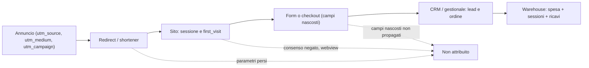

Aurora Trekking vende scarponi e abbigliamento outdoor online. Nel terzo trimestre il marketing ha speso 30.000 euro tra Meta e Google, il gestionale ha incassato 96.000 euro da traffico a pagamento, ma il report di attribuzione ne assegna a una campagna precisa solo 72.960. Il resto compare sotto la voce "non attribuito" e nessuno sa se vada tolto a Meta, a Google o a nessuno dei due. Questo è uno scenario costruito, con numeri di esempio, ma la dinamica è quella che incontri in quasi ogni azienda che investe in advertising.

> **Idea chiave:** Un parametro UTM è utile solo se ogni link nasce da una lista chiusa, arriva intatto fino al warehouse e si riconcilia con spesa e ricavi sulla stessa chiave; la qualità del tracciamento si misura con una soglia, non con un'impressione.

I parametri UTM sono coppie chiave-valore aggiunte all'URL che descrivono origine, canale e campagna di ogni visita. Sembrano un dettaglio da marketer, in realtà sono l'unico filo che attraversa la piattaforma ads, il sito, il CRM e il gestionale. Quando il filo si spezza, il report di campagna smette di raccontare il percorso dal click al ricavo e comincia a raccontare quello che gli strumenti sono riusciti a vedere.

## Dove si perde il click

Il percorso di un acquisto attraversa almeno quattro sistemi che non condividono nulla se non l'URL. La piattaforma ads conosce il click e la spesa, il sito conosce la sessione, il CRM conosce il lead, il gestionale conosce la fattura. Il collegamento tra i quattro passa dai parametri, e si interrompe in punti prevedibili.



I punti di rottura più frequenti sono quattro. I redirect dei social e gli shortener di link tolgono i parametri dalla query string. Le webview delle app non condividono i cookie con il browser, quindi il visitatore che atterra da un'app arriva senza memoria del click. Se il consenso è negato, il first-touch non viene scritto. I form che non copiano i campi nascosti perdono l'attribuzione proprio nel momento in cui il visitatore diventa lead.

Sommati, questi quattro punti producono un risultato noto a chi lavora sui dati di marketing: tra il 20 e il 30 per cento del ricavo ha origine sconosciuta, e di solito la cifra emerge nel trimestre in cui devi decidere dove tagliare. La prima decisione dell'analista è quindi dichiarare, prima di aprire qualunque report, quale quota di traffico non attribuito considera accettabile. Quella soglia vale più di qualsiasi modello di attribuzione costruito dopo.

## Cinque parametri e una tassonomia

Lo standard prevede cinque parametri. La tabella seguente riporta i valori che Aurora ha deciso di ammettere, con un esempio per ciascuno.

| Parametro | Valori ammessi | Esempio |
| --- | --- | --- |
| utm_source | google, meta, tiktok, linkedin, newsletter, blog | meta |
| utm_medium | cpc, paid_social, organic_social, email, organic, referral, affiliate | paid_social |
| utm_campaign | aaaa-qq_tema-obiettivo | 2026-q3_prova-gratuita |
| utm_content | formato_variante-posizionamento | video_b_testimonianza-feed |
| utm_term | keyword, solo per il search | scarponi+trekking+donna |

La confusione più costosa riguarda source e medium. `utm_source=google&utm_medium=cpc` identifica gli annunci a pagamento su Google, mentre `utm_source=google&utm_medium=organic` identifica il traffico organico. Invertire la coppia rende il canale illeggibile nei report aggregati, perché il traffico a pagamento finisce mescolato con quello gratuito. Senza una lista chiusa, dopo sei mesi trovi Facebook, facebook, fb e meta come quattro sorgenti diverse, ciascuna con il proprio pezzetto di ricavo.

Il nome della campagna ha un formato composto, per esempio `2026-q3_prova-gratuita`: dice quando gira, che cosa promuove e con quale obiettivo. Non contiene mai dati personali, perché i parametri finiscono nei log dei server di terze parti, negli strumenti di analytics e nelle cronologie dei browser. Due identificatori completano il quadro. `utm_id` porta l'ID campagna della piattaforma e permette il join con la spesa. Gli ID di click, come `gclid` e `fbclid`, consentono di agganciare le conversioni registrate offline.

La regola di governo è semplice: nessuno scrive un URL a mano. Un builder interno genera i link e un validatore li controlla prima della pubblicazione.

```javascript
// Validatore del link prima del lancio: liste chiuse e formato della campagna
const VALID_SOURCES = ['google', 'meta', 'tiktok', 'linkedin', 'newsletter', 'blog'];
const VALID_MEDIUMS = ['cpc', 'paid_social', 'organic_social', 'email', 'organic', 'referral', 'affiliate'];

function validateUTM(url) {
  const params = new URLSearchParams(new URL(url).search);
  const errors = [];
  if (!VALID_SOURCES.includes(params.get('utm_source'))) errors.push('utm_source non in lista chiusa');
  if (!VALID_MEDIUMS.includes(params.get('utm_medium'))) errors.push('utm_medium non in lista chiusa');
  const campaign = params.get('utm_campaign') || '';
  if (!/^\d{4}-q[1-4]_[a-z0-9-]+$/.test(campaign)) errors.push('utm_campaign fuori formato: atteso aaaa-qN_tema');
  for (const [k, v] of params.entries()) {
    if (k.startsWith('utm_') && v !== v.toLowerCase()) errors.push(k + ' deve essere minuscolo');
  }
  return errors;
}
```

Il validatore è breve di proposito. Controlla tre cose che si possono verificare meccanicamente: appartenenza alle liste, formato del nome campagna, minuscole. Tutto ciò che richiede giudizio, come la scelta del tema della campagna, resta umano.

## Dal click al warehouse con first-touch e last-touch

Un link ben formato non serve se nessuno lo registra. Nel warehouse conviene persistere sia il primo sia l'ultimo tocco di ogni utente, perché rispondono a domande diverse. Il first-touch dice quale investimento ha acquisito l'utente e alimenta il CAC per canale. Il last-touch dice che cosa ha chiuso la conversione e serve per confrontare le creatività. Usare uno al posto dell'altro per entrambe le decisioni è un errore di metodo, non di strumento.

La query seguente ricava il primo tocco per utente dagli eventi grezzi di GA4 esportati in BigQuery.

```sql
-- Primo tocco UTM per utente: base per il CAC per canale
SELECT
  user_pseudo_id AS utente,
  FIRST_VALUE(traffic_source.source) OVER (PARTITION BY user_pseudo_id ORDER BY event_timestamp) AS prima_source,
  FIRST_VALUE(traffic_source.medium) OVER (PARTITION BY user_pseudo_id ORDER BY event_timestamp) AS primo_medium,
  FIRST_VALUE(traffic_source.name)   OVER (PARTITION BY user_pseudo_id ORDER BY event_timestamp) AS prima_campaign
FROM `progetto.analytics.eventi_*`
WHERE event_name IN ('first_visit', 'session_start')
QUALIFY ROW_NUMBER() OVER (PARTITION BY user_pseudo_id ORDER BY event_timestamp) = 1;
```

Il filtro su `first_visit` e `session_start` limita il calcolo agli eventi che aprono una sessione, e `QUALIFY` tiene una sola riga per utente. Per il last-touch si inverte l'ordinamento e si limita la finestra agli eventi precedenti l'acquisto. Attenzione al campo `traffic_source` dell'export GA4: descrive la sorgente che ha acquisito l'utente, non quella della sessione corrente, quindi per il last-touch di sessione servono i parametri dentro `event_params`.

## Spesa, sessioni e ricavi sulla stessa chiave

Il report end-to-end nasce da una join tra tre tabelle con granularità diverse. La spesa per campagna e giorno arriva dalle API delle piattaforme. Le sessioni per campagna e giorno arrivano dal warehouse. I ricavi per campagna e giorno arrivano dal CRM o dal gestionale. La chiave è la tripla data, source, campagna, e funziona solo se la tassonomia della sezione precedente è stata rispettata. La spesa va convertita con il cambio del giorno, le sessioni si contano una volta sola, i ricavi si attribuiscono con una regola dichiarata e unica per ogni report.

Le metriche derivate sono tre. Il CAC è la spesa divisa per i nuovi clienti. Il ROAS è il ricavo attribuito diviso per la spesa. Il payback è il CAC diviso per il margine mensile medio per cliente.

Ecco il calcolo completo per due livelli di analisi di Aurora.

Primo livello, una singola campagna. La campagna `2026-q3_prova-gratuita` su Meta ha speso 10.000 euro e ha portato 40 nuovi clienti con uno scontrino medio di 500 euro. Passaggi:

1. Ricavo = 40 clienti × 500 euro = 20.000 euro.
2. ROAS = 20.000 euro / 10.000 euro = 2,0.
3. CAC = 10.000 euro / 40 clienti = 250 euro.
4. Con un margine di contribuzione del 40%, il margine generato è 20.000 × 0,40 = 8.000 euro.
5. Margine meno spesa = 8.000 − 10.000 = −2.000 euro.

La campagna ha un ROAS di 2,0 che sembra rispettabile e perde 2.000 euro. Il ROAS confronta le creatività tra loro a parità di margini, ma la decisione sul budget la prende il margine di contribuzione.

Secondo livello, l'intero trimestre. Le sessioni paid sono 60.000, di cui 14.400 arrivano senza UTM validi. Il ricavo del gestionale da traffico paid è 96.000 euro, mentre il report ne attribuisce 72.960. Passaggi:

1. Quota di sessioni non attribuite = 14.400 / 60.000 = 24%.
2. Ricavo non attribuito = 96.000 − 72.960 = 23.040 euro, pari a 23.040 / 96.000 = 24% del totale.
3. La spesa della piattaforma è 30.000 euro e l'estratto conto ne mostra 29.400: scarto = 600 / 30.000 = 2,0%, al limite della tolleranza.
4. ROAS apparente = 72.960 / 30.000 = 2,43. Se il ricavo non attribuito fosse distribuito in proporzione, il ROAS salirebbe a 96.000 / 30.000 = 3,2.

La forbice tra 2,43 e 3,2 è il prezzo del tracciamento incompleto: con una quota così alta di non attribuito, ogni confronto tra canali è condizionato da quale canale perde più parametri, non da quale funziona meglio. Questo ci porta al controllo di qualità.

## Qualità del tracciamento come KPI

La qualità UTM si misura come qualsiasi altro indicatore, con una query schedulata e una soglia. Gli indicatori utili sono quattro: la quota di sessioni paid senza UTM validi, la quota di lead senza first-touch, lo scarto tra spesa della piattaforma e spesa riconciliata con l'estratto conto, lo scarto tra ricavo attribuito e fatturato. Le soglie operative sono tre. Sotto il 5% di paid non attribuito bastano controlli leggeri. Tra il 5% e il 10% scatta l'allarme e si apre un intervento di correzione. Sopra il 10% si bloccano le nuove campagne finché il builder non è stato applicato a tutti i link.

```sql
-- Quota di sessioni paid senza UTM valido, per settimana
SELECT
  DATE_TRUNC('week', data_sessione) AS settimana,
  COUNT(*) AS sessioni_paid,
  COUNTIF(utm_campaign IS NULL OR utm_campaign = '') AS senza_utm,
  ROUND(100 * COUNTIF(utm_campaign IS NULL OR utm_campaign = '') / COUNT(*), 1) AS pct_non_attribuito
FROM marts.sessioni
WHERE medium_dichiarato_dalla_piattaforma IN ('cpc', 'paid_social')
GROUP BY 1
ORDER BY 1;
```

Con il 24% di Aurora la soglia di blocco è superata con ampio margine. L'intervento è meccanico: builder obbligatorio, validazione all'import della spesa, redirect che preservano i parametri, campi nascosti nei form. In due trimestri i team che applicano questa disciplina portano il non attribuito sotto il 3%. Nel caso di Aurora significherebbe scendere da 14.400 a 1.800 sessioni non attribuite su 60.000, cioè 1.800 / 60.000 = 3%.

Il guadagno sta nella copertura del dato in ingresso, non in un modello di attribuzione più sofisticato. Va detto con chiarezza anche cosa gli UTM non fanno: descrivono l'ultimo click misurabile, non l'incrementalità. Il brand search mostra ROAS altissimi perché intercetta chi comprerebbe comunque. Per le decisioni di scala servono holdout, pause controllate o un modello di marketing mix. Per proteggere la copertura si stratificano gli identificatori: ID di click, conversioni server-side, codici sconto e QR unici per campagna.

## Errori tipici nella gestione degli UTM

### Link scritti a mano con valori liberi

Il sintomo è un report in cui la stessa sorgente compare con tre grafie e il canale più importante sembra più piccolo del reale. Succede perché scrivere un URL a mano è rapido, e a nessuno sembra grave scrivere `Facebook` invece di `meta`. Si corregge con il builder obbligatorio, una lista chiusa e un validatore all'ingresso della spesa, più una vista di normalizzazione che mappa i valori storici sulla tassonomia attuale.

### Un'eccezione per l'urgenza

Il sintomo è una campagna importante lanciata senza UTM, giustificata da una scadenza. Il ragionamento sembra ragionevole: lo sconto finisce domani e il builder richiede approvazione. Il danno è che la prima eccezione trasforma la tassonomia in un suggerimento e il report in un'opinione. La regola è nessuna campagna fuori lista chiusa, senza eccezioni per urgenza o seniority; se il builder è lento, si accelera il builder.

### Un report pubblicato con scarti non spiegati

Il sintomo è una riunione in cui il marketing mostra un ROAS e la finanza mostra un fatturato diverso. Accade quando la riconciliazione tra piattaforma, warehouse e gestionale viene saltata per fretta. Si evita con un controllo automatico: se lo scarto supera il 2-3%, il report non viene pubblicato e la causa viene documentata.

## Da Urchin a Google Analytics

Gli UTM prendono il nome da Urchin Tracking Module, dal nome di Urchin Software, società acquisita da Google nel 2005. Con il lancio di Google Analytics nel novembre 2005, i cinque parametri sono diventati il linguaggio comune del tracciamento delle campagne e oggi li leggono praticamente tutti gli strumenti di analytics.

Questa storia ricorda un punto pratico: gli UTM sono una convenzione, non una garanzia. Funzionano finché tutti li applicano nello stesso modo, e per questo la governance conta più della tecnologia. Un team che concede eccezioni dopo pochi mesi si ritrova con una convenzione diventata rumore.

## Verifica sul tracciamento

1. Quali tre parametri reggono l'analisi di canale e perché gli altri due sono secondari?

<details>
<summary>Mostra risposta</summary>

Reggono utm_source, utm_medium e utm_campaign, perché identificano da dove viene la visita, con quale tipo di traffico e per quale iniziativa. utm_content e utm_term rifiniscono il confronto tra varianti creative e tra keyword, ma da soli non permettono di riconciliare spesa e ricavi.

</details>

2. Che cosa serve per evitare che Facebook, fb e meta compaiano come tre sorgenti diverse?

<details>
<summary>Mostra risposta</summary>

Serve una lista chiusa di valori ammessi, applicata da un builder che valida ogni link prima del lancio, più una vista di normalizzazione per i dati storici. I valori liberi nei link vanno vietati, perché dopo pochi mesi producono canali duplicati.

</details>

3. Una campagna ha speso 10.000 euro e ha portato 40 clienti da 500 euro, con margine del 40%. Il ROAS è 2,0: conviene scalarla?

<details>
<summary>Mostra risposta</summary>

No. Il ricavo è 40 × 500 = 20.000 euro, il margine è 20.000 × 0,40 = 8.000 euro, contro 10.000 euro di spesa: la campagna perde 2.000 euro. Il ROAS non tiene conto del margine, e la decisione sul budget va presa sul margine di contribuzione.

</details>

4. Su 60.000 sessioni paid, 3.600 arrivano senza UTM validi. Quale azione scatta e perché?

<details>
<summary>Mostra risposta</summary>

La quota è 3.600 / 60.000 = 6%, quindi nella fascia tra il 5% e il 10%: scatta l'allarme e va aperto un intervento di correzione sui link e sui redirect. Il blocco delle nuove campagne si applica solo sopra il 10%, mentre sotto il 5% bastano i controlli leggeri.

</details>
