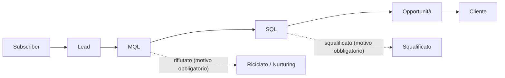

Caso ricostruito su numeri di esempio: Vettoria è una software house B2B che vende una piattaforma di gestione flotte a imprese di logistica. A fine trimestre il marketing presenta 340 MQL, le vendite dichiarano di averne ricevuti 90 utilizzabili e il finance conta 20 opportunità create. Nessuno mente. La piattaforma di automazione conta le persone che hanno superato una soglia di punteggio, il CRM conta i record accettati dai commerciali, il finance conta le opportunità con un importo. Tre sistemi, tre definizioni, tre dashboard che raccontano storie diverse sullo stesso trimestre.

> **Idea chiave:** Nel B2B la qualità della pipeline dipende dalla disciplina operativa su record, stadi e timestamp più che dal budget media: uno stack con tre strumenti ben integrati e regole di ownership scritte batte uno da dieci senza sincronizzazione.

Le martech operations sono il lavoro che tiene allineati questi sistemi: chi possiede ogni record, quando un lead cambia stato, che cosa torna indietro dal CRM alla piattaforma, quali tabelle il warehouse espone a tutti. Questa lezione segue il percorso di Vettoria dai record grezzi fino alla velocità della pipeline.

## Perché lo stack B2B decide la pipeline

Nel B2C una conversione è quasi sempre un evento individuale e rapido. Nel B2B è un processo collettivo che dura mesi: un ingegnere scarica un whitepaper a gennaio, un responsabile operativo partecipa a un webinar a marzo, il procurement chiede una demo a maggio, il direttore finanziario approva a luglio. Chi misura questa sequenza con strumenti pensati per il singolo contatto vede quattro episodi scollegati e assegna il merito all'ultimo tocco.

Due sigle vanno fissate subito. Un MQL (marketing qualified lead) è un lead che il marketing ritiene pronto per una conversazione commerciale, in genere perché ha superato una soglia di punteggio. Un SQL (sales qualified lead) è un lead che le vendite hanno accettato dopo una prima verifica. Il confine tra i due è il punto in cui nascono quasi tutti i conflitti tra i team, perché le due definizioni vengono scritte in momenti diversi da persone diverse.



Il diagramma mostra la sequenza sobria che funziona nella maggior parte delle aziende: sei stadi principali e due uscite laterali con motivazione obbligatoria. Una tassonomia da quindici stadi aumenta le occasioni di dissenso senza aumentare la capacità di decidere.

## Automazione e CRM che si parlano

La piattaforma di automazione ragiona per persona ed evento. Il CRM ragiona per account e opportunità. Ogni volta che un record attraversa il confine tra i due serve una traduzione esplicita, e ogni traduzione implicita diventa un bug silenzioso. Un lead che chiede una demo e viene richiamato dopo due giorni converte una frazione di quello chiamato entro un'ora, ma se nessuno registra l'orario della richiesta e quello della chiamata, il ritardo non emerge mai.

I problemi di integrazione sono prevedibili. Senza regole di deduplica il CRM si riempie di doppioni e ogni metrica si annacqua. Se un campo ha due proprietari, ad esempio il punteggio scritto sia dalla piattaforma sia da un flusso del CRM, l'ultimo che scrive vince e nessuno capisce perché il valore cambi da solo. Se la sincronizzazione è unidirezionale, il marketing continua a nutrire con email di prospecting un contatto che le vendite hanno già trasformato in cliente.

Un controllo smaschera quasi tutto: confronta per una settimana il conteggio degli MQL nella piattaforma e nel CRM, giorno per giorno. Se i due numeri divergono oltre la soglia fisiologica, c'è un filtro, un errore di mapping o una regola che scarta record senza lasciare traccia nei log. Quando oltre il 20-30% degli MQL viene rifiutato con una motivazione, il problema non è il volume dei lead ma la definizione di qualificato.

## Account, stadi e proprietà

Il modello dati del B2B ha tre entità. L'account è l'azienda ed è l'entità centrale. I contatti sono i ruoli dentro l'account. Le opportunità sono i tentativi di monetizzare l'account. Quando il modello pende sul singolo lead succedono assurdità quotidiane: tre colleghi della stessa azienda si trovano in tre stadi diversi, un'opportunità viene vinta mentre il marketing continua a trattare gli altri colleghi come contatti freddi.

Il lifecycle stage è il vocabolario condiviso tra i team. Ogni transizione tra uno stadio e il successivo deve registrare tre informazioni: il timestamp, l'attore responsabile e il criterio soddisfatto. Senza timestamp non si calcolano le velocità tra stadi. Senza attore non si sa chi doveva agire. Senza criterio ogni passaggio resta negoziabile a posteriori, e la discussione sul trimestre diventa una discussione sulle definizioni.

La proprietà dell'account segue la stessa logica. È una regola scritta in una matrice con soglie temporali, applicata dal routing automatico e non dalla buona volontà di qualcuno. Un esempio di regola: l'account appartiene al commerciale che ha lavorato l'ultimo contatto negli ultimi 60 giorni, altrimenti torna al pool territoriale. La regola non deve essere perfetta, deve essere leggibile e applicata sempre.

## Scoring, routing e account-based marketing

Il lead scoring fallisce quasi sempre perché è un esercizio statistico del marketing che le vendite non hanno firmato. Il modello assegna 80 punti a chi scarica un ebook, il commerciale chiama e scopre di parlare con uno studente. Lo scoring funziona quando è un contratto tra i due team, con due componenti separate. Il fit descrive quanto l'azienda assomiglia al cliente ideale per settore, dimensione e tecnologie, e cambia lentamente. L'engagement descrive il comportamento recente, come visite alla pagina prezzi, richiesta di demo, partecipazione a un webinar, e decade in fretta. Solo l'incrocio tra fit alto ed engagement alto merita un passaggio immediato alle vendite. Alto fit con basso engagement si nutre con contenuti, basso fit con alto engagement non si passa.

Il routing traduce il punteggio in azione: a chi va il lead, in quanto tempo, con quale contesto. La metrica che conta non è quanti MQL sono stati passati, ma la velocità di primo contatto e la quota lavorata entro lo SLA. Se lo SLA è di quattro ore lavorative e la mediana reale è di tre giorni, nessun modello di scoring compensa il ritardo.

L'account-based marketing sposta l'unità di analisi all'azienda che deve firmare. Tre misure lo reggono: il punteggio di engagement per account, che aggrega le attività di tutti i contatti pesando ruolo e intensità; la penetrazione dell'account, cioè quanti ruoli decisivi sono stati toccati; l'influenza sulla pipeline, senza pretendere un'attribuzione millimetrica. I pesi sono ipotesi da calibrare: si parte da valori concordati con le vendite, si osserva per un trimestre quali account ingaggiati diventano opportunità e si correggono.

```sql
-- Punteggio di engagement per account, finestra 90 giorni
WITH scored AS (
  SELECT
    c.account_id,
    CASE
      WHEN e.event_type = 'request_demo'    THEN 50
      WHEN e.event_type = 'contact_sales'   THEN 40
      WHEN e.event_type = 'webinar_75pct'   THEN 30
      WHEN e.event_type = 'ebook_download'  THEN 10
      WHEN e.event_type = 'long_visit'      THEN 5
      ELSE 1
    END AS points
  FROM engagement_events e
  JOIN contacts c ON e.user_email = c.email
  WHERE e.event_ts >= CURRENT_DATE - INTERVAL '90 days'
)
SELECT account_id, SUM(points) AS total_engagement_score
FROM scored
GROUP BY account_id
ORDER BY total_engagement_score DESC
LIMIT 100;
```

Un account di Vettoria con una richiesta di demo, due partecipazioni a un webinar oltre il 75%, tre download di ebook e quattro visite lunghe nei 90 giorni totalizza: 1 × 50 = 50, 2 × 30 = 60, 3 × 10 = 30, 4 × 5 = 20. La somma è 160 punti. Un secondo account con solo cinque download di ebook ne ottiene 5 × 10 = 50: pesa un terzo del primo, pur avendo generato più eventi. È il comportamento voluto, perché il punteggio ordina per intenzione d'acquisto e non per volume di attività.

## Account a 360 gradi, velocità e unit economics

Né la piattaforma di automazione né il CRM vedono tutto. La riconciliazione avviene nel warehouse, con pipeline ELT e modelli versionati, su tre strati: tabelle grezze immutabili, tabelle intermedie che puliscono e risolvono le identità, tabelle finali per account. La tabella `dim_accounts_360` ha una riga per account con engagement recente, stadio, owner, ricavo annuo ricorrente, salute del prodotto, ticket aperti e segnali di intento esterni. Con un reverse ETL i campi calcolati tornano nel CRM, dove i commerciali lavorano davvero. L'account a 360 gradi è buono quanto la peggiore delle sue sorgenti, perciò servono test su unicità delle chiavi, freschezza e volumi.

La velocità della pipeline si calcola come V = N × p × ACV / T, dove N è il numero di opportunità, p il tasso di vittoria, ACV il valore medio annuo del contratto e T la durata del ciclo in giorni. Il CAC è (S + M) / nuovi clienti, con S spesa commerciale e M spesa marketing.

Ecco il calcolo per Vettoria, con numeri di esempio. Le 20 opportunità del trimestre hanno un tasso di vittoria del 25%, un ACV di 18.000 euro e un ciclo di 90 giorni. Passaggi:

1. Clienti acquisiti = 20 × 0,25 = 5 clienti.
2. Valore chiuso = 5 × 18.000 euro = 90.000 euro.
3. Velocità della pipeline = 90.000 euro / 90 giorni = 1.000 euro al giorno.
4. Il trimestre è costato S = 70.000 euro di vendite e M = 30.000 euro di marketing: CAC = (70.000 + 30.000) / 5 = 20.000 euro per cliente.
5. Con un margine lordo del 75%, il margine annuo per cliente è 18.000 × 0,75 = 13.500 euro, cioè 1.125 euro al mese.
6. Payback = 20.000 / 1.125 = 17,8 mesi, quasi 18 mesi.
7. Con una vita media del cliente di 3 anni, l'LTV è 13.500 × 3 = 40.500 euro, e il rapporto LTV su CAC è 40.500 / 20.000 = 2,0.

Un rapporto sotto 3 segnala un motore che brucia più di quanto costruisce, e un payback vicino ai 18 mesi in un SaaS mid-market va spiegato. Spingere solo sul volume N di solito deprime p e allunga T: il lavoro sui 340 MQL di partenza produce più valore se alza p dal 25% al 30% che se aggiunge 4 opportunità di qualità inferiore. Con p al 30% i clienti sarebbero 6, il CAC scenderebbe a 100.000 / 6 = 16.667 euro e il rapporto LTV su CAC salirebbe a 2,4.

Nessun modello di attribuzione assegna il merito in modo oggettivo: first-touch, last-touch e multi-touch sono lenti diverse sulla stessa pipeline, e vanno confrontate invece di scegliere quella che fa apparire meglio il proprio canale.

## Governo dei dati e il caso Adobe-Marketo

Lo stack B2B tratta dati personali su una scala che rende la privacy un vincolo architetturale. Ogni email nel warehouse porta una storia di consenso: dove è stata raccolta, con quale informativa, per quali finalità, quando scade. La regola è avere una sola tabella di consensi come riferimento centrale, con revoche che si propagano in ore e non in trimestri.

L'igiene dei dati decide se i numeri sono usabili. Servono controlli di completezza sui campi critici, di validità sui formati e di freschezza sulle sincronizzazioni. Se la sincronizzazione tra CRM e warehouse ha più di sei ore di ritardo, il report del mattino mostra la pipeline di ieri spacciata per quella di oggi. Quando il team cresce, le operations diventano un prodotto interno: un backlog visibile, un proprietario per ogni integrazione, un registro delle modifiche a scoring, routing e mapping.

Nel settembre 2018 Adobe ha annunciato l'acquisizione di Marketo per 4,75 miliardi di dollari, chiusa nell'ottobre dello stesso anno, con l'obiettivo di unire advertising, automazione e misura in un unico stack enterprise. Il prezzo segnala dove sta il valore: nell'integrazione tra ingaggio, CRM e analisi. La licenza da sola non risolve nulla: senza ownership dei record, timestamp sui cambi di stato e sincronizzazione bidirezionale, anche lo stack più costoso produce dashboard in disaccordo.

## Errori tipici delle martech operations

### Stadi negoziabili a posteriori

Il sintomo è una riunione di fine trimestre in cui marketing e vendite discutono di che cosa fosse un MQL. Succede perché lo stadio è stato impostato senza un criterio scritto e senza timestamp, quindi nessuno può dimostrare quando e perché un lead è passato. Si corregge registrando a ogni transizione timestamp, attore e criterio, e rifiutando il passaggio se uno dei tre campi manca.

### Un modello di scoring che nessuno capisce

Il sintomo è un punteggio a cento variabili che le vendite ignorano e che il marketing non sa spiegare. Sembra una scelta ragionevole perché il modello migliora la metrica di accuratezza in laboratorio, ma un punteggio opaco non diventa mai un contratto tra i team. Si evita con pesi leggibili, ricalibrati ogni trimestre contro le opportunità effettivamente create, e con una riga di spiegazione visibile nel CRM per ogni lead.

### Comprare tecnologia senza scrivere le regole

Il sintomo è uno stack costoso che produce dashboard in conflitto. Il ragionamento è che uno strumento più potente risolva il disordine, mentre in realtà lo amplifica. Si corregge scrivendo prima le regole operative, cioè ownership, timestamp e sincronizzazione bidirezionale, e solo dopo scegliendo gli strumenti che le applicano.

## Verifica sulle martech operations

1. Che differenza c'è tra MQL e SQL e perché il confine genera conflitti?

<details>
<summary>Mostra risposta</summary>

Un MQL è qualificato dal marketing, in genere tramite una soglia di punteggio, mentre un SQL è accettato dalle vendite dopo una verifica. Il confine genera conflitti perché i due criteri sono scritti da team diversi in momenti diversi; si risolve con un criterio condiviso e con una motivazione obbligatoria per ogni rifiuto.

</details>

2. Che cosa registra ogni transizione di stadio e che cosa si perde se manca uno dei tre campi?

<details>
<summary>Mostra risposta</summary>

Registra timestamp, attore responsabile e criterio soddisfatto. Senza timestamp non si calcolano le velocità tra stadi, senza attore non si sa chi doveva agire, senza criterio il passaggio resta negoziabile a posteriori.

</details>

3. Un account ha una richiesta di demo, due webinar oltre il 75% e quattro visite lunghe in 90 giorni. Quanti punti totalizza con i pesi della lezione?

<details>
<summary>Mostra risposta</summary>

1 × 50 = 50, 2 × 30 = 60, 4 × 5 = 20, quindi 50 + 60 + 20 = 130 punti. I download di ebook non ci sono, quindi non contribuiscono.

</details>

4. Con 20 opportunità, tasso di vittoria del 25%, ACV di 18.000 euro e ciclo di 90 giorni, quanto vale la velocità della pipeline?

<details>
<summary>Mostra risposta</summary>

Clienti = 20 × 0,25 = 5, valore chiuso = 5 × 18.000 = 90.000 euro, velocità = 90.000 / 90 = 1.000 euro al giorno. Alzando il tasso di vittoria al 30% la velocità sale a 1.200 euro al giorno senza aggiungere opportunità.

</details>

5. Lo SLA di primo contatto è di quattro ore lavorative e la mediana reale è di tre giorni. Che cosa conviene correggere per primo?

<details>
<summary>Mostra risposta</summary>

Il routing e la capacità di risposta, non il modello di scoring. Con un ritardo di questa entità, il valore di un lead qualificato decade prima che qualcuno lo chiami, e nessun punteggio più accurato recupera il tempo perso.

</details>
