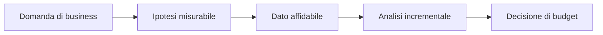

# B2B martech operations

Nel 2014, Slack era ancora un prodotto di nicchia, un tool di comunicazione interna nato dalle ceneri di una società di gaming fallita. Eppure, nel giro di pochi anni, ha orchestrato una delle più spettacolari crescite nel mondo del software-as-a-service (SaaS) B2B, culminata con l'acquisizione da parte di Salesforce per 27.7 miliardi di dollari nel 2021. Questa ascesa non è stata casuale, ma il risultato di una macchina di marketing e vendite B2B oliata alla perfezione, dove ogni interazione, ogni trial attivato e ogni team che superava la soglia dei 2.000 messaggi veniva tracciato, analizzato e trasformato in un'opportunità commerciale. Il loro stack tecnologico, pur evolvendosi, si è sempre basato su un principio cardine: la profonda integrazione tra i sistemi che gestiscono il marketing automation e quelli che governano le relazioni con i clienti. Per Slack, questo significava trasformare un utente "freemium" in un lead qualificato per il marketing (MQL), per poi nutrirlo con contenuti pertinenti fino a farlo diventare un'opportunità di vendita (SQL) per un contratto enterprise. La capacità di orchestrare questo percorso su milioni di utenti e migliaia di aziende contemporaneamente è l'essenza delle moderne operazioni di Martech B2B.

## L'Architettura Fondamentale: Il Dialogo tra MAP e CRM

A differenza del marketing B2C, dove la transazione può essere impulsiva e il percorso d'acquisto lineare, il contesto B2B è caratterizzato da complessità. I cicli di vendita si misurano in mesi, se non anni; il valore dei contratti (Annual Contract Value, ACV) è elevato; e la decisione d'acquisto non è presa da un singolo individuo, ma da un "buying committee" che può includere figure tecniche, finanziarie e manageriali. Questa realtà plasma inevitabilmente l'architettura tecnologica. Al centro di questo universo non troviamo un singolo sistema, ma una diarchia funzionale: la Marketing Automation Platform (MAP) e il Customer Relationship Management (CRM).

Una MAP, come Marketo, HubSpot o Pardot, è il cervello operativo del marketing. Il suo compito è orchestrare le interazioni nella parte alta e media del funnel (Top-of-Funnel, ToFu; Middle-of-Funnel, MoFu). Traccia le attività digitali degli utenti anonimi e dei lead noti: visite al sito, download di white paper, partecipazione a webinar, aperture di email. Sulla base di queste azioni, esegue due funzioni vitali: il *lead scoring*, che assegna un punteggio a ogni lead per misurarne l'interesse (engagement) e l'aderenza al profilo cliente ideale (fit), e il *lead nurturing*, che invia comunicazioni automatizzate e personalizzate per educare il potenziale cliente e guidarlo nel suo percorso.

Il CRM, come Salesforce o HubSpot CRM, è invece il sistema di riferimento per il team di vendita e il cuore della gestione delle relazioni commerciali. Contiene l'anagrafica completa di Account (le aziende clienti o prospect), Contatti (le persone all'interno di tali aziende) e Opportunità (le trattative commerciali in corso). Mentre la MAP si concentra sui "lead", il CRM si concentra sulle "opportunità" concrete di generare fatturato.

Il flusso di dati tra questi due sistemi è il sistema circolatorio dell'intera strategia go-to-market. In un'architettura ben progettata, il flusso è bidirezionale e quasi istantaneo.
1.  **MAP → CRM**: Quando un lead raggiunge un determinato punteggio (es. `&gt;`100 punti) o compie un'azione qualificante (es. compila il form "Richiedi una Demo"), la MAP lo sincronizza con il CRM, creando un nuovo oggetto "Lead". Questo evento è noto come passaggio da MQL (Marketing Qualified Lead). Tutte le attività di engagement tracciate dalla MAP (es. "Ha aperto l'email X", "Ha visitato la pagina dei prezzi 3 volte") vengono passate al CRM per arricchire il profilo e dare contesto al venditore.
2.  **CRM → MAP**: Il venditore, ricevuto il lead, lo contatta e ne valuta la qualità. Se il lead è valido, lo converte in un Contatto associato a un Account e, potenzialmente, a un'Opportunità. Questo cambio di stato (es. da "MQL" a "SQL" - Sales Qualified Lead) viene ritrasmesso alla MAP. Questa informazione è vitale per il marketing, che può così calcolare i tassi di conversione, valutare la qualità dei lead generati da diverse campagne e, soprattutto, escludere i contatti in trattativa attiva da campagne di nurturing generiche.

La sfida ingegneristica sta nel garantire che questa sincronizzazione sia robusta, veloce e che gestisca correttamente la deduplicazione e la mappatura dei campi, un problema non banale quando i due sistemi hanno modelli dati leggermente diversi.

## Il Paradigma Account-Based Marketing (ABM): Dall'Individuo all'Organizzazione

Per anni, il marketing B2B ha operato su un modello "lead-centrico", simile al B2C: accumulare il maggior numero possibile di lead e filtrarli attraverso il funnel. L'Account-Based Marketing (ABM) rovescia questa logica. Invece di pescare a strascico, si usa l'arpione. La strategia parte dall'identificazione di un elenco ristretto di aziende target ad alto potenziale (il cosiddetto "Ideal Customer Profile", ICP), per poi orchestrare campagne di marketing e vendita altamente personalizzate per coinvolgere i decisori chiave all'interno di quegli specifici account.

Questo cambiamento strategico impone un'evoluzione dell'infrastruttura analitica. Le metriche a livello di singolo lead perdono di centralità. Se dieci persone della stessa azienda visitano il tuo sito, non hai dieci lead deboli, ma un account molto interessato. Le analisi devono aggregare i segnali a livello di account. Nascono così metriche specifiche per l'ABM:

*   **Account Engagement Score**: Un punteggio aggregato che somma le attività di tutti i contatti noti di un'azienda. Un download di un white paper da parte di un Junior Analyst vale X punti, ma la partecipazione a un webinar del CTO della stessa azienda vale 10X.
*   **Account Penetration (or Coverage)**: La percentuale di decisori chiave all'interno di un account target con cui si è stabilito un contatto. Se il tuo ICP per l'azienda ACME prevede il coinvolgimento di VP of Engineering, Head of Security e CIO, e hai avuto interazioni solo con il primo, la tua copertura è del 33%.
*   **Account Pipeline Influence**: La capacità di misurare come le attività di marketing su un account target abbiano influenzato la creazione o l'accelerazione di opportunità di vendita.

**Caso di Studio: Stripe Atlas e l'orchestrazione ABM**
Stripe, la piattaforma per pagamenti online, offre un servizio chiamato Stripe Atlas per aiutare le startup a costituire una società negli Stati Uniti. Il loro mercato target non sono aziende generiche, ma fondatori di startup in fase iniziale, spesso parte di acceleratori o community di venture capital. Un approccio ABM per Stripe Atlas potrebbe concentrarsi non su singole startup, ma sugli acceleratori stessi (es. Y Combinator, Techstars) come "macro-account".
Invece di targettizzare 1000 startup individualmente, Stripe potrebbe focalizzare i suoi sforzi di marketing sui 50 principali acceleratori globali. Le attività di marketing non sarebbero generiche, ma consisterebbero in workshop dedicati ai founder di quell'acceleratore, contenuti co-brandizzati e offerte esclusive.
Le metriche di successo non sarebbero i singoli MQL, ma:
1.  **Accelerator Engagement**: Quanti workshop sono stati tenuti per l'acceleratore "Y Combinator"? Qual è stato il tasso di partecipazione?
2.  **Cohort Adoption Rate**: Delle 200 startup nella coorte "YC Winter 2023", quante hanno attivato Stripe Atlas entro 90 giorni dalla fine del programma? L'obiettivo potrebbe essere di aumentare questo tasso dal 15% al 25%.
3.  **Influenced Revenue**: Il valore totale dei contratti generati dalle startup di un determinato acceleratore, attribuibile alle iniziative ABM dedicate.

Questo approccio permette a Stripe di concentrare le risorse dove il potenziale è più alto, passando da un marketing "one-to-many" a un marketing "one-to-few" estremamente efficace.

## L'Ingegneria dei Dati per un "Account 360": Oltre MAP e CRM

La diarchia MAP-CRM, sebbene potente, ha un limite intrinseco: la visione che offre è spesso limitata ai dati di marketing e vendita. Una comprensione veramente profonda di un account B2B richiede l'integrazione di dati provenienti da altre fonti cruciali:
*   **Dati di Prodotto (Product Usage)**: Come l'account sta usando il tuo software? Quali funzionalità adotta? Sta raggiungendo i limiti del suo piano attuale? Questi dati, provenienti da sistemi come Segment, Mixpanel o database interni, sono il più forte segnale di intenzione di acquisto per upsell o di rischio di abbandono (churn).
*   **Dati di Supporto (Support Tickets)**: Quali problemi sta riscontrando l'account? Il numero di ticket è in aumento? La loro risoluzione è rapida? Dati da Zendesk o Intercom possono rivelare frustrazioni o, al contrario, un forte engagement.
*   **Dati Finanziari (Billing)**: L'account paga puntualmente? Ha mai avuto problemi con la fatturazione? Dati da sistemi come Zuora o NetSuite completano il quadro della salute del cliente.
*   **Dati di Intento di Terze Parti (Intent Data)**: Quali argomenti sta ricercando l'azienda su Internet? Sta visitando siti di recensioni di competitor? Piattaforme come 6sense o Bombora forniscono questi segnali "esterni", indicando che un account è attivamente alla ricerca di una soluzione.

La sfida ingegneristica moderna, affrontata dal team di Revenue Operations (RevOps), è unificare queste fonti di dati eterogenee. La soluzione non è più una semplice sincronizzazione punto-punto, ma la creazione di un **Data Warehouse centralizzato** (come Snowflake, BigQuery o Redshift) che agisca da "single source of truth".
Il flusso diventa:
`Sorgenti (Salesforce, Marketo, Zendesk, DB Prodotto) → ETL/ELT (Fivetran, Stitch) → Data Warehouse (Snowflake) → Modellazione (dbt) → Destinazioni (BI, Reverse ETL)`

**Caso di Studio: L'architettura RevOps di Gong**
Gong, una piattaforma di "Revenue Intelligence" che analizza le conversazioni di vendita, è un esempio emblematico di questa architettura. Il loro stack, documentato pubblicamente, utilizza Salesforce come CRM, Marketo come MAP e 6sense per i dati di intento. Tuttavia, il vero cuore del sistema è Snowflake. Tutti i dati da queste piattaforme, insieme ai dati di utilizzo del prodotto Gong stesso, vengono caricati in Snowflake.
Qui, il team di data engineering utilizza dbt (Data Build Tool) per costruire modelli dati trasformati e unificati. Il risultato finale è una tabella chiamata `dim_accounts_360`. Questa tabella non contiene solo le informazioni del CRM, ma per ogni account include:
*   `last_marketing_engagement_date` (da Marketo)
*   `active_users_last_30_days` (dal database di prodotto)
*   `open_support_tickets_p1` (da Zendesk)
*   `intent_score_competitor_x` (da 6sense)
*   `mrr` (Monthly Recurring Revenue, dal sistema di billing)

La vera magia avviene nel passo finale: utilizzando uno strumento di **Reverse ETL** come Hightouch, i dati arricchiti da `dim_accounts_360` vengono rispediti *indietro* nei sistemi operativi. Ad esempio, il punteggio di salute dell'account calcolato in Snowflake viene visualizzato come un campo custom direttamente nell'interfaccia di Salesforce. In questo modo, un venditore non deve accedere a cinque dashboard diverse per preparare una chiamata: ha una visione olistica e aggiornata direttamente nel suo strumento di lavoro quotidiano. Questo approccio ha permesso a Gong di ridurre drasticamente il tempo di preparazione dei sales rep e di aumentare l'identificazione di opportunità di cross-sell del 30%, basandosi sui segnali di utilizzo del prodotto.

## Calcolo di un Punteggio di Engagement per Account in SQL

L'implementazione di un modello ABM richiede la capacità di tradurre la strategia in codice. Un primo passo fondamentale è la creazione di un punteggio di engagement a livello di account, che aggreghi le diverse interazioni dei contatti associati. Questo non è un semplice `COUNT(*)`, ma una somma pesata che riflette il valore di diverse azioni. Un download di un e-book è un segnale di interesse, ma la partecipazione a un webinar di 60 minuti è un segnale molto più forte.

Il seguente codice SQL, eseguibile su un data warehouse come BigQuery o Snowflake, costruisce un modello di scoring di questo tipo. Utilizza le Common Table Expressions (CTEs) per rendere la logica modulare e leggibile, unendo dati da diverse fonti (visite al sito, compilazione di form, partecipazione a webinar) e aggregandoli a livello di `account_id`.

```sql
-- Questo codice calcola un punteggio di engagement per account aggregando
-- diverse attività di marketing degli ultimi 90 giorni e pesandole.

WITH website_visits AS (
    -- Pondera le visite al sito, dando più peso a sessioni più lunghe
    SELECT
        c.account_id,
        SUM(CASE
            WHEN v.session_duration_sec > 300 THEN 5 -- Sessione > 5 min
            WHEN v.session_duration_sec > 60 THEN 2  -- Sessione > 1 min
            ELSE 1
        END) AS visit_score
    FROM raw_data.web_visits v
    JOIN raw_data.contacts c ON v.user_email = c.email
    WHERE v.visit_timestamp >= CURRENT_DATE - 90
    GROUP BY c.account_id
),

form_fills AS (
    -- Assegna punteggi diversi in base al tipo di form compilato
    SELECT
        c.account_id,
        SUM(CASE
            WHEN f.form_name = 'request_demo' THEN 50
            WHEN f.form_name = 'contact_sales' THEN 40
            WHEN f.form_name = 'ebook_download' THEN 10
            ELSE 5
        END) AS form_score
    FROM raw_data.form_submissions f
    JOIN raw_data.contacts c ON f.user_email = c.email
    WHERE f.submission_timestamp >= CURRENT_DATE - 90
    GROUP BY c.account_id
),

webinar_attendance AS (
    -- Premia la partecipazione ai webinar, specialmente se completa
    SELECT
        c.account_id,
        SUM(CASE
            WHEN w.attended_percentage > 0.75 THEN 30 -- Ha visto > 75%
            WHEN w.attended_percentage > 0.25 THEN 15 -- Ha visto > 25%
            ELSE 5 -- Si è solo registrato
        END) AS webinar_score
    FROM raw_data.webinar_logs w
    JOIN raw_data.contacts c ON w.user_email = c.email
    WHERE w.webinar_date >= CURRENT_DATE - 90
    GROUP BY c.account_id
)

-- Query finale che unisce i punteggi e presenta i risultati
SELECT
    acc.account_id,
    acc.account_name,
    acc.industry,
    COALESCE(wv.visit_score, 0) AS visit_score,
    COALESCE(ff.form_score, 0) AS form_score,
    COALESCE(wa.webinar_score, 0) AS webinar_score,
    (COALESCE(wv.visit_score, 0) + COALESCE(ff.form_score, 0) + COALESCE(wa.webinar_score, 0)) AS total_engagement_score
FROM raw_data.accounts acc
LEFT JOIN website_visits wv ON acc.account_id = wv.account_id
LEFT JOIN form_fills ff ON acc.account_id = ff.account_id
LEFT JOIN webinar_attendance wa ON acc.account_id = wa.account_id
WHERE
    -- Filtriamo per mostrare solo gli account che hanno avuto almeno un'attività
    (wv.visit_score IS NOT NULL OR ff.form_score IS NOT NULL OR wa.webinar_score IS NOT NULL)
ORDER BY total_engagement_score DESC
LIMIT 100;

```
Questa query non solo calcola un punteggio, ma fornisce una base analitica per il team di vendita. Ordinando per `total_engagement_score`, i Sales Development Representatives (SDRs) possono prioritizzare le loro attività di outreach sugli account che mostrano il maggior interesse, aumentando drasticamente l'efficienza e il tasso di risposta.

## Mettiamoci alla Prova: Laboratorio di Ingegneria dei Dati Martech

La comprensione teorica di queste architetture è solo il primo passo. La vera competenza emerge dall'applicazione pratica. I seguenti esercizi sono progettati per simulare le sfide reali che un data engineer o un data analyst affronterebbe in un team di RevOps.

**Esercizio 1: Progettazione di un Modello di Lead Scoring (Concettuale)**
Il tuo CMO ti ha chiesto di rivedere l'attuale modello di lead scoring, che è troppo semplicistico. Il tuo compito è progettare un nuovo modello bidimensionale che valuti sia il *fit* demografico/firmografico sia l'*engagement* comportamentale.
*   **Dimensione Fit (Punteggio da A a D)**: Elenca almeno 5 attributi (es. `job_title`, `company_size`, `industry`, `country`) e definisci i criteri per assegnare un punteggio. Ad esempio, un `job_title` che contiene "Director" o "VP" potrebbe ricevere un punteggio più alto di "Intern". Un'azienda nel settore target (es. "Software") ottiene più punti di una in un settore non target (es. "Ristorazione").
*   **Dimensione Engagement (Punteggio da 1 a 4)**: Elenca almeno 5 azioni comportamentali (es. `website_visit`, `email_open`, `pricing_page_view`, `case_study_download`) e assegna loro un valore in punti.
*   **Matrice di Priorità**: Combina le due dimensioni in una matrice. Un lead "A1" (fit ottimo, engagement alto) dovrebbe essere inviato immediatamente a un Account Executive. Un lead "D4" (fit pessimo, engagement basso) potrebbe essere ignorato. Un lead "A4" (fit ottimo, engagement basso) è un candidato perfetto per una campagna di nurturing. Disegna questa matrice e definisci l'azione successiva per ogni quadrante.

**Esercizio 2: Estensione della Query SQL di Engagement (Analitico)**
Partendo dalla query SQL fornita in precedenza, il team di prodotto ha appena reso disponibili i dati di utilizzo della piattaforma in una nuova tabella chiamata `raw_data.product_usage` con i seguenti campi: `usage_date`, `user_email`, `account_id`, `feature_used`, `session_time_minutes`.
Il tuo compito è modificare la query SQL per incorporare questi dati nel `total_engagement_score`.
1.  Crea una nuova CTE chiamata `product_engagement`.
2.  All'interno di questa CTE, calcola un `product_score` per ogni `account_id`.
3.  Assegna un punteggio più alto all'utilizzo di funzionalità "avanzate" (es. `feature_used = 'api_integration'`) rispetto a quelle di base (es. `feature_used = 'login'`).
4.  Incorpora il `product_score` nel calcolo del `total_engagement_score` nella query finale. Assegna a questo punteggio un peso significativo, ad esempio moltiplicandolo per un fattore 1.5, poiché l'utilizzo del prodotto è un segnale molto forte.

**Esercizio 3: Analisi di Scenario e Diagnosi (Strategico)**
Il report del primo trimestre mostra un dato allarmante: il numero di MQL è aumentato del 15% grazie a una nuova campagna di contenuti, ma il tasso di conversione da MQL a SQL è crollato del 30%. Il team di vendita si lamenta che "il marketing ci sta passando lead di bassa qualità".
Il tuo ruolo è quello di analista RevOps. Formula tre ipotesi distinte che potrebbero spiegare questo fenomeno. Per ciascuna ipotesi, descrivi esattamente quali dati e quali analisi condurresti all'interno del tuo stack Martech (CRM, MAP, Data Warehouse) per validarla o confutarla.
*   *Esempio di ipotesi*: "La nuova campagna sta attraendo un'audience con un fit demografico più basso rispetto alle campagne precedenti."
*   *Analisi per validarla*: "Confronteri la distribuzione dei `job_title` e `company_size` dei MQL generati dalla nuova campagna con quelli delle campagne storiche. Creerei una query nel nostro data warehouse che segmenta i MQL per campagna e calcola il tasso di conversione a SQL per ogni segmento demografico."

## Riepilogo

Le operazioni di Martech B2B rappresentano un dominio complesso e tecnicamente esigente, lontano dalla semplicità apparente del marketing B2C. L'architettura tecnologica è intrinsecamente duale, basata sul dialogo costante tra una Marketing Automation Platform e un CRM. Questo dialogo, tuttavia, è solo il punto di partenza. L'evoluzione verso strategie sofisticate come l'Account-Based Marketing richiede un cambiamento di paradigma analitico, spostando il focus dal singolo lead all'account nella sua interezza. La vera frontiera dell'ingegneria e dell'analisi in questo campo risiede nella capacità di superare i silos applicativi, unificando i dati di marketing, vendita, prodotto e supporto in un data warehouse centrale. È questa visione a 360 gradi dell'account, resa operativa tramite modelli dati robusti e processi di Reverse ETL, che permette alle aziende leader come Gong e Stripe di orchestrare percorsi cliente altamente personalizzati, efficienti e, in definitiva, profittevoli. La competenza non sta solo nel saper usare gli strumenti, ma nel saper progettare i flussi di dati che li rendono intelligenti.

## References

*   Hutt, M. D., & Speh, T. W. (2012). *Business marketing management: B2B*. Cengage Learning. (Un testo fondamentale che delinea le differenze strategiche del marketing business-to-business, fornendo il contesto per la necessità di stack tecnologici specializzati).
*   Fader, P. S., & Hardie, B. G. (2009). Probability models for customer-base analysis. *Journal of Interactive Marketing*, 23(1), 61-69. (Sebbene non strettamente B2B, questo articolo è un riferimento seminal_e per la modellazione del comportamento del cliente e il calcolo del valore, concetti che vengono adattati e applicati per calcolare il LTV degli account B2B).
```

## Problema reale

Nel lavoro su marketing analytics, **B2B martech operations** serve a risolvere un problema concreto: trasformare budget, canali, creativita e audience in decisioni misurabili senza confondere volume, attribuzione e incrementalita. La domanda non e se il concetto sia interessante in astratto, ma quale decisione migliora quando lo applichi con dati affidabili e con una soglia di errore esplicita.

Questa lezione va studiata come uno strumento operativo: entro la fine devi saper Comprendere il problema analitico e il contesto decisionale; Applicare esempi, metriche e controlli a casi reali. Se non riesci a collegare il concetto a una scelta reale, la conoscenza resta decorativa e non diventa competenza.

## Modello concettuale



Il modello mentale e sequenziale: prima si formula la domanda, poi si traduce in unita osservabili, quindi si valuta la qualita del dato e solo alla fine si decide. Saltare un passaggio produce analisi eleganti ma fragili.

| Passaggio | Domanda guida | Output atteso |
|---|---|---|
| Framing | Quale decisione deve cambiare? | Una scelta concreta, non una curiosita |
| Misura | Quale segnale rappresenta il fenomeno? | Metrica, fonte e granularita |
| Confronto | Rispetto a quale baseline interpreto il risultato? | Benchmark o controfattuale plausibile |
| Azione | Che cosa faccio se il segnale supera la soglia? | Decisione, owner e prossimo controllo |

## Formalizzazione rigorosa

Formalizza **B2B martech operations** come una relazione tra quattro elementi: unita di analisi, segnale, baseline e decisione. Nel contesto di questa lezione l'unita principale e **campagna, coorte, touchpoint o segmento cliente**. Il segnale da osservare deve essere collegato a **margine incrementale, CAC payback, conversion rate corretto, lift o retention generata**, mentre la baseline deve essere scelta tra **periodo precedente, gruppo holdout, mercato comparabile o benchmark storico**.

Una formulazione robusta segue questa logica:

| Elemento | Definizione operativa per questa lezione |
|---|---|
| Unita | campagna, coorte, touchpoint o segmento cliente |
| Segnale | margine incrementale, CAC payback, conversion rate corretto, lift o retention generata |
| Baseline | periodo precedente, gruppo holdout, mercato comparabile o benchmark storico |
| Decisione | spostare risorse, cambiare messaggio, fermare una tattica o scalare un esperimento |
| Rischio | Confondere correlazione, qualita del dato e causalita decisionale |

La regola pratica e semplice: una misura e utile solo se riduce l'incertezza su una decisione specifica. Se non cambia una scelta, e documentazione; se cambia una scelta senza controlli, e rischio.

## Esempio o caso studio

Un team growth deve decidere se aumentare il budget su un canale che mostra CPA basso ma vendite marginali deboli. La lezione aiuta a separare il segnale utile dal rumore operativo, collegando metrica, modello mentale e decisione economica.

Applicando **B2B martech operations**, il team costruisce una lettura in tre colonne: cosa sappiamo, cosa assumiamo e quale decisione prendiamo. Questo formato impedisce di presentare un numero come se fosse una conclusione autosufficiente.

| Evidenza | Interpretazione prudente | Decisione conseguente |
|---|---|---|
| Segnale positivo ma non isolato | Il fenomeno esiste, ma la causa e ancora incerta | Cercare baseline o holdout |
| Segmento con risposta diversa | L'effetto medio nasconde eterogeneita | Analizzare coorti o sottogruppi |
| Costo operativo crescente | Il risultato va valutato sul margine | Applicare soglie economiche |

## Lab / esercizio

### Livello base

Prendi una decisione reale collegata a **B2B martech operations** e scrivi in cinque righe: obiettivo, metrica primaria, baseline, rischio principale e azione prevista. Non usare piu di una metrica primaria.

### Livello intermedio

Costruisci una tabella con almeno tre segmenti o scenari. Per ciascuno indica segnale, possibile spiegazione alternativa e controllo necessario prima di decidere.

### Livello research-grade

Disegna un piano di validazione: ipotesi, dati necessari, criterio di esclusione, soglia decisionale e controllo post-decisione. Specifica anche che cosa ti farebbe cambiare idea.

### Dataset e materiali consigliati

Usa export campagne, costi media, eventi web o app, CRM, transazioni, survey brand e log di consenso. Se non hai dati reali, crea un dataset sintetico con 200-500 righe e almeno una colonna temporale, una colonna segmento, una metrica di outcome e una variabile di esposizione.

## Errore tipico da evitare

L'errore piu frequente e trattare **B2B martech operations** come una definizione da ricordare invece che come un protocollo decisionale. In pratica succede quando si presenta una metrica senza baseline, un grafico senza ipotesi, o una raccomandazione senza costo dell'errore.

Un controllo utile e chiedersi: "se questo risultato fosse falso o instabile, quale decisione sbaglierei?". Se la risposta non e chiara, la lezione non e ancora stata applicata davvero.

## Quiz o checkpoint

1. Qual e la decisione concreta che questa lezione dovrebbe migliorare?
2. Quale baseline rende interpretabile il risultato?
3. Quale assunzione, se sbagliata, cambierebbe la conclusione?
4. Quale controllo minimo useresti prima di presentare la raccomandazione?

## Riepilogo operativo

**B2B martech operations** e una competenza utile quando collega concetto, dato e decisione. Studiala partendo da un problema reale, formalizza il segnale, cerca una baseline credibile, costruisci un esempio e chiudi con un controllo pratico. Categoria: Tecnico. Difficolta: advanced. Tempo stimato: 22 min.
