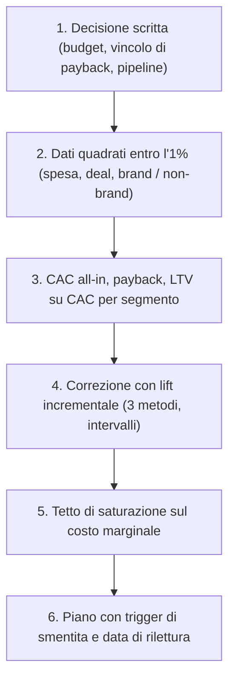

Nordwind è una SaaS B2B inventata ma verosimile, uno scenario costruito con numeri di esempio: 4,2 milioni di euro di ricavo annuo ricorrente, ciclo di vendita di 47 giorni, sei persone nel marketing e un trimestre che inizia male. Il board ha congelato le assunzioni e chiede una cosa sola: il prossimo euro deve lavorare più del precedente. Il budget da distribuire è di 180.000 euro per il trimestre, con un vincolo di payback sotto i 12 mesi.

> **Idea chiave:** Un budget si alloca sul costo incrementale e marginale di un cliente, non sul CPA mostrato dalla piattaforma, e solo dopo aver quadrato i dati di spesa e di deal entro una tolleranza dichiarata.

Il caso si risolve in quattro mosse: scrivere la decisione, mettere in ordine i dati, calcolare costo e payback per segmento correggendoli con l'incrementalità, cercare il punto di saturazione. Ogni mossa ha la sua trappola e il suo controllo, e il percorso parte da tabelle disallineate, non da modelli.

## Il brief e la decisione da scrivere

Sul tavolo ci sono tre richieste in competizione. Il paid search chiede il 30% di budget in più perché il CPA è sceso. Il team lifecycle vuole fermarsi due settimane per ripulire il nurturing, che genera MQL ignorati dalle vendite. Il CEO spinge sul brand, convinto che comprare solo domanda esistente renda l'azienda fragile. Tutti hanno un grafico che dimostra di avere ragione e nessuno ha un controfattuale.

La prima mossa dell'analista è scrivere la decisione prima di aprire i dati: 180.000 euro trimestrali da distribuire tra search, social, content e brand, con payback medio sotto i 12 mesi e pipeline pari a tre volte il target di booking. Quando la domanda passa da "dove performiamo meglio" a "quale spostamento di 20.000 euro dà più margine incrementale", quasi tutte le metriche di vanità escono dal tavolo da sole.



## Mettere i dati in ordine

Il CMO consegna tre file: l'export delle piattaforme pubblicitarie, il CRM con lead, MQL, opportunità e deal, il billing con attivazioni, fatturato e churn. Mancano holdout storici, indagini di brand e log di consenso utilizzabili. La spesa social è registrata per settimana mentre il CRM ragiona per giorno, e senza normalizzazione ogni analisi di ritardo tra spesa e conversione è falsa.

I numeri di partenza descrivono bene il disordine. Il 71% dei deal ha almeno un touch digitale registrato, ma il 34% dei deal vinti non ha alcun touch a pagamento, il 12% dei click paid cade sul nome dell'azienda e il 6% delle date di creazione e chiusura è in conflitto. Chi modella a questo punto produce cifre precise e sbagliate. La pulizia costa tre giorni e cambia ogni numero successivo di almeno il 15%.

Tre controlli, in ordine. Il primo è l'identità: si uniscono solo i record con almeno due segnali concordanti, come stesso dominio e stesso telefono normalizzato, e si dichiara il tasso di match. Fondere troppo crea percorsi finti, fondere poco lascia il brand invisibile. Il secondo è il calendario: spesa settimanale, eventi giornalieri e fatturato mensile non si sommano senza una tabella ponte. Nella retention a 90 giorni si filtra prima chi ha avuto 90 giorni di osservazione e poi si conta: l'errore di Nordwind era includere clienti acquisiti 20 giorni prima, che risultavano non ritenuti solo per anzianità. Il terzo è la separazione tra brand e non-brand. Il CPA "migliore di sempre" si scompone in brand a 90 euro per lead, in gran parte già convertiti, e generico a 620 euro, salito del 25% per l'asta.

Il controllo finale è la quadratura: la spesa per canale deve coincidere con l'estratto conto entro l'1% e i deal per segmento con il fatturato. Al primo giro la spesa dell'export risultava 196.200 euro contro 180.000 dell'estratto conto. Passaggi:

1. Scarto = 196.200 − 180.000 = 16.200 euro.
2. Scarto percentuale = 16.200 / 180.000 = 9%, contro una tolleranza dell'1%, cioè 1.800 euro.
3. Il 9% derivava da rimborsi pubblicitari contati due volte; dopo l'eliminazione dei doppi conteggi la spesa torna a 180.000 euro e lo scarto a 0%.

Scoprirlo prima di decidere è un dettaglio operativo, scoprirlo dopo è una figuraccia davanti al board.

## Quanto costa un cliente

Il ROAS di piattaforma dice quanto rende un euro di spesa media. Il payback dice in quanti mesi un cliente ripaga tutto ciò che è costato acquisirlo, stipendi e strumenti inclusi. Per una SaaS ricorrente il secondo comanda e il primo decora. Il CAC all-in è la spesa media più la quota di costi fissi di marketing e vendite, divisa per i nuovi clienti. Il payback è il CAC diviso per il margine mensile per cliente.

Nel caso, un cliente paga in media 9.600 euro l'anno, cioè 800 euro al mese, con un margine di contribuzione di circa 350 euro al mese. Passaggi per il payback apparente di ogni segmento:

1. Search brand: 1.100 / 350 = 3,1 mesi.
2. Search generico: 4.800 / 350 = 13,7 mesi.
3. Social prospecting: 3.900 / 350 = 11,1 mesi.
4. Content: 2.700 / 350 = 7,7 mesi.

Il rapporto LTV su CAC a 24 mesi, senza churn per semplicità, parte da un margine cumulato di 350 × 24 = 8.400 euro per cliente.

| Segmento | CAC all-in | Payback apparente | LTV 24 mesi / CAC | Lettura onesta |
| --- | --- | --- | --- | --- |
| Search brand | 1.100 € | 3,1 mesi | 7,6 | Cattura domanda esistente |
| Search generico | 4.800 € | 13,7 mesi | 1,75 | Sopra il vincolo di 12 mesi |
| Social prospecting | 3.900 € | 11,1 mesi | 2,15 | Dentro il vincolo, varianza alta |
| Content | 2.700 € | 7,7 mesi | 3,1 | Il migliore, lento a partire |

Il quadro rovescia le impressioni della dashboard. Il brand ha un payback di 3,1 mesi che non regge appena si toglie l'organico che avrebbe convertito comunque. Il generico sta sopra il vincolo e peggiora di trimestre in trimestre. Il social è dentro il vincolo ma bimodale: metà delle coorti chiude bene, metà non chiude mai, e la media nasconde tutto. Il content, misurato su 180 giorni invece dei 30 delle piattaforme, è l'unico in miglioramento.

Il payback premia chi paga subito e punisce chi pagherebbe per anni. Per questo Nordwind lo affianca al rapporto LTV su CAC a 24 mesi nei segmenti a ciclo lungo: la decisione è una coppia di numeri con orizzonti diversi, non un singolo indicatore.

## Che cosa causa davvero il marketing

L'attribuzione assegna il merito, l'incrementalità misura la differenza rispetto allo scenario senza campagna. Confonderle porta a scalare i canali che intercettano domanda e a definanziare quelli che la creano, ed è esattamente l'errore di Nordwind. Il traffico è concentrato in tre mercati e non se ne può spegnere uno per un test pulito, quindi si cerca la convergenza di tre stime indipendenti invece della precisione di una sola: una pausa su un mercato singolo, un confronto geografico con mercati simili e un'analisi dei click brand che si spostano sull'organico.

Un risultato tipico, confermato qui, è che il 60-70% dei click brand a pagamento si sposta sull'organico gratuito: click da 90 euro per comprare ciò che si aveva quasi gratis. I tre metodi convergono su intervalli, non su punti: il brand è incrementale al 25-35%, il generico al 55-65%, il social al 50-70% con alta incertezza, il content al 60-80% su finestra semestrale.

La correzione è meccanica: il CAC incrementale è il CAC all-in diviso per la quota incrementale. Usando il valore centrale di ogni intervallo, cioè 30%, 60%, 60% e 70%, i passaggi sono:

1. Brand: 1.100 / 0,30 = 3.667 euro, payback 3.667 / 350 = 10,5 mesi.
2. Generico: 4.800 / 0,60 = 8.000 euro, payback 8.000 / 350 = 22,9 mesi.
3. Social: 3.900 / 0,60 = 6.500 euro, payback 6.500 / 350 = 18,6 mesi.
4. Content: 2.700 / 0,70 = 3.857 euro, payback 3.857 / 350 = 11,0 mesi.

La classifica cambia di nuovo. Il brand resta economico per cliente incrementale, ma il suo volume è limitato dalla domanda esistente: spendere di più sulle parole del proprio nome non crea nuove ricerche. Per questo il prossimo euro non va al brand e il paid brand si riduce a una presenza minima di difesa. Il content passa in testa tra i canali scalabili. Generico e social restano fuori vincolo.

Il controllo onesto è la sensibilità: se il lift fosse ai limiti dell'intervallo, la decisione cambierebbe? Per il content, con lift al 60%, al 70% e all'80%, il CAC incrementale è 4.500, 3.857 e 3.375 euro e il payback 12,9, 11,0 e 9,6 mesi: il limite basso supera di poco il vincolo, quindi la scommessa va fatta per tappe. Per il social, con lift al 50%, 60% e 70%, il payback è 22,3, 18,6 e 15,9 mesi: la decisione non cambia in nessuno scenario. Dimostrarlo con una tabella a tre scenari è ciò che fa approvare un piano.

Un holdout naturale su scala industriale lo ha fatto Procter and Gamble: nel 2017 la società ha dichiarato di aver tagliato circa 200 milioni di dollari di spesa digitale giudicata inefficace, senza vedere cali di vendite né di copertura, perché aveva eliminato impression non viste e traffico non umano. La lezione per Nordwind è la stessa su scala minore: prima si dimostra che cosa succede senza la spesa, poi si decide dove rimetterla.

## Saturazione del search generico

Anche un canale incrementale smette di rendere oltre una certa spesa. Il search generico di Nordwind ha superato quel punto due mesi fa senza che nessuno se ne accorgesse. Aumentare il budget non porta lo stesso aumento di clienti: porta più costo e meno clienti per ogni euro. Per vederlo si traccia il costo marginale per cliente aggiuntivo, non quello medio, perché il medio è trascinato dalla storia e si muove appena.

Il modello è deliberatamente semplice: clienti settimanali = a + b × ln(spesa settimanale). Con questa forma, ogni euro in più rende meno del precedente e il costo marginale è la spesa divisa per b. Il tetto si ottiene ponendo il costo marginale uguale al costo massimo accettabile per cliente, cioè 12 mesi × 350 euro = 4.200 euro.

```python
# Stima della saturazione: clienti settimanali in funzione della spesa settimanale
import numpy as np
import pandas as pd

settimane = pd.read_csv("search_generico_26_settimane.csv")  # colonne: spesa_euro, nuovi_clienti
spesa = settimane["spesa_euro"].to_numpy()
clienti = settimane["nuovi_clienti"].to_numpy()

# Modello logaritmico: clienti = a + b * ln(spesa); il costo marginale e' spesa / b
b, a = np.polyfit(np.log(spesa), clienti, 1)

margine_mensile = 350
costo_max_cliente = 12 * margine_mensile      # vincolo di payback a 12 mesi = 4.200 euro
tetto_spesa = b * costo_max_cliente            # spesa a cui il marginale uguaglia il massimo
print(f"b = {b:.3f}, tetto settimanale = {tetto_spesa:.0f} euro")
```

Con i dati di Nordwind il coefficiente stimato è b ≈ 1,23 clienti per unità di logaritmo. Passaggi:

1. Costo marginale a 3.900 euro a settimana, otto settimane fa = 3.900 / 1,23 = circa 3.170 euro.
2. Costo marginale oggi, a 7.500 euro a settimana = 7.500 / 1,23 = circa 6.100 euro, ben sopra i 4.200 del vincolo.
3. Tetto di spesa = 1,23 × 4.200 = circa 5.200 euro a settimana, contro i 7.500 spesi: i 2.300 euro in eccesso comprano quasi solo costo.
4. L'aumento del 30% chiesto dal team search porterebbe la spesa a 9.750 euro: clienti aggiuntivi = 1,23 × ln(9.750 / 7.500) = 1,23 × 0,262 = 0,32 a settimana, per 2.250 euro in più, cioè circa 6.970 euro per cliente aggiuntivo.

Il limite va dichiarato: ventisei osservazioni con stagionalità e cambi creativi non identificano una curva causale, ma bastano per un tetto provvisorio e per un test di riduzione, non per un taglio definitivo. Se il modello non regge, la regola di ripiego è più semplice: si congela la spesa per tre settimane e si osserva il costo marginale.

## Nurturing e qualità degli MQL

Il team lifecycle celebra open rate e MQL in linea con l'obiettivo, le vendite non lavorano più quegli MQL, e hanno ragione entrambi perché misurano stadi diversi dello stesso imbuto. Nei dodici mesi osservati gli MQL sono 6.000. Dividendoli per livello di engagement profondo, cioè pagine di prezzi e documentazione lette e non email aperte, la conversione in opportunità entro 45 giorni è molto diversa tra le fasce.

```sql
-- Conversione MQL -> opportunita' per fascia di engagement profondo
-- Finestra chiusa a 45 giorni: le coorti immature sono escluse
SELECT
    m.fascia_engagement,
    COUNT(*) AS mql_totali,
    COUNT(o.opportunita_id) AS diventati_opp,
    ROUND(COUNT(o.opportunita_id) * 1.0 / COUNT(*), 3) AS tasso_conversione
FROM mql m
LEFT JOIN opportunita o
    ON o.mql_id = m.mql_id
    AND o.data_creazione <= m.data_mql + INTERVAL '45 days'
WHERE m.data_mql <= CURRENT_DATE - INTERVAL '45 days'
GROUP BY m.fascia_engagement
ORDER BY tasso_conversione DESC;
```

Il risultato è riassunto nella tabella seguente, con le tre fasce che pesano rispettivamente il 18%, il 30% e il 52% del volume.

| Fascia di engagement | MQL | Peso sul volume | Opportunità | Conversione |
| --- | --- | --- | --- | --- |
| Alta | 1.080 | 18% | 335 | 31% |
| Media | 1.800 | 30% | 252 | 14% |
| Bassa | 3.120 | 52% | 125 | 4% |

La fascia bassa consuma più di metà del follow-up commerciale e produce poco più del 17% delle opportunità, e il 38% di quei lead arriva da un ebook generalista promosso sui social. Con un ticket di 9.600 euro e il 20% di chiusura, cento MQL della fascia bassa lavorati come quelli alti producono 100 × 0,04 = 4 opportunità e 4 × 0,20 = 0,8 clienti, cioè circa 7.700 euro di ricavo annuo, a fronte di circa 40 ore commerciali (25 minuti ciascuno).

La correzione cambia tre meccanismi. Lo scoring viene ricalibrato dando peso ai comportamenti che costano tempo e togliendo peso alle aperture di email, con un backtest sulle coorti storiche. Una qualifica automatica di tre tocchi ad alto intento in sette giorni precede il passaggio alle vendite. Il loop si chiude: ogni opportunità rifiutata torna al marketing con un motivo codificato, riletto ogni due settimane. La soglia è mobile: sotto 2,5 volte di copertura della pipeline si allarga, sopra 3,5 si stringe.

## Il piano e i criteri che lo smentiscono

Ogni voce del piano porta il criterio che la smentirebbe, perché una raccomandazione senza condizione di falsifica è un'opinione costosa. Il budget del trimestre si ridistribuisce così: il generico scende al tetto stimato, il brand a una presenza di difesa, il content assorbe il grosso della quota liberata, e una riserva finanzia i test.

| Voce | Budget attuale | Budget proposto | Variazione |
| --- | --- | --- | --- |
| Search generico (7.500 → 5.200 € a settimana) | 97.500 € | 67.600 € | −29.900 € |
| Search brand | 25.000 € | 12.000 € | −13.000 € |
| Social prospecting | 30.000 € | 30.000 € | 0 € |
| Content | 27.500 € | 53.400 € | +25.900 € |
| Riserva per test e pulizia del nurturing | 0 € | 17.000 € | +17.000 € |

La somma dei tagli è 29.900 + 13.000 = 42.900 euro, e le assegnazioni nuove sono 25.900 + 17.000 = 42.900 euro: il totale resta di 180.000 euro. I trigger stanno nello stesso documento del budget, non in un'appendice. Se il traffico organico non assorbe almeno il 50% dei click brand spenti entro tre settimane, il taglio al brand si rivede. Se il tasso da MQL a opportunità del nuovo scoring non supera il 20% entro due coorti complete, si torna al vecchio con gli apprendimenti incorporati. Se il content non genera almeno sei opportunità entro 120 giorni, la scommessa si ridimensiona.

Al board bastano una pagina di decisione e tre di prove. Alle vendite si risponde con le ore restituite, al CEO con il test a mercato singolo e il rollback pronto, alla finanza con la tabella di sensibilità. Tre strumenti restano come metodo: la scheda di decisione scritta prima di ogni analisi, con una metrica primaria e un responsabile; la tabella dei segmenti con le spiegazioni rivali; il calendario di verifica, con una data di rilettura e un trigger numerico per ogni decisione.

## Errori tipici nel caso

### Scalare il canale con il CPA migliore

Il sintomo è un budget che sale sul brand perché il CPA è il più basso. Succede perché la piattaforma attribuisce al brand conversioni che sarebbero avvenute comunque sull'organico. Si evita calcolando il CAC incrementale e verificando con una pausa su un mercato singolo.

### Modellare prima di quadrare

Il sintomo è un'analisi con risultati precisi che il finance non riconosce. Accade perché i dati di spesa contengono doppi conteggi e disallineamenti di calendario. Si corregge con la quadratura entro l'1% su spesa e deal prima di qualsiasi stima.

### Una raccomandazione senza condizione di smentita

Il sintomo è un piano approvato che nessuno rilegge, finché il trimestre successivo mostra che non ha funzionato. Sembra ragionevole perché una decisione con troppi condizionali pare debole. Si risolve scrivendo per ogni voce un trigger numerico e una data di rilettura.

## Verifica sul caso Nordwind

1. Qual è la prima mossa dell'analista e perché viene prima dei dati?

<details>
<summary>Mostra risposta</summary>

Scrivere la decisione, il vincolo di payback e la copertura pipeline richiesta. Con la decisione scritta, le metriche di vanità escono dal tavolo e la discussione passa da "dove performiamo meglio" a "quale spostamento dà più margine incrementale".

</details>

2. La spesa dell'export è 196.200 euro e l'estratto conto 180.000. Qual è lo scarto e che cosa si fa?

<details>
<summary>Mostra risposta</summary>

Lo scarto è 16.200 euro, pari al 9% dell'estratto conto, contro una tolleranza dell'1% (1.800 euro). Non si procede alla modellazione: si cerca la causa, qui i rimborsi contati due volte, e si ripete la quadratura.

</details>

3. Un segmento ha CAC di 4.800 euro e lift del 60%, con margine mensile di 350 euro. Quanto vale il payback incrementale?

<details>
<summary>Mostra risposta</summary>

CAC incrementale = 4.800 / 0,60 = 8.000 euro, payback = 8.000 / 350 = 22,9 mesi. Il segmento resta ben oltre il vincolo di 12 mesi, mentre il payback apparente di 13,7 mesi lo faceva sembrare quasi accettabile.

</details>

4. Perché si traccia il costo marginale e non quello medio per capire la saturazione?

<details>
<summary>Mostra risposta</summary>

Il costo medio è trascinato dalla storia e si muove appena, mentre il marginale misura l'ultimo euro speso. A 7.500 euro a settimana il marginale è circa 6.100 euro per cliente, sopra i 4.200 del vincolo, anche se il medio sembra ancora accettabile.

</details>

5. Che cosa deve accompagnare ogni voce di budget approvata?

<details>
<summary>Mostra risposta</summary>

Un trigger numerico che la smentirebbe e una data di rilettura. Senza una condizione di falsifica la raccomandazione è un'opinione costosa e le decisioni giuste perdono validità senza che nessuno le riveda.

</details>
