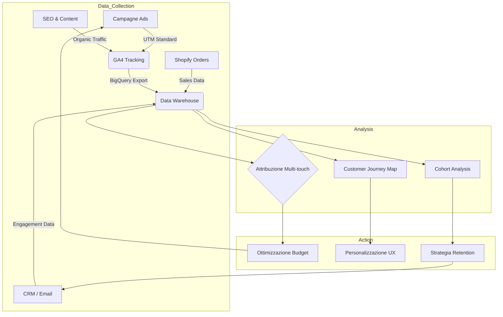
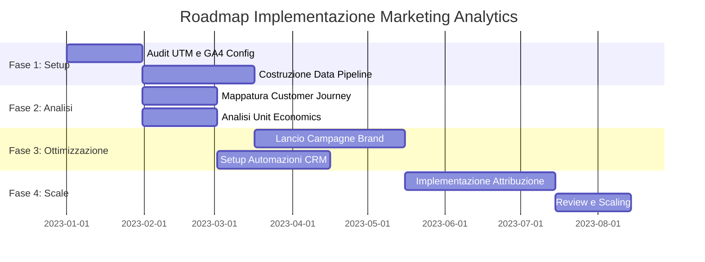
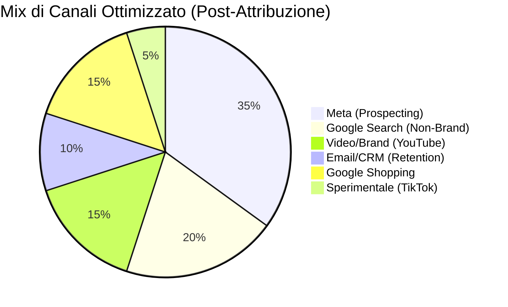

## Contesto Aziendale

**Azienda:** *ModaVeloce S.r.l.* (nome fittizio)
**Settore:** E-commerce Fashion & Apparel
**Mercato:** Italia (80%) ed Europa (20%)
**Dimensioni:** 50 dipendenti, fatturato annuo €12M

ModaVeloce è un brand nativo digitale che ha visto una rapida crescita negli ultimi 3 anni grazie a campagne aggressive su Meta Ads. Tuttavia, la crescita ha iniziato a stagnare. Il costo di acquisizione cliente (CAC) è aumentato del 45% nell'ultimo anno, mentre il Lifetime Value (LTV) è rimasto piatto.

L'azienda opera in silos: il team Performance Marketing non comunica con il team Brand, e i dati risiedono in piattaforme separate (Google Ads, Meta Business Manager, Klaviyo, Shopify). Non esiste una "Single Source of Truth".

### Dati Iniziali (Ultimo Trimestre)

| Metrica | Valore Attuale | Target Settore | Note |
| :--- | :--- | :--- | :--- |
| **CAC (Blended)** | €45,00 | €30,00 | In costante aumento |
| **ROAS (Meta)** | 2.1x | 4.0x | Calato da 3.5x |
| **LTV (1 anno)** | €120,00 | €180,00 | Basso tasso di riacquisto |
| **Brand Awareness** | Bassa | Media | Traffico diretto < 10% |
| **Attribuzione** | Last Click (GA4) | Multi-touch | Sottostima canali Top-Funnel |

**Problema Principale:** L'inefficienza della spesa pubblicitaria dovuta a un modello di attribuzione errato e la mancanza di una strategia di brand a lungo termine, unite a una scarsa valorizzazione della base clienti esistente (CRM).

## Obiettivi del Progetto

Il progetto di trasformazione "Data-Driven Marketing" si pone i seguenti obiettivi misurabili a 12 mesi:

1.  **Ridurre il CAC del 25%** (da €45 a €33,75) ottimizzando il mix di canali e migliorando il Quality Score degli annunci.
2.  **Aumentare il LTV del 20%** (da €120 a €144) attraverso segmentazione CRM e automazioni email personalizzate.
3.  **Implementare una Marketing Data Pipeline unificata** che centralizzi i dati di GA4, Ads e CRM in un Data Warehouse per un'attribuzione multi-channel.
4.  **Incrementare la Brand Search Volume del 30%** come proxy della Brand Awareness, lanciando campagne di brand misurabili.

**Vincoli:** Budget marketing invariato (riallocazione interna), stack tecnologico esistente (Shopify, Klaviyo, GA4) da integrare, non sostituire.

## Analisi e Strategia

Per raggiungere gli obiettivi, applicheremo un approccio olistico che integra i concetti del modulo: dalla standardizzazione dei dati (UTM, Pipeline) all'analisi strategica (Attribuzione, Unit Economics, Brand Equity).

### 1. Data Foundation & Governance
Il primo passo è "pulire la casa". Implementeremo una tassonomia rigorosa per il tracciamento (**Analisi End-to-End con UTM**) e configureremo **GA4 Avanzato** per esportare i dati grezzi su BigQuery.

### 2. Strategia Full-Funnel
Abbandoneremo la logica puramente "performance" per un approccio bilanciato.
- **Top of Funnel:** Campagne di Brand Awareness (YouTube, Meta Reach) misurate con Brand Lift Studies.
- **Middle of Funnel:** Traffico qualificato tramite SEO e Content Marketing.
- **Bottom of Funnel:** Retargeting dinamico e Google Shopping.

### 3. Customer Retention
Utilizzeremo **CRM e Email Analytics** per mappare il **Customer Journey** e attivare flussi automatici basati su trigger comportamentali, migliorando la Unit Economics.

### Diagramma della Strategia

**Decisioni Chiave:**
*   **Modello 70-20-10:** Allocazione budget: 70% Performance collaudata, 20% Brand Building, 10% Sperimentazione (es. TikTok).
*   **Attribuzione Data-Driven:** Passaggio da Last-Click a un modello algoritmico (o basato sui dati) per valutare l'impatto dei canali di awareness.
*   **Focus su Owned Media:** Investimento pesante su Email e SEO per ridurre la dipendenza dal Paid Media.

## Implementazione

Il progetto si articola in 4 fasi operative su 12 mesi.

### Timeline di Progetto

### Dati Intermedi: Audit dei Canali (Mese 3)

Dopo la correzione del tracciamento UTM, è emersa la vera efficacia dei canali:

| Canale | Conversioni (Last Click) | Conversioni (Data-Driven) | Variazione | Azione Presa |
| :--- | :--- | :--- | :--- | :--- |
| Meta Ads (Prospecting) | 500 | 850 | +70% | Budget Aumentato |
| Google Search (Brand) | 1200 | 900 | -25% | Budget Ridotto (Cannibalizzazione) |
| Email Marketing | 300 | 450 | +50% | Investimento in Creatività |
| Display / Video | 50 | 200 | +300% | Mantenuto per Awareness |

**Problema Incontrato:** Discrepanza dei dati tra Meta Ads Manager e GA4.
**Soluzione:** Implementazione di *Enhanced Conversions* e utilizzo del Data Warehouse come "Source of Truth" unificata, accettando una tolleranza del 10-15% dovuta a cookie policy e iOS privacy.

## Risultati

A 12 mesi dall'avvio, ModaVeloce ha trasformato la sua struttura di marketing.

### Performance KPI: Prima vs Dopo

| KPI | Prima (T0) | Dopo (T12) | Variazione | Obiettivo Raggiunto? |
| :--- | :--- | :--- | :--- | :--- |
| **CAC** | €45,00 | €34,50 | -23% | Quasi (Target -25%) |
| **LTV (1 anno)** | €120,00 | €155,00 | +29% | Sì (Superato) |
| **ROAS Blended** | 2.1x | 3.4x | +61% | Sì |
| **Brand Search Vol** | 1.5k/mese | 2.8k/mese | +86% | Sì (Superato) |
| **% Fatturato da Email** | 12% | 28% | +133% | Sì |

### Analisi ROI

L'investimento in infrastruttura dati e consulenza è stato di €50.000.
Il risparmio ottenuto dall'ottimizzazione dell'ad spend (riduzione sprechi) è stato di €120.000 su base annua.
L'incremento di fatturato da LTV (retention) è stato di €200.000.

**ROI del Progetto** = ((120.000 + 200.000) - 50.000) / 50.000 = **540%**

### Visualizzazione Allocazione Budget Ottimizzata

## Lezioni Apprese

1.  **La qualità del dato vince sull'algoritmo:** Senza UTM rigorosi e tassonomie pulite, anche i modelli di attribuzione più avanzati falliscono ("Garbage In, Garbage Out").
2.  **Il Brand abbassa il CAC:** Le campagne di pura awareness, sebbene non convertano subito, creano un "bacino" di utenti che convertono successivamente a costi inferiori.
3.  **L'attribuzione non è perfetta:** Non esiste un modello perfetto. L'obiettivo è essere "meno in errore" rispetto al Last Click e prendere decisioni direzionali migliori.
4.  **Il CRM è una miniera d'oro:** Spesso trascurato a favore dell'acquisizione, il database clienti è l'asset con il ROI più alto se attivato correttamente.
5.  **Silos organizzativi bloccano i dati:** La barriera più grande non è tecnica ma culturale. Marketing e Analisti devono lavorare insieme quotidianamente.
6.  **Misurare l'incrementabilità:** Oltre all'attribuzione, test di incrementabilità (es. geo-lift) sono essenziali per validare il vero impatto dei canali.

## Domande di Discussione

1.  Come cambieresti la strategia di attribuzione se il 90% delle conversioni avvenisse da mobile (in-app)?
2.  Quali rischi comporta spostare budget dal Performance Marketing (risultati immediati) al Brand Marketing (risultati a lungo termine) e come li mitigeresti agli occhi del CEO?
3.  Se il LTV non fosse aumentato nonostante le automazioni email, quali altre leve di Retention avresti analizzato?
4.  Come utilizzeresti i dati di "Social Media Analytics" per informare la creazione di contenuti SEO?
5.  In uno scenario cookieless, come evolverebbe la "Marketing Data Pipeline" progettata?

**Cosa faresti diversamente?**
*   *Se avessi metà del budget:* Mi concentrerei esclusivamente sull'ottimizzazione del CRM e del tasso di conversione (CRO) del sito, tagliando l'advertising Top-Funnel.
*   *Se l'azienda fosse B2B:* Sostituirei le metriche e-commerce (CAC/LTV transazionale) con metriche di Lead Quality (MQL/SQL) e Pipeline Velocity, e punterei molto di più su LinkedIn e Content Marketing educativo.
