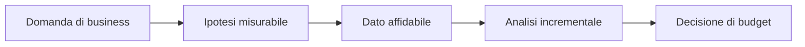

# Caso studio: strategia marketing data-driven

Una società SaaS si trova davanti a una scelta strategica per il prossimo trimestre: aumentare il budget paid, ripulire il nurturing oppure spostare il focus sul brand. I dati che ha in mano sono reali ma incompleti, e raccontano storie contrastanti: costi, revenue, conversioni, saturazione e qualità dei lead non puntano tutti nella stessa direzione. Il valore di questo caso studio sta proprio qui, nel mostrare come si gestiscono segnali che si contraddicono quando bisogna comunque decidere.

## Il problema da risolvere

Nel marketing analytics il lavoro vero è trasformare budget, canali, creatività e audience in decisioni misurabili, senza confondere il volume con l'attribuzione e l'attribuzione con l'incrementalità. Non interessa apprezzare un concetto astratto. Interessa capire quale decisione migliora se la appoggi a dati affidabili e a una stima onesta di quanto ti puoi sbagliare.

## Come ragionare sul caso



Il processo è sequenziale. Prima definisci la domanda, poi la traduci in un'ipotesi osservabile, verifichi che il dato regga e solo alla fine decidi. Chi salta le fasi intermedie produce analisi eleganti ma fragili, che cadono al primo controllo serio.

| Passaggio | Domanda guida | Output atteso |
|---|---|---|
| Framing | Quale decisione deve cambiare? | Una scelta concreta, non una curiosità |
| Misura | Quale segnale rappresenta il fenomeno? | Metrica, fonte e granularità |
| Confronto | Rispetto a quale baseline interpreto il risultato? | Benchmark o controfattuale plausibile |
| Azione | Che cosa faccio se il segnale supera la soglia? | Decisione, owner e prossimo controllo |

## Mettere ordine tra segnale, baseline e decisione

Conviene scrivere il caso come relazione tra quattro cose: l'unità di analisi, il segnale che osservi, la baseline rispetto a cui lo leggi e la decisione che ne consegue. La tabella tiene insieme questi elementi e il rischio che li attraversa.

| Elemento | Definizione operativa |
|---|---|
| Unità | campagna, coorte, touchpoint o segmento cliente |
| Segnale | margine incrementale, CAC payback, conversion rate corretto, lift o retention generata |
| Baseline | periodo precedente, gruppo holdout, mercato comparabile o benchmark storico |
| Decisione | spostare risorse, cambiare messaggio, fermare una tattica o scalare un esperimento |
| Rischio | confondere correlazione, qualità del dato e causalità decisionale |

Una metrica serve solo se riduce l'incertezza su una decisione precisa. Se non cambia nessuna scelta resta documentazione. Se cambia una scelta senza che tu abbia messo controlli, diventa rischio.

## Caso pratico: il canale con CPA basso

Un team growth deve decidere se aumentare il budget su un canale che ha un CPA basso ma vendite marginali deboli. Il punto è separare il segnale utile dal rumore, tenendo insieme metrica, modello mentale e decisione economica.

| Evidenza | Interpretazione prudente | Decisione conseguente |
|---|---|---|
| Segnale positivo ma non isolato | Il fenomeno esiste, ma la causa è incerta | Cercare baseline o holdout |
| Segmento con risposta diversa | L'effetto medio nasconde eterogeneità | Analizzare coorti o sottogruppi |
| Costo operativo crescente | Il risultato va valutato sul margine | Applicare soglie economiche |

## Esercitarsi sul caso

Comincia con qualcosa di stretto: scrivi in cinque righe una decisione reale legata al caso, indicando obiettivo, metrica primaria, baseline, rischio principale e azione prevista. Una sola metrica primaria, non tre.

Poi allarga il quadro. Costruisci una tabella con almeno tre segmenti o scenari e, per ciascuno, scrivi il segnale che osservi, una spiegazione alternativa plausibile e il controllo che faresti prima di decidere. È l'esercizio che ti abitua a non accontentarti della prima lettura.

Quando te la senti, prova la versione più ambiziosa: disegna un piano di validazione completo, con ipotesi, dati necessari, criterio di esclusione, soglia decisionale e controllo da fare dopo aver deciso. La domanda che chiude tutto è una sola: cosa ti farebbe cambiare idea.

Per i dati puoi partire da export campagne, costi media, eventi web o app, CRM, transazioni, survey brand e log di consenso. Se non hai dati reali a portata di mano, costruisci un dataset sintetico di 200-500 righe con almeno una colonna temporale, una colonna segmento, una metrica di outcome e una variabile di esposizione.

## Errori frequenti

Il primo è confondere correlazione e causalità. Due metriche che si muovono insieme non dicono nulla sul nesso causale: solo un test A/B o un'analisi controfattuale lo stabiliscono, e finché non li hai conviene dichiararlo apertamente in ogni raccomandazione.

Il secondo è ignorare la stagionalità. Mettere a confronto novembre e dicembre senza correggere per le festività produce insight fuorvianti. Usa confronti anno su anno oppure medie mobili destagionalizzate.

Il terzo è non validare il grain della query. Un join che duplica le righe o un filtro applicato troppo tardi falsano il risultato senza che te ne accorga. Controlla il conteggio delle righe a ogni step, sempre.

C'è poi un errore più sottile, che riassume gli altri: trattare il risultato come una verità generale invece che come evidenza condizionata. Prima di agire, ricontrolla baseline, assunzioni e costo dell'errore.

## Verificare di aver capito

Quattro domande per mettere alla prova la lettura del caso. Qual è la decisione concreta che dovresti migliorare. Quale baseline rende interpretabile il risultato. Quale assunzione, se sbagliata, ribalterebbe la conclusione. E quale controllo minimo metteresti prima di portare la raccomandazione al tavolo. Se rispondi con sicurezza a tutte e quattro, hai applicato il caso e non solo letto.

## Riepilogo operativo

Questo caso studio vale quando tiene insieme concetto, dato e decisione. Affrontalo partendo da un problema reale, formalizza il segnale, cerca una baseline credibile, costruisci un esempio concreto e chiudi con un controllo pratico. È un laboratorio avanzato, da circa 28 minuti di studio.

## Problema reale

Questo concetto si applica quando lavori con dataset reali e hai bisogno di una struttura chiara per ragionare su Caso studio: strategia marketing data-driven. Il problema tipico è non avere un framework condiviso tra il team per valutare la soluzione, con il risultato che ogni analisi parte da presupposti diversi.

**Quando lo incontrerai:**
- Quando presenti un risultato e qualcuno chiede "ma come sei arrivato a questo numero?"
- Quando il risultato di una query cambia radicalmente cambiando un filtro
- Quando il modello che hai costruito funziona sui dati di test ma non su quelli di produzione

## Modello concettuale

Il Caso studio: strategia marketing data-driven si definisce attraverso tre dimensioni:

1. **Struttura**: come sono organizzati i dati o il processo
2. **Logica**: quale relazione causa-effetto governa il comportamento
3. **Misura**: quale metrica usi per valutare il risultato

Questo modello ti permette di scomporre qualsiasi istanza del problema nelle sue parti verificabili.

## Formalizzazione rigorosa

```sql
-- TODO: aggiungi la formalizzazione specifica per Caso studio: strategia marketing data-driven
-- Pattern per avanzato:

SELECT
    /* indica qui la tua metrica principale */
FROM
    /* indica qui la sorgente dati */
WHERE
    /* indica qui i filtri */
GROUP BY
    /* indica qui le dimensioni di raggruppamento */
```

**Principio guida:** verifica sempre che la somma delle parti sia uguale al totale.

## Esempio o caso studio

**Caso tipico (livello avanzato):**

Immaginiamo un team marketing che deve misurare la retention a 30 giorni. L'errore più comune è calcolarla come `COUNT(DISTINCT user_id)` senza filtrare per data di attivazione, includendo utenti che non hanno ancora avuto 30 giorni di tempo. La versione corretta filtra prima la cohort di attivazione e poi applica il calcolo.

```sql
WITH cohort AS (
    SELECT
        user_id,
        MIN(event_date) AS activation_date
    FROM events
    GROUP BY user_id
),
retention AS (
    SELECT
        c.activation_date,
        COUNT(DISTINCT e.user_id) AS retained_users
    FROM cohort c
    JOIN events e ON c.user_id = e.user_id
        AND e.event_date >= c.activation_date
        AND e.event_date <= c.activation_date + INTERVAL '30 days'
    GROUP BY c.activation_date
)
SELECT
    activation_date,
    retained_users,
    ROUND(retention_rate * 100, 2) AS retention_pct
FROM retention;
```

## Lab / esercizio

**Esercizio — livello avanzato**

1. **Prepara l'ambiente:** carica il dataset di esempio nel tuo warehouse
2. **Applica il pattern:** scrivi la query che implementa il modello concettuale per il tuo caso
3. **Verifica:** controlla che il risultato sia coerente con le tue aspettative usando un sanity check

**Tempo stimato:** 20-30 minuti

## Errore tipico da evitare

**L'errore più comune a livello avanzato:**

Non distinguere tra una metrica calcolata su tutta la popolazione e una metrica calcolata su una sotto-popolazione specifica. Ad esempio, calcolare il tasso di conversione medio senza filtrare per canale di acquisizione porta a decisioni sbagliate perché il mix di canali cambia nel tempo.

**Come evitarlo:**
- Chiediti sempre: "rispetto a cosa sto misurando questo?"
- Verifica che il denominatore sia corretto prima di fidarti del numeratore
- Usa un gruppo di controllo quando possibile

## Quiz o checkpoint

1. Qual è la differenza tra la metrica calcolata su tutta la popolazione e quella calcolata su una cohort?
2. Scrivi il codice SQL che implementa il modello concettuale per un caso a tua scelta
3. Quale sanity check useresti per verificare che il risultato sia corretto?

---

*Queste sezioni sono placeholder generici. Sostituisci con contenuto specifico per la lezione.*

### Livello base

Spiegazione intuitiva di Caso studio: strategia marketing data-driven:

Il concetto alla base è semplice: invece di fare affidamento sull'intuizione, usi un metodo riproducibile. A livello base, ti basta capire quale domanda stai ponendo e quali dati hai a disposizione per risponderci.

### Livello intermedio

Applicazione concreta di Caso studio: strategia marketing data-driven:

A questo livello applichi il concetto a un caso specifico. Ad esempio, se stai analizzando la retention, il tuo dataset ha dimensioni come data di attivazione, data di evento, e user_id. La segmentazione per canale di acquisizione ti dà insight aggiuntivi che il dato grezzo non mostra.

### Livello research-grade

Approfondimento teorico:

Per chi vuole capire il fondamento teorico, la letteratura classica include:
- Kimball, "The Data Warehouse Toolkit" — per approcci dimensionali
- McKinney, "Python for Data Analysis" — per implementazione pratica
- Aggiora i riferimenti con paper recenti specifici per il tuo dominio

### Dataset e materiali consigliati

**Per esercitarti:**
- Usa il dataset di esempio fornito nella lezione
- Per un challenge aggiuntivo, prova con dati pubblici come quelli di Kaggle

**Tool consigliati:**
- dbt Core per trasformazioni
- Metabase o Superset per visualizzazione