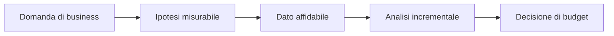

# Caso studio: strategia marketing data-driven

Una società SaaS si trova davanti a una scelta strategica per il prossimo trimestre: aumentare il budget paid, ripulire il nurturing oppure spostare il focus sul brand. I dati che ha in mano sono reali ma incompleti, e raccontano storie contrastanti: costi, revenue, conversioni, saturazione e qualità dei lead non puntano tutti nella stessa direzione. Il valore di questo caso studio sta proprio qui, nel mostrare come si gestiscono segnali che si contraddicono quando bisogna comunque decidere.

## Il problema da risolvere

Nel marketing analytics il lavoro vero è trasformare budget, canali, creatività e audience in decisioni misurabili, senza confondere il volume con l'attribuzione e l'attribuzione con l'incrementalità. Non interessa apprezzare un concetto astratto. Interessa capire quale decisione migliora se la appoggi a dati affidabili e a una stima onesta di quanto ti puoi sbagliare.

## Come ragionare sul caso

Il processo è sequenziale. Prima definisci la domanda, poi la traduci in un'ipotesi osservabile, verifichi che il dato regga e solo alla fine decidi. Chi salta le fasi intermedie produce analisi eleganti ma fragili, che cadono al primo controllo serio.

| Passaggio | Domanda guida | Output atteso |
|---|---|---|
| Framing | Quale decisione deve cambiare? | Una scelta concreta, non una curiosità |
| Misura | Quale segnale rappresenta il fenomeno? | Metrica, fonte e granularità |
| Confronto | Rispetto a quale baseline interpreto il risultato? | Benchmark o controfattuale plausibile |
| Azione | Che cosa faccio se il segnale supera la soglia? | Decisione, owner e prossimo controllo |

## Mettere ordine tra segnale, baseline e decisione

Conviene scrivere il caso come relazione tra quattro cose: l'unità di analisi, il segnale che osservi, la baseline rispetto a cui lo leggi e la decisione che ne consegue. La tabella tiene insieme questi elementi e il rischio che li attraversa.

| Elemento | Definizione operativa |
|---|---|
| Unità | campagna, coorte, touchpoint o segmento cliente |
| Segnale | margine incrementale, CAC payback, conversion rate corretto, lift o retention generata |
| Baseline | periodo precedente, gruppo holdout, mercato comparabile o benchmark storico |
| Decisione | spostare risorse, cambiare messaggio, fermare una tattica o scalare un esperimento |
| Rischio | confondere correlazione, qualità del dato e causalità decisionale |

Una metrica serve solo se riduce l'incertezza su una decisione precisa. Se non cambia nessuna scelta resta documentazione. Se cambia una scelta senza che tu abbia messo controlli, diventa rischio.

## Caso pratico: il canale con CPA basso

Un team growth deve decidere se aumentare il budget su un canale che ha un CPA basso ma vendite marginali deboli. Il punto è separare il segnale utile dal rumore, tenendo insieme metrica, modello mentale e decisione economica.

| Evidenza | Interpretazione prudente | Decisione conseguente |
|---|---|---|
| Segnale positivo ma non isolato | Il fenomeno esiste, ma la causa è incerta | Cercare baseline o holdout |
| Segmento con risposta diversa | L'effetto medio nasconde eterogeneità | Analizzare coorti o sottogruppi |
| Costo operativo crescente | Il risultato va valutato sul margine | Applicare soglie economiche |

## Esercitarsi sul caso

Comincia con qualcosa di stretto: scrivi in cinque righe una decisione reale legata al caso, indicando obiettivo, metrica primaria, baseline, rischio principale e azione prevista. Una sola metrica primaria, non tre.

Poi allarga il quadro. Costruisci una tabella con almeno tre segmenti o scenari e, per ciascuno, scrivi il segnale che osservi, una spiegazione alternativa plausibile e il controllo che faresti prima di decidere. È l'esercizio che ti abitua a non accontentarti della prima lettura.

Quando te la senti, prova la versione più ambiziosa: disegna un piano di validazione completo, con ipotesi, dati necessari, criterio di esclusione, soglia decisionale e controllo da fare dopo aver deciso. La domanda che chiude tutto è una sola: cosa ti farebbe cambiare idea.

Per i dati puoi partire da export campagne, costi media, eventi web o app, CRM, transazioni, survey brand e log di consenso. Se non hai dati reali a portata di mano, costruisci un dataset sintetico di 200-500 righe con almeno una colonna temporale, una colonna segmento, una metrica di outcome e una variabile di esposizione.

## Errori frequenti

Il primo è confondere correlazione e causalità. Due metriche che si muovono insieme non dicono nulla sul nesso causale: solo un test A/B o un'analisi controfattuale lo stabiliscono, e finché non li hai conviene dichiararlo apertamente in ogni raccomandazione.

Il secondo è ignorare la stagionalità. Mettere a confronto novembre e dicembre senza correggere per le festività produce insight fuorvianti. Usa confronti anno su anno oppure medie mobili destagionalizzate.

Il terzo è non validare il grain della query. Un join che duplica le righe o un filtro applicato troppo tardi falsano il risultato senza che te ne accorga. Controlla il conteggio delle righe a ogni step, sempre.

C'è poi un errore più sottile, che riassume gli altri: trattare il risultato come una verità generale invece che come evidenza condizionata. Prima di agire, ricontrolla baseline, assunzioni e costo dell'errore.

## Verificare di aver capito

Quattro domande per mettere alla prova la lettura del caso. Qual è la decisione concreta che dovresti migliorare. Quale baseline rende interpretabile il risultato. Quale assunzione, se sbagliata, ribalterebbe la conclusione. E quale controllo minimo metteresti prima di portare la raccomandazione al tavolo. Se rispondi con sicurezza a tutte e quattro, hai applicato il caso e non solo letto.

## Riepilogo operativo

Questo caso studio vale quando tiene insieme concetto, dato e decisione. Affrontalo partendo da un problema reale, formalizza il segnale, cerca una baseline credibile, costruisci un esempio concreto e chiudi con un controllo pratico. È un laboratorio avanzato, da circa 28 minuti di studio.
