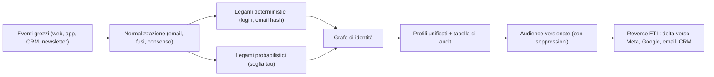

Una persona scopre un paio di scarpe da corsa su Instagram dal telefono, torna sul sito da desktop una settimana dopo, apre la newsletter da un indirizzo email diverso e compra dall'app dopo aver fatto il login. Per il marketing sono quattro righe in quattro tabelle, per l'azienda è una sola persona con un solo budget di attenzione. Questo è uno scenario costruito, con numeri di esempio, ma descrive il problema di fondo di ogni e-commerce: il web frammenta le identità, e le metriche costruite sul frammento sbagliano.

> **Idea chiave:** Una CDP vale quanto la qualità dei legami tra identificatori: il match deterministico costruisce la spina dorsale, quello probabilistico si confina a soglie dichiarate, e ogni fusione lascia una traccia verificabile.

La Customer Data Platform è, nel modo più semplice, un ciclo di tabelle: eventi normalizzati, legami tra identificatori, profili unificati, audience versionate. Se non ricuce i frammenti, il retargeting insegue chi ha già comprato. Se ricuce troppo, fonde due coinquilini che condividono rete e dispositivo in un unico super-cliente con gusti incoerenti e due indirizzi di consegna.

## Una persona, quattro righe

La frammentazione non è un difetto del tracciamento, è l'architettura del web. Ogni contesto genera il proprio identificatore con un ciclo di vita diverso: l'`anonymous_id` del tracker web, il `device_id` dell'app, i cookie che su Safari scadono dopo sette giorni, il `member_id` che compare dopo il login, l'email trasformata in hash che arriva dalla newsletter.

Il danno più concreto è sul denominatore delle metriche. Prendiamo un retailer con 250.000 identificatori anonimi attivi in un mese e 2.750 ordini, con numeri di esempio. Il calcolo senza risoluzione di identità dà: 2.750 ordini / 250.000 identificatori = 1,1% di conversione. Dopo la risoluzione, gli stessi identificatori corrispondono a 114.500 persone reali, con una media di 250.000 / 114.500 = 2,2 identificatori per persona. La conversione per persona diventa 2.750 / 114.500 = 2,4%, più del doppio.

| Metrica | Senza risoluzione | Con risoluzione |
| --- | --- | --- |
| Denominatore | 250.000 identificatori | 114.500 persone |
| Ordini | 2.750 | 2.750 |
| Conversione | 1,1% | 2,4% |
| Lettura del team | "Il sito non converte" | "La conversione è nella norma" |

Il team media che legge 1,1% conclude che il sito non converte e aumenta il budget di acquisizione, mentre il problema è nel denominatore e non nella creatività. Lo stesso errore avvelena il CAC per canale, il tasso di ritorno e ogni analisi per coorte.

## Come funziona una CDP

Il percorso di un evento dentro una CDP attraversa quattro fasi. Gli eventi arrivano da fonti diverse e vengono normalizzati: email in minuscolo, fusi orari unificati, telefono in formato internazionale. Poi un motore di identity resolution costruisce i legami tra identificatori. Le componenti connesse del grafo diventano profili unificati. Infine le audience, definite sul profilo, vengono sincronizzate verso le destinazioni.



Un vincolo attraversa tutte le fasi: il consenso. Quando due identificatori si fondono, le basi giuridiche non si sommano: vale la più restrittiva, e la revoca su un canale si propaga alle audience già sincronizzate. Il consenso va quindi trattato come un attributo del legame e non come un campo del profilo, altrimenti una fusione può rendere trattabile un dato che non lo era.

La latenza decide l'architettura. Un abbandono carrello da recuperare via email può aspettare quindici minuti. Una personalizzazione on-site deve rispondere in meno di 200 millisecondi. Una lookalike su Meta si aggiorna una volta al giorno. La regola pratica è batch giornaliero per prospecting e reporting, micro-batch da 5-15 minuti per email e SMS di lifecycle, streaming solo dove il ritardo costa soldi misurabili. Una buona strumentazione distingue tre tipi di evento: identificazione, che lega due identificatori, comportamento, che descrive un'azione, e stato, che descrive una proprietà del profilo come il livello di fedeltà.

## Match deterministico e probabilistico

Il matching deterministico lavora su identificatori verificati. Se due eventi condividono lo stesso hash di email normalizzata, la probabilità che appartengano a persone diverse è trascurabile, sopra il 99% in dataset puliti. È la spina dorsale del grafo: pochi match, quasi tutti corretti. Il limite è la copertura, perché in molti e-commerce solo il 15-35% del traffico è autenticato.

Il matching probabilistico lavora su segnali deboli come indirizzo IP, user agent, risoluzione dello schermo, orari di attività, e restituisce una probabilità, non un verdetto. Due identificatori si fondono quando la probabilità supera una soglia tau. Alzare tau aumenta la precisione e riduce il richiamo, abbassarla fa il contrario.

Un esempio numerico rende il compromesso concreto. Supponiamo che nel dataset esistano 1.000 coppie di identificatori che appartengono realmente alla stessa persona. Con tau = 0,9 il motore ha richiamo del 35% e precisione dell'87%. Con tau = 0,6 il richiamo sale al 60% e la precisione scende al 70%. Passaggi per tau = 0,9: coppie trovate corrette = 1.000 × 0,35 = 350; fusioni totali = 350 / 0,87 = circa 402; fusioni sbagliate = 402 − 350 = 52. Passaggi per tau = 0,6: coppie corrette = 1.000 × 0,60 = 600; fusioni totali = 600 / 0,70 = circa 857; fusioni sbagliate = 857 − 600 = 257.

Abbassare la soglia da 0,9 a 0,6 recupera 250 coppie corrette in più ma introduce 205 fusioni sbagliate in più. Non esiste una soglia giusta in assoluto, esiste quella giusta per l'uso: per consenso e fatturazione serve una precisione quasi perfetta, per allargare un'audience di prospecting si tollera rumore, perché un errore costa un'impression sprecata e non una violazione.

## Il grafo e la scelta della piattaforma

Il grafo di identità ha nodi che rappresentano identificatori e archi che rappresentano evidenze di equivalenza. Le componenti connesse diventano profili unificati. Non tutti gli archi pesano uguale: un login con email verificata vale più di dieci sessioni dallo stesso IP, e un segnale debole non deve mai spezzare un legame forte. Lo scheletro è sempre lo stesso: normalizzare, costruire i legami, risolvere le componenti.

```sql
-- Normalizza le email prima di ogni confronto
WITH normalized AS (
  SELECT event_id, event_ts, anonymous_id, device_id, user_id,
         LOWER(TRIM(email)) AS email_clean
  FROM raw_events
  WHERE event_ts >= CURRENT_DATE - INTERVAL '90 days'
),
-- Legami deterministici: ogni riga e' un'evidenza forte
deterministic_edges AS (
  SELECT DISTINCT
    COALESCE(user_id, 'sha256:' || SHA256(email_clean)) AS canonical_id,
    anonymous_id AS alias_id
  FROM normalized
  WHERE user_id IS NOT NULL OR email_clean IS NOT NULL
)
SELECT * FROM deterministic_edges;
```

Il pezzo che manca in molti progetti è la tabella di audit: per ogni fusione, chi o quale regola ha deciso, con quale confidenza e su quali evidenze. Senza audit nessuno riesce a spiegare perché un profilo contiene due persone, né a disfare la fusione.

Due metriche tengono sotto controllo il grafo. Il tasso di unificazione è la quota di identificatori anonimi legati a un profilo noto. Il tasso di collisione è la quota di profili con segnali incoerenti, per esempio due date di nascita diverse o due paesi di residenza. Un'unificazione al 45% con collisioni sotto l'1% è sana. Un'unificazione al 75% con collisioni al 6% è un allarme: si stanno fondendo estranei per inseguire un numero da mostrare nei report.

La scelta della piattaforma si riduce a due famiglie con costi diversi.

| Scelta | Vantaggio | Costo |
| --- | --- | --- |
| Suite chiusa (Segment, Bloomreach, Insider) | Time-to-value di settimane, centinaia di connettori | Lock-in, logica di match non ispezionabile, prezzi per utente tracciato |
| Composable (warehouse, Snowplow o RudderStack, dbt, reverse ETL) | Logica trasparente e testabile, costi legati a storage e calcolo | Data engineer dedicati, setup di mesi, real-time da costruire |

Il segnale per cambiare piattaforma è quando la fattura per utenti tracciati cresce più in fretta del fatturato attribuito.

## Attivazione delle audience a delta

Una buona audience è codice versionato. Ha una finestra temporale esplicita, "ha visitato la pagina prezzi negli ultimi 14 giorni" e non "è interessato". Include le soppressioni nella definizione, per esempio chi ha già comprato. Porta metadati operativi: titolare, ipotesi, destinazione, frequenza di aggiornamento.

Il reverse ETL calcola il delta, cioè chi è entrato e chi è uscito dall'ultima sincronizzazione, e lo spedisce alle API con ripetizioni controllate e idempotenza. Il consenso si filtra sul delta, non a valle: un utente che ha revocato il consenso pubblicitario non deve mai arrivare alla destinazione.

```python
# Sincronizzazione a delta con filtro di consenso
def build_delta(current: set, previous: set):
    entrati = current - previous   # nuovi ingressi da aggiungere
    usciti = previous - current    # da rimuovere o sopprimere
    return entrati, usciti

def sync_audience(segmento: str, entrati: set, usciti: set, consenso: dict):
    # mai sincronizzare chi ha revocato il consenso advertising
    entrati_ok = {u for u in entrati if consenso.get(u) == "granted"}
    api.add(segmento, entrati_ok)
    api.remove(segmento, usciti)
```

Il delta riduce chiamate e costi, e rende le sincronizzazioni verificabili: se ieri l'audience aveva 48.000 profili e oggi 48.600, con 900 entrati e 300 usciti, la differenza 900 − 300 = +600 deve tornare. Se non torna, c'è una perdita nel flusso.

## Misurare l'effetto con un holdout

Senza holdout, ogni campagna che converte al 4% è un numero senza controfattuale. Un esempio con 50.000 profili nell'audience, di cui il 10% tenuto fuori dalla campagna. Il gruppo esposto conta 45.000 profili e converte al 4,0%, il holdout conta 5.000 profili e converte al 3,2%. Passaggi: ordini del gruppo esposto = 45.000 × 0,040 = 1.800. Lift relativo = (4,0% − 3,2%) / 3,2% = 25%. Ordini incrementali = (0,040 − 0,032) × 45.000 = 360. Quota degli ordini davvero causata dalla campagna = 360 / 1.800 = 20%.

L'80% degli ordini sarebbe arrivato comunque. È il motivo per cui il retargeting senza controllo sembra un miracolo: colpisce chi stava già per comprare. L'unificazione rende i test più puliti perché riduce la contaminazione, cioè la presenza dello stesso individuo sia tra gli esposti sia nell'holdout sotto due identificatori diversi, che diluisce il lift verso zero. Va controllata anche la stabilità degli identificatori: se il 5% dei profili cambia assegnazione ogni mese, ogni coorte longitudinale è inaffidabile.

## Il caso Netflix e l'identità certa

Nel 2015 Carlos Gomez-Uribe e Neil Hunt hanno descritto il sistema di raccomandazione di Netflix in un articolo accademico diventato un riferimento del settore: circa l'80% delle ore guardate passa da contenuti suggeriti dal sistema. Il caso funziona perché quasi tutto il traffico è autenticato tramite `member_id`. Il grafo di identità è banale, e la complessità sta nell'attivazione.

Per un e-commerce con il 70% di traffico anonimo la lezione è opposta. Senza identità certa conviene investire nella risoluzione deterministica, con login incentivato, email catturata al primo contatto e sincronizzazione dei dati di app e sito, invece di copiare l'architettura di chi non ha quel problema.

## Errori tipici con le CDP

### Soglie basse per gonfiare l'unificazione

Il sintomo è un tasso di unificazione che sale al 75% e collisioni che salgono con lui. Sembra ragionevole perché un numero alto sembra un risultato di progetto. Si corregge fissando la soglia per uso, monitorando il tasso di collisione accanto a quello di unificazione e limitando il probabilistico alle audience di prospecting.

### Un grafo senza traccia delle decisioni

Il sintomo è un profilo con due persone dentro che nessuno riesce a spiegare né a separare. Succede perché la fusione viene calcolata e non registrata. Si evita con una tabella di audit che riporta regola, confidenza ed evidenze, e con regole versionate.

### Audience sincronizzate senza consenso né controllo

Il sintomo è una sincronizzazione che include utenti con consenso revocato e una campagna che sembra funzionare senza che nessuno sappia quanto. Si corregge filtrando il consenso sul delta e riservando sempre un holdout, di norma il 10% dell'audience.

## Verifica sull'identità e sulle audience

1. Perché la conversione calcolata senza risoluzione di identità risulta più bassa del reale?

<details>
<summary>Mostra risposta</summary>

Perché la stessa persona viene contata più volte nel denominatore, una per ogni identificatore. Con 2.750 ordini, 250.000 identificatori danno 1,1%, mentre 114.500 persone unificate danno 2,4%.

</details>

2. Quando due identificatori con basi giuridiche diverse si fondono, quale vale?

<details>
<summary>Mostra risposta</summary>

Vale la più restrittiva. Le basi giuridiche non si sommano, e una revoca su un canale deve propagarsi alle audience già sincronizzate.

</details>

3. Con tau = 0,9, richiamo del 35% e precisione dell'87% su 1.000 coppie vere, quante fusioni sono sbagliate?

<details>
<summary>Mostra risposta</summary>

Le coppie corrette sono 1.000 × 0,35 = 350. Le fusioni totali sono 350 / 0,87, circa 402. Le sbagliate sono 402 − 350 = circa 52.

</details>

4. Unificazione al 75% con collisioni al 6%: è un buon risultato?

<details>
<summary>Mostra risposta</summary>

No, è un allarme: si stanno fondendo estranei per inseguire un numero. Un'unificazione al 45% con collisioni sotto l'1% è una situazione sana.

</details>

5. Un'audience esposta di 45.000 profili converte al 4,0%, un holdout di 5.000 converte al 3,2%. Quanti ordini sono incrementali?

<details>
<summary>Mostra risposta</summary>

Gli ordini incrementali sono (0,040 − 0,032) × 45.000 = 360, cioè il 20% dei 1.800 ordini del gruppo esposto. Il lift relativo è 25%, ma l'80% degli ordini sarebbe avvenuto comunque.

</details>
