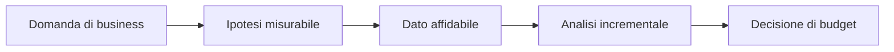

# Cheat Sheet — Analisi di Marketing


Immagina un team marketing che deve capire cosa ha creato domanda e cosa ha solo intercettato domanda già esistente alla fine di una campagna, quando il budget è stato speso e restano domande scomode. Sul tavolo non c'è un esercizio astratto: c'è la pressione concreta di difendere una lettura onesta di canali, funnel, brand e marginalità. **Cheat Sheet — Analisi di Marketing** entra qui, nel punto in cui una scelta deve diventare più chiara, più misurabile e più difendibile.

## Una scena da cui partire

La lezione va letta con questo atteggiamento: non collezionare frasi da ricordare, ma cercare il passaggio che trasforma una misura di marketing che regge davanti a finanza e direzione in lavoro reale. Questa lezione funziona come una postazione di lavoro: torna qui quando devi ricordare cosa controllare, in che ordine e con quale criterio. Il livello è avanzato: non cercare una ricetta unica, cerca i vincoli che cambiano la risposta.

- **Contesto:** Quale regola serve sotto pressione?
- **Metodo:** Quale eccezione non devi dimenticare?
- **Applicazione:** Quale checklist useresti domani in un progetto reale?

## Oltre il Last-Click: La Complessità dell'Attribuzione Moderna

Per decenni, il marketing digitale ha vissuto sotto la tirannia del modello di attribuzione "last-click". La sua logica è seducente nella sua semplicità: l'intero merito di una conversione viene assegnato all'ultimo punto di contatto con cui l'utente ha interagito. Se un cliente clicca su un annuncio Google e acquista, Google Ads riceve il 100% del credito. Questo approccio, sebbene facile da implementare e da spiegare, dipinge un quadro pericolosamente distorto della realtà. Ignora completamente il lungo e tortuoso percorso che porta un utente dalla scoperta di un brand alla decisione di acquisto. Sottovaluta sistematicamente i canali di *awareness* e *consideration* (come i social media, i contenuti del blog, le campagne display) che piantano il seme iniziale, dando un peso sproporzionato ai canali di *intent* (come la ricerca brand) che raccolgono il frutto. L'analogia è quella di dare tutto il merito del goal all'attaccante che ha spinto la palla oltre la linea, ignorando i passaggi dei centrocampisti che hanno costruito l'azione.

Per superare questa miopia, sono stati introdotti modelli basati su regole più sofisticate: *first-click* (premia la scoperta), *lineare* (distribuisce il credito equamente tra tutti i touchpoint), *time decay* (dà più peso ai touchpoint più vicini alla conversione). Sebbene rappresentino un passo avanti, condividono un difetto fondamentale: l'arbitrarietà. Chi decide che ogni touchpoint valga uguale o che il peso debba decadere con una certa curva? La vera svolta è arrivata con i modelli di attribuzione data-driven, o algoritmici. Questi modelli non si basano su regole predefinite, ma utilizzano tecniche statistiche e di machine learning per stimare il contributo marginale di ogni singolo canale. Analizzano migliaia di percorsi di conversione (e di non conversione) per capire quale touchpoint, se rimosso dal percorso, avrebbe avuto il maggior impatto negativo sulla probabilità di conversione.

Il gold standard in questo campo è l'applicazione dei **valori di Shapley**, un concetto preso in prestito dalla teoria dei giochi cooperativi. In parole semplici, il modello calcola il contributo di ogni canale considerandolo come un "giocatore" in una "coalizione" (il percorso di conversione) e calcolando il suo contributo medio su tutte le possibili combinazioni di giocatori. È computazionalmente intensivo e richiede dati a livello di utente molto granulari, ma il risultato è la stima più equa e accurata del valore di ciascun canale.

Un caso studio emblematico è quello di **Booking.com**. L'azienda, che gestisce budget pubblicitari miliardari, ha documentato pubblicamente il suo passaggio da modelli basati su regole a un approccio data-driven basato sui valori di Shapley. L'analisi ha rivelato che i modelli tradizionali sottostimavano pesantemente il valore dei canali display e social generici, mentre sopravvalutavano la ricerca brand. Implementando il nuovo modello, Booking.com è stata in grado di **ridistribuire circa il 18% del proprio budget di marketing** dai canali di fondo funnel a quelli di mid/upper funnel. Il risultato? Un **aumento complessivo del Return on Ad Spend (ROAS) del 7%** a parità di investimento, perché il budget veniva ora allocato in modo più efficiente per creare nuova domanda, non solo per raccogliere quella esistente.

## L'Equazione del Valore: Decomposizione di LTV e CAC

Due acronimi dominano qualsiasi discussione sulla sostenibilità di un business digitale: LTV (Customer Lifetime Value) e CAC (Customer Acquisition Cost). Analizzarli superficialmente è facile; comprenderli a fondo è ciò che distingue un analista competente da uno eccellente. Il CAC rappresenta il costo totale per acquisire un nuovo cliente. La sua formula base è `Costo Totale Marketing & Vendite / Numero di Nuovi Clienti Acquisiti`. La trappola qui è nella definizione di "Costo Totale". Un calcolo ingenuo potrebbe includere solo la spesa pubblicitaria diretta (il cosiddetto *paid CAC*). Un'analisi rigorosa, invece, deve calcolare il *fully-loaded CAC*, che include anche gli stipendi del team marketing e vendite, i costi dei software (CRM, automazione, analytics), le commissioni e qualsiasi altra spesa operativa legata all'acquisizione. Ad esempio, se un'azienda spende 50.000€ in ads, 30.000€ in stipendi e 5.000€ in tool in un mese, acquisendo 1.000 clienti, il suo CAC non è 50€, ma 85€. Questa distinzione è vitale per comprendere la reale efficienza del motore di crescita.

Dall'altra parte dell'equazione c'è il LTV, il valore totale che un cliente genera per l'azienda durante l'intera durata del suo rapporto. Un calcolo storico semplice potrebbe essere `(Valore Medio Ordine * Frequenza di Acquisto) * Durata Media Vita Cliente`. Tuttavia, i modelli più avanzati sono predittivi. Utilizzano tecniche statistiche come i modelli "Buy 'Til You Die" (BTYD) per prevedere il comportamento futuro di un cliente basandosi sui suoi primi acquisti, sulla recency, frequency e monetary value (RFM). Questo permette di stimare il LTV di un nuovo cliente molto prima che il suo ciclo di vita si concluda. Ad esempio, un modello predittivo potrebbe identificare che i clienti che effettuano un secondo acquisto entro 30 giorni e comprano da due categorie di prodotti diverse hanno un LTV previsto 5 volte superiore a quelli che non lo fanno. Questa informazione è oro colato per personalizzare le campagne di retention.

Il vero indicatore di salute di un business è il rapporto **LTV/CAC**. Questo rapporto misura il ritorno sull'investimento di ogni cliente acquisito. Una regola empirica ampiamente accettata nel mondo SaaS e e-commerce suggerisce che un rapporto **superiore a 3:1** indica un modello di business sano e scalabile. Un rapporto di 1:1 significa che si sta perdendo denaro su ogni cliente (a causa dei costi operativi non inclusi nel CAC). Un rapporto di 5:1 o superiore è eccezionale e giustifica investimenti aggressivi in crescita. Questo rapporto non è statico. Un'azienda può migliorarlo aumentando il LTV (attraverso programmi di loyalty, upselling, cross-selling) o diminuendo il CAC (ottimizzando le campagne, migliorando il tasso di conversione, sfruttando canali organici). L'analisi non si ferma alla media aziendale: è essenziale segmentare il rapporto LTV/CAC per canale di acquisizione, per coorte di clienti, per persona. Potreste scoprire che il canale A ha un CAC di 50€ e il canale B di 100€. A prima vista, il canale A sembra migliore. Ma se i clienti del canale A hanno un LTV di 120€ (rapporto 2.4:1) e quelli del canale B un LTV di 600€ (rapporto 6:1), il canale B è di gran lunga il più profittevole e merita più investimenti.

## L'Anatomia di un Data Stack per il Marketing Moderno

Per eseguire le analisi sofisticate di cui abbiamo discusso, è indispensabile un'infrastruttura dati robusta, spesso definita "Modern Data Stack". Dimenticate i fogli di calcolo esportati manualmente da Google Analytics e Facebook Ads. Oggi, le decisioni si basano su un flusso di dati centralizzato, modellato e attivabile. Vediamo i componenti chiave di questo stack.

1.  **Ingestion & Collection**: Il primo passo è raccogliere i dati da una miriade di fonti. Gli strumenti di *ETL/ELT (Extract, Load, Transform)* come Fivetran o Airbyte sono fondamentali. Utilizzano connettori pre-costruiti per estrarre dati grezzi da piattaforme pubblicitarie (Google Ads, Meta Ads, LinkedIn Ads), sistemi di analisi web (Google Analytics 4), CRM (Salesforce, HubSpot), piattaforme email (Klaviyo, Braze) e database di produzione. Parallelamente, le *Customer Data Platform (CDP)* come Segment o Rudderstack raccolgono dati comportamentali in tempo reale dal vostro sito web e dalla vostra app, creando un profilo unificato per ogni utente.

2.  **Warehousing**: Tutti questi dati vengono caricati in un *Cloud Data Warehouse*, che funge da unica fonte di verità (*Single Source of Truth*). Piattaforme come Snowflake, Google BigQuery o Amazon Redshift sono progettate per gestire enormi volumi di dati e consentire query complesse in pochi secondi. Avere tutti i dati – costi pubblicitari, click, impression, sessioni web, transazioni, eventi in-app, dati CRM – in un unico luogo è il prerequisito per qualsiasi analisi cross-canale.

3.  **Transformation**: I dati grezzi caricati nel warehouse sono spesso disordinati e non pronti per l'analisi. Qui entra in gioco **dbt (data build tool)**. dbt permette agli analisti di trasformare i dati usando semplice SQL. Si costruisce un processo di modellazione a strati:
    *   **Staging**: Pulizia e standardizzazione dei dati grezzi da ogni fonte.
    *   **Intermediate**: Creazione di modelli intermedi che uniscono e arricchiscono i dati. Ad esempio, unire i dati di sessione di GA4 con i dati di transazione dal database di produzione.
    *   **Marts**: Creazione di tabelle finali, aggregate e ottimizzate per specifici casi d'uso, come un `marketing_performance_mart` o un `customer_360_mart`.

Ecco un esempio pratico di come si potrebbe costruire un modello intermedio `int_marketing_spend_daily` con dbt, unificando i dati di spesa da Google Ads e Facebook Ads.

```sql
-- models/intermediate/int_marketing_spend_daily.sql

WITH google_ads AS (
    SELECT
        date_day AS spend_date,
        'Google Ads' AS platform,
        campaign_name,
        ad_group_name,
        SUM(cost) AS spend,
        SUM(impressions) AS impressions,
        SUM(clicks) AS clicks
    FROM {{ ref('stg_google_ads__ad_performance') }}
    GROUP BY 1, 2, 3, 4
),

facebook_ads AS (
    SELECT
        date_day AS spend_date,
        'Facebook Ads' AS platform,
        campaign_name,
        adset_name AS ad_group_name,
        SUM(spend) AS spend,
        SUM(impressions) AS impressions,
        SUM(clicks) AS clicks
    FROM {{ ref('stg_facebook_ads__ad_performance') }}
    GROUP BY 1, 2, 3, 4
)

-- Unisce i dati delle due piattaforme in un unico modello
SELECT
    spend_date,
    platform,
    campaign_name,
    ad_group_name,
    spend,
    impressions,
    clicks
FROM google_ads

UNION ALL

SELECT
    spend_date,
    platform,
    campaign_name,
    ad_group_name,
    spend,
    impressions,
    clicks
FROM facebook_ads
```
Questo modello SQL, gestito da dbt, crea una tabella pulita e affidabile che può essere usata da chiunque in azienda per analizzare la spesa marketing aggregata.

4.  **Consumption & Activation**: Lo strato finale è dove il valore viene estratto. Gli strumenti di *Business Intelligence* (Looker, Tableau, Power BI) si collegano al data warehouse per creare dashboard e report interattivi. Ma la vera innovazione recente è il *Reverse ETL* (con strumenti come Hightouch o Census). Invece di portare solo i dati dal warehouse ai cruscotti, il Reverse ETL riporta i dati arricchiti e i segmenti di pubblico dal warehouse *indietro* agli strumenti operativi. Ad esempio, si può creare un segmento di "utenti a rischio churn" in SQL nel warehouse e inviarlo automaticamente a Braze per una campagna di re-engagement mirata, o a Google Ads come custom audience per escluderli dalle campagne di acquisizione. Questo chiude il cerchio, trasformando l'analisi da un'attività di reporting passiva a un motore di automazione e personalizzazione attiva.

## Dal Funnel alla Flywheel: Ottimizzazione Incrementale

Il modello del "funnel" di marketing (Awareness → Interest → Desire → Action) è stato un pilastro della teoria del marketing per oltre un secolo. Sebbene utile per visualizzare un percorso cliente ideale, la sua natura lineare e transazionale mostra i suoi limiti nel mondo digitale, dove le relazioni con i clienti sono continue e non terminano con il primo acquisto. Un modello più moderno e potente è la **Flywheel**, resa popolare da HubSpot. In questo modello, i clienti soddisfatti non sono la fine del processo, ma il carburante che lo alimenta. Le fasi sono **Attract, Engage, Delight**. Clienti deliziati diventano promotori, generando passaparola e recensioni positive (il più potente canale di marketing) che a loro volta attraggono nuovi prospect, creando un ciclo virtuoso auto-rinforzante.

Questo cambio di paradigma ha implicazioni profonde per l'ottimizzazione. L'obiettivo non è più solo spingere le persone lungo un imbuto, ma ridurre l'attrito in ogni fase del ciclo per far girare la ruota più velocemente. L'analisi si sposta dall'ottimizzazione di singole metriche di conversione (come il Click-Through Rate o il Cost per Lead) alla misurazione e al miglioramento dell'**incrementalità**. La domanda chiave diventa: "Questa campagna ha generato risultati *che non si sarebbero verificati comunque*?". Per rispondere a questa domanda, la metodologia principe è la sperimentazione controllata, ovvero gli A/B test o, su scala più ampia, i test di *lift*. Invece di lanciare una campagna a tutti, si divide il pubblico in un gruppo di trattamento (che vede la campagna) e un gruppo di controllo (che non la vede). La differenza di comportamento tra i due gruppi (al netto della significatività statistica) rappresenta il vero *lift* incrementale della campagna.

**Netflix** è un maestro in questo campo, applicando la sperimentazione a ogni aspetto del suo business, marketing incluso. Un esempio classico è l'ottimizzazione delle immagini di anteprima (thumbnail) per i suoi contenuti. Per una nuova serie come "The Crown", Netflix non mostra la stessa immagine a tutti. Testa decine di varianti – una con il volto della Regina, una con un'immagine del palazzo, una con una scena drammatica – su segmenti di pubblico diversi. Misura quali thumbnail generano il più alto *view-through rate* (la percentuale di persone che iniziano a guardare dopo aver visto l'anteprima) e poi distribuisce dinamicamente la variante vincente a ciascun cluster di utenti. Si stima che questa personalizzazione basata su test A/B su vasta scala **aumenti l'engagement di oltre il 20%**, traducendosi in miliardi di dollari di LTV salvato grazie alla riduzione del churn.

Questo approccio si estende oltre la piattaforma. Quando Netflix lancia una campagna di marketing per una nuova stagione, può usare test geografici (geo-lift). Aumenta la spesa pubblicitaria in un insieme di città (gruppo di trattamento) e la mantiene costante in un insieme di città simili (gruppo di controllo). L'aumento incrementale di abbonamenti, ricerche del brand e menzioni social nelle città di trattamento fornisce una misura molto più accurata del ROAS rispetto a qualsiasi modello di attribuzione. L'ottimizzazione incrementale richiede una mentalità scientifica e un'infrastruttura dati che supporti la sperimentazione, ma è l'unico modo per capire veramente cosa funziona e cosa è solo rumore.

## Applicazioni Pratiche: Un Laboratorio Guidato

Abbiamo coperto molta teoria. È il momento di metterla in pratica. In questa sezione, affronteremo tre esercizi progressivi che simulano le sfide reali di un data analyst nel campo del marketing.

**Esercizio 1: Costruire una Tassonomia UTM Robusta**

Un'azienda di e-commerce sta per lanciare la sua campagna "Saldi Estivi 2024". La campagna si articolerà su diversi canali e formati. Il vostro compito è definire i parametri UTM per i seguenti link, garantendo coerenza e tracciabilità.

1.  Un annuncio a pagamento su Google Search per la keyword "costumi da bagno donna".
2.  Un post organico sulla pagina Facebook dell'azienda che promuove la categoria "Occhiali da Sole".
3.  Un link nella newsletter settimanale inviata a tutti gli iscritti, contenuto nel banner principale.

*Suggerimento: Pensate a una struttura logica per `utm_source`, `utm_medium`, `utm_campaign`, `utm_content` e `utm_term` che sia scalabile e facile da analizzare in seguito.*

**Esercizio 2: Calcolare LTV e CAC da Dati Grezzi**

Vi viene fornito il seguente dataset semplificato per il primo trimestre di attività di una startup. L'azienda ha speso 10.000€ su Google Ads e 8.000€ su Facebook Ads. Il vostro compito è calcolare il CAC per canale, il LTV medio (basato su 12 mesi) e il rapporto LTV/CAC per ogni canale.

| customer_id | acquisition_channel | first_order_date | total_orders_12m | total_revenue_12m |
|-------------|---------------------|------------------|--------------------|---------------------|
| 1           | Google Ads          | 2024-01-15       | 4                  | €200                |
| 2           | Facebook Ads        | 2024-01-20       | 2                  | €120                |
| 3           | Google Ads          | 2024-02-01       | 5                  | €280                |
| 4           | Facebook Ads        | 2024-02-10       | 1                  | €50                 |
| 5           | Google Ads          | 2024-03-05       | 3                  | €150                |
| 6           | Facebook Ads        | 2024-03-12       | 3                  | €180                |
| ... (immaginate 200 clienti da Google, 150 da Facebook) | | | | |

*Assumete che il dataset completo contenga 200 clienti acquisiti da Google e 150 da Facebook, con un ricavo medio per cliente pari a quello degli esempi mostrati. Quale canale è più efficiente e perché?*

**Esercizio 3: Interpretare un Report di Attribuzione Multi-Touch**

Il vostro Head of Marketing vi mostra due report che confrontano il numero di conversioni attribuite ai canali principali secondo due modelli diversi: Last-Click e un modello Data-Driven (basato su Shapley).

| Canale               | Conversioni (Last-Click) | Conversioni (Data-Driven) |
|----------------------|--------------------------|---------------------------|
| Ricerca Brand (Paid) | 1,200                    | 750                       |
| Ricerca Generica (Paid) | 800                      | 950                       |
| Social (Paid)        | 300                      | 650                       |
| Display (Paid)       | 50                       | 250                       |
| Email Marketing      | 450                      | 400                       |
| Direct               | 200                      | 100                       |

Scrivete una breve analisi (massimo 150 parole) per il vostro manager. Identificate quali canali sono sopravvalutati e quali sottovalutati dal modello Last-Click. Sulla base di questi dati, quale dovrebbe essere la vostra raccomandazione preliminare per una riallocazione del budget pubblicitario?

## Sintesi Strategica: I Principi Fondamentali

Al termine di questo percorso, il "cheat sheet" iniziale si è trasformato da una semplice lista di metriche a un framework strategico. I principi operativi che devono guidare ogni analista di marketing non sono le singole cifre, ma le idee che le sottendono. Primo, l'attribuzione non è un problema tecnico, ma strategico; passare da modelli arbitrari a modelli data-driven significa decidere di investire nella creazione di domanda futura invece che nella sola cattura di quella presente. Secondo, la sostenibilità del business non si misura dai volumi di traffico o dal numero di lead, ma dal rapporto tra il valore a lungo termine di un cliente (LTV) e il costo per acquisirlo (CAC); ogni decisione deve essere valutata attraverso questa lente economica. Terzo, i dati non servono solo a creare report, ma ad alimentare un'infrastruttura intelligente. Un moderno data stack non è un costo, ma un asset strategico che abilita automazione, personalizzazione e sperimentazione su vasta scala. Infine, l'ottimizzazione non è la ricerca di un "silver bullet", ma un processo scientifico e continuo di sperimentazione volto a misurare l'incrementalità. La domanda non è "quanto abbiamo venduto?", ma "quante vendite in più abbiamo generato grazie a questa attività?". Padroneggiare questi principi significa passare da un ruolo di reporter a quello di partner strategico, capace di guidare la crescita del business con rig

## Laboratorio ed esercizi

Metti in pratica quanto appreso con esercizi a difficoltà crescente. Lavora su un dataset reale — se non hai accesso al tuo data warehouse aziendale, usa dataset pubblici come Google Analytics Sample su BigQuery o il dataset E-Commerce di Kaggle.

**Esercizio 1 — Implementazione base.** Riproduci la query o il modello descritto nella lezione, adattandolo al tuo dataset. Verifica che i risultati siano coerenti con le metriche attese: se il totale non quadra con una query di controllo, c'è un problema di grain.

**Esercizio 2 — Estensione.** Aggiungi una dimensione di analisi non coperta nella lezione: segmenta per paese, per device, per fascia oraria o per coorte. Dove emergono pattern inattesi? Cosa implicano per le decisioni operative?

**Esercizio 3 — Automazione.** Trasforma la query in una vista o in un modello dbt con test di integrità (unique, not_null) e documenta le colonne. Se il tuo stack lo permette, configura un alert che notifichi quando la metrica esce da 2 deviazioni standard dalla media mobile.

## Problema reale

Nel lavoro su marketing analytics, **Cheat Sheet — Analisi di Marketing** serve a risolvere un problema concreto: trasformare budget, canali, creativita e audience in decisioni misurabili senza confondere volume, attribuzione e incrementalita. La domanda non e se il concetto sia interessante in astratto, ma quale decisione migliora quando lo applichi con dati affidabili e con una soglia di errore esplicita.

Questa lezione va studiata come uno strumento operativo: entro la fine devi saper Comprendere il problema analitico e il contesto decisionale; Applicare esempi, metriche e controlli a casi reali. Se non riesci a collegare il concetto a una scelta reale, la conoscenza resta decorativa e non diventa competenza.

## Modello concettuale



Il modello mentale e sequenziale: prima si formula la domanda, poi si traduce in unità osservabili, quindi si valuta la qualità del dato e solo alla fine si decide. Saltare un passaggio produce analisi eleganti ma fragili.

| Passaggio | Domanda guida | Output atteso |
|---|---|---|
| Framing | Quale decisione deve cambiare? | Una scelta concreta, non una curiosita |
| Misura | Quale segnale rappresenta il fenomeno? | Metrica, fonte e granularita |
| Confronto | Rispetto a quale baseline interpreto il risultato? | Benchmark o controfattuale plausibile |
| Azione | Che cosa faccio se il segnale supera la soglia? | Decisione, owner e prossimo controllo |

## Formalizzazione rigorosa

Formalizza **Cheat Sheet — Analisi di Marketing** come una relazione tra quattro elementi: unità di analisi, segnale, baseline e decisione. Nel contesto di questa lezione l'unità principale e **campagna, coorte, touchpoint o segmento cliente**. Il segnale da osservare deve essere collegato a **margine incrementale, CAC payback, conversion rate corretto, lift o retention generata**, mentre la baseline deve essere scelta tra **periodo precedente, gruppo holdout, mercato comparabile o benchmark storico**.

Una formulazione robusta segue questa logica:

| Elemento | Definizione operativa per questa lezione |
|---|---|
| Unità | campagna, coorte, touchpoint o segmento cliente |
| Segnale | margine incrementale, CAC payback, conversion rate corretto, lift o retention generata |
| Baseline | periodo precedente, gruppo holdout, mercato comparabile o benchmark storico |
| Decisione | spostare risorse, cambiare messaggio, fermare una tattica o scalare un esperimento |
| Rischio | Confondere correlazione, qualità del dato e causalità decisionale |

La regola pratica e semplice: una misura e utile solo se riduce l'incertezza su una decisione specifica. Se non cambia una scelta, e documentazione; se cambia una scelta senza controlli, e rischio.

## Esempio o caso studio

Un team growth deve decidere se aumentare il budget su un canale che mostra CPA basso ma vendite marginali deboli. La lezione aiuta a separare il segnale utile dal rumore operativo, collegando metrica, modello mentale e decisione economica.

Applicando **Cheat Sheet — Analisi di Marketing**, il team costruisce una lettura in tre colonne: cosa sappiamo, cosa assumiamo e quale decisione prendiamo. Questo formato impedisce di presentare un numero come se fosse una conclusione autosufficiente.

| Evidenza | Interpretazione prudente | Decisione conseguente |
|---|---|---|
| Segnale positivo ma non isolato | Il fenomeno esiste, ma la causa e ancora incerta | Cercare baseline o holdout |
| Segmento con risposta diversa | L'effetto medio nasconde eterogeneita | Analizzare coorti o sottogruppi |
| Costo operativo crescente | Il risultato va valutato sul margine | Applicare soglie economiche |

## Lab / esercizio

### Livello base

Prendi una decisione reale collegata a **Cheat Sheet — Analisi di Marketing** e scrivi in cinque righe: obiettivo, metrica primaria, baseline, rischio principale e azione prevista. Non usare più di una metrica primaria.

### Livello intermedio

Costruisci una tabella con almeno tre segmenti o scenari. Per ciascuno indica segnale, possibile spiegazione alternativa e controllo necessario prima di decidere.

### Livello research-grade

Disegna un piano di validazione: ipotesi, dati necessari, criterio di esclusione, soglia decisionale e controllo post-decisione. Specifica anche che cosa ti farebbe cambiare idea.

### Dataset e materiali consigliati

Usa export campagne, costi media, eventi web o app, CRM, transazioni, survey brand e log di consenso. Se non hai dati reali, crea un dataset sintetico con 200-500 righe e almeno una colonna temporale, una colonna segmento, una metrica di outcome e una variabile di esposizione.

## Errore tipico da evitare

L'errore più frequente e trattare **Cheat Sheet — Analisi di Marketing** come una definizione da ricordare invece che come un protocollo decisionale. In pratica succede quando si presenta una metrica senza baseline, un grafico senza ipotesi, o una raccomandazione senza costo dell'errore.

Un controllo utile e chiedersi: "se questo risultato fosse falso o instabile, quale decisione sbaglierei?". Se la risposta non e chiara, la lezione non e ancora stata applicata davvero.

## Quiz o checkpoint

1. Qual e la decisione concreta che questa lezione dovrebbe migliorare?
2. Quale baseline rende interpretabile il risultato?
3. Quale assunzione, se sbagliata, cambierebbe la conclusione?
4. Quale controllo minimo useresti prima di presentare la raccomandazione?

## Riepilogo operativo

**Cheat Sheet — Analisi di Marketing** e una competenza utile quando collega concetto, dato e decisione. Studiala partendo da un problema reale, formalizza il segnale, cerca una baseline credibile, costruisci un esempio e chiudi con un controllo pratico. Categoria: Sintesi Operativa. Difficoltà: advanced. Tempo stimato: 10 min.
