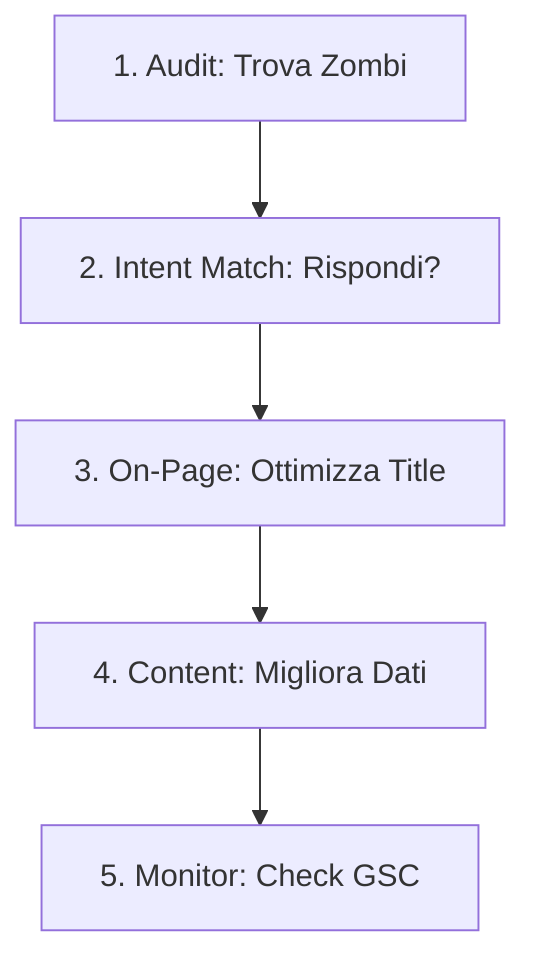

## Concetti Chiave

- **Unit Economics**: L'analisi della profittabilità di una singola unità (cliente/prodotto). Fondamentale per capire la scalabilità.
- **CAC (Customer Acquisition Cost)**: Costo totale per acquisire un nuovo cliente pagante. Include ads, stipendi marketing, tool.
- **LTV (Lifetime Value)**: Valore monetario netto che un cliente genera durante tutta la sua relazione con l'azienda.
- **ROAS (Return on Ad Spend)**: Efficienza della spesa pubblicitaria diretta. Non include i costi operativi (vedi ROI).
- **Attribution Modeling**: Metodo per assegnare il credito di una conversione ai vari touchpoint (es. Facebook, Google, Email).
- **Marketing Mix Modeling (MMM)**: Analisi statistica (econometrica) top-down per stimare l'impatto dei canali (anche offline) senza tracciare i singoli utenti.
- **UTM Parameters**: Tag aggiunti agli URL per tracciare la fonte del traffico. Fondamentali per l'attribuzione precisa.
- **SEO Intent**: L'obiettivo dietro la ricerca dell'utente (Informational, Transactional, Navigational). Più importante della keyword stessa.
- **Dark Social**: Traffico proveniente da canali privati (WhatsApp, DM) che i tool di analytics faticano a tracciare (spesso finisce in "Direct").
- **Share of Voice (SOV)**: La tua quota di conversazioni/menzioni rispetto al totale del mercato o dei competitor.

## Formule e Metriche

| Metrica | Formula | Uso |
|---------|---------|-----|
| **CAC** | `Costo Totale Marketing / N. Nuovi Clienti` | Capire quanto costa crescere. Se > LTV, il business fallisce. |
| **LTV** | `(ARPU × Gross Margin %) / Churn Rate` | Stimare quanto puoi permetterti di spendere per acquisire un cliente. |
| **LTV:CAC Ratio** | `LTV / CAC` | L'indice di salute. Target ideale: 3:1. Se 1:1, perdi soldi. Se 5:1, stai crescendo troppo piano. |
| **ROAS** | `Revenue da Ads / Costo Ads` | Misurare l'efficienza tattica di una campagna. |
| **ROI Marketing** | `(Revenue - Costo Totale) / Costo Totale` | Misurare la profittabilità reale (include stipendi, agenzie, ecc.). |
| **Weighted Engagement** | `(Like×1 + Comm×5 + Share×10 + Save×10) / Reach` | Valutare la qualità reale dell'interazione social (un Save vale più di un Like). |
| **Churn Rate** | `(Clienti persi nel periodo / Clienti inizio periodo) × 100` | Velocità con cui perdi clienti. Il nemico n.1 della crescita. |

## Framework e Modelli

### Modelli di Attribuzione
Confronto tra come viene assegnato il valore di una conversione.

```mermaid
graph TD
    A[Touchpoints: FB -> Google -> Email -> Acquisto]
    B{Modello}
    B -->|Last Click| C[Email: 100%]
    B -->|First Click| D[FB: 100%]
    B -->|Linear| E[FB: 33%, Google: 33%, Email: 33%]
    B -->|Time Decay| F[Email: 50%, Google: 30%, FB: 20%]
    B -->|Algoritmico| G[Basato su probabilità (Markov/Shapley)]
```

### Marketing Data Pipeline
Il flusso corretto dei dati per un'analisi scalabile.

```mermaid
flowchart LR
    Source[Sorgenti Dati<br/>(FB, Google, CRM)] --> Ingest[Ingestion<br/>(Fivetran/Airbyte)]
    Ingest --> Warehouse[Data Warehouse<br/>(Snowflake/BigQuery)]
    Warehouse --> Trans[Transformation<br/>(dbt)]
    Trans --> Viz[Visualizzazione<br/>(Looker/Tableau)]
```

## Processo Step-by-Step: Ottimizzazione SEO

1.  **Audit**: Analizza il traffico esistente con GSC (Google Search Console) per trovare contenuti "zombie" o in calo.
2.  **Intent Match**: Verifica che la pagina risponda all'intento di ricerca (es. non vendere subito su una query informativa).
3.  **On-Page Optimization**: Ottimizza Title (CTR), Meta Description e struttura (H1, H2) per la leggibilità.
4.  **Content Upgrade**: Aggiorna i dati, espandi le sezioni scarne, migliora l'esperienza utente (Dwell Time).
5.  **Monitor**: Controlla il posizionamento dopo 2-4 settimane.



## Errori da Evitare

-   ❌ **Ottimizzare per Vanity Metrics** (Like, Pageviews) → ✅ Focalizzati su Actionable Metrics (Conversioni, Lead Qualificati, Retention).
-   ❌ **Guardare solo il ROAS** → ✅ Guarda il POAS (Profit on Ad Spend) o il ROI totale; il ROAS ignora i margini.
-   ❌ **Ignorare il "Dark Social"** → ✅ Usa sempre i parametri UTM per illuminare il traffico diretto.
-   ❌ **Basarsi solo sul Last Click** → ✅ Sottostima i canali di "Discovery" (Social, Video) che iniziano il funnel.
-   ❌ **SEO senza Intento** → ✅ Scrivere per le keyword senza capire cosa vuole l'utente porta ad alto Bounce Rate.
-   ❌ **Dati Silos** → ✅ Analizzare Facebook e Google separatamente porta a sovrastimare le conversioni (duplicazione). Unifica i dati.

## Quick Reference

| Strumento | A cosa serve | Quando usarlo |
|-----------|--------------|---------------|
| **Google Analytics 4 (GA4)** | Web & App Analytics | Analisi del comportamento utente e attribuzione base. |
| **Google Search Console** | SEO Performance | Monitorare ranking, click organici e salute tecnica del sito. |
| **dbt (data build tool)** | Trasformazione Dati | Pulire e modellare i dati grezzi nel Warehouse (ELT). |
| **Fivetran / Airbyte** | Data Ingestion | Spostare dati dalle piattaforme (Ads, CRM) al Warehouse. |
| **Snowflake / BigQuery** | Data Warehouse | Archiviare e interrogare grandi volumi di dati. |
| **Looker / Tableau** | Business Intelligence | Creare dashboard visuali per gli stakeholder. |
