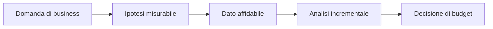

# Cheat Sheet  -  Analisi di Marketing

Quando una campagna è attiva e il board chiede un numero, non serve una lunga teoria. Serve sapere quali metriche sono affidabili, quali sono proxy e quali richiedono caveat. Questa cheat sheet raccoglie controlli, definizioni e domande pratiche da usare prima di trasformare un report in una decisione.

## Una scena da cui partire

Usa questa pagina come postazione di lavoro. Torna qui per controllare naming, attribuzione, funnel, marginalità, dashboard o audience activation e per evitare risposte brillanti ma non verificate.

- **Contesto:** Quale metrica rischia di essere letta fuori dal suo perimetro?
- **Metodo:** Quale controllo minimo fai prima di condividere il numero?
- **Applicazione:** Quale checklist useresti domani prima di una review marketing?

## Oltre il Last-Click: la complessità dell'attribuzione moderna

Per decenni, il marketing digitale ha vissuto sotto la tirannia del modello di attribuzione "last-click". Assegna tutto il merito dell'acquisto all'ultimo touchpoint, ignorando il percorso complesso che porta un utente dalla scoperta all'acquisto. Questo sottovaluta i canali di awareness e consideration e sovrastima quelli di intent.

Modelli basati su regole come first-click, lineare o time decay migliorano la situazione, ma restano arbitrari. La vera svolta sono i modelli data-driven, che usano machine learning per stimare il contributo marginale di ogni canale analizzando migliaia di percorsi di conversione.

Il gold standard è l'applicazione dei valori di Shapley, presi dalla teoria dei giochi cooperativi. Ogni canale è un "giocatore" e il modello calcola il suo contributo medio su tutte le combinazioni possibili. Richiede dati granulari e potenza di calcolo, ma restituisce la stima più equa e accurata.

**Booking.com** ha documentato il passaggio da modelli basati su regole a un approccio data-driven con valori di Shapley. Ha scoperto che i modelli tradizionali sottostimavano display e social e sovrastimavano la ricerca brand. Ridistribuendo il 18% del budget verso mid/upper funnel, ha aumentato il ROAS del 7% a parità di investimento.

## L'equazione del valore: decomposizione di LTV e CAC

LTV (Customer Lifetime Value) e CAC (Customer Acquisition Cost) sono i pilastri per valutare la sostenibilità di un business digitale. Il CAC è il costo totale per acquisire un cliente, non solo la spesa pubblicitaria, ma anche stipendi, software, commissioni e altri costi operativi. Ad esempio, con 50.000€ in ads, 30.000€ in stipendi e 5.000€ in tool per 1.000 clienti, il CAC è 85€, non 50€.

Il LTV è il valore totale generato da un cliente nel suo ciclo di vita. Modelli predittivi come "Buy 'Til You Die" stimano il LTV basandosi sui primi acquisti e sul comportamento RFM (recency, frequency, monetary). Questo permette di personalizzare campagne di retention in anticipo.

Il rapporto LTV/CAC misura il ritorno sull'investimento per cliente. Un valore superiore a 3:1 indica un modello sano e scalabile. Un rapporto di 1:1 significa perdita, mentre 5:1 o più giustifica investimenti aggressivi. È fondamentale segmentare questo rapporto per canale, coorte e persona per identificare le vere opportunità.

## L'anatomia di un data stack per il marketing moderno

Per analisi sofisticate serve un'infrastruttura dati robusta, il Modern Data Stack:

1. **Ingestion & Collection:** strumenti ETL/ELT come Fivetran o Airbyte estraggono dati da Google Ads, Meta Ads, GA4, CRM e piattaforme email. Le CDP come Segment raccolgono dati comportamentali in tempo reale, creando profili utente unificati.

2. **Warehousing:** i dati confluiscono in un Cloud Data Warehouse (Snowflake, BigQuery, Redshift), unica fonte di verità per analisi cross-canale.

3. **Transformation:** dbt trasforma i dati grezzi in modelli puliti e aggregati. Si costruiscono livelli di staging, intermediate e marts ottimizzati per casi d'uso specifici.

Esempio di modello intermedio `int_marketing_spend_daily` che unisce spese Google Ads e Facebook Ads:

- Per Google Ads si aggregano costo, impression e click per giorno, campagna e gruppo di annunci.
- Per Facebook Ads si fa lo stesso, adattando i nomi dei campi.
- I dati delle due piattaforme si uniscono con UNION ALL in un'unica tabella.

4. **Consumption & Activation:** strumenti BI (Looker, Tableau, Power BI) creano dashboard interattivi collegati al warehouse. Il Reverse ETL riporta segmenti e dati arricchiti agli strumenti operativi per automazione e personalizzazione, chiudendo il cerchio tra analisi e azione.

## Dal funnel alla flywheel: ottimizzazione incrementale

Il modello tradizionale funnel (Awareness → Interest → Desire → Action) è lineare e transazionale, inadatto al mondo digitale dove la relazione con il cliente è continua. La flywheel di HubSpot propone un ciclo virtuoso: Attract, Engage, Delight. Clienti soddisfatti diventano promotori che attraggono nuovi prospect.

L'ottimizzazione si sposta dall'incremento di metriche di conversione al miglioramento dell'incrementalità: la domanda chiave è "Questa campagna ha generato risultati che non si sarebbero verificati comunque?".

La metodologia principe è la sperimentazione controllata (A/B test, test di lift). Si confrontano gruppi di trattamento e controllo per misurare il vero lift incrementale.

**Netflix** è un esempio eccellente, testando decine di varianti di thumbnail per massimizzare il view-through rate e usando test geografici per misurare l'incremento di abbonamenti. Questo approccio scientifico e basato su dati ha aumentato l'engagement oltre il 20%, traducendosi in miliardi di dollari di LTV salvato.

## Applicazioni pratiche: un laboratorio guidato

### Esercizio 1: costruire una tassonomia UTM robusta

Definisci parametri UTM coerenti e scalabili per:

1. Annuncio Google Search per "costumi da bagno donna".
2. Post organico Facebook per "Occhiali da Sole".
3. Link nella newsletter settimanale nel banner principale.

Pensa a una struttura logica per `utm_source`, `utm_medium`, `utm_campaign`, `utm_content` e `utm_term`.

### Esercizio 2: calcolare LTV e CAC da dati grezzi

Dataset semplificato con clienti acquisiti da Google Ads e Facebook Ads, spesa rispettiva di 10.000€ e 8.000€. Calcola CAC per canale, LTV medio (12 mesi) e rapporto LTV/CAC. Quale canale è più efficiente e perché?

### Esercizio 3: interpretare un report di attribuzione multi-touch

Confronta conversioni attribuite da modello Last-Click e Data-Driven (Shapley). Identifica canali sopravvalutati e sottovalutati dal Last-Click e suggerisci una riallocazione preliminare del budget.

| Canale               | Conversioni (Last-Click) | Conversioni (Data-Driven) |
|----------------------|--------------------------|---------------------------|
| Ricerca Brand (Paid) | 1.200                    | 750                       |
| Ricerca Generica (Paid) | 800                      | 950                       |
| Social (Paid)        | 300                      | 650                       |
| Display (Paid)       | 50                       | 250                       |
| Email Marketing      | 450                      | 400                       |
| Direct               | 200                      | 100                       |

## Sintesi strategica: i principi fondamentali

Questa cheat sheet è un framework strategico, non una lista di numeri. L'attribuzione è una scelta strategica: passare da modelli arbitrari a data-driven significa investire nella creazione di domanda futura. La sostenibilità si misura con il rapporto LTV/CAC, non con volumi o lead. Il data stack moderno è un asset strategico che abilita automazione e sperimentazione. L'ottimizzazione è un processo scientifico continuo che misura l'incrementalità, non solo i volumi di vendita.

Padroneggiare questi principi significa diventare partner strategici capaci di guidare la crescita con rigore e metodo.

## Laboratorio ed esercizi

### Livello base

Scrivi in cinque righe una decisione reale collegata a questa cheat sheet: obiettivo, metrica primaria, baseline, rischio principale e azione prevista.

### Livello intermedio

Costruisci una tabella con almeno tre segmenti o scenari. Per ciascuno indica segnale, possibile spiegazione alternativa e controllo necessario prima di decidere.

### Livello research-grade

Disegna un piano di validazione: ipotesi, dati necessari, criterio di esclusione, soglia decisionale e controllo post-decisione. Specifica cosa ti farebbe cambiare idea.

### Dataset e materiali consigliati

Usa export campagne, costi media, eventi web o app, CRM, transazioni, survey brand e log di consenso. Se non hai dati reali, crea un dataset sintetico con 200-500 righe, una colonna temporale, una colonna segmento, una metrica di outcome e una variabile di esposizione.

## Errore tipico da evitare

Trattare questa cheat sheet come una definizione da ricordare invece che come un protocollo decisionale. Presentare metriche senza baseline, grafici senza ipotesi o raccomandazioni senza valutare il costo dell'errore porta a decisioni fragili.

Chiediti sempre: "Se questo risultato fosse falso o instabile, quale decisione sbaglierei?". Se non sai rispondere, non hai ancora applicato davvero la lezione.

## Quiz o checkpoint

1. Qual è la decisione concreta che questa lezione dovrebbe migliorare?
2. Quale baseline rende interpretabile il risultato?
3. Quale assunzione, se sbagliata, cambierebbe la conclusione?
4. Quale controllo minimo useresti prima di presentare la raccomandazione?

## Riepilogo operativo

Questa cheat sheet è una competenza utile quando collega concetto, dato e decisione. Studiala partendo da un problema reale, formalizza il segnale, cerca una baseline credibile, costruisci un esempio e chiudi con un controllo pratico.

---

## Problema reale

Nel marketing analytics, la sfida è trasformare budget, canali, creatività e audience in decisioni misurabili, senza confondere volume, attribuzione e incrementalità. La domanda non è se il concetto sia interessante, ma quale decisione migliora applicandolo con dati affidabili e una soglia di errore esplicita.

## Modello concettuale

Il modello è sequenziale: si formula la domanda, si traduce in segnale osservabile, si valuta la qualità del dato, si analizza l'incrementalità e si decide. Saltare passaggi produce analisi fragili.

| Passaggio | Domanda guida | Output atteso |
|---|---|---|
| Framing | Quale decisione deve cambiare? | Scelta concreta |
| Misura | Quale segnale rappresenta il fenomeno? | Metrica, fonte, granularità |
| Confronto | Rispetto a quale baseline interpreto il risultato? | Benchmark o controfattuale |
| Azione | Che cosa faccio se il segnale supera la soglia? | Decisione, owner, prossimo controllo |

## Formalizzazione rigorosa

| Elemento | Definizione per questa lezione |
|---|---|
| Unità | campagna, coorte, touchpoint, segmento cliente |
| Segnale | margine incrementale, CAC payback, conversion rate corretto, lift, retention |
| Baseline | periodo precedente, gruppo holdout, mercato comparabile, benchmark storico |
| Decisione | spostare risorse, cambiare messaggio, fermare tattica, scalare esperimento |
| Rischio | confondere correlazione, qualità dato e causalità decisionale |

Una misura è utile solo se riduce l'incertezza su una decisione specifica. Se non cambia una scelta, è solo documentazione; se cambia una scelta senza controlli, è rischio.

## Esempio o caso studio

Un team growth valuta se aumentare budget su un canale con CPA basso ma vendite marginali deboli. La cheat sheet aiuta a separare segnale da rumore, collegando metrica, modello mentale e decisione economica.

| Evidenza | Interpretazione prudente | Decisione |
|---|---|---|
| Segnale positivo ma non isolato | Fenomeno esiste, causa incerta | Cercare baseline o holdout |
| Segmento con risposta diversa | Effetto medio nasconde eterogeneità | Analizzare coorti o sottogruppi |
| Costo operativo crescente | Valutare sul margine | Applicare soglie economiche |

## Lab / esercizio

### Livello base

Scrivi una decisione reale collegata a questa cheat sheet: obiettivo, metrica primaria, baseline, rischio e azione.

### Livello intermedio

Costruisci tabella con tre segmenti/scenari: segnale, spiegazione alternativa, controllo prima di decidere.

### Livello research-grade

Disegna piano di validazione: ipotesi, dati, esclusioni, soglia decisionale, controllo post-decisione, cosa cambierebbe idea.

### Dataset e materiali consigliati

Usa export campagne, costi media, eventi web/app, CRM, transazioni, survey brand, log consenso. Se non hai dati reali, crea dataset sintetico con 200-500 righe, colonna temporale, segmento, metrica outcome, variabile esposizione.

## Errore tipico da evitare

Non usare questa cheat sheet come definizione da ricordare ma come protocollo decisionale. Presentare metriche senza baseline, grafici senza ipotesi o raccomandazioni senza valutare costo errore porta a decisioni fragili.

Chiediti sempre: "Se questo risultato fosse falso o instabile, quale decisione sbaglierei?". Se non sai rispondere, non hai applicato la lezione.

## Quiz o checkpoint

1. Quale decisione concreta migliora questa lezione?
2. Quale baseline rende interpretabile il risultato?
3. Quale assunzione, se sbagliata, cambierebbe la conclusione?
4. Quale controllo minimo useresti prima di presentare la raccomandazione?

## Riepilogo operativo

Questa cheat sheet è una competenza che collega concetto, dato e decisione. Studiala partendo da un problema reale, formalizza il segnale, cerca una baseline credibile, costruisci un esempio e chiudi con un controllo pratico.
