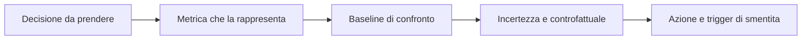

Il consiglio di amministrazione chiede se la campagna di primavera ha funzionato. La risposta non è un numero solo ma una catena corta: quale decisione dobbiamo prendere, quale metrica la rappresenta, rispetto a quale baseline, che cosa ci farebbe cambiare idea. Tutti i valori di questa pagina sono numeri di esempio, scelti per far tornare i conti, e servono a ricordare il metodo, non a fissare soglie universali.

> **Idea chiave:** Ogni numero condiviso porta con sé tre cose: la definizione operativa che lo genera, la baseline con cui si confronta e una stima dell'incertezza; senza questi tre elementi un numero è un'opinione.

Questa pagina è l'indice del modulo. Raccoglie definizioni, formule e controlli da tenere aperti mentre si decide, e rimanda alle lezioni dove ogni tema è sviluppato per esteso. Non è un glossario da memorizzare: serve a scegliere in pochi minuti quale lezione aprire e quale controllo applicare.

## Mappa del modulo per domanda decisionale

Il modo più rapido di orientarsi è partire dalla domanda che hai davanti, non dall'argomento. La tabella associa ogni domanda tipica alla lezione che la tratta e al controllo da fare per primo.

| Domanda decisionale | Lezioni di riferimento | Primo controllo |
| --- | --- | --- |
| Il traffico e le conversioni sono misurati bene? | gtm-datalayer-qa-tracking, ga4-avanzato, server-side-tracking-gtm-server-capi | Quota di sessioni paid senza UTM valido |
| Quale canale merita il prossimo euro? | modelli-attribuzione, mmm-incrementality, funnel-unit-economics | Confronto last-click e data-driven, poi esperimento |
| Quanto vale un cliente rispetto a quanto costa? | funnel-unit-economics, crm-email-analytics | CAC fully-loaded e LTV su coorti mature |
| Il marchio sta creando valore? | efficacia-brand, costruire-brand-forte | Share of Search contro quota di mercato |
| Lo stack B2B è allineato? | b2b-martech-ops, cdp-identity-resolution-audience-activation, reverse-etl-sincronizzazione-audience | Conteggio MQL in piattaforma contro CRM |
| Come si porta tutto in una decisione? | martech-dashboard-operativi, caso-studio | Riconciliazione settimanale con il warehouse |

Le lezioni si dispongono in tre strati. Alla base c'è il dato: tracciamento, tassonomia UTM, pipeline verso il warehouse. Sopra c'è la misura: attribuzione, incrementalità, unit economics. In cima c'è la decisione: dashboard, attivazione delle audience, allocazione del budget. Se saltiamo uno strato, paghiamo interessi tecnici in quelli superiori: con la spesa nei fogli e gli ordini nel gestionale, nessun modello di attribuzione sarà credibile.



## Leggere una metrica

Ogni metrica di marketing è una frazione con una storia. Il tasso di conversione è conversioni su sessioni, ma quali sessioni? Il CAC è costo totale su nuovi clienti, ma quali costi entrano al numeratore? Se due persone calcolano lo stesso indicatore con perimetri diversi, il confronto è finto.

Per ogni numero che condividiamo fissiamo tre elementi. La definizione operativa è la query o la regola che lo genera, non il nome della dashboard in cui compare. La baseline è il termine di paragone: stesso periodo dell'anno precedente, coorte precedente, gruppo di controllo, previsione. Senza baseline un più 18% non dice nulla. L'incertezza conta soprattutto su campioni piccoli o finestre corte, dove l'oscillazione casuale domina il segnale.

Un controllo rapido salva sempre: scomporre la media. Il ROAS blended può salire mentre il ROAS marginale crolla, perché abbiamo tagliato un canale debole e alzato la media senza creare valore. Se il segnale cambia segno tra segmenti, la media è una bugia comoda.

Attenzione ai proxy. View-through rate, like e sessioni sono segnali precoci utili e obiettivi pericolosi. Un proxy sta in dashboard solo con accanto la metrica di risultato a cui è legato e la data dell'ultima verifica della correlazione.

## Oltre il last click

Il last click assegna tutto il merito all'ultimo tocco. È comodo e disponibile ovunque, ed è sistematicamente distorto: premia la domanda catturata, come brand search, direct e retargeting, e punisce la domanda creata, come display, social prospecting e video. I modelli a regole, cioè first click, lineare, time decay e position-based, distribuiscono meglio il merito ma restano arbitrari, perché i pesi li decidiamo noi e non i dati.

I modelli data-driven stimano il contributo confrontando percorsi simili con e senza quel canale. L'idea viene dai valori di Shapley: il credito di un canale è il suo contributo marginale medio su tutte le combinazioni di tocchi. Nessuno calcola la formula esatta su milioni di percorsi, si usano approssimazioni con catene di Markov, modelli di sopravvivenza o stime bayesiane.

| Canale | Last click (conversioni) | Data-driven (conversioni) | Lettura |
| --- | --- | --- | --- |
| Ricerca brand | 1.200 | 750 | Gonfiata: intercetta domanda esistente |
| Ricerca generica | 800 | 850 | Contributo mid-funnel più alto |
| Social prospecting | 300 | 650 | Il last click lo dimezza |
| Display | 50 | 250 | Assist fondamentale, invisibile |
| Email | 450 | 400 | Leggera sovrastima, base calda |
| Direct | 200 | 100 | Spesso brand o email mal tracciata |

I due modelli distribuiscono lo stesso totale di 3.000 conversioni, perché 1.200 + 800 + 300 + 50 + 450 + 200 = 3.000 e anche 750 + 850 + 650 + 250 + 400 + 100 = 3.000. Cambia solo la distribuzione: la ricerca brand perde 450 conversioni (da 1.200 a 750, cioè meno 37,5%), il social prospecting ne guadagna 350 (da 300 a 650, più 117%). La mossa operativa è confrontare le due viste sullo stesso periodo e, dove il divario ha il segno della tabella, spostare il 15-20% del budget da brand a prospecting e display tramite un esperimento, non in un colpo solo.

I modelli data-driven hanno tre limiti. Vedono solo ciò che è tracciato. Sono correlazionali: se social e search crescono insieme per stagionalità, separano male causa ed effetto. Degradano in fretta quando cambiano il mix di canali e le regole di privacy. Per questo si affiancano sempre a esperimenti di incrementalità.

## CAC, LTV e payback

Il CAC corretto è la somma di spesa media, stipendi, strumenti, commissioni e contenuti, divisa per i nuovi clienti. Con 50.000 euro di ads, 30.000 di stipendi, 5.000 di strumenti e 1.000 nuovi clienti il CAC è (50.000 + 30.000 + 5.000) / 1.000 = 85 euro, non 50. Lo si segmenta sempre per canale, campagna e coorte mensile, perché un CAC medio stabile può nascondere un canale in deriva e uno nuovo che scala bene.

L'LTV è il margine cumulato atteso da un cliente. La versione storica è scontrino medio per ordini all'anno per anni di vita per margine. La versione predittiva stima il futuro dai primi segnali di recency, frequency e monetary, con modelli come Buy 'Til You Die per la frequenza e gamma-gamma per il valore.

Il rapporto LTV su CAC guida le decisioni. Sotto 1 si perdono soldi a ogni cliente. Tra 1 e 3 si è in zona fragile. Sopra 3 il modello scala, sopra 5 si può spingere. Ma anche questo rapporto medio mente, quindi lo si calcola per coorte. Se il payback supera i dodici mesi si aggiunge il vincolo di cassa, perché si può avere un rapporto sano e restare senza liquidità.

Un esempio numerico: Google Ads ha speso 10.000 euro per 180 clienti, quindi il CAC è 10.000 / 180 = 55,6 euro. Meta ha speso 8.000 euro per 110 clienti, quindi il CAC è 8.000 / 110 = 72,7 euro. A dodici mesi l'LTV medio è 190 euro per Google e 260 per Meta. I rapporti sono 190 / 55,6 = 3,4 contro 260 / 72,7 = 3,6: il canale apparentemente più caro è il più sostenibile.

```sql
-- CAC e rapporto LTV/CAC per canale e coorte mensile
SELECT
  canale_acquisizione,
  DATE_TRUNC('month', data_primo_ordine) AS coorte,
  SUM(costo_totale) / COUNT(DISTINCT cliente_id) AS cac,
  AVG(ltv_12_mesi) AS ltv_medio_12m,
  AVG(ltv_12_mesi) / (SUM(costo_totale) / COUNT(DISTINCT cliente_id)) AS ltv_su_cac
FROM marts.marketing_coorti
GROUP BY 1, 2
ORDER BY 1, 2;
```

## Tracciamento e tassonomia UTM

Metà dei misteri di attribuzione nasce da parametri UTM scritti a mano libera. La tassonomia si decide una volta e si impone come vincolo. Cinque parametri bastano: utm_source indica chi mostra l'annuncio, per esempio google; utm_medium il tipo di traffico, per esempio cpc; utm_campaign l'iniziativa, per esempio ss26-nuoto-donna; utm_content la variante creativa; utm_term la keyword, solo per il paid search.

Le regole che evitano il caos sono poche: minuscole sempre, trattini invece di spazi, valori da lista chiusa per source e medium, redirect che preservano i parametri, test su ogni nuovo template prima del lancio e una query settimanale che elenca i valori mai visti. La lezione dedicata, UTM e parametri di campagna, descrive il builder interno e le soglie di allarme sul traffico paid non attribuito: sotto il 5% si lavora tranquilli, tra 5% e 10% si ripara, sopra il 10% si bloccano le nuove campagne.

Sul tracciamento tecnico tre punti non sono negoziabili. Gli ID di click di piattaforma, come gclid, fbclid e ttclid, si salvano insieme alla sessione, perché senza il join tra click e ordine l'attribuzione resta una stima. Il consenso accompagna ogni evento con il suo stato e la sua base giuridica. Gli eventi critici, come acquisto e lead qualificato, passano anche lato server, perché il solo pixel nel browser perde troppo.

## Incrementalità, dashboard e audience

Il funnel classico descrive bene una transazione e male un abbonamento, dove il cliente soddisfatto porta altri clienti. La domanda cambia: non più come alziamo la conversione, ma quanta conversione è davvero causata dalla campagna. L'incrementalità è la differenza tra ciò che è successo e ciò che sarebbe successo comunque: un gruppo vede la campagna, un controllo no. Per le audience digitali si usano test A/B, per i canali broadcast si usano geo-test, sospendendo la spesa in regioni comparabili e confrontandole con le gemelle.

Ogni test serio dichiara prima ipotesi, metrica primaria, guardrail su margine, resi e churn, durata minima e soglia decisionale. Senza pre-registrazione ogni risultato diventa confermabile a posteriori. Il fondamento sperimentale lo hanno dato nel 2015 Thomas Blake, Chris Nosko e Steven Tadelis su Econometrica, con un esperimento su larga scala condotto con eBay: sospesi gli annunci a pagamento sul brand, gran parte dei click è andata sul risultato organico gratuito e il rendimento incrementale è risultato una frazione delle stime convenzionali. L'attribuzione assegna il merito, solo l'esperimento misura la causa.

Una buona dashboard risponde in trenta secondi a tre domande: vinciamo o perdiamo rispetto alla baseline, dove succede, che cosa facciamo dopo. La riga alta porta i risultati, cioè ricavo incrementale, margine, nuovi clienti e LTV su CAC di coorte. Seguono la scomposizione per canale e coorte, la diagnostica e le annotazioni su lanci, promozioni e rotture di tracciamento. Il controllo che distingue una dashboard viva da un poster è la riconciliazione settimanale con il warehouse, scritta come test automatico: sopra la soglia del 2% il report non si pubblica.

L'analisi crea valore quando cambia a chi mostriamo che cosa. Il reverse ETL sincronizza segmenti come alto LTV predetto, carrello recente o rischio di abbandono verso Meta, Google, email e CRM ogni notte, con consenso e timestamp. Ogni segmento porta la definizione e la data di calcolo, perché un pubblico di prospecting vecchio di sessanta giorni è rumore. La misura torna all'incrementalità: un holdout sempre acceso, il 5-10% di ogni segmento chiave senza la campagna personalizzata, evita che il retargeting sembri miracoloso solo perché colpisce chi stava già per comprare.

Due abitudini contano più di qualsiasi strumento. Il diario delle decisioni annota ogni cambio di budget, creatività o promozione con data e ipotesi, così tra un mese si sa perché il grafico ha un gradino. La revisione del costo dell'errore consiste nel chiedersi, prima di condividere una raccomandazione, quale decisione sbagliata prenderemmo se il numero fosse instabile. Se non sappiamo rispondere, il numero non è pronto per il tavolo.

## Tre errori da riconoscere subito

### Un numero senza baseline

Il sintomo è un più 18% presentato come successo, che nessuno sa dire rispetto a che cosa. Succede perché la variazione sembra autoesplicativa. Si corregge scrivendo accanto a ogni variazione il periodo di riferimento, il denominatore e l'intervallo di incertezza.

### Il CAC delle sole ads

Il sintomo è un CAC di 50 euro che sparisce quando la finanza aggiunge stipendi e strumenti e arriva a 85. Sembra ragionevole perché la spesa pubblicitaria è il dato più immediato. Si evita calcolando sempre il CAC fully-loaded e leggendolo per coorte matura, non sul primo click.

### Retargeting senza gruppo di controllo

Il sintomo è una campagna di retargeting con un ritorno altissimo che non regge a un test. Accade perché raggiunge persone con il carrello già pieno, che avrebbero comprato comunque. Si corregge con un holdout permanente del 5-10% e misurando solo gli ordini incrementali.

## Controlli di fine lettura

1. Quali tre elementi accompagnano ogni numero condiviso?

<details>
<summary>Mostra risposta</summary>

Definizione operativa, baseline e incertezza. Senza baseline un più 18% non dice nulla, senza definizione due persone calcolano cose diverse, senza incertezza si scambia il rumore per segnale.

</details>

2. Che cosa premia sistematicamente il last click e che cosa penalizza?

<details>
<summary>Mostra risposta</summary>

Premia la domanda catturata, come brand search, direct e retargeting. Penalizza la domanda creata, come social prospecting, display e video, che aprono il percorso ma raramente lo chiudono.

</details>

3. Con 50.000 euro di ads, 30.000 di stipendi, 5.000 di strumenti e 1.000 clienti, quanto è il CAC?

<details>
<summary>Mostra risposta</summary>

(50.000 + 30.000 + 5.000) / 1.000 = 85 euro. Il solo costo delle ads darebbe 50 euro e sottostimerebbe di quasi il 41% il costo reale di acquisizione.

</details>

4. Perché le UTM devono usare liste chiuse?

<details>
<summary>Mostra risposta</summary>

Per evitare che la stessa sorgente compaia in più versioni nei report, come Facebook, fb e meta. Con una lista chiusa e un builder che valida, ogni link rispetta la tassonomia e la riconciliazione tra spesa e ricavi funziona.

</details>

5. Quale controllo separa il merito del retargeting dagli acquisti che sarebbero avvenuti comunque?

<details>
<summary>Mostra risposta</summary>

Un holdout del 5-10% di ogni segmento chiave, che non vede la campagna. Gli ordini incrementali sono la differenza di conversione tra esposti e holdout moltiplicata per la dimensione del gruppo esposto.

</details>
