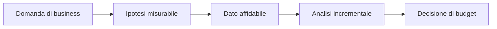

# Costruire un brand forte: dati e strategia

Il marketing di performance genera vendite immediate, ma appena il budget si riduce, la domanda cala. Il vero nodo non è scegliere tra brand e performance, ma capire se il brand sta davvero creando preferenza, fiducia e un prezzo sostenibile. Costruire un brand forte significa tradurre un concetto spesso vago in segnali concreti e misurabili.

## Una scena da cui partire

Questa lezione fa da ponte tra ricerca, posizionamento e finanza. Un brand forte non si dimostra con slide aspirazionali, ma con dati che mostrano come riduce l'attrito, aumenta la scelta o protegge il margine in mercati competitivi.

- **Contesto:** Quale posizionamento vuoi misurare?
- **Metodo:** Quale segnale distingue la semplice awareness dalla preferenza reale?
- **Applicazione:** Come collegheresti la forza del brand a pricing o conversione?

## Dalla performance al brand equity: una trasformazione quantitativa

Il conflitto tra marketing di performance e brand building nasce spesso da orizzonti temporali e metriche diverse. Il performance marketing ottimizza il breve termine, puntando a acquisire utenti al costo più basso oggi. Il brand building è un investimento a lungo termine, con ritorni meno immediati ma misurabili.

Molte organizzazioni data-driven commettono l'errore di applicare le stesse metriche a entrambe le discipline. Pretendere un ROAS diretto da una campagna di brand awareness è come aspettarsi che un seme diventi un albero in una settimana.

Il concetto chiave è la **Brand Equity**: il valore differenziale che il nome del brand conferisce a un prodotto, traducibile in vantaggi economici tangibili:

1. **Riduzione del CAC nel tempo:** un consumatore che cerca "scarpe Nike" costa meno da acquisire rispetto a uno che cerca "scarpe da corsa".
2. **Aumento della willingness-to-pay:** i consumatori pagano un premium price per un brand di cui si fidano o che sentono affine.
3. **Incremento del Customer Lifetime Value (LTV):** un forte legame con il brand aumenta retention e fedeltà, riducendo il churn.
4. **Creazione di un "fossato" competitivo:** anni di fiducia e riconoscibilità non si replicano facilmente.

La misurazione non si basa sulle conversioni immediate, ma su metriche proxy che indicano cambiamenti nella percezione e nel comportamento. Una delle più efficaci è la **Share of Search**: la quota di ricerche organiche per il brand rispetto al totale delle ricerche nella categoria. Les Binet e Peter Field hanno dimostrato una forte correlazione tra Share of Search e futura quota di mercato. Se la Share of Search supera la quota di mercato attuale, è un segnale di crescita futura.

## Decomposizione analitica del brand: i quattro pilastri misurabili

Per gestire la misurazione del brand, lo scomponiamo in quattro pilastri, ciascuno con metriche specifiche:

1. **Distinctiveness (Riconoscibilità):** il brand deve venire in mente nel momento del bisogno, tramite asset unici come colori, suoni o testimonial.
   - *Metriche:* Brand Recall spontanea e sollecitata, riconoscimento unico di asset, volume di ricerche brand.

2. **Relevance (Rilevanza):** il brand deve essere percepito come soluzione valida a un bisogno.
   - *Metriche:* Consideration Rate, associazione categoria-brand tramite analisi testuali.

3. **Esteem (Stima e Fiducia):** il consumatore deve fidarsi e rispettare il brand.
   - *Metriche:* Net Promoter Score segmentato, Trust Score, willingness to pay premium.

4. **Knowledge (Conoscenza):** il consumatore deve capire chiaramente cosa offre il brand e cosa lo differenzia.
   - *Metriche:* Comprensione della value proposition, awareness e adozione delle feature chiave.

Questi pilastri richiedono un mix di dati comportamentali e attitudinali.

## Quantificare il fossato competitivo: stima del brand premium

Concetti come stima e fiducia vanno tradotti in euro. La **Conjoint Analysis** è la tecnica chiave per isolare il valore attribuito a ogni attributo, incluso il brand.

Immaginiamo Bolt, un servizio di ride-hailing, che vuole quantificare il valore del proprio brand rispetto a FastRide e Uber. Si mostrano scenari con diverse combinazioni di brand, tempo di attesa, prezzo e valutazione autista, chiedendo agli utenti di scegliere.

Analizzando le scelte con un modello logit multinomiale, si stimano le utilità parziali di ogni attributo. Il brand premium si calcola come il rapporto tra il coefficiente del brand e quello del prezzo, traducendo l'utilità in valore monetario.

Questo numero diventa un KPI strategico: ad esempio, "i consumatori pagherebbero 1.25€ in più per Bolt rispetto a FastRide". L'obiettivo può essere aumentare questo premio nel tempo, giustificando investimenti in brand building.

## Il sistema nervoso del brand: progettare un dashboard di brand health

Non si può fare una conjoint analysis ogni settimana. Serve un sistema di indicatori agili, un "sistema nervoso" che segnali cambiamenti nella percezione del mercato.

Il dashboard di Brand Health combina:

- **Leading indicators:** segnali deboli e predittivi come social sentiment, menzioni e share of search.
- **Lagging indicators:** misure di risultato come brand recall, NPS, brand premium e traffico diretto.

Un buon dashboard bilancia entrambi, permettendo di anticipare trend e reagire tempestivamente.

### Caso studio: Netflix e la "Share of Conversation"

Netflix aggrega dati da Twitter, Reddit, YouTube e recensioni, usando NLP per identificare menzioni di brand e show principali. Pesano le menzioni in base all'engagement e le confrontano con il volume totale di conversazioni sullo streaming. Questa metrica predice con precisione la crescita di nuovi abbonati con un trimestre di anticipo.

### Esempio di indice composito SQL

Un indice di brand health può combinare dati di Google Trends, traffico web e NPS in un unico indicatore pesato, facilitando il monitoraggio e la comunicazione con la leadership.

## Laboratorio pratico: dall'ipotesi alla metrica

### Livello base

Analizza la Share of Search di "Wise" rispetto a "Revolut" e "Western Union" su Google Trends negli ultimi 5 anni. Calcola e visualizza la quota settimanale di ricerca per ciascun brand e interpreta i trend.

### Livello intermedio

Con un dataset NPS, calcola l'NPS mensile aggregato e segmentato per coorti di utenti e per mercato. Verifica se l'NPS aggregato nasconde dinamiche divergenti tra segmenti.

### Livello research-grade

Scrivi query SQL per distinguere conversioni "brand-led" da "performance-led" usando dati di sessioni e conversioni. Calcola il valore medio degli ordini per ciascun gruppo e valuta la profittabilità.

### Dataset e materiali consigliati

Usa dati di campagne, costi media, eventi web/app, CRM, transazioni, survey brand e log di consenso. Se non disponibili, crea dataset sintetici con variabili temporali, segmenti, outcome e esposizione.

## Errore tipico da evitare

Trattare questa lezione come una definizione da ricordare anziché un protocollo decisionale. Presentare metriche senza baseline, grafici senza ipotesi o raccomandazioni senza valutazione del rischio porta a decisioni fragili.

Un controllo utile è chiedersi: "Se questo risultato fosse falso, quale decisione sbaglierei?". Se la risposta non è chiara, la lezione non è stata applicata davvero.

## Quiz o checkpoint

1. Qual è la decisione concreta che questa lezione dovrebbe migliorare?
2. Quale baseline rende interpretabile il risultato?
3. Quale assunzione, se sbagliata, cambierebbe la conclusione?
4. Quale controllo minimo useresti prima di presentare la raccomandazione?

## Riepilogo operativo

Costruire un brand forte è una competenza che collega concetto, dato e decisione. Parte da un problema reale, formalizza il segnale, cerca una baseline credibile, costruisce esempi e chiude con controlli pratici. Solo così il brand diventa un asset strategico misurabile e ottimizzabile, capace di ridurre l'incertezza nelle decisioni di marketing.

## References

1. Aaker, D. A. (1991). *Managing Brand Equity*. The Free Press.
2. Sharp, B. (2010). *How Brands Grow: What Marketers Don't Know*. Oxford University Press.
3. Binet, L., & Field, P. (2013). *The Long and the Short of It: Balancing Short and Long-Term Marketing Strategies*. Institute of Practitioners in Advertising (IPA).

## Problema reale

Nel marketing analytics, costruire un brand forte serve a trasformare budget, canali, creatività e audience in decisioni misurabili, evitando di confondere volume, attribuzione e incrementalità. La domanda è quale decisione migliora con dati affidabili e soglie di errore esplicite.

## Modello concettuale

Il modello è sequenziale: dalla domanda si passa all'ipotesi, poi al dato, all'analisi e infine alla decisione. Saltare passaggi produce analisi fragili.

| Passaggio | Domanda guida | Output atteso |
|---|---|---|
| Framing | Quale decisione deve cambiare? | Scelta concreta |
| Misura | Quale segnale rappresenta il fenomeno? | Metrica, fonte, granularità |
| Confronto | Rispetto a quale baseline interpreto il risultato? | Benchmark o controfattuale |
| Azione | Che cosa faccio se il segnale supera la soglia? | Decisione, owner, controllo |

## Formalizzazione rigorosa

| Elemento | Definizione operativa |
|---|---|
| Unità | campagna, coorte, touchpoint, segmento cliente |
| Segnale | margine incrementale, CAC payback, conversion rate corretto, lift, retention |
| Baseline | periodo precedente, gruppo holdout, mercato comparabile, benchmark storico |
| Decisione | spostare risorse, cambiare messaggio, fermare tattica, scalare esperimento |
| Rischio | confondere correlazione, qualità dato, causalità |

Una misura è utile solo se riduce l'incertezza su una decisione specifica.

## Esempio o caso studio

Un team growth valuta se aumentare budget su un canale con CPA basso ma vendite marginali deboli. La lezione aiuta a separare segnale da rumore, collegando metrica, modello mentale e decisione economica.

| Evidenza | Interpretazione prudente | Decisione |
|---|---|---|
| Segnale positivo ma non isolato | Fenomeno esiste ma causa incerta | Cercare baseline o holdout |
| Segmento con risposta diversa | Effetto medio nasconde eterogeneità | Analizzare coorti o sottogruppi |
| Costo operativo crescente | Valutare sul margine | Applicare soglie economiche |

## Lab / esercizio

### Livello base

Scrivi in cinque righe: obiettivo, metrica primaria, baseline, rischio principale e azione prevista per una decisione reale legata al brand.

### Livello intermedio

Costruisci una tabella con tre segmenti o scenari. Per ciascuno indica segnale, possibile spiegazione alternativa e controllo necessario.

### Livello research-grade

Disegna un piano di validazione: ipotesi, dati necessari, criteri di esclusione, soglia decisionale, controllo post-decisione e condizioni per cambiare idea.

### Dataset e materiali consigliati

Usa dati di campagne, costi media, eventi web/app, CRM, transazioni, survey brand e log di consenso. Se non disponibili, crea dataset sintetici con variabili temporali, segmenti, outcome e esposizione.

## Errore tipico da evitare

Non trattare il brand come un concetto da ricordare ma come un protocollo decisionale. Presentare metriche senza baseline, grafici senza ipotesi o raccomandazioni senza valutazione del rischio porta a decisioni fragili.

## Quiz o checkpoint

1. Quale decisione concreta migliora questa lezione?
2. Quale baseline rende interpretabile il risultato?
3. Quale assunzione, se errata, cambia la conclusione?
4. Quale controllo minimo useresti prima di raccomandare?

## Riepilogo

Costruire un brand forte è un processo che trasforma dati in decisioni, combinando rigore analitico e visione strategica. Solo così il brand diventa un asset competitivo duraturo.
