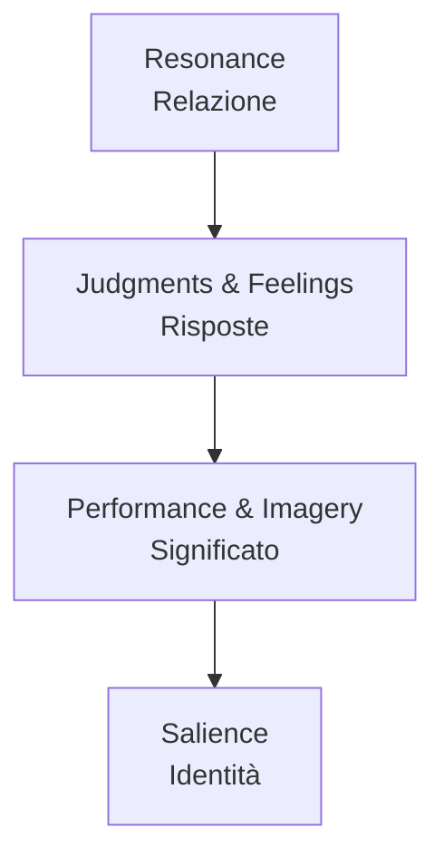
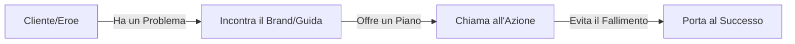

## Costruire un Brand Forte

Un brand non è un logo, un colore o uno slogan. Un brand è l'insieme delle percezioni, delle emozioni e delle aspettative che vivono nella mente del consumatore. Costruire un brand forte significa progettare deliberatamente queste percezioni, renderle coerenti attraverso ogni touchpoint e coltivarle nel tempo. Questa lezione esplora i modelli accademici e gli strumenti pratici per costruire un brand che genera valore economico misurabile.

### Obiettivi di Apprendimento

Al termine di questa lezione, lo studente sarà in grado di:
1.  Distinguere chiaramente tra brand identity (emittente) e brand image (ricevente).
2.  Applicare il modello CBBE (Customer-Based Brand Equity) di Kevin Lane Keller per diagnosticare la salute di un marchio.
3.  Costruire un posizionamento competitivo efficace utilizzando il Value Proposition Canvas.
4.  Definire l'identità di marca attraverso il Prisma di Kapferer.
5.  Progettare una strategia di storytelling basata sul framework dell'Eroe.

### Timeline della Lezione

| Fase | Argomento | Durata |
|------|-----------|--------|
| 1 | Introduzione: Brand Equity e Modello di Keller | 10 min |
| 2 | Strategia: Posizionamento e Value Proposition | 10 min |
| 3 | Identità: Il Prisma di Kapferer e Tone of Voice | 10 min |
| 4 | Narrazione: Brand Storytelling | 10 min |
| 5 | Analisi: Metriche e Casi Studio (Apple, Nike) | 15 min |
| 6 | Operatività: Piano di 90 Giorni | 5 min |
| **Totale** | | **60 min** |

## 1. Brand Equity: il Modello di Keller (CBBE)

Kevin Lane Keller ha sviluppato il modello **Customer-Based Brand Equity (CBBE)**, che rappresenta la costruzione del brand come una piramide a quattro livelli. Ogni livello deve essere consolidato prima di passare al successivo.

### La Piramide della Brand Equity

1.  **Salience (Prominenza):** Il brand è presente nella mente del consumatore quando pensa alla categoria? Riesce a ricordarlo spontaneamente? La prominenza si misura con *aided* e *unaided awareness*.
2.  **Performance e Imagery (Significato):** Il brand mantiene le sue promesse funzionali (qualità, affidabilità, durata)? E che immagine simbolica evoca (status, modernità, appartenenza)?
3.  **Judgments e Feelings (Risposte):** Cosa pensa razionalmente il consumatore del brand (qualità percepita, credibilità, superiorità)? Cosa prova emotivamente (calore, divertimento, sicurezza, esclusività)?
4.  **Resonance (Risonanza):** Il livello più alto. Il consumatore ha una relazione attiva con il brand: riacquista, lo consiglia, partecipa alla community, sente un legame identitario.

> **Nota:** Non puoi saltare i livelli. Un brand sconosciuto (bassa salience) non può generare risonanza. Prima investi in awareness, poi costruisci significato, poi coltivi la relazione. Molte startup falliscono perché cercano la fedeltà senza aver costruito la consapevolezza.

## 2. Brand Positioning: Occupare uno Spazio Mentale

Il posizionamento è la scelta deliberata del posto che il brand occupa nella mente del consumatore rispetto ai competitor. Un posizionamento efficace risponde a tre domande fondamentali.

### Il framework del posizionamento

| Domanda | Elemento | Esempio (Tesla) |
|---|---|---|
| **Per chi?** | Target audience | Professionisti tech-savvy attenti all'ambiente |
| **In quale categoria?** | Frame of Reference | Automobili premium |
| **Perché sceglierci?** | Points of Difference | Performance elettrica superiore, tecnologia autonoma, zero emissioni |

### Points of Parity vs Points of Difference

-   **Points of Parity (POP):** Attributi che il brand DEVE avere per essere considerato nella categoria. Per un'auto premium: comfort, sicurezza, qualità dei materiali.
-   **Points of Difference (POD):** Attributi unici che distinguono il brand dai competitor. Devono essere desiderabili, consegnabili e differenzianti.

### Il posizionamento statement

La formula classica:

> Per [target audience] che [bisogno/desiderio], [Brand] è il [frame of reference] che [point of difference] perché [reason to believe].

**Esempio:**
*Per professionisti creativi che vogliono strumenti potenti e intuitivi, Apple è il brand tecnologico che unisce design ed esperienza utente perché integra hardware, software e servizi in un ecosistema coerente.*

> **Attenzione:** Un posizionamento come "offriamo prodotti di qualità a prezzi competitivi" non è un posizionamento. È una descrizione che si applica a chiunque. Il posizionamento efficace richiede scelte: decidere cosa NON sei è altrettanto importante quanto decidere cosa sei.

## 3. Value Proposition Canvas

Il Value Proposition Canvas, sviluppato da Alexander Osterwalder, è uno strumento pratico per allineare l'offerta del brand ai bisogni reali del cliente.

### I due lati del canvas

**1. Profilo del Cliente**
-   **Customer Jobs:** Cosa sta cercando di fare il cliente? (funzionale, sociale, emotivo)
    -   *Funzionale:* "Devo gestire la contabilità della mia azienda"
    -   *Sociale:* "Voglio apparire professionale davanti agli investitori"
    -   *Emotivo:* "Voglio sentirmi tranquillo sulla situazione finanziaria"
-   **Pains:** Quali frustrazioni, rischi e ostacoli incontra?
    -   "I software contabili sono complicati e richiedono formazione"
    -   "Ho paura di commettere errori fiscali"
-   **Gains:** Quali risultati e benefici desidera?
    -   "Automatizzare le operazioni ripetitive"
    -   "Avere una visione chiara dei numeri in tempo reale"

**2. Mappa del Valore**
-   **Products & Services:** Cosa offri concretamente? (es. Software di contabilità cloud per PMI)
-   **Pain Relievers:** Come risolvi i problemi del cliente? (es. Interfaccia semplice, calcolo automatico delle tasse)
-   **Gain Creators:** Come generi benefici? (es. Dashboard real-time, notifiche pre-scadenza)

Il **fit** si verifica quando i Pain Relievers e i Gain Creators corrispondono ai Pains e Gains del cliente. Un brand forte nasce dall'allineamento perfetto tra questi elementi.

## 4. Brand Architecture

Quando un'azienda gestisce più brand o prodotti, la brand architecture definisce la relazione gerarchica tra di essi.

### I quattro modelli principali

| Modello | Descrizione | Esempio | Pro | Contro |
|---|---|---|---|---|
| **Branded House** | Un brand unico per tutto | Google (Search, Maps, Drive) | Sinergie massime, awareness condivisa | Un problema impatta tutto |
| **House of Brands** | Brand indipendenti | P&G (Tide, Gillette, Pampers) | Segmentazione netta, rischio isolato | Nessuna sinergia, costi alti |
| **Endorsed Brands** | Sub-brand con endorsement | Marriott Bonvoy | Credibilità + differenziazione | Complessità gestionale |
| **Sub-Brands** | Parent + sub-brand | Apple iPhone, Apple Watch | Equity condivisa + personalità distinta | Rischio di diluizione |

## 5. Brand Identity: il Prisma di Kapferer

Jean-Noël Kapferer ha sviluppato il **Prisma dell'Identità di Marca**, un modello a sei sfaccettature che definisce l'identità completa di un brand.

### Le sei facce del prisma

| Faccia | Descrizione | Esempio (Nike) |
|---|---|---|
| **Physique** | Caratteristiche fisiche e visive | Swoosh, design atletico |
| **Personality** | Il carattere del brand | Determinato, coraggioso, competitivo |
| **Culture** | I valori e la cultura | Cultura sportiva americana, superamento dei limiti |
| **Relationship** | Il tipo di relazione | Coach motivazionale: ti sfida a dare il meglio |
| **Reflection** | L'immagine del consumatore | Atleta, persona attiva, chi vuole migliorarsi |
| **Self-image** | Come il consumatore si vede | "Sono una persona che non si arrende" |

> **Consiglio:** Il prisma si divide lungo due assi. L'asse verticale distingue tra dimensioni **esterne** (Physique, Relationship, Reflection) e **interne** (Personality, Culture, Self-image). Un brand coerente allinea entrambi i lati.

## 6. Tone of Voice: la Voce del Brand

Il tone of voice è il modo in cui un brand comunica: le parole che sceglie, la struttura delle frasi, il registro linguistico. È uno degli elementi più potenti di differenziazione.

### Il framework delle 4 dimensioni del ToV

| Dimensione | Spettro | Esempio basso | Esempio alto |
|---|---|---|---|
| **Formalità** | Informale ←→ Formale | "Ehi, dai un'occhiata!" | "La invitiamo a visionare la nostra offerta" |
| **Entusiasmo** | Sobrio ←→ Entusiasta | "Il prodotto è disponibile" | "Finalmente disponibile il prodotto che aspettavi!" |
| **Umorismo** | Serio ←→ Ironico | "Assistenza clienti 24/7" | "Siamo qui anche alle 3 di notte (sì, davvero)" |
| **Rispetto** | Distaccato ←→ Empatico | "Si prega di attendere" | "Sappiamo che aspettare è frustrante. Ci siamo quasi." |

## 7. Brand Storytelling: Costruire Narrazioni che Restano

Lo storytelling non è un'opzione creativa: è il modo naturale in cui il cervello umano elabora e ricorda le informazioni.

### La struttura narrativa (Framework dell'Eroe)

> **Nota Fondamentale:** L'errore più comune è mettere il brand al centro della storia. Il brand è la guida (Yoda). L'eroe è il cliente (Luke Skywalker). Il brand aiuta l'eroe a vincere.

## 8. Misurare la Brand Health

Un brand si misura, non si indovina.

### Le metriche fondamentali

| Metrica | Domanda Chiave | Cosa indica |
|---|---|---|
| **Aided Awareness** | "Conosci il brand X?" | Riconoscimento di base |
| **Unaided Awareness** | "Quali brand di [categoria] conosci?" | Top-of-mind presence |
| **Consideration** | "Considereresti di acquistare da X?" | Intenzione verso il brand |
| **NPS** | "Consiglieresti X a un amico?" | Advocacy e passaparola |

### Share of Voice (SOV) e Share of Market (SOM)

La legge di Binet e Field: **Excess Share of Voice (ESOV) = SOV - SOM**.
Quando il SOV (quota di voce pubblicitaria) supera il SOM (quota di mercato), il brand tende a crescere.

## 9. Casi Studio: Apple e Nike

-   **Apple:** Ha costruito equity sulla coerenza (Design + Semplicità). Il suo "Think Different" non parlava di computer, ma di creatività.
-   **Nike:** Ha spostato il focus dal prodotto ("scarpe comode") alla trasformazione personale ("Just Do It"). Vende l'atleta che c'è in te.

## 10. Framework Operativo: Costruire il Brand in 90 Giorni

### Mese 1: Fondamenta
-   Analisi competitiva e interviste clienti.
-   Workshop di posizionamento (Canvas).

### Mese 2: Identità
-   Definizione Tone of Voice e Storytelling.
-   Aggiornamento identità visiva.

### Mese 3: Attivazione
-   Lancio campagna brand.
-   Misurazione baseline metriche (Brand Health).

---

> **Conclusione:** Un brand forte riduce il costo di acquisizione (CAC), aumenta i margini e migliora la retention. È l'investimento più difendibile nel lungo periodo.
