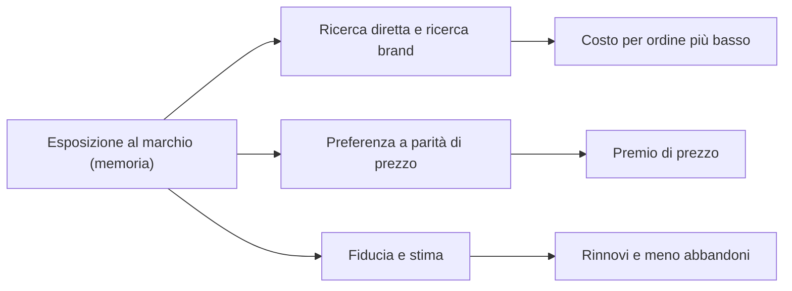

Un negozio online di borracce e zaini da montagna spegne le campagne di performance per due settimane, per un guasto al tracciamento. Il sito perde due terzi degli ordini, il costo di acquisizione delle settimane successive sale e le vendite tornano solo con uno sconto. Nello stesso periodo un concorrente con un marchio più noto perde pochissimo. Questo è uno scenario costruito, con numeri di esempio, ma mostra il limite del performance marketing: si misura in giorni e svanisce in giorni, mentre un brand lavora su orizzonti di mesi.

> **Idea chiave:** Un brand forte è un differenziale economico che si ripete, e si misura con grandezze che hanno una tabella, una baseline e un confronto: Share of Search, premio di prezzo, quota di ordini guidati dal marchio.

Un brand forte non è un logo riconoscibile. Tra sei mesi una parte dei clienti ti cerca per nome, ti sceglie a parità di prezzo, ti perdona un disservizio. La lezione trasforma questi effetti in numeri che un direttore finanziario può discutere.

## Il brand come asset economico

Il differenziale si manifesta in quattro effetti osservabili. Il brand abbassa il costo di acquisizione, perché la domanda con il nome del marchio costa meno di quella generica. Sostiene un prezzo più alto a parità di specifiche. Allunga la relazione, con più rinnovi e meno abbandoni. Crea un fossato temporale, perché la fiducia accumulata non si compra con un trimestre di spesa media.

Un calcolo illustrativo, su valori ipotetici, mostra il primo effetto. Il prodotto costa 60 euro. Le query generiche costano 1,20 euro a click e convertono al 2%: servono 50 click per ordine, cioè 60 euro di costo per ordine. Le query con il nome del marchio costano 0,25 euro a click e convertono al 6%: servono circa 16,7 click per ordine, cioè circa 4,17 euro per ordine.

Su 100 ordini, se tutti arrivano da query generiche il costo è 100 × 60 = 6.000 euro. Se il brand sposta il 15% del volume sulle query brand, 15 ordini costano 15 × 4,17 = circa 62,5 euro e gli 85 restanti 85 × 60 = 5.100 euro. Il totale è 5.162,5 euro, cioè 51,6 euro per ordine, contro i 60 di partenza: una riduzione di circa 8,4 euro per ordine, il 14% del costo.



## I segnali che anticipano la quota di mercato

La Share of Search è la quota di ricerche che contengono il nostro nome sul totale delle ricerche che contengono il nome di un brand della categoria. Les Binet e Peter Field hanno mostrato che questa quota tende a convergere con la quota di mercato futura: se la supera in modo stabile, la quota di mercato tende a crescere. Non è una legge fisica ma una regolarità empirica, osservata su beni con cicli di acquisto medio-lunghi.

Il vantaggio è che il segnale è comportamentale, non dichiarato. Nessuno dice in un questionario "cercherò questo brand tra tre mesi", ma cercarlo è un'azione. Per calcolarla servono tre decisioni: il perimetro della categoria, la lista dei brand concorrenti, la finestra temporale. Con numeri di esempio, in un mese si contano 4.800 ricerche per il nostro brand, 6.000 per il concorrente B, 3.200 per C e 2.000 per D. Il totale è 4.800 + 6.000 + 3.200 + 2.000 = 16.000 ricerche, e la nostra Share of Search è 4.800 / 16.000 = 30%. Se la quota di mercato è del 27%, il divario è di 3 punti percentuali a nostro favore.

Un divario positivo di 3-5 punti, mantenuto per due trimestri, è il segnale che il brand sta anticipando una crescita. Si usa una media mobile di 4 o 12 settimane per togliere il rumore stagionale. Una campagna televisiva pesante gonfia le ricerche per tre settimane senza spostare nulla di strutturale, quindi la serie si legge al netto dei periodi di pianificazione media, sovrapponendo il calendario dei flight. La Share of Conversation sui social è più rumorosa e si valida sempre contro un segnale più solido, come la ricerca.

## I quattro pilastri

Misurare il brand in blocco non indica dove intervenire. I pilastri sono quattro: la notorietà, intesa come recall spontanea, la distintività, la considerazione e la stima. Ognuno richiede due famiglie di dati: il comportamentale continuo dice che cosa accade, il dichiarato a onde trimestrali dice perché.

| Combinazione osservata | Che cosa segnala | Dove intervenire |
| --- | --- | --- |
| Recall alta, traffico diretto basso | Problema di reperibilità: ci ricordano ma non ci trovano | Presenza nella ricerca, distribuzione, nome del sito |
| Distintività alta, considerazione bassa | Il posizionamento non aggancia un bisogno reale, o il prezzo percepito esclude | Messaggio, prezzo, prova del valore |
| Stima alta, notorietà bassa | Brand vulnerabile: amato per motivi generici | Comunicazione che spiega il vantaggio specifico |
| Notorietà alta, stima bassa | Il marchio è noto per motivi sbagliati | Prodotto, servizio, gestione della reputazione |

La stima è il pilastro più lento a muoversi e il più costoso da ricostruire dopo una crisi. Un brand con stima alta e conoscenza bassa è vulnerabile, perché i clienti lo amano per ragioni generiche e lo abbandonano appena un concorrente spiega meglio la stessa cosa.

## Il premio di prezzo

Finché la fiducia resta un punteggio da 1 a 10, nessun direttore finanziario la prende sul serio. Va convertita in euro. La conjoint analysis presenta ai rispondenti scenari di scelta con combinazioni di attributi, come marca, prezzo e tempi di consegna, e osserva che cosa scelgono. Il campione deve essere composto da compratori reali della categoria.

Il modello di stima è il logit multinomiale: la probabilità di scegliere l'alternativa j è exp(Uj) diviso la somma di exp(Uk) su tutte le alternative. L'utilità di un'alternativa è la somma dei coefficienti dei suoi attributi. Il premio di marca è la differenza tra il coefficiente del nostro brand e quello del concorrente, divisa per il coefficiente di prezzo cambiato di segno.

Con coefficienti di marca 0,50 per noi e 0,10 per il concorrente, e un coefficiente di prezzo di −0,32 per euro, il premio è (0,50 − 0,10) / 0,32 = 1,25 euro: a parità di resto, il cliente medio paga 1,25 euro in più per quel nome. Per vedere l'effetto sulla scelta, a prezzi uguali le utilità sono 0,50 e 0,10, quindi la probabilità di scegliere noi è exp(0,50) / (exp(0,50) + exp(0,10)) = 1,6487 / (1,6487 + 1,1052) = circa 59,9%. Se alziamo il prezzo di 1,25 euro, la nostra utilità scende di 0,32 × 1,25 = 0,40, quindi diventa 0,10 e la probabilità scende al 50%: il premio è proprio il sovrapprezzo che azzera il vantaggio.

Il premio diventa un indicatore da rilevare una o due volte l'anno, e viene confrontato con il sovrapprezzo effettivo del listino. Se il mercato riconosce 1,25 euro e il listino ne applica 4, il divario di 2,75 euro va colmato con prodotto, servizio o comunicazione, oppure il prezzo va rivisto.

## Il cruscotto di brand health

Una conjoint all'anno non governa il quotidiano. Serve un cruscotto con otto-dieci indicatori, ciascuno con un titolare, una baseline, una soglia di attenzione e l'annotazione degli eventi. Gli indicatori si dividono in due gruppi: gli anticipatori, come Share of Search, traffico diretto e menzioni, si muovono presto ma sono rumorosi. Gli indicatori di risultato, come recall, NPS, premio di prezzo e ordini guidati dal marchio, sono solidi ma tardivi. Un NPS senza segmentazione per coorte nasconde divergenze gravi.

L'indice composito normalizza ogni indicatore su una scala da 0 a 100 rispetto alla propria storia, con pesi dichiarati, e mostra sempre le componenti. Un indice che non correla con nulla di economico per quattro trimestri è un termometro rotto.

```sql
-- Indice composito di brand health: media pesata di segnali normalizzati
WITH settimanale AS (
  SELECT
    DATE_TRUNC('week', giorno) AS settimana,
    AVG(quota_ricerca_brand) AS sos,        -- 0-100
    AVG(quota_diretto) AS diretto,          -- 0-100
    AVG(menzioni_nette_idx) AS conversazione -- 0-100
  FROM brand_segnali_giornalieri
  WHERE giorno >= CURRENT_DATE - INTERVAL '180 days'
  GROUP BY 1
)
SELECT
  settimana,
  ROUND(0.40 * sos + 0.35 * diretto + 0.25 * conversazione, 1) AS brand_health_idx,
  ROUND(sos, 1) AS sos_componente,
  ROUND(diretto, 1) AS diretto_componente,
  ROUND(conversazione, 1) AS conversazione_componente
FROM settimanale
ORDER BY settimana;
```

Con componenti settimanali di Share of Search 24, traffico diretto 40 e conversazione 32, l'indice vale 0,40 × 24 + 0,35 × 40 + 0,25 × 32 = 9,6 + 14,0 + 8,0 = 31,6. Dopo un periodo di comunicazione che porta le tre componenti a 28, 42 e 40, l'indice sale a 0,40 × 28 + 0,35 × 42 + 0,25 × 40 = 11,2 + 14,7 + 10,0 = 35,9, un aumento di 4,3 punti. Il contributo maggiore viene dalla conversazione, che pesa solo il 25% ma è cresciuta di 8 punti, e va letta con cautela perché è la componente più sensibile a un picco temporaneo.

I pesi si rivedono una volta all'anno: mai ricalibrati diventano superstizione. La validazione fuori campione è il controllo che separa un indice utile da uno decorativo. Si calcola l'indice sui trimestri passati e si verifica se anticipa la variazione degli ordini guidati dal marchio nei trimestri successivi, senza adattare i pesi sugli stessi dati che si vogliono spiegare.

## Il riferimento di Binet e Field

Nel 2013 Les Binet e Peter Field hanno pubblicato per l'IPA The Long and the Short of It, un'analisi del databank britannico di casi pubblicitari che è diventata il riferimento sulla ripartizione tra brand e attivazione. La regola operativa che ne deriva è il 60/40 per i brand maturi: circa il 60% del budget a memoria e preferenza, circa il 40% all'attivazione delle vendite, con quote brand più alte nei cicli di acquisto lunghi.

Con un budget trimestrale di 500.000 euro, il 60/40 significa 300.000 euro a brand e 200.000 euro ad attivazione. Il meccanismo documentato è la quota di voce: una pressione continuativa sopra la quota di mercato anticipa la crescita della quota stessa. Per questo ogni trimestre si confrontano Share of Search e quota di mercato, e si ribilancia l'allocazione sui segnali. Se la Share of Search resta sotto la quota di mercato per due trimestri mentre il costo di acquisizione generica sale, spostare budget sul brand è difendibile con i numeri.

La terza decisione è la lettura per sessione: gli ordini guidati dal marchio hanno scontrini più alti e resi più bassi, e mostrano che ogni punto di Share of Search sposta il mix verso clienti migliori. Una tabella trimestrale degli ordini brand-led contro quelli performance-led rende il confronto visibile.

## Errori tipici nella misura del brand

### Leggere un picco durante un flight come brand più forte

Il sintomo è una Share of Search che sale di colpo nelle settimane di una campagna televisiva e scende poco dopo. Succede perché la pubblicità stimola ricerche immediate che non indicano un cambiamento strutturale. Si evita sovrapponendo il calendario dei flight e rileggendo la serie a quattro settimane dalla fine della campagna.

### Un panel generico per la conjoint

Il sintomo è un premio di prezzo irrealistico, o vicino a zero, che nessuno nel business riconosce. Sembra ragionevole usare un campione economico, ma i rispondenti non compratori non hanno una preferenza reale e l'attributo dominante della categoria spesso manca. Si corregge con un campione di compratori reali e con tutti gli attributi che guidano la scelta.

### Un'allocazione copiata da una regola citata

Il sintomo è una quota 70/30 o 60/40 fissata per abitudine e mai rivista. Succede perché una regola autorevole dispensa dal calcolare. Si corregge trattando il 60/40 come punto di partenza, confrontando ogni trimestre Share of Search, quota di mercato e costo di acquisizione, e spostando il budget quando i segnali lo giustificano.

## Verifica sulla misura del brand

1. Che cos'è la Share of Search e che relazione ha con la quota di mercato?

<details>
<summary>Mostra risposta</summary>

È la quota di ricerche con il nostro nome sul totale delle ricerche con il nome dei brand della categoria. Tende a convergere con la quota di mercato futura, quindi un divario positivo stabile anticipa la crescita, senza essere una legge fisica.

</details>

2. Recall spontanea alta e traffico diretto basso: che cosa segnala?

<details>
<summary>Mostra risposta</summary>

Un problema di reperibilità: il marchio viene ricordato ma non trovato. Conviene intervenire su presenza nella ricerca, distribuzione e chiarezza del nome del sito, non sulla notorietà.

</details>

3. Coefficienti di marca 0,50 e 0,10, coefficiente di prezzo −0,32 per euro. Quanto vale il premio e che cosa succede alla scelta se il nostro prezzo sale di quella cifra?

<details>
<summary>Mostra risposta</summary>

Il premio è (0,50 − 0,10) / 0,32 = 1,25 euro. Alzando il prezzo di 1,25 euro, l'utilità scende di 0,32 × 1,25 = 0,40 e le due alternative si equivalgono: la probabilità di scelta passa da circa 59,9% a 50%.

</details>

4. Se tutti gli ordini arrivano da query generiche a 60 euro e il 15% si sposta su query brand a 4,17 euro, quanto scende il costo medio per ordine?

<details>
<summary>Mostra risposta</summary>

Su 100 ordini il costo diventa 85 × 60 + 15 × 4,17 = 5.162,5 euro, cioè 51,6 euro per ordine contro 60: una riduzione di circa 8,4 euro.

</details>

5. Che cosa dicono Binet e Field sul 60/40 e come si usa?

<details>
<summary>Mostra risposta</summary>

Indicano una ripartizione di partenza per i brand maturi, con più quota di brand nei cicli di acquisto lunghi. Non è una legge: ogni trimestre si confrontano Share of Search, quota di mercato e costo di acquisizione, e si ribilancia di conseguenza.

</details>
