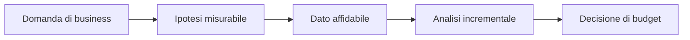

# Costruire un brand forte: dati e strategia

Benvenuti a questa lezione. Per anni, nel mondo digitale, il marketing è stato dominato da un mantra quasi ossessivo: la misurabilità immediata. Acronimi come CPA, ROAS e LTV sono diventati il Vangelo per startup e scale-up, relegando il "brand" a una voce di spesa nebulosa, spesso giustificata più dall'istinto del CEO che da un'analisi rigorosa. Eppure, qualcosa è cambiato. Prendiamo il caso di Zalando, il colosso europeo dell'e-commerce. Per quasi un decennio, la sua crescita è stata alimentata da un motore di performance marketing tra i più sofisticati al mondo. Poi, nel 2020, l'azienda ha lanciato la sua campagna "Cry of Joy", un investimento massiccio non finalizzato alla conversione diretta, ma alla costruzione di un legame emotivo. Dietro questa mossa apparentemente "soft" si celava un'analisi glaciale: il costo di acquisizione cliente (CAC) stava raggiungendo un plateau insostenibile. I dati mostravano che la crescita marginale ottenuta spendendo un milione di euro in più su Google Ads era diminuita del 15% anno su anno. L'analisi predittiva del loro team di data science indicava che, senza un brand forte che generasse traffico organico e diretto, il loro modello di crescita sarebbe imploso entro 36 mesi. Questa non è più una conversazione tra creativi e analisti; è una discussione strategica guidata dai dati, dove il brand diventa un asset quantificabile che genera un fossato competitivo duraturo.

## Dalla Performance al Brand Equity: Una Trasformazione Quantitativa

Il conflitto tra marketing di performance e brand building è, in gran parte, un artefatto di orizzonti temporali e metriche divergenti. Il performance marketing ottimizza per il breve termine: l'obiettivo è acquisire un utente al costo più basso possibile, oggi. Il brand building, invece, è un investimento a lungo termine il cui rendimento si manifesta in modo più sottile, ma non per questo meno misurabile. L'errore che molte organizzazioni data-driven commettono è applicare la stessa logica di misurazione a entrambe le discipline. Pretendere un ROAS diretto da una campagna di brand awareness è come chiedere a un seme di diventare un albero in una settimana. Il nostro compito, come analisti e ingegneri dei dati, è fornire un framework quantitativo per valutare questi investimenti a lungo termine.

Il concetto chiave da interiorizzare è quello di **Brand Equity**: il valore differenziale che il nome del brand conferisce a un prodotto. Questo valore non è astratto; si traduce in vantaggi economici tangibili. Un brand forte permette di:
1.  **Ridurre il CAC nel tempo**: Un consumatore che cerca "scarpe Nike" su Google costa molto meno da acquisire rispetto a uno che cerca "scarpe da corsa". Il primo è un "brand-led search", frutto di un investimento pregresso in brand equity.
2.  **Aumentare la Willingness-to-Pay**: I consumatori sono disposti a pagare un premium price per un brand di cui si fidano o che sentono affine ai propri valori. Questo margine extra va direttamente a migliorare la profittabilità.
3.  **Incrementare la Customer Lifetime Value (LTV)**: Un forte legame con il brand aumenta la retention e la fedeltà, riducendo il churn. I clienti fedeli tendono anche a esplorare più categorie di prodotto (cross-sell).
4.  **Creare un "fossato" competitivo (moat)**: Un concorrente può copiare le feature del tuo prodotto o eguagliare la tua spesa su Facebook Ads, ma non può replicare anni di fiducia e riconoscibilità costruiti con i clienti.

Come si misura questo progresso? Non con le conversioni, ma con metriche proxy che segnalano un cambiamento nella percezione e nel comportamento del mercato. Una delle più potenti è la **Share of Search**. Invece di misurare la Share of Voice (menzioni sui media, spesso costose da tracciare), si analizza la quota di ricerche organiche per il proprio brand rispetto al totale delle ricerche per tutti i brand in una data categoria. Les Binet e Peter Field, nel loro lavoro per l'IPA, hanno dimostrato una correlazione fortissima tra la Share of Search e la futura Share of Market. Se la tua Share of Search oggi è superiore alla tua attuale quota di mercato, è un segnale predittivo di crescita futura. Questo trasforma un dato pubblico e gratuito (Google Trends) in un indicatore strategico di primo livello.

## Decomposizione Analitica del Brand: I Quattro Pilastri Misurabili

Per rendere gestibile la misurazione del brand, possiamo scomporlo in quattro pilastri fondamentali, ciascuno con le proprie metriche e metodologie di analisi. Questo approccio ci permette di diagnosticare con precisione dove risiedono le forze e le debolezze della nostra strategia.

1.  **Distinctiveness (Riconoscibilità)**: Un brand esiste solo se viene in mente alle persone in un momento di bisogno. La riconoscibilità non riguarda solo il logo, ma un insieme di "brand assets" unici: un colore (il rosso Coca-Cola), un suono (il "ta-dum" di Netflix), un jingle, un testimonial. L'obiettivo è creare scorciatoie mentali.
    *   **Metriche**:
        *   **Brand Recall (Spontanea e Sollecitata)**: Misurata tramite survey. La domanda spontanea è "Quali servizi di streaming video conosci?". Quella sollecitata è "Conosci Netflix?". L'obiettivo è aumentare la percentuale di risposte positive, specialmente nella recall spontanea.
        *   **Unique Brand Asset Recognition**: Si possono condurre test A/B mostrando elementi del brand (es. una palette colori, un font) senza il logo, per misurare se vengono correttamente associati all'azienda. Spotify, ad esempio, testa costantemente se il suo iconico verde duotone viene riconosciuto anche in assenza del nome.
        *   **Brand Search Volume**: Il volume di ricerche organiche per il nome esatto del brand. Un aumento costante è un segnale di crescente "mental availability".

2.  **Relevance (Rilevanza)**: Essere riconoscibili non basta se il prodotto non è percepito come una soluzione valida a un bisogno del consumatore. La rilevanza collega il brand a una specifica categoria o a un'occasione d'uso.
    *   **Metriche**:
        *   **Consideration Rate**: Nelle survey, dopo aver stabilito la conoscenza del brand, si chiede: "Quali di questi brand considereresti per il tuo prossimo acquisto?". Questo misura il passaggio da "conosco" a "valuto".
        *   **Category-Brand Association**: Attraverso analisi testuali di recensioni, social media e survey, si può mappare quali categorie o attributi vengono associati al brand. Wise (ex TransferWise) monitora costantemente se viene associato a "trasferimenti internazionali veloci e a basso costo" piuttosto che a "banca tradizionale".

3.  **Esteem (Stima e Fiducia)**: I consumatori si fidano del brand? Lo rispettano? Sono disposti a raccomandarlo? Questo pilastro è legato alla qualità percepita, all'affidabilità e all'allineamento valoriale.
    *   **Metriche**:
        *   **Net Promoter Score (NPS)**: Sebbene controverso, l'NPS rimane un indicatore utile se segmentato correttamente. Un NPS aggregato di 50 dice poco. Ma sapere che l'NPS per i nuovi utenti è 30 mentre per gli utenti al terzo anno è 70 rivela una storia sulla curva di apprendimento del prodotto e sulla fedeltà.
        *   **Trust Score**: Misurato con domande dirette in survey ("Su una scala da 1 a 10, quanto ti fidi di [Brand] per gestire i tuoi dati personali?").
        *   **Premium Willingness**: La disponibilità a pagare un prezzo più alto rispetto a un'alternativa generica o a un competitor, che vedremo come quantificare.

4.  **Knowledge (Conoscenza)**: I consumatori capiscono chiaramente cosa offre il brand e cosa lo differenzia? Una value proposition confusa è un ostacolo insormontabile.
    *   **Metriche**:
        *   **Value Proposition Comprehension**: Tramite test qualitativi o survey a risposta aperta ("Con parole tue, cosa rende [Brand] diverso dagli altri?"), si può analizzare la chiarezza del posizionamento. L'analisi di queste risposte con tecniche di NLP può rivelare temi emergenti e fraintendimenti comuni.
        *   **Feature Awareness/Adoption**: Per i brand tecnologici, è utile misurare quante persone conoscono e usano le feature chiave che dovrebbero differenziare il prodotto.

Ciascuno di questi pilastri richiede un approccio di misurazione dedicato, combinando dati comportamentali (search volume, site traffic) con dati attitudinali (survey, focus group).

## Quantificare il Fossato Competitivo: Stima del Brand Premium

Parlare di "stima" e "fiducia" può suonare astratto a un CFO. La nostra sfida è tradurre questi concetti in euro. Lo strumento analitico d'elezione per questo compito è la **Conjoint Analysis**. Questa tecnica statistica ci permette di isolare il valore che i consumatori attribuiscono a ciascun attributo di un prodotto, incluso il brand stesso.

Immaginiamo di essere Bolt, il servizio di ride-hailing, e di voler quantificare il valore del nostro brand rispetto a un nuovo concorrente "FastRide" e al leader di mercato Uber. Invece di chiedere direttamente "Quanto pagheresti in più per Bolt?", creiamo una serie di scenari di scelta ipotetici. A un campione di utenti mostriamo diverse opzioni di corsa, ognuna definita da alcuni attributi:
*   **Brand**: Bolt, Uber, FastRide
*   **Tempo di attesa**: 2 minuti, 5 minuti, 8 minuti
*   **Prezzo**: 8€, 10€, 12€
*   **Valutazione autista**: 4.7 stelle, 4.9 stelle

L'utente deve semplicemente scegliere la sua opzione preferita per ogni scenario. Ripetendo questo processo decine di volte con combinazioni diverse, raccogliamo un dataset ricco che rivela i trade-off inconsci degli utenti. A questo punto, possiamo costruire un modello statistico (tipicamente un Logit multinomiale) per stimare l'utilità parziale di ogni livello di ogni attributo.

Il codice Python per analizzare questi dati potrebbe assomigliare a questo, utilizzando la libreria `statsmodels`:

```python
import pandas as pd
import statsmodels.formula.api as smf

# Assumiamo di avere un DataFrame 'df_choices' con le scelte degli utenti.
# 'chosen' è una colonna binaria (1 se l'opzione è stata scelta, 0 altrimenti).
# Le altre colonne sono dummy variables per ogni attributo/livello.
# Esempio di colonne: is_brand_bolt, is_brand_uber, wait_time_min, price_eur, driver_rating

# Il modello di regressione logistica stima la probabilità di scelta
# basandosi sull'utilità dei vari attributi.
# Omettiamo una categoria per ogni attributo come baseline (es. 'FastRide')
model = smf.logit("chosen ~ is_brand_bolt + is_brand_uber + wait_time_min + price_eur + driver_rating", data=df_choices).fit()

print(model.summary())

# I coefficienti rappresentano l'utilità parziale (part-worth utility)
# Un coefficiente negativo per il prezzo è atteso: all'aumentare del prezzo, l'utilità diminuisce.
params = model.params

# Calcoliamo il brand premium in termini monetari.
# Quanto valore monetario equivale all'utilità aggiuntiva del brand 'Bolt' rispetto alla baseline?
# La formula è: - (coefficiente_brand / coefficiente_prezzo)
price_coefficient = params['price_eur']
bolt_brand_coefficient = params['is_brand_bolt']
uber_brand_coefficient = params['is_brand_uber']

bolt_premium_vs_fastride = - (bolt_brand_coefficient / price_coefficient)
uber_premium_vs_fastride = - (uber_brand_coefficient / price_coefficient)

print(f"\nIl premio monetario del brand Bolt rispetto a FastRide è: €{bolt_premium_vs_fastride:.2f}")
print(f"Il premio monetario del brand Uber rispetto a FastRide è: €{uber_premium_vs_fastride:.2f}")
```

L'output di questa analisi non è un'opinione, ma un numero: "A parità di tempo di attesa e valutazione dell'autista, i consumatori sono disposti a pagare 1.25€ in più per una corsa con Bolt rispetto a FastRide". Questo numero, il **Brand Premium**, diventa un KPI strategico per il team di marketing. L'obiettivo per il prossimo anno potrebbe essere: "Aumentare il brand premium da 1.25€ a 1.50€". Questa metrica giustifica gli investimenti in campagne di brand, sponsorizzazioni e miglioramenti del servizio che non hanno un ritorno immediato in termini di conversioni.

## Il Sistema Nervoso del Brand: Progettare un Dashboard di Brand Health

Per monitorare la salute del brand in modo continuativo, non possiamo lanciare una conjoint analysis ogni settimana. Abbiamo bisogno di un sistema di indicatori più agili, un "sistema nervoso" che ci avvisi di cambiamenti nella percezione del mercato. Questo prende la forma di un **Dashboard di Brand Health**, un report tipicamente mensile o trimestrale che aggrega metriche da fonti diverse. La progettazione di questo dashboard è un esercizio di data engineering e analytics cruciale.

Gli indicatori si dividono in due categorie:
*   **Leading Indicators (predittivi)**: Segnali deboli che anticipano futuri cambiamenti. Sono spesso qualitativi o basati su dati non strutturati. Esempi: Social Sentiment, menzioni sulla stampa specializzata, Share of Search.
*   **Lagging Indicators (di consuntivo)**: Misurano risultati già avvenuti. Sono più robusti ma meno tempestivi. Esempi: Brand Recall, NPS, Brand Premium, traffico diretto.

Un buon dashboard bilancia entrambi. Per esempio, un calo improvviso nel Social Sentiment (leading) potrebbe anticipare un futuro calo dell'NPS (lagging) di diverse settimane.

**Caso Studio: Netflix e la metrica "Share of Conversation"**
Netflix non si limita a monitorare la propria Share of Search. Il suo team di data science ha sviluppato una metrica composita chiamata "Share of Conversation". Aggregano dati da Twitter, Reddit, YouTube e portali di recensioni, utilizzando l'NLP per identificare non solo le menzioni di "Netflix", ma anche quelle dei loro show principali ("Stranger Things", "The Crown"). Pesano queste menzioni in base all'engagement (like, condivisioni, commenti) e le confrontano con il volume totale di conversazioni relative allo streaming video (includendo Disney+, Prime Video, ecc.). Hanno scoperto che questa metrica è un predittore incredibilmente accurato della crescita di nuovi abbonati con un ritardo di un trimestre. Quando la "Share of Conversation" di uno show come "Squid Game" esplose nel 2021, il loro modello previde un'acquisizione di 12-15 milioni di nuovi utenti netti nel trimestre successivo, permettendo al team operations di preparare l'infrastruttura tecnica e al team finance di rivedere le previsioni di fatturato al rialzo.

Un possibile scheletro SQL per un indice aggregato di brand health potrebbe essere il seguente, unendo dati da diverse fonti interne:

```sql
WITH
  monthly_search AS (
    SELECT
      date_trunc('month', observation_date)::date AS report_month,
      -- Indice di Google Trends normalizzato per il brand
      avg(brand_search_index) AS avg_brand_search
    FROM marketing.google_trends_data
    WHERE brand_name = 'nostro_brand'
    GROUP BY 1
  ),
  monthly_traffic AS (
    SELECT
      date_trunc('month', session_start_ts)::date AS report_month,
      -- Percentuale di sessioni da canali diretti o organic brand search
      count(CASE WHEN channel IN ('Direct', 'Organic Search') AND landing_page LIKE '%utm_campaign=brand%' THEN session_id END) * 100.0 / count(session_id) AS pct_direct_brand_traffic
    FROM web_analytics.sessions
    GROUP BY 1
  ),
  monthly_nps AS (
    SELECT
      date_trunc('month', response_date)::date AS report_month,
      -- Calcolo dell'NPS
      (count(CASE WHEN score >= 9 THEN user_id END) - count(CASE WHEN score <= 6 THEN user_id END)) * 100.0 / count(user_id) AS nps_score
    FROM internal_surveys.nps_responses
    GROUP BY 1
  )
SELECT
  t.report_month,
  s.avg_brand_search,
  t.pct_direct_brand_traffic,
  n.nps_score,
  -- Indice composito pesato. I pesi sono strategici e decisi dal team.
  (s.avg_brand_search * 0.4) + (t.pct_direct_brand_traffic * 0.3) + (n.nps_score * 0.3) AS brand_health_index
FROM monthly_traffic AS t
LEFT JOIN monthly_search AS s
  ON t.report_month = s.report_month
LEFT JOIN monthly_nps AS n
  ON t.report_month = n.report_month
WHERE t.report_month >= current_date - interval '24 months'
ORDER BY t.report_month DESC;
```

Questo indice composito, sebbene una semplificazione, fornisce una singola metrica di alto livello per tracciare la salute del brand nel tempo, facilitando la comunicazione con la leadership.

## Laboratorio Pratico: Dall'Ipotesi alla Metrica

Ora tocca a voi. Affrontiamo tre esercizi progressivi per applicare i concetti visti. Non si tratta di un test, ma di un'applicazione pratica delle metodologie discusse, come fareste in un vero team di data analytics.

**Esercizio 1: Analisi della Share of Search (Livello Base)**
Il vostro CMO vuole capire come si posiziona il vostro brand, "Wise", nel mercato dei trasferimenti di denaro internazionali rispetto ai competitor "Revolut" e "Western Union".
1.  Andate su Google Trends.
2.  Confrontate i termini di ricerca "Wise", "Revolut" e "Western Union" a livello mondiale ("Worldwide") negli ultimi 5 anni.
3.  Esportate i dati settimanali in formato CSV.
4.  Utilizzando il vostro strumento preferito (Excel, Python/Pandas, R), calcolate la "Share of Search" settimanale per ogni brand. Per una data settimana, la Share of Search di Wise è `(Indice di Wise) / (Indice di Wise + Indice di Revolut + Indice di Western Union)`.
5.  Visualizzate le tre Share of Search in un grafico a linee nel tempo. Quali trend osservate? Ci sono eventi (es. campagne marketing, notizie) che coincidono con picchi o cali?

**Esercizio 2: Segmentazione dell'NPS (Livello Intermedio)**
Avete ricevuto un dataset di risposte NPS (`nps_responses.csv`) con le seguenti colonne: `user_id`, `response_date`, `nps_score`, `user_creation_date`, `country`. Il management si lamenta che l'NPS aggregato è stabile e "inutile".
1.  Calcolate l'NPS aggregato mensile per gli ultimi 12 mesi.
2.  Ora, segmentate. Calcolate l'NPS mensile separatamente per coorti di utenti. Create delle coorti basate sull'età dell'account (es. "primi 30 giorni", "31-365 giorni", "oltre 1 anno"). L'età si calcola come `response_date - user_creation_date`.
3.  Calcolate l'NPS mensile per i vostri 3 mercati principali (es. 'UK', 'USA', 'DE').
4.  Presentate i risultati. L'NPS è davvero stabile? O ci sono dinamiche divergenti tra segmenti che si annullano a vicenda nella media aggregata? Ad esempio, potreste scoprire che l'NPS dei nuovi utenti sta crollando, un segnale d'allarme mascherato dalla fedeltà degli utenti più vecchi.

**Esercizio 3: Identificare Conversioni "Brand-Led" (Livello Avanzato)**
Il vostro obiettivo è dimostrare il valore del brand sulle conversioni. Dovete scrivere una query SQL per distinguere le conversioni guidate dal brand da quelle guidate dalla performance. Lavorate con due tabelle: `sessions` (`session_id`, `user_id`, `session_start_ts`, `channel`, `utm_campaign`) e `conversions` (`conversion_id`, `user_id`, `conversion_ts`).
Una conversione è "brand-led" se una delle sessioni dell'utente *prima* della conversione proveniva da un canale "Direct" o da una campagna organica con il nome del brand (es. `utm_campaign = 'brand_search'`).
1.  Scrivete una query che, per ogni `user_id` che ha convertito, trovi la prima sessione in assoluto (`first_touch_channel`).
2.  Scrivete una query più complessa che, per ogni conversione, classifichi l'attribuzione come 'Brand-Led' o 'Performance-Led'. Potete usare un modello di attribuzione "last non-direct click" o, più semplicemente, verificare se *almeno una* sessione prima della conversione fosse di tipo brand.
3.  Calcolate il valore medio degli ordini (assumendo una colonna `conversion_value` in `conversions`) per i clienti 'Brand-Led' vs 'Performance-Led'. Quale gruppo è più profittevole? Questa analisi può giustificare un aumento del budget per le attività di brand building.

## Riepilogo

Abbiamo percorso un lungo cammino, smontando l'idea del brand come concetto puramente creativo per ricostruirlo come un asset strategico, misurabile e ottimizzabile. I punti chiave da portare con voi sono:

*   Il brand non è un'alternativa al performance marketing, ma un investimento a lungo termine che rende più efficiente ogni altra attività di marketing, riducendo il CAC e aumentando LTV.
*   Per misurare il brand, dobbiamo scomporlo in pilastri analitici come Riconoscibilità, Rilevanza, Stima e Conoscenza, ognuno con metriche proxy specifiche.
*   Tecniche statistiche come la Conjoint Analysis permettono di tradurre il valore del brand in un premio monetario tangibile, un KPI comprensibile da tutta l'azienda.
*   Un dashboard di Brand Health, che bilancia indicatori leading e lagging, funge da sistema di monitoraggio continuo, permettendo di correlare le attività di marketing con i cambiamenti nella percezione del mercato.
*   L'analisi non deve mai fermarsi alla media aggregata. La segmentazione per coorte, mercato o comportamento rivela le dinamiche sottostanti che guidano le decisioni strategiche.

Costruire un brand forte nell'era dei dati non significa abbandonare la creatività, ma potenziarla con un rigore analitico che permette di investire con più coraggio, misurare con più precisione e costruire un vantaggio competitivo che dura nel tempo.

## References

1.  Aaker, D. A. (1991). *Managing Brand Equity*. The Free Press.
2.  Sharp, B. (2010). *How Brands Grow: What Marketers Don't Know*. Oxford University Press.
3.  Binet, L., & Field, P. (2013). *The Long and the Short of It: Balancing Short and Long-Term Marketing Strategies*. Institute of Practitioners in Advertising (IPA).

```

## Problema reale

Nel lavoro su marketing analytics, **Costruire un brand forte: dati e strategia** serve a risolvere un problema concreto: trasformare budget, canali, creativita e audience in decisioni misurabili senza confondere volume, attribuzione e incrementalita. La domanda non e se il concetto sia interessante in astratto, ma quale decisione migliora quando lo applichi con dati affidabili e con una soglia di errore esplicita.

Questa lezione va studiata come uno strumento operativo: entro la fine devi saper Comprendere il problema analitico e il contesto decisionale; Applicare esempi, metriche e controlli a casi reali. Se non riesci a collegare il concetto a una scelta reale, la conoscenza resta decorativa e non diventa competenza.

## Modello concettuale



Il modello mentale e sequenziale: prima si formula la domanda, poi si traduce in unita osservabili, quindi si valuta la qualita del dato e solo alla fine si decide. Saltare un passaggio produce analisi eleganti ma fragili.

| Passaggio | Domanda guida | Output atteso |
|---|---|---|
| Framing | Quale decisione deve cambiare? | Una scelta concreta, non una curiosita |
| Misura | Quale segnale rappresenta il fenomeno? | Metrica, fonte e granularita |
| Confronto | Rispetto a quale baseline interpreto il risultato? | Benchmark o controfattuale plausibile |
| Azione | Che cosa faccio se il segnale supera la soglia? | Decisione, owner e prossimo controllo |

## Formalizzazione rigorosa

Formalizza **Costruire un brand forte: dati e strategia** come una relazione tra quattro elementi: unita di analisi, segnale, baseline e decisione. Nel contesto di questa lezione l'unita principale e **campagna, coorte, touchpoint o segmento cliente**. Il segnale da osservare deve essere collegato a **margine incrementale, CAC payback, conversion rate corretto, lift o retention generata**, mentre la baseline deve essere scelta tra **periodo precedente, gruppo holdout, mercato comparabile o benchmark storico**.

Una formulazione robusta segue questa logica:

| Elemento | Definizione operativa per questa lezione |
|---|---|
| Unita | campagna, coorte, touchpoint o segmento cliente |
| Segnale | margine incrementale, CAC payback, conversion rate corretto, lift o retention generata |
| Baseline | periodo precedente, gruppo holdout, mercato comparabile o benchmark storico |
| Decisione | spostare risorse, cambiare messaggio, fermare una tattica o scalare un esperimento |
| Rischio | Confondere correlazione, qualita del dato e causalita decisionale |

La regola pratica e semplice: una misura e utile solo se riduce l'incertezza su una decisione specifica. Se non cambia una scelta, e documentazione; se cambia una scelta senza controlli, e rischio.

## Esempio o caso studio

Un team growth deve decidere se aumentare il budget su un canale che mostra CPA basso ma vendite marginali deboli. La lezione aiuta a separare il segnale utile dal rumore operativo, collegando metrica, modello mentale e decisione economica.

Applicando **Costruire un brand forte: dati e strategia**, il team costruisce una lettura in tre colonne: cosa sappiamo, cosa assumiamo e quale decisione prendiamo. Questo formato impedisce di presentare un numero come se fosse una conclusione autosufficiente.

| Evidenza | Interpretazione prudente | Decisione conseguente |
|---|---|---|
| Segnale positivo ma non isolato | Il fenomeno esiste, ma la causa e ancora incerta | Cercare baseline o holdout |
| Segmento con risposta diversa | L'effetto medio nasconde eterogeneita | Analizzare coorti o sottogruppi |
| Costo operativo crescente | Il risultato va valutato sul margine | Applicare soglie economiche |

## Lab / esercizio

### Livello base

Prendi una decisione reale collegata a **Costruire un brand forte: dati e strategia** e scrivi in cinque righe: obiettivo, metrica primaria, baseline, rischio principale e azione prevista. Non usare piu di una metrica primaria.

### Livello intermedio

Costruisci una tabella con almeno tre segmenti o scenari. Per ciascuno indica segnale, possibile spiegazione alternativa e controllo necessario prima di decidere.

### Livello research-grade

Disegna un piano di validazione: ipotesi, dati necessari, criterio di esclusione, soglia decisionale e controllo post-decisione. Specifica anche che cosa ti farebbe cambiare idea.

### Dataset e materiali consigliati

Usa export campagne, costi media, eventi web o app, CRM, transazioni, survey brand e log di consenso. Se non hai dati reali, crea un dataset sintetico con 200-500 righe e almeno una colonna temporale, una colonna segmento, una metrica di outcome e una variabile di esposizione.

## Errore tipico da evitare

L'errore piu frequente e trattare **Costruire un brand forte: dati e strategia** come una definizione da ricordare invece che come un protocollo decisionale. In pratica succede quando si presenta una metrica senza baseline, un grafico senza ipotesi, o una raccomandazione senza costo dell'errore.

Un controllo utile e chiedersi: "se questo risultato fosse falso o instabile, quale decisione sbaglierei?". Se la risposta non e chiara, la lezione non e ancora stata applicata davvero.

## Quiz o checkpoint

1. Qual e la decisione concreta che questa lezione dovrebbe migliorare?
2. Quale baseline rende interpretabile il risultato?
3. Quale assunzione, se sbagliata, cambierebbe la conclusione?
4. Quale controllo minimo useresti prima di presentare la raccomandazione?

## Riepilogo operativo

**Costruire un brand forte: dati e strategia** e una competenza utile quando collega concetto, dato e decisione. Studiala partendo da un problema reale, formalizza il segnale, cerca una baseline credibile, costruisci un esempio e chiudi con un controllo pratico. Categoria: Decisione. Difficolta: advanced. Tempo stimato: 22 min.
