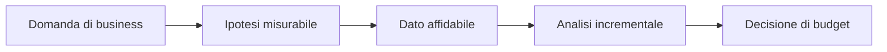

# CRM e email marketing analytics

Una sequenza di email può avere open rate alti, clic discreti e ricavi bassi. La tentazione è mettersi a limare l'oggetto della mail, quando il vero problema sta altrove: segmentazione sbagliata, timing infelice o una promessa commerciale che non convince. Conviene trattare il canale email come una relazione misurabile nel tempo, non come una raffica di invii isolati.

## Il problema reale

L'analisi su CRM ed email serve a trasformare budget, canali, creatività e audience in decisioni misurabili, senza confondere volume, attribuzione e incrementalità. La domanda utile non è se il concetto sia interessante in astratto, ma quale decisione migliora quando lo applichi con dati affidabili e una soglia di errore dichiarata.

È materiale operativo. Devi saper inquadrare il problema analitico e il contesto della decisione, e applicare esempi, metriche e controlli a casi reali. Finché non colleghi il concetto a una scelta concreta, resta conoscenza decorativa.

## Modello concettuale



Il modello mentale è sequenziale: prima si formula la domanda, poi si traduce in unità osservabili, quindi si valuta la qualità del dato e infine si decide. Saltare un passaggio produce analisi eleganti ma fragili.

| Passaggio | Domanda guida | Output atteso |
|---|---|---|
| Framing | Quale decisione deve cambiare? | Una scelta concreta, non una curiosità |
| Misura | Quale segnale rappresenta il fenomeno? | Metrica, fonte e granularità |
| Confronto | Rispetto a quale baseline interpreto il risultato? | Benchmark o controfattuale plausibile |
| Azione | Che cosa faccio se il segnale supera la soglia? | Decisione, owner e prossimo controllo |

## Formalizzazione rigorosa

Formalizza **CRM e email marketing analytics** come relazione tra quattro elementi: unità di analisi, segnale, baseline e decisione. L'unità principale può essere campagna, coorte, touchpoint o segmento cliente. Il segnale deve collegarsi a margine incrementale, CAC payback, conversion rate corretto, lift o retention generata. La baseline può essere periodo precedente, gruppo holdout, mercato comparabile o benchmark storico.

| Elemento | Definizione operativa |
|---|---|
| Unità | campagna, coorte, touchpoint o segmento cliente |
| Segnale | margine incrementale, CAC payback, conversion rate corretto, lift o retention generata |
| Baseline | periodo precedente, gruppo holdout, mercato comparabile o benchmark storico |
| Decisione | spostare risorse, cambiare messaggio, fermare una tattica o scalare un esperimento |
| Rischio | confondere correlazione, qualità del dato e causalità decisionale |

La regola pratica è semplice: una misura è utile solo se riduce l'incertezza su una decisione specifica. Se non cambia una scelta, è documentazione; se cambia una scelta senza controlli, è rischio.

## Dalla metrica di vanità all'impatto sul business: decostruire il funnel dell'email

L'analisi email spesso si basa su "metriche di vanità" come l'Open Rate, che ha perso affidabilità dopo l'introduzione della Mail Privacy Protection (MPP) di Apple nel 2021. MPP pre-carica le email tramite server proxy, gonfiando artificialmente le aperture registrate.

Un analista rigoroso deve spostare l'attenzione su metriche che collegano la campagna a un impatto economico reale:

1. **Click-Through Rate (CTR):** `(Clic unici / Email consegnate) * 100`. Indica un'intenzione esplicita.
2. **Click-to-Open Rate (CTOR):** `(Clic unici / Aperture uniche) * 100`. Proxy della pertinenza del messaggio.
3. **Conversion Rate (CVR):** Percentuale di utenti che completano l'azione desiderata dopo il clic.
4. **Revenue Per Email (RPE):** `Ricavi totali / Numero di email inviate`. Misura l'impatto finanziario.

### Esempio o caso studio

Un retailer invia due campagne a 200.000 iscritti:

| Campagna | Open Rate | CTR | CTOR | Conversion Rate | AOV (€) | Ricavi (€) | RPE (€) |
|---|---|---|---|---|---|---|---|
| A ("🔥 50% DI SCONTO SU TUTTO! 🔥") | 35% (gonfiato) | 2% (4.000) | 5.7% | 5% (200 acquisti) | 40 | 8.000 | 0.04 |
| B ("Nuovi arrivi selezionati per te, [Nome]") | 22% | 4.5% (9.000) | 20.5% | 8% (720 acquisti) | 65 | 46.800 | 0.234 |

L'analisi superficiale premia la Campagna A per l'open rate, ma la Campagna B genera quasi 6 volte più ricavi grazie a maggiore pertinenza e conversione. L'obiettivo è massimizzare il valore per invio, non le aperture.

## Anatomia della deliverability: oltre la cartella spam

La deliverability è la capacità delle email di raggiungere la casella principale. Se un'email finisce nello spam o non viene consegnata, tutte le altre metriche perdono significato. La deliverability dipende da tre pilastri:

1. **Autenticazione tecnica:**
   - SPF: record DNS che autorizza IP a inviare per il dominio.
   - DKIM: firma digitale che garantisce integrità.
   - DMARC: policy che indica come trattare email non autenticate.

2. **Reputazione dominio e IP:**
   - Tasso di lamentele per spam (soglia critica 0.1%).
   - Engagement degli utenti (aperture, clic, risposte).
   - Spam traps: indirizzi usati per identificare liste sporche.
   - Consistenza del volume di invio (warm-up necessario).

3. **Igiene della lista e politiche di engagement:**
   - Rimozione immediata dei bounce hard.
   - Sunset policy per utenti inattivi oltre 180 giorni.

### Query diagnostica per la lista

Identifica utenti iscritti da più di 90 giorni senza engagement negli ultimi 180 giorni:

```sql
SELECT
  u.user_id,
  u.email,
  u.subscription_date,
  MAX(e.event_timestamp) AS last_engagement_date
FROM users u
LEFT JOIN email_events e ON u.user_id = e.user_id AND e.event_type IN ('open', 'click')
WHERE u.is_subscribed = TRUE
  AND u.subscription_date <= CURRENT_DATE - INTERVAL '90 day'
GROUP BY u.user_id, u.email, u.subscription_date
HAVING MAX(e.event_timestamp) IS NULL
   OR MAX(e.event_timestamp) < CURRENT_DATE - INTERVAL '180 day';
```

Questa query è uno strumento strategico per proteggere la reputazione e la capacità di raggiungere la inbox.

## Esempio o caso studio

Garantita la deliverability e definite le metriche di business, l'analisi si concentra sulla pertinenza tramite segmentazione comportamentale e marketing basato sul ciclo di vita cliente.

Spotify è un esempio eccellente, orchestrando email come estensione naturale dell'esperienza in-app:

- **Onboarding e attivazione:** serie di email guidate da trigger come primo ascolto o creazione playlist, con KPI su attivazione e retention.
- **Engagement e retainment:** email personalizzate su nuovi album o campagne virali come "Spotify Wrapped", con CTOR fino a 250% superiore a newsletter generiche.
- **Riattivazione:** email mirate a utenti inattivi da 30 giorni, con offerte personalizzate e KPI di win-back.
- **Monetizzazione e upsell:** email che evidenziano benefici Premium basati su comportamenti specifici, con KPI di conversione da Free a Premium.

La segmentazione più efficace è comportamentale, non demografica, richiedendo infrastrutture dati capaci di agire su eventi in tempo quasi reale.

## A/B testing e inferenza causale nell'email marketing

L'ottimizzazione richiede un approccio scientifico per stabilire causalità tra modifica e risultato. Un A/B test valido è un esperimento controllato e randomizzato con:

1. **Ipotesi chiara e falsificabile:** definisce variabile da testare e metrica di successo.
2. **Randomizzazione e gruppo di controllo:** garantisce equivalenza statistica tra gruppi.
3. **Significatività statistica:** p-value inferiore a 0.05 per rifiutare ipotesi nulla.
4. **Potenza statistica e dimensione del campione:** calcolo a priori per evitare errori di tipo II.

Oltre all'A/B test classico, il test multivariato (MVT) permette di testare simultaneamente più modifiche combinandole.

## Lab / esercizio

### Livello base

Scrivi in cinque righe una decisione reale collegata a CRM e email marketing analytics: obiettivo, metrica primaria, baseline, rischio principale e azione prevista. Usa una sola metrica primaria.

### Livello intermedio

Costruisci una tabella con almeno tre segmenti o scenari. Per ciascuno indica segnale, possibile spiegazione alternativa e controllo necessario prima di decidere.

### Livello research-grade

Disegna un piano di validazione: ipotesi, dati necessari, criterio di esclusione, soglia decisionale e controllo post-decisione. Specifica cosa ti farebbe cambiare idea.

### Dataset e materiali consigliati

Usa export campagne, costi media, eventi web o app, CRM, transazioni, survey brand e log di consenso. Se non hai dati reali, crea un dataset sintetico con 200-500 righe e almeno una colonna temporale, una colonna segmento, una metrica di outcome e una variabile di esposizione.

## Errori frequenti e come evitarli

- **Confondere correlazione e causalità:** un A/B test o analisi controfattuale sono necessari per stabilire causalità.
- **Ignorare la stagionalità:** confronti senza correzione producono insight fuorvianti.
- **Non validare il grain della query:** join o filtri errati causano risultati sbagliati.

## Errore tipico da evitare

L'errore piu comune e trattare il risultato come una verita generale invece che come evidenza condizionata. Prima di agire, controlla baseline, assunzioni e costo dell'errore.

## Quiz o checkpoint

1. Qual è la decisione concreta che questa lezione dovrebbe migliorare?
2. Quale baseline rende interpretabile il risultato?
3. Quale assunzione, se sbagliata, cambierebbe la conclusione?
4. Quale controllo minimo useresti prima di presentare la raccomandazione?

## Riepilogo operativo

**CRM e email marketing analytics** è una competenza utile quando collega concetto, dato e decisione. Studiala partendo da un problema reale, formalizza il segnale, cerca una baseline credibile, costruisci un esempio e chiudi con un controllo pratico.

---
