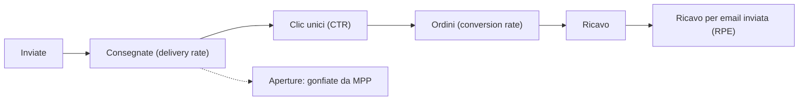

Scenario costruito, con numeri di esempio: un e-commerce di abbigliamento invia ogni venerdì una newsletter a 200.000 contatti. Il report della campagna di ottobre mostra un open rate del 35 per cento, il team festeggia, ma a fine mese il ricavo attribuito all'email è fermo e il CFO chiede perché il costo della piattaforma sia salito. La reazione istintiva è riscrivere l'oggetto per la terza volta. Il problema, quasi sempre, sta altrove: il messaggio arriva alla persona sbagliata, nel momento sbagliato, con una promessa che non regge il confronto con il prezzo.

Sul binario ml-tabellare l'email si legge come una catena di tabelle: invio, recapito, clic, ordine, ricavo. L'email è l'unico canale proprietario in cui ogni contatto ha una storia misurabile, e l'analisi serve a decidere chi contattare, con quale offerta e soprattutto quando stare zitti.

## Perché l'open rate non basta più

L'open rate è stato per anni la metrica regina, ma dal 2021 ha perso gran parte del suo significato. Con la Mail Privacy Protection, Apple precarica le immagini delle email tramite proxy prima che l'utente le apra: il pixel di tracciamento si attiva comunque e registra aperture mai avvenute. Un open rate del 35 per cento su una lista in cui metà dei contatti legge da Apple Mail è una cifra in cui non sappiamo più quanta parte sia persone e quanta sia un proxy.

> **Idea chiave:** Una campagna email si giudica dal ricavo per email inviata e dall'incremento rispetto a chi non l'ha ricevuta, non dalle aperture e nemmeno dai ricavi attribuiti con l'ultimo clic.

Esistono altri due inganni, meno discussi. Il primo è il volume: inviare a 500.000 contatti invece che a 200.000 fa salire i ricavi assoluti, ma se i 300.000 aggiunti sono dormienti il costo si paga in deliverability, cioè nella quota di messaggi che finisce in spam. Il secondo è l'attribuzione last-click: l'email spesso intercetta una domanda già formata, e una parte degli acquisti sarebbe avvenuta comunque, con o senza la newsletter del venerdì.



Il diagramma ordina le metriche dal recapito al ricavo. Le aperture restano nel disegno solo come ramo laterale tratteggiato, utile per diagnosi di oggetto e orario ma non come misura di risultato.

## Dal recapito al ricavo: due campagne a confronto

Prendiamo due campagne inviate entro lo stesso mese alla stessa base di 200.000 contatti. Per rendere confrontabili campagne con tassi di recapito diversi, calcoliamo il CTR sugli inviati.

| Campagna | Open rate | CTR sugli inviati | Conversion rate (ordini su clic) | Scontrino | Ricavi | RPE |
| --- | --- | --- | --- | --- | --- | --- |
| A, sconto generico | 35% (gonfiato da MPP) | 2,0% | 5,0% | 40 euro | 8.000 euro | 0,04 euro |
| B, selezione personalizzata | 22% | 4,5% | 8,0% | 65 euro | 46.800 euro | 0,234 euro |

Il calcolo parte sempre dal numero di invii e scende stadio per stadio. Per la campagna A: 200.000 invii × 2,0% = 4.000 clic; 4.000 × 5,0% = 200 ordini; 200 × 40 euro = 8.000 euro; 8.000 / 200.000 = 0,04 euro per email. Per la campagna B: 200.000 × 4,5% = 9.000 clic; 9.000 × 8,0% = 720 ordini; 720 × 65 euro = 46.800 euro; 46.800 / 200.000 = 0,234 euro per email.

La campagna A vince all'apertura e perde quasi sei a uno sui ricavi: 46.800 / 8.000 = 5,85. A spiegare la differenza non è l'oggetto, ma l'offerta: lo sconto generico attira clic poco qualificati che convertono al 5 per cento, la selezione personalizzata attira meno aperture ma clic con intenzione d'acquisto reale.

Ogni stadio ha la sua metrica onesta. Il delivery rate è dato dalle email consegnate diviso quelle inviate: sotto il 95 per cento ci sono problemi tecnici o di qualità della lista. Il CTR, calcolato sui clic unici, misura l'attrattiva dell'offerta. Il CTOR, cioè i clic divisi per le aperture, isola la qualità del contenuto ma va letto con cautela, perché il denominatore è inquinato dalle aperture automatiche. Il conversion rate guarda ordini su clic e giudica la coerenza tra email e pagina di arrivo. La revenue per email riporta tutto in un numero confrontabile tra campagne di dimensioni diverse.

### Errore: scegliere la campagna dall'open rate

Il sintomo è un report in cui la campagna con più aperture riceve più budget creativo, mentre il ricavo mensile non si muove. Succede perché l'apertura è la prima metrica disponibile e la più facile da spiegare al management. Si corregge cambiando la colonna di ordinamento del report: ricavo per email e conversion rate per ogni segmento, con l'open rate relegato a metrica diagnostica.

## La deliverability decide prima del contenuto

Se l'email non arriva in inbox, il miglior copy del mondo vale zero. Per arrivare ai grandi provider servono tre record DNS allineati: SPF, che dichiara quali server possono inviare per il dominio, DKIM, che firma crittograficamente il messaggio, e DMARC, che stabilisce che cosa fare quando SPF o DKIM falliscono. Senza i tre record allineati una parte del traffico viene scartata prima ancora che qualcuno guardi il contenuto, ed è la causa più comune di crolli improvvisi dopo una migrazione di provider.

Da febbraio 2024 Google e Yahoo applicano ai mittenti bulk, cioè sopra i 5.000 messaggi al giorno verso le loro caselle, tre requisiti: autenticazione SPF e DKIM, allineamento DMARC e un tasso di reclami per spam sotto lo 0,3 per cento, con un obiettivo operativo sotto lo 0,1. Chi supera la soglia vede le proprie email finire nello spam o essere rifiutate, a prescindere da oggetto e creatività. La deliverability ha smesso di essere una buona pratica facoltativa ed è diventata un cancello misurato dai provider.

Anche i picchi di volume vengono letti come segnale. Passare da 20.000 a 300.000 invii in un giorno assomiglia al comportamento di uno spammer e deprime la reputazione del dominio mittente. Quando serve scalare, si fa con un riscaldamento graduale, aumentando i volumi ogni giorno e partendo dai contatti più attivi.

### Errore: scrivere la campagna prima di controllare il recapito

Il sintomo è un calo improvviso di clic e ricavi dopo un cambio di provider o di dominio di invio, con aperture apparentemente stabili per via dei proxy. Succede perché il team guarda le metriche di contenuto e non il tasso di consegna o i reclami. La correzione è un audit prima di ogni campagna: record DNS, tasso di reclami degli ultimi invii e quota di dormienti nella lista.

## Sunset policy: smettere di scrivere a chi non risponde

La sunset policy decide quando un contatto smette di ricevere email commerciali. Un segmento dormiente da oltre sei mesi converte sotto lo 0,1 per cento per invio e genera la maggior parte dei reclami, con il risultato di abbassare la reputazione per tutti gli altri iscritti. La regola operativa è semplice: un iscritto da oltre 90 giorni senza alcuna apertura o clic negli ultimi 180 diventa candidato alla riconquista. Chi non risponde a una o due email di riconquista resta nel CRM per i messaggi transazionali, come conferme d'ordine e spedizioni, ma non riceve più il commerciale.

La query seguente individua i candidati. Il LEFT JOIN conserva anche gli iscritti che non hanno mai generato un evento, e la clausola HAVING seleziona sia chi non ha interazioni sia chi ha un'ultima interazione più vecchia di 180 giorni.

```sql
-- Contatti dormienti candidati alla sunset policy
SELECT u.user_id, u.email, MAX(e.event_timestamp) AS ultima_interazione
FROM users AS u
LEFT JOIN email_events AS e
  ON u.user_id = e.user_id AND e.event_type IN ('open', 'click')
WHERE u.is_subscribed = TRUE
  AND u.subscription_date <= CURRENT_DATE - INTERVAL '90 day'
GROUP BY u.user_id, u.email
HAVING MAX(e.event_timestamp) IS NULL
    OR MAX(e.event_timestamp) < CURRENT_DATE - INTERVAL '180 day';
```

Un dettaglio che il team tecnico conosce bene: dopo il 2021 un'apertura può essere un proxy. Per questo conviene contare come interazione anche i clic e gli accessi al sito dei contatti identificati, e non soltanto la colonna delle aperture. La sunset non è una pulizia annuale ma un flusso continuo: la query gira ogni settimana e alimenta in automatico il flusso di riconquista.

### Errore: pulire la lista una volta l'anno

Il sintomo è un picco di reclami e di bounce tre o quattro mesi dopo ogni pulizia. Succede perché la lista si sporca di nuovo a ritmo costante e una pulizia annuale arriva quando il danno alla reputazione è già avvenuto. Si corregge con la sunset automatizzata e con un controllo trimestrale della quota di dormienti sulla base totale.

## Segmenti comportamentali e flussi automatici

La segmentazione demografica spiega poco del comportamento d'acquisto via email. Quella che sposta CTR e conversioni è comportamentale: lo stadio del ciclo di vita, la recenza e la frequenza d'acquisto. Il framework RFM, recency, frequency e monetary, ordina i clienti in gruppi leggibili: campioni, fedeli in raffreddamento, nuovi da consolidare, dormienti. A ogni gruppo corrisponde un messaggio diverso, e sul gruppo dei fedeli in raffreddamento l'azione ha un ritorno spesso più alto che sui nuovi.

I flussi automatici generano di solito una quota sproporzionata dei ricavi email, spesso oltre la metà, perché arrivano quando l'intenzione esiste già. Il carrello abbandonato lavora in tre tocchi: un promemoria neutro dopo poche ore, un messaggio di assistenza dopo un giorno, un incentivo solo per chi ne ha davvero bisogno. Dare lo sconto al primo tocco insegna ai clienti ad abbandonare il carrello apposta. La riattivazione scatta dopo 30-90 giorni senza acquisti, la sunset dopo i 180 giorni descritti sopra.

Serve infine un tetto di frequenza globale, con una priorità dichiarata: transazionale sopra trigger, trigger sopra campagne massive. Senza questa regola ogni flusso ragiona per sé e nessuno vede il totale, per cui i clienti migliori, che sono anche i più reattivi ai trigger, finiscono per essere i più bombardati.

## A/B test e incrementalità con holdout

Testare l'oggetto su 2.000 invii per gruppo e proclamare vincitore un CTR del 3,1 per cento contro 2,8 significa leggere rumore. Per confrontare due tassi di clic, 3,0 e 3,6 per cento, con potenza dell'80 per cento e livello di significatività del 5 per cento, la dimensione per gruppo si ricava dalla formula n = 2 × p̄ × (1 − p̄) × (1,96 + 0,84)² / (p2 − p1)².

Calcolo: p̄ = (0,030 + 0,036) / 2 = 0,033; 2 × 0,033 × 0,967 = 0,0638; (1,96 + 0,84)² = 7,84; 0,0638 × 7,84 = 0,500; il denominatore è 0,006² = 0,000036; quindi n = 0,500 / 0,000036 ≈ 13.900 invii per variante. Con tassi bassi servono decine di migliaia di invii: chi non li ha deve testare differenze grandi, come layout, offerta e segmentazione, e non sfumature di punteggiatura.

```python
import math

p1 = 0.030              # CTR atteso del controllo
p2 = 0.036              # CTR minimo che giustifica il cambio (+20% relativo)
alpha_z, beta_z = 1.96, 0.84   # p < 0,05 a due code, potenza 80%
p_medio = (p1 + p2) / 2
n = 2 * p_medio * (1 - p_medio) * (alpha_z + beta_z) ** 2 / (p2 - p1) ** 2
print(f"Invii per variante: {math.ceil(n):,}")   # circa 13.900
```

L'A/B test risponde a quale variante funziona meglio, non a quanto vale la campagna. Per quella domanda serve l'holdout sistematico: trattenere ogni settimana il 5-10 per cento degli utenti da ogni campagna massiva e confrontare gli acquisti pro capite. Il lift incrementale è (tasso inviati − tasso holdout) / tasso holdout.

Esempio numerico con una base di 100.000 contatti e un holdout del 10 per cento. Il gruppo inviato conta 90.000 contatti e registra 720 ordini, cioè uno 0,80 per cento; l'holdout conta 10.000 contatti e registra 50 ordini, cioè uno 0,50 per cento. Il lift è (0,80 − 0,50) / 0,50 = 60 per cento. Gli ordini che sarebbero avvenuti comunque sono 90.000 × 0,50% = 450, quindi gli ordini incrementali sono 720 − 450 = 270, pari a tre ottavi di quelli attribuiti: 270 / 720 = 37,5 per cento. Con uno scontrino di 60 euro, il ricavo incrementale è 270 × 60 = 16.200 euro, contro i 43.200 euro che l'attribuzione last-click assegnerebbe alla campagna.

### Errore: dichiarare vincitore un test sotto la soglia di campione

Il sintomo è un vincitore che al rilancio non conferma il risultato. Succede perché con campioni piccoli due varianti identiche mostrano scarti del 10 per cento per puro caso. Si corregge fissando la dimensione del campione prima dell'invio e non guardando il risultato prima di averla raggiunta.

Un'ultima nota sulle coorti acquisite con incentivo. Su un database che cresce con lo sconto di benvenuto del 15 per cento, la coorte si giudica sul margine cumulato a un anno e non sulla RPE della welcome email, perché i clienti entrati con lo sconto possono avere una retention più bassa di quelli entrati senza.

## Verifica sulle tue campagne

1. Una campagna di 150.000 invii ha CTR sugli inviati del 3,0 per cento, conversion rate del 6 per cento e scontrino di 50 euro. Quanto vale la revenue per email?

<details>
<summary>Mostra risposta</summary>

150.000 × 3,0% = 4.500 clic; 4.500 × 6% = 270 ordini; 270 × 50 euro = 13.500 euro; 13.500 / 150.000 = 0,09 euro per email inviata.

</details>

2. Perché un open rate del 40 per cento oggi non dimostra che metà dei destinatari abbia letto il messaggio?

<details>
<summary>Mostra risposta</summary>

Perché la Mail Privacy Protection di Apple precarica le immagini tramite proxy e il pixel registra aperture che nessuno ha compiuto. Una parte del 40 per cento è traffico automatico, e non sappiamo stimarla senza incrociare le aperture con i clic.

</details>

3. Un mittente invia 8.000 email al giorno verso Gmail e riceve reclami sullo 0,4 per cento dei messaggi. Quali due fatti rendono la situazione critica?

<details>
<summary>Mostra risposta</summary>

Supera i 5.000 messaggi al giorno, quindi è un mittente bulk soggetto ai requisiti di Google, e il tasso di reclami dello 0,4 per cento è sopra la soglia dello 0,3. Il rischio è che le email finiscano nello spam o vengano rifiutate, a prescindere dal contenuto.

</details>

4. I destinatari di una campagna convertono allo 0,9 per cento e l'holdout allo 0,6 per cento. Quanto vale il lift e quale quota degli ordini dei destinatari è incrementale?

<details>
<summary>Mostra risposta</summary>

Il lift è (0,9 − 0,6) / 0,6 = 50 per cento. La quota incrementale è 0,3 / 0,9, cioè un terzo: due ordini su tre sarebbero avvenuti comunque.

</details>
