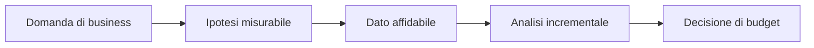

# CRM e email marketing analytics


Una sequenza email mostra open rate alti, clic discreti e ricavi bassi. Il rischio è ottimizzare l'oggetto della mail mentre il vero problema è segmentazione, timing o promessa commerciale. **CRM e email marketing analytics** guarda il canale come relazione misurabile, non come serie di invii isolati.

## Una scena da cui partire

Leggi questa lezione come diagnosi del ciclo di vita cliente. Aperture e click sono segnali intermedi: la metrica importante è se il CRM muove utenti giusti verso azioni coerenti, senza bruciare fiducia o saturare la lista.

- **Contesto:** Quale segmento riceve davvero valore dalla comunicazione?
- **Metodo:** Quale controllo separa engagement superficiale da impatto economico?
- **Applicazione:** Quale regola di frequenza difenderesti davanti al team commerciale?

## Dalla Metrica di Vanità all'Impatto sul Business: Decostruire il Funnel dell'Email

L'analisi dell'email marketing è spesso inquinata da quelle che potremmo definire "metriche di vanità". L'Open Rate, o tasso di apertura, è l'esempio più classico. Per anni ha rappresentato il primo indicatore di successo di una campagna, misurando apparentemente l'efficacia di un oggetto. Tuttavia, la sua utilità è drasticamente diminuita, soprattutto dopo l'introduzione della Mail Privacy Protection (MPP) da parte di Apple nel 2021 su iOS 15. Questa funzionalità pre-carica il contenuto delle email, incluso il pixel di tracciamento dell'apertura, attraverso server proxy. Il risultato è che una porzione significativa di email vengono registrate come "aperte" anche se l'utente non le ha mai visualizzate, inflazionando artificialmente la metrica e rendendola inaffidabile per una vasta fetta di pubblico.

Un analista rigoroso deve spostare l'attenzione su una catena causale di metriche che conducono a un impatto misurabile sul business.
1.  **Click-Through Rate (CTR):** Calcolato come `(Clic unici / Email consegnate) * 100`, misura un'intenzione esplicita. Un utente che clicca sta dedicando tempo e attenzione. È il primo vero segnale di interesse per il contenuto.
2.  **Click-to-Open Rate (CTOR):** Calcolato come `(Clic unici / Aperture uniche) * 100`, questo indicatore, pur risentendo dell'inflazione delle aperture, è un proxy eccellente per la pertinenza del messaggio. Dice: "Tra coloro che hanno (potenzialmente) visto la tua email, quale percentuale ha trovato il contenuto abbastanza convincente da agire?". Un CTOR elevato suggerisce un forte allineamento tra l'oggetto, l'anteprima e il corpo dell'email.
3.  **Conversion Rate (CVR):** La percentuale di utenti che, dopo aver cliccato, completa l'azione desiderata (acquisto, iscrizione, download). Questa metrica collega direttamente la campagna a un obiettivo di business.
4.  **Revenue Per Email (RPE) o Revenue Per Mille (RPM):** L'indicatore finanziario definitivo. L'RPE si calcola come `Ricavi totali generati dalla campagna / Numero di email inviate`. L'RPM è la stessa metrica ma normalizzata su 1000 invii, utile per confrontare campagne di dimensioni diverse.

Consideriamo un esempio pratico. Un retailer di abbigliamento invia due campagne a 200.000 iscritti.
*   **Campagna A (Oggetto: "🔥 50% DI SCONTO SU TUTTO! 🔥"):**
    *   Open Rate (gonfiato da MPP): 35%
    *   CTR: 2% (4.000 clic)
    *   CTOR: 5.7%
    *   Conversion Rate (sui clic): 5% (200 acquisti)
    *   Valore medio dell'ordine (AOV): €40
    *   Ricavi totali: 200 * €40 = €8.000
    *   **RPE: €8.000 / 200.000 = €0.04**
*   **Campagna B (Oggetto: "Nuovi arrivi selezionati per te, [Nome]")**:
    *   Open Rate: 22%
    *   CTR: 4.5% (9.000 clic)
    *   CTOR: 20.5%
    *   Conversion Rate: 8% (720 acquisti)
    *   AOV: €65 (gli utenti acquistano prodotti a prezzo pieno e più pertinenti)
    *   Ricavi totali: 720 * €65 = €46.800
    *   **RPE: €46.800 / 200.000 = €0.234**

L'analisi superficiale basata sull'Open Rate avrebbe premiato la Campagna A. Un'analisi orientata al business dimostra che la Campagna B, pur con un'apertura inferiore, ha generato un impatto economico quasi 6 volte superiore grazie a una maggiore pertinenza, testimoniata da un CTOR e un CVR nettamente più alti. L'obiettivo dell'analista non è massimizzare le aperture, ma il valore estratto da ogni singolo invio.

## Anatomia della Deliverability: Oltre la Cartella Spam

La deliverability, ovvero la capacità delle email di raggiungere la casella di posta principale del destinatario, è il fondamento su cui poggia l'intera analisi. Se un'email non viene consegnata o finisce direttamente nella cartella spam, tutte le altre metriche diventano irrilevanti. La deliverability non è un semplice interruttore on/off, ma il risultato di un complesso sistema di reputazione gestito dagli Internet Service Provider (ISP) come Gmail, Outlook e Yahoo. Un analista deve interpretarla come un problema "econometrico" in cui la propria reputazione è un asset da costruire e proteggere. Questa reputazione si basa su tre pilastri interconnessi.

**1. Autenticazione Tecnica:** È l'infrastruttura di base che garantisce l'identità del mittente. Senza di essa, un ISP non ha motivo di fidarsi.
*   **SPF (Sender Policy Framework):** Un record DNS che elenca gli indirizzi IP autorizzati a inviare email per conto del tuo dominio. Funziona come un passaporto: se il server di invio non è nella lista, l'email è sospetta.
*   **DKIM (DomainKeys Identified Mail):** Aggiunge una firma digitale crittografica all'intestazione dell'email. Il server del destinatario può verificare questa firma usando una chiave pubblica nel DNS del mittente, garantendo che il messaggio non sia stato alterato durante il transito.
*   **DMARC (Domain-based Message Authentication, Reporting, and Conformance):** Una policy che indica agli ISP cosa fare con le email che falliscono i controlli SPF o DKIM (es. `p=quarantine` o `p=reject`). Fornisce anche report preziosi sui tentativi di spoofing, trasformando l'autenticazione da un'azione passiva a un sistema di monitoraggio attivo.

**2. Reputazione del Dominio e dell'IP:** Gli ISP utilizzano algoritmi di machine learning per assegnare un punteggio di reputazione sia al dominio di invio (`@azienda.com`) sia all'indirizzo IP del server. I segnali che alimentano questi modelli sono numerosi:
*   **Tasso di lamentele per spam:** Il segnale negativo più forte. Un tasso superiore allo 0.1% è un campanello d'allarme critico.
*   **Engagement:** Gli ISP monitorano se gli utenti aprono, cliccano, rispondono o inoltrano le email. Un alto engagement è un potente segnale positivo che indica che i messaggi sono desiderati.
*   **Spam Traps:** Indirizzi email, spesso vecchi o creati appositamente dagli ISP, utilizzati per identificare i mittenti che non curano l'igiene delle proprie liste. Inviare a una spam trap è un grave danno reputazionale.
*   **Consistenza del volume di invio:** Picchi improvvisi e massicci di invii da un nuovo IP o dominio sono un comportamento tipico degli spammer. È necessario un "riscaldamento" graduale (warm-up) per costruire la reputazione.

**3. Igiene della Lista e Politiche di Engagement:** Questo è l'aspetto più strategico. La qualità della lista è più importante della sua dimensione. Pratiche di igiene proattiva sono essenziali.
*   **Rimozione dei bounce:** Gli indirizzi che restituiscono un hard bounce (errore permanente, es. indirizzo inesistente) devono essere rimossi immediatamente.
*   **Sunset Policy:** Implementare una politica di "tramonto" per gli utenti inattivi. Un utente che non ha aperto o cliccato un'email negli ultimi 180 giorni è, ai fini della deliverability, più un rischio che un'opportunità. Questi utenti andrebbero spostati in un segmento a bassissima frequenza o rimossi del tutto. Sembra controintuitivo ridurre la propria lista, ma migliora drasticamente la reputazione e, di conseguenza, le performance sull'audience attiva.

Un analista può monitorare la salute della lista con una query SQL come la seguente, che identifica gli utenti candidati per una campagna di riattivazione o per la sunset policy.

```sql
-- Identifica gli utenti iscritti da più di 90 giorni
-- che non hanno mostrato engagement negli ultimi 180 giorni.
SELECT
    u.user_id,
    u.email,
    u.subscription_date,
    MAX(e.event_timestamp) AS last_engagement_date
FROM
    users u
LEFT JOIN
    email_events e ON u.user_id = e.user_id AND e.event_type IN ('open', 'click')
WHERE
    u.is_subscribed = TRUE
    AND u.subscription_date <= CURRENT_DATE - INTERVAL '90 day'
GROUP BY
    u.user_id, u.email, u.subscription_date
HAVING
    MAX(e.event_timestamp) IS NULL
    OR MAX(e.event_timestamp) < CURRENT_DATE - INTERVAL '180 day';

```
Questa query non è solo un esercizio tecnico; è lo strumento diagnostico per una decisione strategica che protegge l'asset più importante dell'email marketing: la capacità di raggiungere la inbox.

## Segmentazione Comportamentale e Lifecycle Marketing: il Caso Spotify

Una volta garantita la deliverability e definite le metriche di business, l'analisi si sposta sulla massimizzazione della pertinenza. Il modo più efficace per raggiungere questo obiettivo è passare da campagne "batch and blast" (un messaggio uguale per tutti) a una comunicazione basata sul ciclo di vita del cliente (lifecycle marketing), orchestrata da trigger comportamentali. Spotify è un maestro in questo campo, utilizzando i dati per rendere ogni interazione via email un'estensione naturale dell'esperienza in-app.

Il lifecycle marketing di Spotify può essere scomposto in diverse fasi, ognuna con obiettivi e metriche specifiche:
*   **Onboarding e Attivazione:** L'obiettivo non è semplicemente dare il benvenuto, ma guidare l'utente verso il "momento aha!", ovvero la scoperta del valore principale del prodotto. Invece di un'unica email di benvenuto, Spotify orchestra una serie di comunicazioni.
    *   **Trigger:** Primo ascolto di una canzone. **Azione:** Email che suggerisce di creare una playlist o di seguire l'artista.
    *   **Trigger:** Creazione della prima playlist. **Azione:** Email che spiega come rendere le playlist collaborative o come usare Spotify Connect.
    *   **KPI primario:** Tasso di attivazione (es. % di utenti che creano una playlist entro 7 giorni), retention a D7 e D30.
    *   **KPI secondario:** Adozione di feature secondarie (es. podcast, radio).
*   **Engagement e Retainment:** Per gli utenti attivi, l'obiettivo è rafforzare l'abitudine e dimostrare un valore continuo.
    *   **Trigger:** Un artista seguito dall'utente pubblica un nuovo album. **Azione:** Notifica email personalizzata con un link diretto all'album. Queste email hanno un CTOR che, secondo analisi del settore, può essere fino al 250% superiore rispetto a newsletter generiche.
    *   **Trigger:** Dati aggregati di ascolto. **Azione:** La celebre campagna annuale "Spotify Wrapped". Questa non è solo un'email, ma un evento di marketing virale. Trasforma i dati personali in un'esperienza condivisibile, generando un enorme passaparola organico. Nel 2022, "Wrapped" ha generato un aumento stimato del 21% nelle menzioni sui social media e un lift del 7% nelle riaperture dell'app da parte di utenti dormienti nella settimana del lancio.
*   **Riattivazione (Re-engagement):** Quando un utente diventa inattivo, l'approccio di Spotify è mirato e contestuale.
    *   **Trigger:** Inattività per 30 giorni. **Azione:** Email "Ci manchi" che non si limita a un generico sconto, ma evidenzia cosa si è perso l'utente, come "Scopri le nuove uscite dei tuoi artisti preferiti" o una playlist personalizzata "Scoperta della settimana" basata sui suoi ascolti passati.
    *   **KPI primario:** Tasso di win-back (% di utenti inattivi che tornano attivi entro 30 giorni dalla campagna).
    *   **KPI secondario:** Valore recuperato (CLV degli utenti riattivati).
*   **Monetizzazione e Upsell:** Le comunicazioni sono integrate nel percorso per convertire gli utenti gratuiti in abbonati Premium.
    *   **Trigger:** L'utente salta un numero elevato di brani o cerca di usare una funzionalità solo Premium. **Azione:** Email che evidenzia i benefici specifici di Premium legati a quel comportamento (es. "Ascolta senza limiti e senza interruzioni").
    *   **KPI:** Tasso di conversione da Free a Premium.

Il successo di Spotify dimostra che la segmentazione più potente non è demografica ("uomini 25-34"), ma comportamentale ("utenti che ascoltano musica elettronica per più di 5 ore a settimana ma non hanno mai ascoltato un podcast"). Questa granularità richiede un'infrastruttura dati capace di catturare e agire su eventi in tempo quasi reale, trasformando il CRM da un semplice strumento di invio a un motore di orchestrazione dell'esperienza utente.

## A/B Testing e Inferenza Causale nell'Email Marketing

L'ottimizzazione delle campagne email non può basarsi sull'intuizione o sulle "best practice" generiche. Richiede un approccio scientifico per stabilire una relazione di causa-effetto tra una modifica e un risultato. L'A/B testing, o split testing, è lo strumento principale per raggiungere questo scopo, ma la sua implementazione deve essere metodologicamente rigorosa per produrre risultati affidabili.

Un A/B test valido è un esperimento controllato e randomizzato. I suoi componenti fondamentali sono:
1.  **Ipotesi Chiara e Falsificabile:** Ogni test deve iniziare con un'ipotesi che leghi una causa a un effetto. Un'ipotesi debole è: "Cambiamo il colore del bottone". Un'ipotesi forte è: "Cambiare il testo del CTA da 'Scopri di più a 'Ottieni il tuo sconto' nella nostra email di carrello abbandonato aumenterà il tasso di recupero del carrello del 15%, perché crea un senso di urgenza e un beneficio immediato". L'ipotesi definisce la variabile da testare (il testo del CTA) e la metrica di successo (tasso di recupero).
2.  **Randomizzazione e Gruppo di Controllo:** Il campione di utenti deve essere diviso casualmente in due o più gruppi. Il Gruppo A (controllo) riceve la versione esistente (la "baseline"). Il Gruppo B (variante o trattamento) riceve la nuova versione. La randomizzazione è essenziale per garantire che i due gruppi siano statisticamente equivalenti e che ogni differenza osservata nei risultati sia attribuibile alla modifica testata, e non a bias preesistenti.
3.  **Significatività Statistica:** Al termine del test, non basta osservare che la Variante B ha performato meglio. Dobbiamo determinare se questa differenza è statisticamente significativa o se potrebbe essere dovuta al caso. Si calcola il p-value, che rappresenta la probabilità di osservare una differenza pari o superiore a quella misurata, assumendo che in realtà non ci sia alcuna differenza tra le versioni (l'ipotesi nulla). Convenzionalmente, se p &lt;0.05, si rifiuta l'ipotesi nulla e si conclude che la differenza è statisticamente significativa. È anche importante considerare gli intervalli di confidenza, che forniscono un range di valori plausibili per l'effetto reale.
4.  **Potenza Statistica e Dimensione del Campione:** Prima di lanciare il test, è necessario calcolare la dimensione minima del campione richiesta per ogni variante. Questo calcolo dipende da quattro fattori: la metrica di base (baseline conversion rate), l'effetto minimo rilevabile (minimum detectable effect, MDE), il livello di significatività desiderato (α, solitamente 0.05) e la potenza statistica (1-β, solitamente 0.80). La potenza è la probabilità di rilevare un effetto se questo esiste realmente. Un test con bassa potenza rischia di non trovare un vincitore anche se una versione è effettivamente migliore (errore di tipo II).

Oltre al classico A/B testing, esistono approcci più sofisticati. Il **test multivariato (MVT)** permette di testare simultaneamente più modifiche su una pagina (es. Oggetto + Immagine + CTA). Invece di confrontare due versioni complete, l'MVT confronta tutte le possibili combinazioni, permettendo

## Laboratorio ed esercizi

Metti in pratica quanto appreso con esercizi a difficoltà crescente. Lavora su un dataset reale — se non hai accesso al tuo data warehouse aziendale, usa dataset pubblici come Google Analytics Sample su BigQuery o il dataset E-Commerce di Kaggle.

**Esercizio 1 — Implementazione base.** Riproduci la query o il modello descritto nella lezione, adattandolo al tuo dataset. Verifica che i risultati siano coerenti con le metriche attese: se il totale non quadra con una query di controllo, c'è un problema di grain.

**Esercizio 2 — Estensione.** Aggiungi una dimensione di analisi non coperta nella lezione: segmenta per paese, per device, per fascia oraria o per coorte. Dove emergono pattern inattesi? Cosa implicano per le decisioni operative?

**Esercizio 3 — Automazione.** Trasforma la query in una vista o in un modello dbt con test di integrità (unique, not_null) e documenta le colonne. Se il tuo stack lo permette, configura un alert che notifichi quando la metrica esce da 2 deviazioni standard dalla media mobile.


## Strumenti e automazione

Il lavoro dell'analista non finisce con la query corretta. Automatizzare la generazione, validazione e distribuzione dei risultati è ciò che distingue un'analisi una tantum da una capacità analitica permanente.

Se usi dbt, crea un modello con test `unique` e `not_null` sulle chiavi. Aggiungi un test di volume: il numero di righe non deve scendere sotto il 50% della media mobile a 7 giorni. Se usi Airflow o Prefect, programma l'esecuzione quotidiana con alert su Slack o email in caso di fallimento. L'obiettivo non è la perfezione statistica: è che nessuno prenda una decisione basata su dati di tre giorni fa senza saperlo.
## Errori frequenti e come evitarli

Anche gli analisti esperti cadono in trappole prevedibili quando lavorano con questo tipo di analisi. Conoscerle in anticipo riduce il tempo di debugging e aumenta la fiducia nei risultati.

**Errore 1 — Confondere correlazione e causalità.** Solo perché due metriche si muovono insieme non significa che una causi l'altra. Un A/B test o un'analisi controfattuale sono l'unico modo per stabilire causalità. Qualsiasi dashboard di correlazione va presentata con un disclaimer esplicito.

**Errore 2 — Ignorare la stagionalità.** Confrontare novembre con dicembre senza correggere per l'effetto festività produce insight fuorvianti. Usa sempre un confronto anno-su-anno o una media mobile destagionalizzata quando la metrica ha componenti stagionali note.

**Errore 3 — Non validare il grain della query.** La causa più comune di risultati errati è un grain sbagliato: un JOIN che duplica righe, un filtro applicato troppo tardi, una finestra definita sul dataset sbagliato. Prima di interpretare qualsiasi numero, verifica il conteggio delle righe a ogni step della query.

## Problema reale

Nel lavoro su marketing analytics, **CRM e email marketing analytics** serve a risolvere un problema concreto: trasformare budget, canali, creativita e audience in decisioni misurabili senza confondere volume, attribuzione e incrementalita. La domanda non è se il concetto sia interessante in astratto, ma quale decisione migliora quando lo applichi con dati affidabili e con una soglia di errore esplicita.

Questa lezione va studiata come uno strumento operativo: entro la fine devi saper Comprendere il problema analitico e il contesto decisionale; Applicare esempi, metriche e controlli a casi reali. Se non riesci a collegare il concetto a una scelta reale, la conoscenza resta decorativa e non diventa competenza.

## Modello concettuale



Il modello mentale e sequenziale: prima si formula la domanda, poi si traduce in unità osservabili, quindi si valuta la qualità del dato e solo alla fine si decide. Saltare un passaggio produce analisi eleganti ma fragili.

| Passaggio | Domanda guida | Output atteso |
|---|---|---|
| Framing | Quale decisione deve cambiare? | Una scelta concreta, non una curiosità |
| Misura | Quale segnale rappresenta il fenomeno? | Metrica, fonte e granularità |
| Confronto | Rispetto a quale baseline interpreto il risultato? | Benchmark o controfattuale plausibile |
| Azione | Che cosa faccio se il segnale supera la soglia? | Decisione, owner e prossimo controllo |

## Formalizzazione rigorosa

Formalizza **CRM e email marketing analytics** come una relazione tra quattro elementi: unità di analisi, segnale, baseline e decisione. Nel contesto di questa lezione l'unità principale e **campagna, coorte, touchpoint o segmento cliente**. Il segnale da osservare deve essere collegato a **margine incrementale, CAC payback, conversion rate corretto, lift o retention generata**, mentre la baseline deve essere scelta tra **periodo precedente, gruppo holdout, mercato comparabile o benchmark storico**.

Una formulazione robusta segue questa logica:

| Elemento | Definizione operativa per questa lezione |
|---|---|
| Unità | campagna, coorte, touchpoint o segmento cliente |
| Segnale | margine incrementale, CAC payback, conversion rate corretto, lift o retention generata |
| Baseline | periodo precedente, gruppo holdout, mercato comparabile o benchmark storico |
| Decisione | spostare risorse, cambiare messaggio, fermare una tattica o scalare un esperimento |
| Rischio | Confondere correlazione, qualità del dato e causalità decisionale |

La regola pratica e semplice: una misura e utile solo se riduce l'incertezza su una decisione specifica. Se non cambia una scelta, e documentazione; se cambia una scelta senza controlli, e rischio.

## Esempio o caso studio

Un team growth deve decidere se aumentare il budget su un canale che mostra CPA basso ma vendite marginali deboli. La lezione aiuta a separare il segnale utile dal rumore operativo, collegando metrica, modello mentale e decisione economica.

Applicando **CRM e email marketing analytics**, il team costruisce una lettura in tre colonne: cosa sappiamo, cosa assumiamo e quale decisione prendiamo. Questo formato impedisce di presentare un numero come se fosse una conclusione autosufficiente.

| Evidenza | Interpretazione prudente | Decisione conseguente |
|---|---|---|
| Segnale positivo ma non isolato | Il fenomeno esiste, ma la causa e ancora incerta | Cercare baseline o holdout |
| Segmento con risposta diversa | L'effetto medio nasconde eterogeneita | Analizzare coorti o sottogruppi |
| Costo operativo crescente | Il risultato va valutato sul margine | Applicare soglie economiche |

## Lab / esercizio

### Livello base

Prendi una decisione reale collegata a **CRM e email marketing analytics** e scrivi in cinque righe: obiettivo, metrica primaria, baseline, rischio principale e azione prevista. Non usare più di una metrica primaria.

### Livello intermedio

Costruisci una tabella con almeno tre segmenti o scenari. Per ciascuno indica segnale, possibile spiegazione alternativa e controllo necessario prima di decidere.

### Livello research-grade

Disegna un piano di validazione: ipotesi, dati necessari, criterio di esclusione, soglia decisionale e controllo post-decisione. Specifica anche che cosa ti farebbe cambiare idea.

### Dataset e materiali consigliati

Usa export campagne, costi media, eventi web o app, CRM, transazioni, survey brand e log di consenso. Se non hai dati reali, crea un dataset sintetico con 200-500 righe e almeno una colonna temporale, una colonna segmento, una metrica di outcome e una variabile di esposizione.

## Errore tipico da evitare

L'errore più frequente e trattare **CRM e email marketing analytics** come una definizione da ricordare invece che come un protocollo decisionale. In pratica succede quando si presenta una metrica senza baseline, un grafico senza ipotesi, o una raccomandazione senza costo dell'errore.

Un controllo utile è chiedersi: "se questo risultato fosse falso o instabile, quale decisione sbaglierei?". Se la risposta non è chiara, la lezione non è ancora stata applicata davvero.

## Quiz o checkpoint

1. Qual è la decisione concreta che questa lezione dovrebbe migliorare?
2. Quale baseline rende interpretabile il risultato?
3. Quale assunzione, se sbagliata, cambierebbe la conclusione?
4. Quale controllo minimo useresti prima di presentare la raccomandazione?

## Riepilogo operativo

**CRM e email marketing analytics** e una competenza utile quando collega concetto, dato e decisione. Studiala partendo da un problema reale, formalizza il segnale, cerca una baseline credibile, costruisci un esempio e chiudi con un controllo pratico. Categoria: Tecnico. Difficoltà: advanced. Tempo stimato: 22 min.
