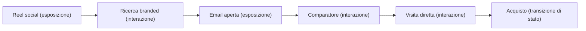

Scenario costruito, con numeri di esempio: un utente vede un reel su Instagram. Una settimana dopo cerca il brand su Google, apre due email senza cliccare, legge tre recensioni su un comparatore, torna da traffico diretto e compra. Il report di attribuzione assegna il 100 per cento del merito alla ricerca branded. Il budget si sposta tutto lì, il social viene giudicato inutile e tre mesi dopo la domanda branded cala del 20 per cento, perché nessuno alimenta più la scoperta.

Questo errore nasce da un dato che descrive l'ultimo passo e viene letto come se descrivesse l'intero cammino. Per evitarlo ricostruiamo il percorso dagli eventi, misuriamo dove il flusso si rompe e diamo un valore economico a ogni rottura prima di decidere che cosa correggere.

## Il percorso intero, non l'ultimo click

> **Idea chiave:** Il merito di una conversione si distribuisce lungo tutto il percorso, e ogni intervento sul funnel va scelto per il valore che produce a valle, non per quanto appare brutto un grafico.

Gli eventi di un journey si dividono in tre livelli, e ciascuno risponde a una domanda diversa. Se ne ignori uno, perdi un pezzo di informazione che nessun modello di attribuzione recupera dopo.

| Livello | Esempi | Che cosa misura | Rischio se lo ignori |
| --- | --- | --- | --- |
| Esposizione | impression, open email, video oltre il 50% | Copertura e familiarità | Sovrastimi i canali di raccolta |
| Interazione | click, ricerca interna, add-to-cart | Intento e attrito | Non sai dove il percorso si rompe |
| Transizione di stato | lead, trial, primo e secondo ordine | Avanzamento reale | Ottimizzi micro-conversioni senza ricavi |

L'ultimo touchpoint prende tutto perché è semplice da calcolare, ma confonde il punto di raccolta con il lavoro di costruzione. La ricerca branded e il traffico diretto raccolgono domanda creata altrove. Tagliare i canali di scoperta perché non convertono equivale a chiudere il vivaio perché le piante si comprano in negozio.

Il mapping completo non serve sempre. Con un ciclo brevissimo, come la ricerca di una pizzeria vicina, l'ultimo click descrive bene la realtà. Il mapping paga quando valgono almeno due condizioni: il ciclo dura più di una sessione, il ticket giustifica più interazioni, esistono touchpoint offline o cross-device che i report standard perdono.



### Errore: ultimo click per tutto, anche dove il ciclo è lungo

Il sintomo è un canale di scoperta con ROAS apparente vicino a zero e un canale di ricerca branded con ROAS altissimo. Succede perché il last-click assegna il merito a chi chiude l'ordine, e chi chiude è quasi sempre chi raccoglie. La correzione è confrontare almeno due modelli sullo stesso periodo e verificare con un test di spegnimento, su una porzione del traffico, che cosa succede ai canali di raccolta quando la scoperta diminuisce.

## Dagli eventi grezzi ai percorsi

Il dato grezzo è un disastro onesto: cookie diversi per ogni browser, ID pubblicitari che cambiano, utenti loggati su un device e anonimi su un altro, timestamp in fusi diversi. L'identity stitching risponde alla domanda: questi tre identificatori appartengono alla stessa persona?

Il metodo deterministico unisce soltanto su chiavi certe, come login, email e ID del CRM, e lascia fuori molto traffico anonimo. Il metodo probabilistico usa segnali come dispositivo, indirizzo IP e finestra temporale per recuperare copertura, al prezzo di qualche fusione sbagliata. Un journey costruito su identità incerte è un'ipotesi, non un'evidenza: il punto operativo è tenere il deterministico come scheletro e usare il probabilistico con soglie conservative, conservando sempre il livello di confidenza accanto alla fusione.

La sessionizzazione raggruppa gli eventi contigui in sessioni separate da un periodo di inattività. Il default di trenta minuti va bene per un e-commerce, ma sbaglia in un configuratore B2B, dove una stessa persona compila un preventivo in tre giorni, e in un'app serale, dove tre visite brevi sono la stessa sessione. Un buon test di calibrazione: se più del 15-20 per cento delle conversioni avviene alla prima sessione successiva a una interrotta dalla soglia, la soglia è troppo corta.

Il risultato di questa fase è la tabella fondativa: una riga per evento, con utente unificato, sessione, timestamp in UTC, tipo di evento, canale e campagna. Un giorno di pulizia su questa tabella vale più di una settimana passata a interpretare artefatti nei report.

### Errore: fondere tutto in modo probabilistico senza tenere la confidenza

Il sintomo è un journey con percorsi troppo lunghi, in cui un singolo utente appare in tre paesi e su sei dispositivi. Succede perché una soglia generosa aumenta la copertura e il risultato sembra migliore. Si corregge salvando la confidenza di ogni fusione e escludendo dall'analisi causale le identità sotto soglia.

## Leggere un funnel senza farsi ingannare

Il funnel è una strada tracciata dentro il territorio: una sequenza obbligata di passi in cui misuriamo quanti avanzano e quanti cadono. Prendiamo una app finanziaria con cinque passi e i relativi utenti unici del mese: 10.000 download, 6.500 registrazioni, 3.900 verifiche d'identità, 2.730 conti collegati e 1.640 primi trasferimenti.

Il tasso tra step adiacenti è c_i = n_(i+1) / n_i, e il tasso complessivo è il prodotto dei tassi, cioè n_k / n_1. Calcolo: 6.500 / 10.000 = 65 per cento; 3.900 / 6.500 = 60 per cento; 2.730 / 3.900 = 70 per cento; 1.638 / 2.730 = 60 per cento, arrotondato a 1.640 nei volumi sopra. Il tasso complessivo è 0,65 × 0,60 × 0,70 × 0,60 = 0,1638, cioè 16,4 per cento.

Il gradino peggiore in percentuale è la verifica identità, al 60 per cento. Portarla dal 60 al 70 per cento significa passare da 3.900 a 4.550 utenti verificati, cioè 650 utenti in più al passaggio successivo, un guadagno che si propaga a valle e supera qualsiasi ottimizzazione fatta più avanti nel funnel.

La formula nasconde però tre scelte che vanno scritte insieme al funnel: la finestra temporale entro cui un utente deve completare i passi, la definizione di coorte, cioè se contiamo gli utenti entrati nel mese o gli eventi avvenuti nel mese, e il trattamento dei salti, per esempio un utente che arriva al conto collegato senza passare dalla verifica. Senza queste specifiche, due analisti calcolano lo stesso funnel e ottengono numeri diversi.

### Errore: un funnel senza specifiche, calcolato in due modi

Il sintomo è una riunione in cui il marketing mostra una conversione del 18 per cento e il prodotto una del 14, con gli stessi dati. Succede perché uno conta gli eventi del mese e l'altro le coorti di ingresso, oppure perché cambia la finestra. Si corregge scrivendo finestra, coorte e regola sui salti nella definizione del funnel e riportandola in ogni dashboard.

## Percorsi, segmenti e matrice di transizione

Un journey medio è una finzione statistica. Lo stesso percorso social, comparatore, branded può convertire al 9 per cento su mobile e al 2 su desktop. In un'app finanziaria con alto abbandono nella verifica identità, la segmentazione per dispositivo, rete e documento ha mostrato tre problemi distinti: timeout su reti lente, messa a fuoco su fotocamere deboli, rigetto di certi documenti. Tre fix mirati hanno alzato il completamento di 18 punti percentuali. Senza segmentazione, il team avrebbe riscritto l'intera schermata.

La path analysis esplora i percorsi davvero percorsi. Lo strumento è la matrice di transizione, che riporta la probabilità P(b | a) di andare dalla pagina a alla pagina b. Le righe con alta probabilità verso l'uscita sono i punti di abbandono. Le transizioni all'indietro, come checkout, scheda prodotto, checkout, segnalano dubbi dell'ultimo minuto. La matrice va sempre incrociata con i volumi assoluti per pagina: un'alta probabilità di uscita su una pagina visitata da poche persone vale meno di una moderata su un passaggio obbligato. E i loop apparenti possono nascere da eventi sparati due volte, per cui conviene deduplicare prima di leggerli.

La query seguente ricostruisce il percorso di canale per ogni utente unificato e calcola la conversione per ciascun pattern.

```sql
-- Percorsi di canale per utente e conversione per pattern (top 20)
WITH journey_paths AS (
  SELECT
    unified_user_id,
    STRING_AGG(marketing_channel, ' > ' ORDER BY event_timestamp) AS journey_path,
    MAX(CASE WHEN event_name = 'purchase_completed' THEN 1 ELSE 0 END) AS converted
  FROM clean_events_log
  GROUP BY unified_user_id
)
SELECT
  journey_path,
  COUNT(*) AS users,
  ROUND(100.0 * SUM(converted) / COUNT(*), 2) AS conversion_rate
FROM journey_paths
GROUP BY journey_path
ORDER BY users DESC
LIMIT 20;
```

Prima di aggregare conviene raggruppare la coda lunga in bucket come altro paid e altro organic, altrimenti ogni pattern conta pochi utenti e la conversione oscilla a caso. Attenzione anche all'interpretazione: la correlazione tra percorso e conversione non è causalità. Se chi usa il comparatore converte di più, forse gli utenti più motivati sono quelli che usano il comparatore.

## Il valore di un fix, in euro al mese

Una volta trovato il punto di attrito, la domanda per la roadmap è quanto vale correggerlo. La formula è: valore = utenti allo step × guadagno di tasso × margine per convertito.

Esempio numerico sulla verifica identità. Ogni mese 40.000 utenti arrivano alla verifica. Un intervento sul flusso di acquisizione del documento porta il completamento dal 60 al 68 per cento, un guadagno di 8 punti percentuali. Ogni utente che completa e arriva al primo trasferimento genera 25 euro di margine. Calcolo: 40.000 × 0,08 = 3.200 utenti in più che completano; 3.200 × 25 euro = 80.000 euro al mese di valore aggiuntivo.

Il numero va confrontato con il costo di sviluppo e con le alternative. Un recupero carrello da 15.000 euro di sviluppo che vale 30.000 euro al mese ha un rapporto migliore di un redesign da 120.000 euro che ne vale 80.000. Questa aritmetica batte qualsiasi heatmap per decidere l'ordine degli interventi.

Per validare un fix su budget o messaggi serve un holdout, oppure un test A/B che usi la conversione a valle come metrica primaria, non il click sullo step modificato. Un pulsante più grande aumenta i click sullo step, ma può peggiorare la qualità di chi prosegue.

### Errore: ottimizzare il click locale a scapito della conversione finale

Il sintomo è una pagina con un tasso di passaggio che sale e un ricavo mensile che non si muove. Succede perché si valuta il test sullo step modificato e non sul risultato finale. Si corregge dichiarando prima del test una metrica primaria a valle e una soglia minima di guadagno in euro.

## Il benchmark Baymard sull'abbandono del carrello

Il Baymard Institute mantiene il benchmark più citato sull'abbandono del carrello: una sintesi di 49 studi indipendenti, consultabile su https://baymard.com/lists/cart-abandonment-rate e aggiornata al 2024, che fissa il tasso medio intorno al 70 per cento. La causa dominante non è il prezzo in sé ma la frizione del percorso, con i costi extra mostrati troppo tardi in testa alle motivazioni dichiarate.

Il benchmark serve come punto di riferimento, non come obiettivo. Un tasso del 70 per cento nel tuo checkout non è un problema se il tuo settore e il tuo mix di dispositivi lo giustificano, e un tasso del 55 non è un successo se il concorrente diretto sta al 40. Prima di tagliare la sorgente di traffico con il checkout peggiore, misuriamo il passaggio carrello-pagamento per device e rimuoviamo la frizione più costosa, usando la formula del valore del fix per ordinare gli interventi.

## Controllo sul tuo funnel

1. Un funnel ha quattro tassi di passaggio: 80, 50, 40 e 90 per cento. Qual è il tasso complessivo e su quale step conviene intervenire per primo?

<details>
<summary>Mostra risposta</summary>

Il tasso complessivo è 0,80 × 0,50 × 0,40 × 0,90 = 0,144, cioè 14,4 per cento. Lo step più debole è il terzo, al 40 per cento, ma la priorità si decide con il valore del fix: utenti allo step, guadagno di tasso e margine per convertito.

</details>

2. Se più del 20 per cento delle conversioni avviene alla prima sessione dopo una interrotta dalla soglia di inattività, che cosa indica e che cosa cambi?

<details>
<summary>Mostra risposta</summary>

Indica che la soglia è troppo corta e spezza percorsi che appartengono alla stessa visita. Si allunga la soglia in base al ciclo reale del prodotto e si ricalcolano sessioni e funnel.

</details>

3. Quali sono i tre elementi da scrivere insieme a ogni funnel per evitare numeri diversi tra analisti?

<details>
<summary>Mostra risposta</summary>

La finestra temporale entro cui completare i passi, la definizione di coorte e la regola sul trattamento dei salti tra step.

</details>

4. Un fix porta il completamento da 55 a 60 per cento su 20.000 utenti mensili, con 30 euro di margine per convertito. Quanto vale al mese?

<details>
<summary>Mostra risposta</summary>

Il guadagno è 5 punti percentuali: 20.000 × 0,05 = 1.000 utenti in più; 1.000 × 30 euro = 30.000 euro al mese.

</details>

5. Perché la matrice di transizione va incrociata con i volumi delle pagine?

<details>
<summary>Mostra risposta</summary>

Perché la probabilità dice dove va chi lascia una pagina, non quante persone la attraversano. Si rischia di ottimizzare un incrocio secondario ignorando l'autostrada su cui passa la maggior parte degli utenti.

</details>
