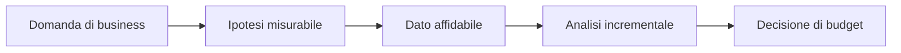

# Customer journey e funnel analytics

Il problema concreto del marketing analytics è trasformare budget, canali, creatività e audience in decisioni misurabili, senza confondere volume, attribuzione e incrementalità. Il customer journey e il funnel analytics servono a questo. Rendono leggibili i passaggi che un utente compie, così capisci dove conviene intervenire.

## Problema reale

Un utente passa da un post social a una pagina prodotto, torna da una email, legge qualche recensione e compra dopo una ricerca branded. Se guardi solo l'ultimo canale perdi tutto il lavoro che ha costruito fiducia lungo la strada. Se guardi tutto insieme senza un ordine, non decidi niente. Quello che ti serve è un metodo per rappresentare e analizzare questi percorsi in modo che ne escano decisioni precise.

## Modello concettuale

Il processo decisionale si articola in quattro passaggi in sequenza. Prima la domanda di business: quale decisione deve cambiare? Poi l'ipotesi misurabile: quale segnale rappresenta il fenomeno? Quindi il dato affidabile: qual è la qualità e la granularità di ciò che osservi? Infine l'analisi incrementale: come interpreti il segnale rispetto a una baseline? Solo a questo punto arrivi a una decisione di budget o di strategia fondata su dati robusti.



| Passaggio | Domanda guida | Output atteso |
|---|---|---|
| Framing | Quale decisione deve cambiare? | Scelta concreta |
| Misura | Quale segnale rappresenta il fenomeno? | Metrica, fonte, granularità |
| Confronto | Rispetto a quale baseline interpreto il risultato? | Benchmark o controfattuale |
| Azione | Che cosa faccio se il segnale supera la soglia? | Decisione, owner, prossimo controllo |

## Formalizzazione rigorosa

Il customer journey e il funnel analytics si possono formalizzare come una relazione tra cinque elementi. L'unità è la campagna, la coorte, il touchpoint o il segmento cliente. Il segnale è il margine incrementale, il CAC payback, il conversion rate corretto, il lift o la retention. La baseline è il periodo precedente, un gruppo holdout, un mercato comparabile o un benchmark storico. La decisione consiste nello spostare risorse, cambiare messaggio, fermare una tattica o scalare un esperimento. Il rischio principale è confondere correlazione, qualità del dato e causalità decisionale.

| Elemento | Definizione operativa |
|---|---|
| Unità | campagna, coorte, touchpoint, segmento cliente |
| Segnale | margine incrementale, CAC payback, conversion rate corretto, lift, retention |
| Baseline | periodo precedente, gruppo holdout, mercato comparabile, benchmark storico |
| Decisione | spostare risorse, cambiare messaggio, fermare tattica, scalare esperimento |
| Rischio | confondere correlazione, qualità dato e causalità decisionale |

Una misura è utile solo se riduce l'incertezza su una decisione specifica.

## Esempio o caso studio

Un team growth deve decidere se aumentare il budget su un canale con CPA basso ma vendite marginali deboli. Qui il punto è separare il segnale utile dal rumore, collegando metrica, modello mentale e decisione economica.

| Evidenza | Interpretazione prudente | Decisione conseguente |
|---|---|---|
| Segnale positivo ma non isolato | Fenomeno esiste, causa incerta | Cercare baseline o holdout |
| Segmento con risposta diversa | Effetto medio nasconde eterogeneità | Analizzare coorti o sottogruppi |
| Costo operativo crescente | Valutare sul margine | Applicare soglie economiche |

## Dalla mappa all'analisi: modellare il journey con i dati transazionali

La costruzione del customer journey parte dall'aggregazione di dati grezzi di touchpoint, spesso frammentati e senza un identificatore unificato. L'identity stitching ricostruisce l'utente unico attraverso dispositivi e sessioni diverse, con login deterministico o metodi probabilistici. Segue la sessionizzazione, che raggruppa gli eventi in sessioni in base a soglie di inattività, di solito 30 minuti, da adattare al contesto.

Il risultato è una tabella di eventi con `user_id` unificato, `session_id`, timestamp e attributi contestuali. Da qui costruisci i percorsi con funzioni SQL come ROW_NUMBER e STRING_AGG. Questo esempio aggrega in sequenza i canali visitati e calcola i tassi di conversione:

```sql
WITH user_events AS (
  SELECT
    unified_user_id,
    event_timestamp,
    event_name,
    marketing_channel,
    ROW_NUMBER() OVER(PARTITION BY unified_user_id ORDER BY event_timestamp) as event_sequence_number
  FROM clean_events_log
  WHERE event_timestamp >= '2023-01-01'
),
user_conversion AS (
  SELECT unified_user_id,
    MAX(CASE WHEN event_name = 'purchase_completed' THEN 1 ELSE 0 END) as converted
  FROM user_events
  GROUP BY unified_user_id
),
journey_paths AS (
  SELECT e.unified_user_id,
    STRING_AGG(e.marketing_channel, ' > ' ORDER BY e.event_timestamp) as journey_path,
    COUNT(*) as total_touchpoints,
    DATEDIFF('day', MIN(e.event_timestamp), MAX(e.event_timestamp)) as journey_duration_days
  FROM user_events e
  GROUP BY e.unified_user_id
)
SELECT
  jp.journey_path,
  COUNT(DISTINCT jp.unified_user_id) as number_of_users,
  AVG(jp.total_touchpoints) as avg_touchpoints,
  AVG(jp.journey_duration_days) as avg_duration,
  ROUND(SUM(uc.converted) * 100.0 / COUNT(DISTINCT jp.unified_user_id), 2) as conversion_rate
FROM journey_paths jp
JOIN user_conversion uc ON jp.unified_user_id = uc.unified_user_id
GROUP BY jp.journey_path
ORDER BY number_of_users DESC
LIMIT 20;
```

La granularità va adattata alla domanda di business.

## Oltre la conversione: analisi di funnel per l'ottimizzazione del prodotto

L'analisi di funnel impone una struttura definita e misura la progressione degli utenti attraverso i passaggi critici. Non serve solo al marketing. La usano anche prodotto, ingegneria e design per quantificare l'attrito.

Prendi il funnel di onboarding di un'app fintech come Wise, che va dal download al primo trasferimento. Per ogni step misuri il numero di utenti e il tasso di conversione rispetto al passaggio precedente. Se poi segmenti il funnel per dispositivo, paese o coorte, scopri dove avvengono i drop-off e dove c'è margine di miglioramento. Misurare il tempo mediano per completare ogni passo trasforma il funnel da fotografia statica a video dell'esperienza utente.

## Caso studio: Netflix e la personalizzazione del journey per la retention

Netflix ha ottimizzato il journey di attivazione post-iscrizione per ridurre il churn. Ha definito un funnel di engagement con passaggi come completamento del profilo, selezione dei gusti, prima riproduzione significativa e sessioni multiple nella prima settimana.

L'analisi di milioni di utenti ha mostrato che completare tutti i passaggi aumenta la probabilità di retention di oltre il 50%, e che il binge-watching è un predittore eccezionale di retention. Questi insight hanno guidato le ottimizzazioni di UI, content strategy ed email marketing, trasformando l'analisi del journey in un motore di personalizzazione che alza la customer lifetime value.

## Identificare attrito e opportunità con la path analysis

La path analysis esplora tutti i percorsi reali degli utenti e rivela loop, uscite inaspettate e scorciatoie. Il diagramma di Sankey visualizza i flussi tra gli stati e mette in evidenza attriti e opportunità.

In Python il passaggio chiave è trasformare un log eventi in una matrice di transizione. Si ordina per utente e timestamp, si usa shift() per ottenere la pagina successiva e si calcolano i conteggi di transizione. Da lì puoi rispondere a domande operative sulle pagine più visitate, sugli abbandoni e sui percorsi che funzionano.

## Caso studio: Revolut e il funnel di onboarding cross-device

Revolut aveva un alto tasso di abbandono nella verifica dell'identità tramite fotocamera. Ha analizzato i segmenti per modello di dispositivo, condizioni di rete e tipo di documento. Interventi mirati come fallback dinamico, compressione adattiva e guida contestuale hanno aumentato il tasso di completamento del funnel di 18 punti percentuali, riducendo il CAC e accelerando la crescita.

## Lab / esercizio

### Livello base

Scrivi in cinque righe una decisione reale collegata a customer journey e funnel analytics: obiettivo, metrica primaria, baseline, rischio e azione.

### Livello intermedio

Costruisci una tabella con almeno tre segmenti o scenari, indicando segnale, possibile spiegazione alternativa e controllo necessario.

### Livello research-grade

Disegna un piano di validazione con ipotesi, dati necessari, criteri di esclusione, soglia decisionale e controllo post-decisione. Specifica cosa ti farebbe cambiare idea.

### Dataset e materiali consigliati

Usa export campagne, costi media, eventi web/app, CRM, transazioni, survey brand e log consenso. Se non hai dati reali, crea un dataset sintetico con almeno 200 righe, una colonna temporale, una colonna segmento, una metrica di outcome e una variabile di esposizione.

## Errore tipico da evitare

L'errore è trattare il customer journey e il funnel analytics come una definizione da ricordare invece che come protocollo decisionale. Presentare metriche senza baseline, grafici senza ipotesi o raccomandazioni senza il costo dell'errore porta a decisioni fragili.

Un controllo utile è chiedersi: "Se questo risultato fosse falso o instabile, quale decisione sbaglierei?". Se non sai rispondere con chiarezza, la lezione non l'hai applicata davvero.

## Quiz o checkpoint

1. Qual è la decisione concreta che questa lezione dovrebbe migliorare?
2. Quale baseline rende interpretabile il risultato?
3. Quale assunzione, se sbagliata, cambierebbe la conclusione?
4. Quale controllo minimo useresti prima di presentare la raccomandazione?

## Riepilogo operativo

Il customer journey e il funnel analytics diventano utili quando collegano concetto, dato e decisione. Studiali partendo da un problema reale, formalizza il segnale, cerca una baseline credibile, costruisci un esempio e chiudi con un controllo pratico.
