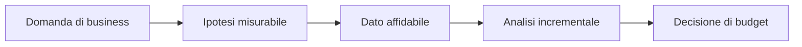

# Customer journey e funnel analytics


Immagina un team marketing che deve capire cosa ha creato domanda e cosa ha solo intercettato domanda già esistente alla fine di una campagna, quando il budget è stato speso e restano domande scomode. Sul tavolo non c'è un esercizio astratto: c'è la pressione concreta di difendere una lettura onesta di canali, funnel, brand e marginalità. **Customer journey e funnel analytics** entra qui, nel punto in cui una scelta deve diventare più chiara, più misurabile e più difendibile.

## Una scena da cui partire

La lezione va letta con questo atteggiamento: non collezionare frasi da ricordare, ma cercare il passaggio che trasforma una misura di marketing che regge davanti a finanza e direzione in lavoro reale. Qui non basta capire il concetto: devi vedere come si rompe, come si controlla e come si spiega a chi userà il risultato. Il livello è avanzato: non cercare una ricetta unica, cerca i vincoli che cambiano la risposta.

- **Contesto:** Quale vincolo tecnico decide il disegno?
- **Metodo:** Quale controllo ti direbbe che il risultato è affidabile?
- **Applicazione:** Quale trade-off racconteresti prima di mettere in produzione?

## Dalla Mappa all'Analisi: Modellare il Journey con i Dati Transazionali

La rappresentazione del customer journey inizia con un'operazione di data engineering tanto critica quanto complessa: la sua costruzione a partire da dati grezzi. I dati di "touchpoint" – eventi registrati come click su un annuncio, visite a una pagina web, aperture di email, interazioni con un'app – sono spesso frammentati, residenti in sistemi diversi (Google Analytics, CRM, database di produzione) e privi di un identificatore utente unificato. Il primo passo consiste nell'aggregare e unificare questi log.

La sfida principale è l'**identity stitching**, ovvero il processo di ricondurre eventi provenienti da dispositivi e sessioni differenti a un unico utente. Un utente potrebbe scoprire un prodotto tramite un'app su smartphone durante il tragitto mattutino, approfondire la ricerca su un laptop in ufficio e completare l'acquisto da un tablet la sera. Senza un meccanismo per collegare l'ID del dispositivo mobile, il cookie del browser desktop e l'email del cliente, il journey appare come tre percorsi distinti e monchi, portando a conclusioni errate. Tecniche come il login deterministico (l'utente si autentica su tutti i dispositivi) o metodi probabilistici (basati su indirizzo IP, user agent, e pattern di navigazione) sono impiegate per creare una visione olistica.

Una volta unificati gli eventi, il passo successivo è la **sessionization**: raggruppare gli eventi in sessioni di interazione coerenti. La regola più comune è basata sul tempo di inattività: una serie di eventi viene considerata una singola sessione se il tempo tra due eventi consecutivi non supera una soglia, tipicamente 30 minuti. Questa soglia, tuttavia, non è universale. Per un sito di news, 30 minuti possono essere adeguati; per una piattaforma di streaming video come Netflix, dove la "pausa" può durare ore, la definizione di sessione deve essere riconsiderata.

Il risultato di questo processo è una tabella di eventi arricchita, dove ogni riga rappresenta un touchpoint con un `user_id` unificato, un `session_id`, un timestamp e attributi contestuali (canale, pagina, dispositivo). Da questa base, possiamo iniziare a costruire i percorsi. Una tecnica SQL comune utilizza le window functions per ordinare gli eventi di ogni utente e concatenarli in una sequenza leggibile.

```sql
WITH user_events AS (
  SELECT
    unified_user_id,
    event_timestamp,
    event_name,
    marketing_channel,
    -- Assegna un numero progressivo a ogni evento per un utente
    ROW_NUMBER() OVER(PARTITION BY unified_user_id ORDER BY event_timestamp) as event_sequence_number
  FROM
    clean_events_log
  WHERE
    event_timestamp >= '2023-01-01'
),
-- Identifica se un utente ha convertito alla fine del suo percorso
user_conversion AS (
  SELECT
    unified_user_id,
    MAX(CASE WHEN event_name = 'purchase_completed' THEN 1 ELSE 0 END) as converted
  FROM user_events
  GROUP BY 1
),
-- Ricostruisce il percorso come una stringa aggregata
journey_paths AS (
  SELECT
    e.unified_user_id,
    -- Concatena i canali in ordine cronologico
    STRING_AGG(e.marketing_channel, ' > ' ORDER BY e.event_timestamp) as journey_path,
    COUNT(*) as total_touchpoints,
    DATEDIFF('day', MIN(e.event_timestamp), MAX(e.event_timestamp)) as journey_duration_days
  FROM user_events e
  GROUP BY 1
)
-- Aggrega i risultati per analizzare i percorsi più comuni
SELECT
  jp.journey_path,
  COUNT(DISTINCT jp.unified_user_id) as number_of_users,
  AVG(jp.total_touchpoints) as avg_touchpoints,
  AVG(jp.journey_duration_days) as avg_duration,
  ROUND(SUM(uc.converted) * 100.0 / COUNT(DISTINCT jp.unified_user_id), 2) as conversion_rate
FROM journey_paths jp
JOIN user_conversion uc ON jp.unified_user_id = uc.unified_user_id
GROUP BY 1
ORDER BY 2 DESC
LIMIT 20;

```
Questo approccio, pur essendo potente, semplifica la realtà. Un vero journey non è solo una sequenza di canali, ma di interazioni specifiche (`view_product`, `add_to_cart`, `use_filter`). La granularità dell'analisi deve sempre essere adattata alla domanda di business a cui si intende rispondere.

## Oltre la Conversione: Analisi di Funnel per l'Ottimizzazione del Prodotto

Mentre l'analisi del journey mappa la complessità dei percorsi possibili, l'analisi di funnel impone una struttura, misurando la progressione degli utenti attraverso una serie predefinita di passaggi critici. Tradizionalmente associato al marketing (Awareness → Interest → Desire → Action), il concetto di funnel è uno strumento diagnostico potentissimo per i team di prodotto, ingegneria e design, perché permette di quantificare l'attrito (friction) nell'esperienza utente.

Consideriamo il funnel di onboarding di un'applicazione fintech come Wise. L'obiettivo non è solo portare un utente a registrarsi, ma a completare la sua prima transazione. Un funnel di prodotto potrebbe essere:
1.  **App Download**: L'utente installa l'applicazione.
2.  **Account Creation**: L'utente inserisce email e password.
3.  **Identity Verification (KYC)**: L'utente carica un documento e scatta un selfie.
4.  **First Deposit**: L'utente collega un conto bancario e aggiunge fondi.
5.  **First Transfer Setup**: L'utente imposta i dettagli del primo trasferimento di denaro.
6.  **Transfer Executed**: L'utente conferma e invia il denaro.

Per ogni passo, misuriamo due metriche fondamentali: il **numero di utenti** che lo completano e il **tasso di conversione** rispetto al passo precedente. Se 10.000 utenti creano un account ma solo 6.000 iniziano la verifica dell'identità, abbiamo un tasso di conversione del 60% e un drop-off del 40% in quel preciso punto. Quel 40% rappresenta un'enorme opportunità persa.

L'analisi non si ferma all'identificazione del "dove". Il passo successivo è investigare il "perché". Segmentando il funnel, possiamo scoprire pattern nascosti.
*   **Segmentazione per dispositivo/OS**: Il drop-off durante la verifica dell'identità è più alto su versioni Android più vecchie? Forse la libreria software per la scansione della fotocamera ha problemi di compatibilità.
*   **Segmentazione per paese**: Gli utenti in Brasile abbandonano il funnel al momento del deposito più di quelli in Germania? Potrebbe esserci un problema con i metodi di pagamento locali offerti.
*   **Segmentazione per coorte di acquisizione**: Gli utenti acquisiti tramite una campagna su TikTok hanno un tasso di completamento del KYC inferiore a quelli provenienti da una ricerca organica su Google? Forse la campagna attira un pubblico meno intenzionato o meno preparato a fornire documenti.

Un'analisi di funnel efficace va oltre i tassi di conversione e include il **tempo mediano per completare ogni passo**. Se il tempo mediano per passare dalla creazione dell'account alla verifica dell'identità è di 2 ore, ma per un segmento specifico è di 3 giorni, c'è un blocco. Forse questi utenti hanno bisogno di recuperare i documenti, o forse l'interfaccia non è chiara e li spinge a procrastinare. L'analisi del tempo trasforma il funnel da una fotografia statica a un video, rivelando la dinamica e l'esperienza vissuta dall'utente.

## Caso Studio - Netflix: Personalizzazione del Journey per Massimizzare la Retention

Per un servizio in abbonamento come Netflix, la vera battaglia non si combatte tanto nell'acquisizione di nuovi iscritti, quanto nel prevenire il **churn**, ovvero l'abbandono del servizio. Il team di data science di Netflix ha capito da tempo che la probabilità di un utente di rimanere abbonato dopo il mese di prova è fortemente correlata alla sua esperienza nelle prime settimane. Hanno quindi mappato e ottimizzato un "journey di attivazione" post-iscrizione, il cui obiettivo non è la vendita, ma il raggiungimento dell' "aha! moment": il momento in cui l'utente percepisce il valore fondamentale del servizio e diventa un fan.

L'analisi di milioni di percorsi di nuovi utenti ha permesso di definire un funnel di engagement critico:
1.  **Completamento del Profilo**: L'utente personalizza il proprio profilo scegliendo avatar e nome.
2.  **Selezione dei Gusti Iniziali**: L'utente indica 3 o più titoli di suo gradimento per avviare l'algoritmo di raccomandazione.
3.  **Prima Riproduzione Significativa**: L'utente guarda almeno il 70% di un film o di un episodio.
4.  **Esplorazione Attiva**: L'utente utilizza la funzione di ricerca o naviga tra le categorie almeno una volta.
5.  **Sessioni Multiple nella Prima Settimana**: L'utente ritorna sulla piattaforma per almeno 3 sessioni distinte nei primi 7 giorni.

Analizzando i dati, Netflix ha scoperto correlazioni potentissime. Ad esempio, gli utenti che completavano il passo 5 avevano una probabilità di rimanere abbonati per più di 6 mesi superiore del 55% rispetto a chi si fermava al passo 3. Hanno inoltre notato che il "binge-watching" (guardare più episodi di una serie in rapida successione) era un predittore di retention eccezionale. Un utente che completava una stagione di una serie nella prima settimana aveva un tasso di churn nel secondo mese inferiore del 70%.

Questi insight hanno guidato decisioni di prodotto e di content strategy.
*   **Ottimizzazione dell'UI**: La homepage è stata riprogettata per spingere aggressivamente i nuovi utenti verso contenuti con alti tassi di completamento e serie TV "bingeable". L'introduzione della funzione "Riproduci il prossimo episodio" automatica fu una mossa ingegneristica volta a ridurre l'attrito tra un episodio e l'altro, capitalizzando sull'insight del binge-watching.
*   **Content Strategy**: La produzione di "Netflix Originals" ha permesso di avere il controllo completo su serie progettate per essere viste d'un fiato, con cliffhanger strategici e rilascio di intere stagioni in un'unica soluzione.
*   **Email Marketing**: Le campagne email per i nuovi utenti non si limitano a un generico "Benvenuto", ma suggeriscono proattivamente il prossimo titolo da guardare basandosi sui gusti iniziali, con l'obiettivo esplicito di guidare l'utente attraverso il funnel di engagement.

Il risultato è un sistema dove l'analisi del journey non è un report a posteriori, ma il motore di un ciclo continuo di personalizzazione e ottimizzazione che ha aumentato la **customer lifetime value (CLV)** di decine di punti percentuali.

## Identificare Attrito e Opportunità con la Path Analysis

Se l'analisi di funnel è come guardare una superstrada con uscite predefinite, la **path analysis** è come esplorare l'intera rete stradale di una città, comprese le vie secondarie, i vicoli ciechi e le scorciatoie inaspettate. Questa tecnica permette di scoprire i percorsi reali e non ipotizzati degli utenti, rivelando comportamenti emergenti, sia positivi che negativi.

Uno degli strumenti più efficaci per la path analysis è il **diagramma di Sankey**, una visualizzazione che mostra i flussi tra diversi stati o eventi. La larghezza delle bande è proporzionale al volume di utenti che seguono un determinato percorso. Un diagramma di Sankey che mappa le pagine visitate su un sito e-commerce può rivelare immediatamente i "loop di confusione" (utenti che passano ripetutamente dalla pagina prodotto al carrello e viceversa, senza mai completare l'acquisto) o le "uscite inaspettate" (un grande flusso di utenti che abbandona il sito da una pagina specifica, come quella delle spese di spedizione).

Per generare i dati necessari a un diagramma di Sankey o ad altre forme di path analysis, dobbiamo calcolare le transizioni tra stati. Il seguente script Python, utilizzando la libreria `pandas`, mostra come trasformare un log di eventi in una matrice di transizione.

```python
import pandas as pd

# Creiamo un DataFrame di esempio con eventi utente
data = {
    'user_id': [1, 1, 1, 2, 2, 2, 2, 3, 3, 4, 4, 4, 4],
    'timestamp': pd.to_datetime([
        '2023-10-01 10:00:00', '2023-10-01 10:01:00', '2023-10-01 10:02:00',
        '2023-10-01 11:00:00', '2023-10-01 11:01:30', '2023-10-01 11:02:00', '2023-10-01 11:05:00',
        '2023-10-02 09:00:00', '2023-10-02 09:01:00',
        '2023-10-02 14:00:00', '2023-10-02 14:01:00', '2023-10-02 14:03:00', '2023-10-02 14:04:00'
    ]),
    'page_name': [
        'homepage', 'product_list', 'product_page',
        'homepage', 'product_list', 'product_page', 'add_to_cart',
        'homepage', 'exit',
        'product_list', 'product_page', 'add_to_cart', 'checkout_page'
    ]
}
events_df = pd.DataFrame(data)

# Ordiniamo gli eventi per utente e timestamp
events_df = events_df.sort_values(by=['user_id', 'timestamp'])

# Usiamo shift() per ottenere la pagina successiva visitata dallo stesso utente
events_df['next_page'] = events_df.groupby('user_id')['page_name'].shift(-1)

# Riempiamo i valori mancanti (l'ultimo evento di un utente) con 'exit'
events_df['next_page'] = events_df['next_page'].fillna('exit_session')

# Rimuoviamo gli eventi che sono l'ultimo di una sessione per non contarli come transizioni
transitions_df = events_df.dropna(subset=['next_page'])

# Calcoliamo il conteggio di ogni transizione
transition_counts = transitions_df.groupby(['page_name', 'next_page']).size().reset_index(name='count')
transition_counts = transition_counts.sort_values(by='count', ascending=False)

print("Matrice di transizione (Top 10):")
print(transition_counts.head(10))

# Esempio di output:
#         page_name        next_page  count
# 3    product_list     product_page      3
# 0        homepage     product_list      2
# 1        homepage             exit      1
# 2     add_to_cart    checkout_page      1
# 4    product_page      add_to_cart      2
# 5    product_page     exit_session      1
# 6   checkout_page     exit_session      1
```

Questo approccio permette di rispondere a domande operative:
*   **Qual è la pagina più comune visitata dopo la homepage?** Se non è la pagina dei prodotti, ma quella dei "Contatti", forse la value proposition non è chiara.
*   **Da quale pagina gli utenti abbandonano più frequentemente il sito?** Un alto tasso di `exit` dalla pagina del carrello indica problemi con i costi di spedizione, i metodi di pagamento o la complessità del form.
*   **Esistono percorsi "virtuosi"?** Potremmo scoprire che gli utenti che visitano la sezione "Recensioni" prima di aggiungere un prodotto al carrello convertono il 30% in più. Questo insight può suggerire di rendere le recensioni più visibili.

La path analysis, combinata con la segmentazione, trasforma l'analisi da reattiva a proattiva, non solo identificando problemi ma anche scoprendo opportunità di ottimizzazione non evidenti.

## Caso Studio - Revolut: Ottimizzazione del Funnel di Onboarding Cross-Device

Revolut, una delle neobanche a più rapida crescita in Europa, basa il suo modello di business su un'acquisizione utenti quasi interamente digitale e a basso costo. Il suo funnel di onboarding è il cuore pulsante di questa strategia. A differenza di un e-commerce, il processo è complesso e soggetto a rigide normative **KYC (Know Your Customer)**, che richiedono la verifica dell'identità.

Nel 2021, il team di growth analytics di Revolut notò un allarmante tasso di abbandono nel suo funnel di registrazione, concentrato in un passaggio specifico: la **verifica del documento d'identità tramite fotocamera**. Il funnel era così strutturato:
1.  Download dell'app e inserimento numero di telefono.
2.  Creazione del profilo base (nome, data di nascita, indirizzo).
3.  Scansione fronte/retro di un documento d'identità (passaporto, carta d'identità).
4.  **Liveness check**: un breve video selfie per confermare che l'utente è una persona reale.
5.  Primo deposito per attivare il conto.

Il drop-off tra il passo 3 e il passo 4 raggiungeva il 45% in alcuni segmenti di utenti. Un'analisi aggregata non era sufficiente. Il team ha quindi segmentato il funnel in modo granulare, incrociando decine di dimensioni:
*   **Modello del dispositivo e versione del sistema operativo**: Hanno scoperto che specifici modelli di smartphone Android di fascia medio-bassa, molto diffusi in mercati emergenti come la Polonia e la Romania, avevano tassi di fallimento del liveness check superiori al 70%. La causa era un mix di fotocamere di bassa qualità e API software non standard che entravano in conflitto con il SDK di verifica di Revolut.
*   **Condizioni di rete**: Gli utenti che tentavano la verifica sotto una rete 3G avevano una probabilità di fallimento del 35% più alta rispetto a quelli in Wi-Fi, a causa del timeout durante l'upload del video.
*   **Tipo di documento**: La scansione di carte d'identità cartacee, comuni in alcuni paesi europei, aveva un tasso di errore di riconoscimento ottico dei caratteri (OCR) doppio rispetto ai passaporti biometrici.

Armati di questi dati, hanno trasformato un problema apparentemente monolitico in una serie di problemi più piccoli e risolvibili. Invece di una soluzione unica, hanno implementato una serie di interventi mirati:
1.  **Fallback dinamico**: Per i modelli di dispositivo noti per avere problemi con il liveness check video, l'app ora proponeva un'alternativa più semplice: scattare una singola foto selfie.
2.  **Compressione adattiva**: L'app ha iniziato a rilevare la velocità della rete e ad applicare una compressione video più aggressiva in condizioni di rete lenta per evitare il timeout.
3.  **Guida contestuale**: Per gli utenti che tentavano di scansionare documenti problematici, l'app mostrava istruzioni animate specifiche su come migliorare l'illuminazione e l'inquadratura.

Queste ottimizzazioni, implementate nel corso di sei mesi, hanno prodotto risultati straordinari. Il tasso di completamento del funnel di onboarding è **aumentato complessivamente di 18 punti percentuali**. Nei mercati dell'Europa orientale, dove i problemi erano più accentuati, l'aumento ha superato i 30 punti. Questo non solo ha accelerato la crescita degli utenti, ma ha ridotto drasticamente il **costo di acquisizione per cliente (CAC)**, dimostrando come l'analisi granulare del journey possa avere un impatto diretto e misurabile sul conto economico di un'azienda.

## Dal Modello alla Pratica: Esercitazioni sul Journey

Per consolidare i concetti esposti, proviamo ad applicarli a un dataset ipotetico di eventi di un sito e-commerce. Immaginiamo di avere una tabella `ecommerce_events` con le seguenti colonne: `event_id`, `session_id`, `user_id`, `event_timestamp`, `event_type` (es. 'view_homepage', 'view_product', 'add_to_cart', 'start_checkout', 'purchase').

**Esercizio 1: Mappare i Percorsi di Conversione più Comuni**
Scrivere una query SQL per identificare i 5 percorsi di eventi più comuni che terminano con un evento di tipo 'purchase'. Il percorso deve essere rappresentato come una stringa di `event_type` separati da '→'.

*Suggerimento*: Utilizzare una Common Table Expression (CTE) per filtrare solo le sessioni che contengono un acquisto. Successivamente, usare `STRING_AGG` (o una funzione simile a seconda del dialetto SQL) per costruire la stringa del percorso, partizionando per `session_id` e ordinando per `event_timestamp`.

**Esercizio 2: Costruire un Funnel di Checkout**
Definiamo un funnel di checkout con i seguenti passaggi: 'add_to_cart' → 'start_checkout' → 'purchase'. Scrivere una singola query SQL che calcoli:
1.  Il numero totale di utenti unici che hanno raggiunto ogni passo.
2.  Il tasso di conversione da un passo al successivo.

*Suggerimento*: Questo è un esercizio più complesso. Si può risolvere con CTE multiple o subquery. Un approccio consiste nel creare una tabella per ogni passo del funnel (contenente gli `user_id` che hanno compiuto quell'azione) e poi usare una serie di `LEFT JOIN` per contare quanti utenti del passo N sono presenti anche nel passo N+1.

**Esercizio 3: Analizzare il Tempo Mediano tra gli Step del Funnel**
Modificare la soluzione dell'esercizio 2 per calcolare non solo la conversione, ma anche il tempo mediano (o medio) che intercorre tra il completamento di un passo e l'inizio del successivo. Identificare il passaggio che richiede più tempo.

*Suggerimento*: Utilizzare le window functions `LAG` o `LEAD` per ottenere il timestamp dell'evento precedente o successivo all'interno di una sessione utente. Calcolare la differenza di tempo (`DATEDIFF` o `TIMESTAMPDIFF`). Infine, aggregare questi intervalli per calcolare la mediana (`PERCENTILE_CONT(0.5)`) o la media (`AVG`) per ogni transizione del funnel. Questa analisi è fondamentale per individuare i punti di maggiore attrito non solo in termini di abbandono, ma anche di esitazione.

## Sintesi e Prospettive Future

L'analisi del customer journey e dei funnel è una disciplina che trascende i confini del marketing per diventare una lente

## Problema reale

Nel lavoro su marketing analytics, **Customer journey e funnel analytics** serve a risolvere un problema concreto: trasformare budget, canali, creativita e audience in decisioni misurabili senza confondere volume, attribuzione e incrementalita. La domanda non e se il concetto sia interessante in astratto, ma quale decisione migliora quando lo applichi con dati affidabili e con una soglia di errore esplicita.

Questa lezione va studiata come uno strumento operativo: entro la fine devi saper Comprendere il problema analitico e il contesto decisionale; Applicare esempi, metriche e controlli a casi reali. Se non riesci a collegare il concetto a una scelta reale, la conoscenza resta decorativa e non diventa competenza.

## Modello concettuale



Il modello mentale e sequenziale: prima si formula la domanda, poi si traduce in unità osservabili, quindi si valuta la qualità del dato e solo alla fine si decide. Saltare un passaggio produce analisi eleganti ma fragili.

| Passaggio | Domanda guida | Output atteso |
|---|---|---|
| Framing | Quale decisione deve cambiare? | Una scelta concreta, non una curiosita |
| Misura | Quale segnale rappresenta il fenomeno? | Metrica, fonte e granularita |
| Confronto | Rispetto a quale baseline interpreto il risultato? | Benchmark o controfattuale plausibile |
| Azione | Che cosa faccio se il segnale supera la soglia? | Decisione, owner e prossimo controllo |

## Formalizzazione rigorosa

Formalizza **Customer journey e funnel analytics** come una relazione tra quattro elementi: unità di analisi, segnale, baseline e decisione. Nel contesto di questa lezione l'unità principale e **campagna, coorte, touchpoint o segmento cliente**. Il segnale da osservare deve essere collegato a **margine incrementale, CAC payback, conversion rate corretto, lift o retention generata**, mentre la baseline deve essere scelta tra **periodo precedente, gruppo holdout, mercato comparabile o benchmark storico**.

Una formulazione robusta segue questa logica:

| Elemento | Definizione operativa per questa lezione |
|---|---|
| Unità | campagna, coorte, touchpoint o segmento cliente |
| Segnale | margine incrementale, CAC payback, conversion rate corretto, lift o retention generata |
| Baseline | periodo precedente, gruppo holdout, mercato comparabile o benchmark storico |
| Decisione | spostare risorse, cambiare messaggio, fermare una tattica o scalare un esperimento |
| Rischio | Confondere correlazione, qualità del dato e causalità decisionale |

La regola pratica e semplice: una misura e utile solo se riduce l'incertezza su una decisione specifica. Se non cambia una scelta, e documentazione; se cambia una scelta senza controlli, e rischio.

## Esempio o caso studio

Un team growth deve decidere se aumentare il budget su un canale che mostra CPA basso ma vendite marginali deboli. La lezione aiuta a separare il segnale utile dal rumore operativo, collegando metrica, modello mentale e decisione economica.

Applicando **Customer journey e funnel analytics**, il team costruisce una lettura in tre colonne: cosa sappiamo, cosa assumiamo e quale decisione prendiamo. Questo formato impedisce di presentare un numero come se fosse una conclusione autosufficiente.

| Evidenza | Interpretazione prudente | Decisione conseguente |
|---|---|---|
| Segnale positivo ma non isolato | Il fenomeno esiste, ma la causa e ancora incerta | Cercare baseline o holdout |
| Segmento con risposta diversa | L'effetto medio nasconde eterogeneita | Analizzare coorti o sottogruppi |
| Costo operativo crescente | Il risultato va valutato sul margine | Applicare soglie economiche |

## Lab / esercizio

### Livello base

Prendi una decisione reale collegata a **Customer journey e funnel analytics** e scrivi in cinque righe: obiettivo, metrica primaria, baseline, rischio principale e azione prevista. Non usare più di una metrica primaria.

### Livello intermedio

Costruisci una tabella con almeno tre segmenti o scenari. Per ciascuno indica segnale, possibile spiegazione alternativa e controllo necessario prima di decidere.

### Livello research-grade

Disegna un piano di validazione: ipotesi, dati necessari, criterio di esclusione, soglia decisionale e controllo post-decisione. Specifica anche che cosa ti farebbe cambiare idea.

### Dataset e materiali consigliati

Usa export campagne, costi media, eventi web o app, CRM, transazioni, survey brand e log di consenso. Se non hai dati reali, crea un dataset sintetico con 200-500 righe e almeno una colonna temporale, una colonna segmento, una metrica di outcome e una variabile di esposizione.

## Errore tipico da evitare

L'errore più frequente e trattare **Customer journey e funnel analytics** come una definizione da ricordare invece che come un protocollo decisionale. In pratica succede quando si presenta una metrica senza baseline, un grafico senza ipotesi, o una raccomandazione senza costo dell'errore.

Un controllo utile e chiedersi: "se questo risultato fosse falso o instabile, quale decisione sbaglierei?". Se la risposta non e chiara, la lezione non e ancora stata applicata davvero.

## Quiz o checkpoint

1. Qual e la decisione concreta che questa lezione dovrebbe migliorare?
2. Quale baseline rende interpretabile il risultato?
3. Quale assunzione, se sbagliata, cambierebbe la conclusione?
4. Quale controllo minimo useresti prima di presentare la raccomandazione?

## Riepilogo operativo

**Customer journey e funnel analytics** e una competenza utile quando collega concetto, dato e decisione. Studiala partendo da un problema reale, formalizza il segnale, cerca una baseline credibile, costruisci un esempio e chiudi con un controllo pratico. Categoria: Tecnico. Difficoltà: advanced. Tempo stimato: 22 min.
