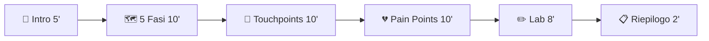
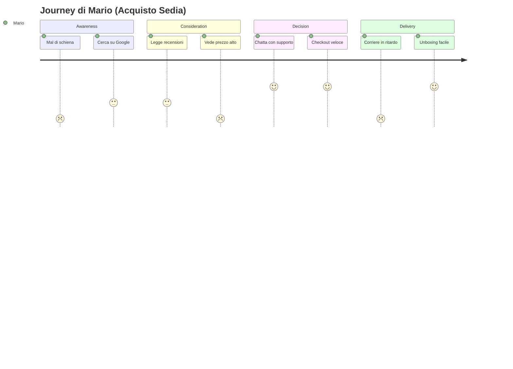

## Customer Journey Mapping: Mappare l'Esperienza — Lezione Completa

Il cliente non segue una linea retta. Entra, esce, si dimentica, ritorna, chiede a un amico, legge una recensione, compra e poi chiama il supporto. Se guardi solo i "Touchpoint" isolati (la mail, il banner), perdi la visione d'insieme. Il Customer Journey Mapping è lo strumento strategico per visualizzare l'intera esperienza dal punto di vista del cliente, identificando i "momenti della verità" e i punti di frizione invisibili.

### Obiettivi di Apprendimento

Al termine di questa lezione, lo studente sarà in grado di:
1.  Costruire una Customer Journey Map dettagliata per le 5 fasi del ciclo di vita (Awareness, Consideration, Decision, Retention, Advocacy).
2.  Integrare dati quantitativi (Analytics) e qualitativi (Interviste) nella mappa.
3.  Identificare i "Pain Points" e i "Momenti WOW" che determinano la soddisfazione.
4.  Utilizzare la mappa per allineare i team Marketing, Sales e Product (Silos Breaking).
5.  Applicare il "Service Blueprint" per collegare l'esperienza cliente ai processi interni aziendali.

### Timeline della Lezione

| Fase | Argomento | Durata |
|------|-----------|--------|
| 1 | Introduzione: La mappa non è il territorio | 5 min |
| 2 | Metodologia: Le 5 Fasi del Journey | 10 min |
| 3 | Pratica: Costruire la Mappa (Persona & Touchpoint) | 10 min |
| 4 | Analisi: Emozioni e Pain Points | 10 min |
| 5 | Esercizi: Mappare un processo reale | 8 min |
| 6 | Riepilogo e Domande | 2 min |
| **Totale** | | **45 min** |

### Fase 1 — Introduzione: La mappa non è il territorio (5 min)

Molte aziende credono di conoscere il percorso del cliente. "Vede l'ad, clicca, compra".
La realtà è un groviglio caotico ("Messy Middle").
Il Customer Journey Mapping serve a mettere ordine nel caos, ma attenzione: non è solo un bel poster da appendere in ufficio. È uno strumento vivo che deve guidare le decisioni operative. "Se il cliente è frustrato qui, dobbiamo cambiare questo processo oggi".

### Fase 2 — Metodologia: Le 5 Fasi del Journey (10 min)

Ogni journey è unico, ma tutti seguono una struttura archetipica.

1.  **Awareness (Consapevolezza):** Il cliente scopre di avere un problema.
    *   *Domanda:* "Perché mi fa male la schiena?"
    *   *Touchpoint:* Blog post, Social, Passaparola.
2.  **Consideration (Valutazione):** Cerca le soluzioni.
    *   *Domanda:* "Meglio un chiropratico o una sedia ergonomica?"
    *   *Touchpoint:* Recensioni, Comparatori, YouTube.
3.  **Decision (Decisione):** Sceglie te.
    *   *Domanda:* "Compro questo modello o quello più costoso?"
    *   *Touchpoint:* Pagina prodotto, Checkout, Chat supporto.
4.  **Retention (Esperienza):** Usa il prodotto.
    *   *Domanda:* "Come si monta?"
    *   *Touchpoint:* Unboxing, Manuale, Customer Success.
5.  **Advocacy (Fedeltà):** Diventa un fan.
    *   *Domanda:* "Posso dirlo ai miei amici?"
    *   *Touchpoint:* Programma Referral, Community.

### Fase 3 — Pratica: Costruire la Mappa (Persona & Touchpoint) (10 min)

Una mappa generica è inutile. Devi farla per una **Persona** specifica.
*   *Persona:* "Mario, Manager stressato".
*   *Obiettivo:* Comprare una sedia ergonomica veloce.

Disegna una matrice.
*   **Asse X:** Le 5 fasi temporali.
*   **Asse Y:**
    1.  **Azione:** Cosa fa Mario fisicamente? (Cerca su Google).
    2.  **Touchpoint:** Con cosa interagisce? (Il tuo annuncio Google Ads).
    3.  **Pensiero:** Cosa gli passa per la testa? ("Sembra costosa, ne varrà la pena?").
    4.  **Emozione:** Come si sente? (Curioso -> Ansioso -> Felice).

**I Dati Quantitativi:**
Sotto ogni fase, aggiungi i KPI.
*   *Awareness:* CTR degli annunci.
*   *Decision:* Tasso conversione Checkout.
*   *Retention:* NPS.

### Fase 4 — Analisi: Emozioni e Pain Points (10 min)

La parte più importante. Dove scende la curva emotiva?

*   **Pain Point:** Un momento di frustrazione.
    *   *Esempio:* Mario prova a pagare ma il sito rifiuta la carta senza spiegare perché.
    *   *Emozione:* Rabbia.
    *   *Rischio:* Abbandono.
*   **Moment of Truth (MOT):** Un istante critico in cui il cliente giudica tutto il brand.
    *   *Esempio:* L'Unboxing. Se la sedia arriva rotta, è finita. Se arriva con un biglietto di ringraziamento scritto a mano, è amore.

**Service Blueprint:**
Collega il "Frontstage" (ciò che vede il cliente) con il "Backstage" (processi interni).
*   *Cliente:* Riceve mail di conferma in ritardo.
*   *Backstage:* Il server CRM si sincronizza solo ogni ora. (Problema tecnico da risolvere).

### Fase 5 — Esercizi: Mappare un processo reale (8 min)

**Scenario:** Prenotazione di un tavolo al ristorante tramite App.

**Compito:** Mappa la fase di "Arrivo al Ristorante".
1.  **Azione:** Entra nel locale.
2.  **Touchpoint:** Hostess / Cameriere.
3.  **Pain Point:** "Non trovano la prenotazione fatta via App".
4.  **Emozione:** Imbarazzo, Fastidio.
5.  **Opportunità:** Dotare l'hostess di un tablet sincronizzato in tempo reale.

### Fase 6 — Riepilogo e Domande (2 min)

1.  **Empatia.** Mettiti nei panni del cliente (letteralmente, prova a comprare il tuo prodotto).
2.  **Olistico.** Guarda tutto, dall'ad al supporto.
3.  **Vivo.** Aggiorna la mappa quando cambi il prodotto.
4.  **Azione.** Ogni Pain Point è un ticket per il team di prodotto.

### Domande di Verifica

1.  Qual è la differenza tra un "Touchpoint" e un "Canale"?
2.  Perché è importante mappare anche le emozioni e non solo le azioni fisiche?
3.  Cos'è un "Service Blueprint" e come estende la Customer Journey Map?
4.  In che fase del journey si verifica tipicamente il "Buyer's Remorse" (Rimorso dell'acquirente) e come puoi mitigarla?
5.  Come useresti i dati di Google Analytics (es. Path Exploration) per validare la tua Journey Map ipotetica?

### Riferimenti Bibliografici

-   Jim Kalbach, "Mapping Experiences", O'Reilly, 2016.
-   Adaptive Path, "Guide to Experience Mapping".
-   Nielsen Norman Group (NN/g), Articoli su Journey Mapping.
