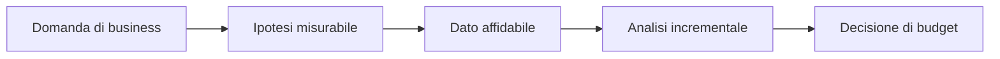

# Brand analytics e misurazione dell'efficacia

La notorietà di un brand può crescere nei sondaggi, ma il nodo vero è capire se questa crescita si traduce in scelte concrete, in margine sul prezzo o in conversioni. Il brand non si misura come un click, e allo stesso tempo non puoi escluderlo dalla disciplina analitica. La brand analytics vive in questa zona intermedia, dove segnali lenti vanno tradotti in decisioni rapide.

## Problema reale

Il compito è trasformare budget, canali, creatività e audience in decisioni misurabili, evitando di confondere volume, attribuzione e incrementalità. Non basta che il concetto sia interessante in astratto. Deve migliorare una decisione reale, poggiare su dati affidabili e avere una soglia di errore esplicita.

## Modello concettuale

Il processo è sequenziale. Parti da una domanda di business, formuli un'ipotesi misurabile, verifichi la qualità del dato e arrivi alla decisione di budget.



| Passaggio | Domanda guida | Output atteso |
|---|---|---|
| Framing | Quale decisione deve cambiare? | Scelta concreta, non curiosità |
| Misura | Quale segnale rappresenta il fenomeno? | Metrica, fonte, granularità |
| Confronto | Rispetto a quale baseline interpreto il risultato? | Benchmark o controfattuale |
| Azione | Che cosa faccio se il segnale supera la soglia? | Decisione, owner, prossimo controllo |

## Formalizzazione rigorosa

La brand analytics si formalizza come relazione tra cinque elementi. L'unità è la campagna, la coorte, il touchpoint o il segmento cliente. Il segnale è il margine incrementale, il CAC payback, il conversion rate corretto, il lift o la retention generata. La baseline è il periodo precedente, un gruppo holdout, un mercato comparabile o un benchmark storico. La decisione consiste nello spostare risorse, cambiare messaggio, fermare una tattica o scalare un esperimento. Il rischio è confondere correlazione, qualità del dato e causalità decisionale.

| Elemento | Definizione operativa |
|---|---|
| Unità | campagna, coorte, touchpoint o segmento cliente |
| Segnale | margine incrementale, CAC payback, conversion rate corretto, lift o retention generata |
| Baseline | periodo precedente, gruppo holdout, mercato comparabile o benchmark storico |
| Decisione | spostare risorse, cambiare messaggio, fermare tattica o scalare esperimento |
| Rischio | confondere correlazione, qualità del dato e causalità decisionale |

Una metrica è utile solo se riduce l'incertezza su una decisione specifica. Se non cambia una scelta, è documentazione. Se cambia una scelta senza controlli, è rischio.

## La brand funnel e le metriche per livello

La brand funnel descrive il percorso del consumatore:

```
Awareness → Consideration → Preference → Purchase → Loyalty → Advocacy
```

| Livello | Metrica | Come misurarla | Frequenza |
|---------|---------|----------------|-----------|
| Awareness | % target che conosce il brand | Survey (aided/unaided recall), Google Trends | Trimestrale, continuo |
| Consideration | % che considera il brand | Survey, Share of Search | Trimestrale |
| Preference | % che preferisce il brand | Survey, Conjoint analysis | Annuale |
| Purchase | Quota di mercato, trial rate | Dati interni, panel | Mensile |
| Loyalty | Repeat rate, NPS, share of wallet | Dati transazionali, survey | Continuo |
| Advocacy | Referral rate, UGC volume | Programma referral, social listening | Continuo |

## Brand lift studies: misurare l'impatto della pubblicità

Lo standard di riferimento per valutare il brand marketing è il brand lift study. Costruisci un gruppo esposto alla campagna, un gruppo di controllo simile ma non esposto, e calcoli il lift come differenza relativa tra i due.

Prendi una campagna TV nel Regno Unito confrontata con l'Irlanda:

- Awareness UK: 45% → 58% (+13pp)
- Awareness Irlanda: 42% → 44% (+2pp)
- Lift attribuibile: +11pp

Un proxy rapido è Google Trends, confrontando i volumi di ricerca durante e prima della campagna.

## Metriche proxy per il brand health in tempo reale

Le survey sono lente e costose, perciò si usano proxy continui. Il brand search volume conta le ricerche Google sul brand. Il direct traffic misura il traffico diretto al sito. Il brand CPC discount cattura il costo per click più basso sul nome del brand. La social mention velocity misura la velocità con cui crescono le menzioni social, e il backlink growth segue la crescita dei link da altri siti.

## Caso reale: il brand tracking di Nike

Nike investe soprattutto in brand marketing e misura un Brand Power Index composito, che mette insieme Google Trends, social sentiment, direct traffic, NPS e survey. Un aumento di 10 punti nell'indice corrisponde a un +3-4% di revenue nei quattro trimestri successivi, con un lag di 12-18 mesi e una correlazione robusta (R²=0.72). È questo che giustifica investimenti brand senza ritorno immediato.

## Brand vs performance: allocazione del budget per stadio

| Stadio aziendale | % Brand | % Performance | Motivazione |
|-----------------|---------|---------------|-------------|
| Early stage (`<$5M`) | 10-20% | 80-90% | Sopravvivenza, focus su ROAS |
| Scale-up ($5-50M) | 30-40% | 60-70% | Costruzione awareness, inizio brand lift |
| Growth ($50-500M) | 40-50% | 50-60% | Brand come fossato competitivo |
| Mature (>$500M) | 50-60% | 40-50% | Mantenimento quota e premium pricing |

## Controllo di qualità e segmentazione

Prima di portare la brand analytics dentro una decisione, verifica completezza, duplicati, timezone, definizioni e segmenti esclusi. La media aggregata è solo un punto di partenza. Segmenta per canale, coorte, paese, device e maturità dell'utente, perché le differenze tra segmenti spesso nascondono errori decisionali.

## Esempio o caso studio

Un team growth valuta se aumentare il budget su un canale con CPA basso ma vendite marginali deboli. Qui si tratta di distinguere il segnale utile dal rumore, collegando metrica, modello mentale e decisione economica. La lettura si organizza in tre colonne:

| Evidenza | Interpretazione prudente | Decisione |
|---|---|---|
| Segnale positivo ma non isolato | Fenomeno esiste, causa incerta | Cercare baseline o holdout |
| Segmento con risposta diversa | Effetto medio nasconde eterogeneità | Analizzare coorti o sottogruppi |
| Costo operativo crescente | Valutare margine | Applicare soglie economiche |

## Lab / esercizio

### Livello base

Descrivi una decisione reale legata a brand analytics in cinque righe: obiettivo, metrica primaria, baseline, rischio e azione.

### Livello intermedio

Costruisci una tabella con almeno tre segmenti o scenari indicando segnale, spiegazione alternativa e controllo necessario.

### Livello research-grade

Progetta un piano di validazione: ipotesi, dati, criteri di esclusione, soglia decisionale e controllo post-decisione. Indica cosa ti farebbe cambiare idea.

### Dataset e materiali consigliati

Usa export campagne, costi media, eventi web/app, CRM, transazioni, survey brand e log consenso. Se non hai dati reali, crea un dataset sintetico con 200-500 righe e almeno una colonna temporale, una di segmento, una metrica di outcome e una variabile di esposizione.

## Errore tipico da evitare

L'errore è trattare la brand analytics come una definizione da ricordare invece che un protocollo decisionale. Presentare metriche senza baseline, grafici senza ipotesi o raccomandazioni senza il costo dell'errore porta a decisioni sbagliate.

Chiediti sempre: "Se questo risultato fosse falso, quale decisione sbaglierei?". Se non sai rispondere, la lezione non l'hai applicata davvero.

## Quiz o checkpoint

1. Quale decisione concreta migliora questa lezione?
2. Quale baseline rende interpretabile il risultato?
3. Quale assunzione, se errata, cambia la conclusione?
4. Quale controllo minimo useresti prima di raccomandare?

## Riepilogo operativo

La brand analytics e la misurazione dell'efficacia collegano concetto, dato e decisione. Studiale partendo da un problema reale, formalizza il segnale, cerca una baseline credibile, costruisci un esempio e chiudi con un controllo pratico. Solo così diventano uno strumento operativo e non conoscenza decorativa.