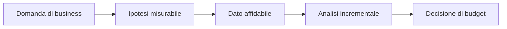

# Brand analytics e misurazione dell'efficacia


La notorietà cresce nei survey, ma il CFO chiede se questo sposta davvero scelta, prezzo o conversione. Il brand non può essere misurato come un click, ma non può nemmeno restare fuori dalla disciplina analitica. **Brand analytics e misurazione dell'efficacia** lavora proprio su questa zona intermedia.

## Una scena da cui partire

Leggi questa lezione come traduzione tra segnali lenti e decisioni veloci. Devi distinguere awareness, consideration, preference e pricing power, poi spiegare quali metriche sono indicatori anticipatori e quali confermano effetti già maturi.

- **Contesto:** Quale decisione di investimento dipende dal brand?
- **Metodo:** Quale metrica collega percezione e comportamento osservabile?
- **Applicazione:** Come presenteresti un effetto di brand senza promettere causalità falsa?

## La brand funnel e le metriche per livello

```
Awareness → Consideration → Preference → Purchase → Loyalty → Advocacy
```

| Livello | Metrica | Come misurarla | Frequenza |
|---------|---------|----------------|-----------|
| **Awareness** | % target audience che conosce il brand | Survey (aided/unaided recall), Google Trends | Trimestrale (survey), continuo (Trends) |
| **Consideration** | % che considera il brand per prossimo acquisto | Survey, Share of Search | Trimestrale |
| **Preference** | % che preferisce il brand ai competitor | Survey, Conjoint analysis | Annuale |
| **Purchase** | Quota di mercato, trial rate | Dati interni, panel (Nielsen, GfK) | Mensile |
| **Loyalty** | Repeat rate, NPS, share of wallet | Dati transazionali, survey NPS | Continuo |
| **Advocacy** | Referral rate, UGC volume | Programma referral, social listening | Continuo |

## Brand lift studies: misurare la pubblicità brand

Il metodo gold standard per l'impatto del brand marketing:

1. **Gruppo esposto**: persone che hanno visto la campagna
2. **Gruppo di controllo**: persone simili che NON l'hanno vista (holdout geografico, temporale o panel)
3. **Lift** = (Metrica esposto - Metrica controllo) / Metrica controllo

Esempio: campagna TV in UK, non in Irlanda (mercato simile, stesso linguaggio). Dopo campagna:
- Brand awareness UK: 45% → 58% (+13pp)
- Brand awareness Irlanda: 42% → 44% (+2pp)
- **Lift attribuibile alla campagna**: +11 punti percentuali

```sql
-- Brand lift via Google Trends (proxy veloce)
WITH brand_trends AS (
  SELECT date, country, 'my_brand' AS brand, search_index
  FROM google_trends WHERE keyword = 'tuobrand'
  UNION ALL
  SELECT date, country, 'competitor', search_index
  FROM google_trends WHERE keyword = 'competitor'
)
SELECT country,
  AVG(CASE WHEN date BETWEEN campaign_start AND campaign_end
           THEN search_index END) AS during_campaign,
  AVG(CASE WHEN date BETWEEN campaign_start - 90 AND campaign_start - 1
           THEN search_index END) AS pre_campaign,
  ROUND((AVG(CASE WHEN date BETWEEN campaign_start AND campaign_end THEN search_index END) /
         AVG(CASE WHEN date BETWEEN campaign_start - 90 AND campaign_start - 1 THEN search_index END) - 1) * 100, 1) AS lift_pct
FROM brand_trends
WHERE brand = 'my_brand'
GROUP BY country;
```

## Metriche proxy per il brand health in tempo reale

Le survey costano e sono lente. Metriche proxy continue:

1. **Brand Search Volume**: trend ricerche Google del brand name. Segnale puro di awareness, non manipolabile (nessuno cerca "Nike" senza sapere cos'è Nike).

2. **Direct Traffic**: % traffico che arriva digitando l'URL o da bookmark. Cresce quando il brand è forte.

3. **Brand CPC discount**: quando il CPC del tuo brand name è molto più basso di keyword generiche. Significa che Google riconosce il tuo brand come rilevante (alto Quality Score).

4. **Social Mention Velocity**: menzioni del brand su social, news e forum. Accelerazione significa che la campagna sta generando conversazione.

5. **Backlink growth**: nuovi link da altri siti verso il tuo. Segnale di brand authority.

## Caso reale: il brand tracking di Nike

Nike spende ~$3.5 miliardi/anno in marketing, di cui la maggior parte in brand. Non misurano un ROAS immediato ma un **Brand Power Index** composito: Google Trends, social sentiment, direct traffic, NPS, e una survey trimestrale di brand health. Hanno scoperto che quando l'indice sale di 10 punti, il revenue cresce del 3-4% nei 4 trimestri successivi. Con un lag di 12-18 mesi, ma con una correlazione robusta (R²=0.72 su dati 2010-2023). Questo permette di giustificare investimenti brand che non mostrano ritorno immediato.

## Brand vs Performance: allocazione del budget per stadio

| Stadio aziendale | % Brand | % Performance | Perché |
|-----------------|---------|---------------|--------|
| **Early stage (&lt;$5M revenue)** | 10-20% | 80-90% | Sopravvivere. Misura tutto con ROAS. |
| **Scale-up ($5-50M)** | 30-40% | 60-70% | Costruire awareness. Inizia brand lift studies. |
| **Growth ($50-500M)** | 40-50% | 50-60% | Il brand diventa fossato competitivo. |
| **Mature ($500M+)** | 50-60% | 40-50% | Mantenere quota e premium pricing. |

Il framework non è rigido ma aiuta a capire perché startup e corporate hanno discussioni diverse sul budget marketing.

## Controllo di qualità

Prima di usare brand analytics e misurazione dell'efficacia in una decisione, controlla sempre completezza, duplicati, timezone, definizioni cambiate e segmenti esclusi. Molte analisi apparentemente sofisticate falliscono perché il dato di partenza misura un comportamento diverso da quello che il team crede di osservare.


## Interpretazione per segmenti

La media aggregata è solo il punto di partenza. Segmenta per canale, coorte, piano, paese, device e maturità dell'utente. Se due segmenti si muovono in direzioni opposte, la media non rappresenta nessuno dei due e può portare a una decisione sbagliata.

## Problema reale

Nel lavoro su marketing analytics, **Brand analytics e misurazione dell'efficacia** serve a risolvere un problema concreto: trasformare budget, canali, creativita e audience in decisioni misurabili senza confondere volume, attribuzione e incrementalita. La domanda non è se il concetto sia interessante in astratto, ma quale decisione migliora quando lo applichi con dati affidabili e con una soglia di errore esplicita.

Questa lezione va studiata come uno strumento operativo: entro la fine devi saper Comprendere il problema analitico e il contesto decisionale; Applicare esempi, metriche e controlli a casi reali. Se non riesci a collegare il concetto a una scelta reale, la conoscenza resta decorativa e non diventa competenza.

## Modello concettuale



Il modello mentale e sequenziale: prima si formula la domanda, poi si traduce in unità osservabili, quindi si valuta la qualità del dato e solo alla fine si decide. Saltare un passaggio produce analisi eleganti ma fragili.

| Passaggio | Domanda guida | Output atteso |
|---|---|---|
| Framing | Quale decisione deve cambiare? | Una scelta concreta, non una curiosità |
| Misura | Quale segnale rappresenta il fenomeno? | Metrica, fonte e granularità |
| Confronto | Rispetto a quale baseline interpreto il risultato? | Benchmark o controfattuale plausibile |
| Azione | Che cosa faccio se il segnale supera la soglia? | Decisione, owner e prossimo controllo |

## Formalizzazione rigorosa

Formalizza **Brand analytics e misurazione dell'efficacia** come una relazione tra quattro elementi: unità di analisi, segnale, baseline e decisione. Nel contesto di questa lezione l'unità principale e **campagna, coorte, touchpoint o segmento cliente**. Il segnale da osservare deve essere collegato a **margine incrementale, CAC payback, conversion rate corretto, lift o retention generata**, mentre la baseline deve essere scelta tra **periodo precedente, gruppo holdout, mercato comparabile o benchmark storico**.

Una formulazione robusta segue questa logica:

| Elemento | Definizione operativa per questa lezione |
|---|---|
| Unità | campagna, coorte, touchpoint o segmento cliente |
| Segnale | margine incrementale, CAC payback, conversion rate corretto, lift o retention generata |
| Baseline | periodo precedente, gruppo holdout, mercato comparabile o benchmark storico |
| Decisione | spostare risorse, cambiare messaggio, fermare una tattica o scalare un esperimento |
| Rischio | Confondere correlazione, qualità del dato e causalità decisionale |

La regola pratica e semplice: una misura e utile solo se riduce l'incertezza su una decisione specifica. Se non cambia una scelta, e documentazione; se cambia una scelta senza controlli, e rischio.

## Esempio o caso studio

Un team growth deve decidere se aumentare il budget su un canale che mostra CPA basso ma vendite marginali deboli. La lezione aiuta a separare il segnale utile dal rumore operativo, collegando metrica, modello mentale e decisione economica.

Applicando **Brand analytics e misurazione dell'efficacia**, il team costruisce una lettura in tre colonne: cosa sappiamo, cosa assumiamo e quale decisione prendiamo. Questo formato impedisce di presentare un numero come se fosse una conclusione autosufficiente.

| Evidenza | Interpretazione prudente | Decisione conseguente |
|---|---|---|
| Segnale positivo ma non isolato | Il fenomeno esiste, ma la causa e ancora incerta | Cercare baseline o holdout |
| Segmento con risposta diversa | L'effetto medio nasconde eterogeneita | Analizzare coorti o sottogruppi |
| Costo operativo crescente | Il risultato va valutato sul margine | Applicare soglie economiche |

## Lab / esercizio

### Livello base

Prendi una decisione reale collegata a **Brand analytics e misurazione dell'efficacia** e scrivi in cinque righe: obiettivo, metrica primaria, baseline, rischio principale e azione prevista. Non usare più di una metrica primaria.

### Livello intermedio

Costruisci una tabella con almeno tre segmenti o scenari. Per ciascuno indica segnale, possibile spiegazione alternativa e controllo necessario prima di decidere.

### Livello research-grade

Disegna un piano di validazione: ipotesi, dati necessari, criterio di esclusione, soglia decisionale e controllo post-decisione. Specifica anche che cosa ti farebbe cambiare idea.

### Dataset e materiali consigliati

Usa export campagne, costi media, eventi web o app, CRM, transazioni, survey brand e log di consenso. Se non hai dati reali, crea un dataset sintetico con 200-500 righe e almeno una colonna temporale, una colonna segmento, una metrica di outcome e una variabile di esposizione.

## Errore tipico da evitare

L'errore più frequente e trattare **Brand analytics e misurazione dell'efficacia** come una definizione da ricordare invece che come un protocollo decisionale. In pratica succede quando si presenta una metrica senza baseline, un grafico senza ipotesi, o una raccomandazione senza costo dell'errore.

Un controllo utile è chiedersi: "se questo risultato fosse falso o instabile, quale decisione sbaglierei?". Se la risposta non è chiara, la lezione non è ancora stata applicata davvero.

## Quiz o checkpoint

1. Qual è la decisione concreta che questa lezione dovrebbe migliorare?
2. Quale baseline rende interpretabile il risultato?
3. Quale assunzione, se sbagliata, cambierebbe la conclusione?
4. Quale controllo minimo useresti prima di presentare la raccomandazione?

## Riepilogo operativo

**Brand analytics e misurazione dell'efficacia** e una competenza utile quando collega concetto, dato e decisione. Studiala partendo da un problema reale, formalizza il segnale, cerca una baseline credibile, costruisci un esempio e chiudi con un controllo pratico. Categoria: Decisione. Difficoltà: advanced. Tempo stimato: 22 min.
