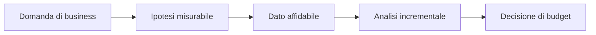

# Funnel marketing e unit economics


Una campagna porta molti lead a basso costo, ma il margine finale peggiora e il payback si allunga. Il funnel sembra efficiente solo finché non colleghi conversioni, valore cliente e costo di acquisizione. **Funnel marketing e unit economics** mette nella stessa analisi volume, qualità e sostenibilità economica.

## Una scena da cui partire

Leggi la lezione come una verifica di qualità della crescita. Un buon funnel non produce solo conversioni: produce clienti che rientrano nei vincoli di margine, retention e capacità commerciale.

- **Contesto:** Quale passaggio del funnel consuma più valore economico?
- **Metodo:** Quale metrica collega acquisizione, margine e payback?
- **Applicazione:** Quando ridurresti volume per migliorare qualità e sostenibilità?

## La Matematica della Crescita: Decomposizione del Funnel di Acquisizione

Un funnel di marketing non è altro che un modello matematico che descrive il percorso di un potenziale cliente da perfetto sconosciuto a fonte di profitto. La sua potenza risiede nella scomposizione di un processo complesso e apparentemente caotico in una sequenza di eventi misurabili e, quindi, ottimizzabili. Ogni stadio del funnel è un evento discreto, e il passaggio da uno stadio al successivo è governato da un tasso di conversione. La bellezza di questo approccio è che l'output finale è il prodotto matematico di tutti i tassi intermedi.

Consideriamo un tipico funnel B2B per un'azienda SaaS che vende un software di project management. Il percorso completo potrebbe essere:

1.  **Impression**: Il nostro annuncio compare sullo schermo di un utente su LinkedIn. Questo è il punto di partenza, il volume grezzo.
2.  **Click**: L'utente è incuriosito dal copy ("Gestisci i tuoi progetti 3 volte più velocemente") e clicca. Il rapporto tra Click e Impression è il **Click-Through Rate (CTR)**.
3.  **Visit**: L'utente atterra sulla nostra landing page. Non tutti i click si traducono in una visita effettiva; alcuni utenti chiudono la pagina prima che si carichi. Il rapporto tra visite e click misura l'efficacia tecnica e di primo impatto della pagina.
4.  **Lead (o Sign-up)**: L'utente è convinto dalla nostra value proposition e compila un form per avviare una prova gratuita di 14 giorni. Il rapporto tra Lead e Visit è il **Conversion Rate (CVR)** della pagina, una delle metriche più scrutinate.
5.  **Marketing Qualified Lead (MQL)**: Il nostro sistema di marketing automation (es. HubSpot) verifica che il lead soddisfi certi criteri (es. email aziendale, azienda con più di 50 dipendenti).
6.  **Sales Qualified Lead (SQL)**: Il team di vendita contatta l'MQL e, dopo una prima chiamata, qualifica il lead come un'opportunità concreta con budget e potere decisionale.
7.  **Customer (o Closed-Won)**: Dopo una demo e una negoziazione, l'opportunità si trasforma in un cliente pagante. Il rapporto tra Customer e SQL è il **Win Rate** del team sales.

La catena matematica è moltiplicativa. Se investiamo €10.000 in una campagna LinkedIn con un Costo per Mille Impression (CPM) di €20, generiamo 500.000 impression.
- Con un CTR del 1.5%, otteniamo 7.500 click.
- Se il 95% dei click si traduce in visite, abbiamo 7.125 visitatori unici.
- Con un CVR della landing page del 4%, generiamo 285 lead.
- Se il 70% di questi sono MQL, otteniamo 199 MQL.
- Se il team sales qualifica il 40% degli MQL in SQL, abbiamo 80 opportunità.
- Con un Win Rate del 25%, chiudiamo 20 nuovi clienti.

L'intero funnel ha convertito 500.000 impression in 20 clienti, con un tasso di conversione end-to-end dello 0.004%. Ogni singolo numero in questa catena è una leva. Un A/B test che aumenta il CVR della landing page dal 4% al 5% non aggiunge solo un punto percentuale: aumenta il numero di clienti finali del 25% (da 20 a 25), senza spendere un euro in più in pubblicità.

## Unit Economics in Azione: Dal CAC al LTV:CAC Ratio

Aver acquisito 20 clienti con €10.000 di spesa ci dice che il nostro **Customer Acquisition Cost (CAC)** puramente media è di €500. Questa è la metrica fondamentale delle unit economics, ma considerarla in isolamento è un errore. Un CAC di €500 è un trionfo o un disastro? La risposta dipende dall'altra metà dell'equazione: il **Lifetime Value (LTV)**, ovvero il profitto totale che un cliente medio genera durante la sua intera relazione con l'azienda.

Il CAC deve essere calcolato in modo onesto. Il CAC "di marketing" (€10.000 / 20 clienti) è solo la punta dell'iceberg. Un'analisi rigorosa richiede il calcolo del **CAC fully-loaded**, che include:
- **Spesa media**: I costi diretti di advertising (Google, Facebook, LinkedIn).
- **Costi del personale**: Gli stipendi (pro-rata) dei team di marketing e vendita coinvolti nel processo di acquisizione.
- **Costi tecnologici**: Le licenze per software come Salesforce (CRM), HubSpot (Marketing Automation), Looker (BI), etc.
- **Costi operativi**: Spese per agenzie, freelance, produzione di creatività.

Ipotizziamo che questi costi aggiuntivi ammontino a €8.000 per lo stesso periodo. Il CAC fully-loaded sale a (€10.000 + €8.000) / 20 = €900. Questo è il numero reale su cui basare le decisioni.

Ora, calcoliamo l'LTV. Per un'azienda SaaS, una formula comune è:
`LTV = (Average Revenue Per Account per mese * Gross Margin %) / Monthly Churn Rate`

Se il nostro software ha un costo medio di €150/mese, un margine lordo dell'80% (dopo i costi di hosting e supporto), e un tasso di abbandono mensile (churn) del 2%, l'LTV è:
`LTV = (€150 * 0.80) / 0.02 = €120 / 0.02 = €6.000`

Il rapporto **LTV:CAC** è il nostro indicatore di salute. Nel nostro caso, è €6.000 / €900 ≈ 6.7. Un rapporto superiore a 3:1 è generalmente considerato sano per un'azienda SaaS. Un rapporto di 6.7:1 è eccellente e segnala che ogni euro investito in acquisizione ne genera quasi sette di valore futuro. Questo dà al management il via libera per investire di più, sapendo che il motore della crescita è non solo funzionante, ma altamente profittevole.

### Caso di Studio: Spotify e la Leva del Freemium

Spotify ha perfezionato l'uso del funnel e delle unit economics per dominare il mercato dello streaming musicale. Il loro funnel è biforcato: uno per gli utenti *Free* e uno per la conversione a *Premium*. Il prodotto gratuito, supportato da pubblicità, non è solo una fonte di ricavi modesta, ma un gigantesco e a basso costo canale di acquisizione per il prodotto a pagamento.

Nel 2022, Spotify ha speso circa 1.4 miliardi di euro in Sales & Marketing. Con circa 489 milioni di utenti attivi mensili (MAU), di cui 205 milioni Premium, la strategia è evidente. Un utente si iscrive gratuitamente, magari attratto da una campagna social. Per mesi, non genera quasi LTV, ma il suo costo di acquisizione è bassissimo. Durante questo periodo, Spotify raccoglie dati sulle sue preferenze e lo espone a messaggi mirati che ne evidenziano i limiti (pubblicità, skip limitati) e i benefici di Premium.

La conversione da Free a Premium è il cuore del loro modello. Ipotizziamo che il CAC per un utente Free sia di soli €2. Se il 10% degli utenti Free converte a Premium entro 12 mesi, il CAC effettivo per acquisire un utente Premium attraverso questo canale è di circa €20 (più i costi delle campagne di conversione). L'ARPU (Average Revenue Per User) per un utente Premium si aggirava intorno ai €4.50/mese. Con un margine lordo del 25% e un churn mensile stimato intorno all'1.5%, l'LTV di un utente Premium è `(€4.50 * 0.25) / 0.015 ≈ €75`.
Il rapporto LTV:CAC per questo flusso è €75 / €20 = 3.75. Questo modello ha permesso a Spotify di scalare globalmente in modo sostenibile, usando il prodotto gratuito come un "vivaio" a basso costo per coltivare futuri clienti ad alto valore.

## Diagnostica del Funnel via SQL: Identificare i Colli di Bottiglia

Quando le metriche di business peggiorano (es. il CAC aumenta o il numero di nuovi clienti diminuisce), la prima domanda è sempre "dove si è rotto il funnel?". L'analisi aggregata non basta. Serve uno strumento per sezionare il funnel e identificare lo stadio esatto che sta sottoperformando. SQL è lo strumento d'elezione per questa diagnostica.

Immaginiamo di avere una tabella `user_events` in un data warehouse come Snowflake o BigQuery, che registra ogni azione significativa dell'utente. La tabella potrebbe avere questa struttura: `event_id`, `user_id`, `event_timestamp`, `event_name` (es. 'view_ad', 'click_ad', 'visit_landing_page', 'submit_form'), e `utm_source` (es. 'google', 'facebook').

Per diagnosticare il funnel, dobbiamo contare il numero di utenti unici che hanno completato ogni stadio in sequenza. Un approccio robusto utilizza le Common Table Expressions (CTEs) per costruire l'analisi passo dopo passo, segmentando per canale.

```sql
WITH event_counts AS (
    SELECT
        utm_source,
        COUNT(DISTINCT CASE WHEN event_name = 'view_ad' THEN user_id END) AS impressions,
        COUNT(DISTINCT CASE WHEN event_name = 'click_ad' THEN user_id END) AS clicks,
        COUNT(DISTINCT CASE WHEN event_name = 'visit_landing_page' THEN user_id END) AS visits,
        COUNT(DISTINCT CASE WHEN event_name = 'submit_form' THEN user_id END) AS leads
    FROM
        user_events
    WHERE
        event_timestamp >= CURRENT_DATE - INTERVAL '30 days'
    GROUP BY
        1
),

funnel_stages AS (
    SELECT
        utm_source,
        impressions,
        clicks,
        visits,
        leads
    FROM
        event_counts
    WHERE
        impressions > 1000 -- Filtriamo canali con volume insignificante
)

SELECT
    utm_source,
    -- Tassi di conversione sequenziali
    ROUND(clicks * 100.0 / NULLIF(impressions, 0), 2) AS ctr_percent,
    ROUND(visits * 100.0 / NULLIF(clicks, 0), 2) AS click_to_visit_percent,
    ROUND(leads * 100.0 / NULLIF(visits, 0), 2) AS visit_to_lead_percent,
    -- Tasso di conversione end-to-end
    ROUND(leads * 100.0 / NULLIF(impressions, 0), 4) AS overall_conversion_percent
FROM
    funnel_stages
ORDER BY
    overall_conversion_percent DESC;
```

L'output di questa query non è solo una serie di numeri, ma una mappa diagnostica. Se vediamo che il canale 'google' ha un `ctr_percent` del 3% ma un `visit_to_lead_percent` del 1.5%, mentre 'facebook' ha un `ctr_percent` del 1% ma un `visit_to_lead_percent` del 6%, otteniamo insight azionabili. Il problema di Google non è l'attrarre click, ma il convertire i visitatori sulla landing page. Forse c'è una discrepanza tra il messaggio dell'annuncio e il contenuto della pagina? Al contrario, Facebook attira meno click, ma quelli che arrivano sono altamente qualificati e convertono bene. L'azione potrebbe essere quella di ottimizzare le creatività su Facebook per aumentare il CTR, mantenendo lo stesso targeting. Questo tipo di analisi permette di allocare le risorse (tempo, budget, talento) esattamente dove l'impatto sarà maggiore.

## Strategie di Ottimizzazione Avanzata e il Caso Netflix

Una volta identificato il collo di bottiglia, l'ottimizzazione diventa un processo scientifico basato sull'A/B testing. Ogni stadio del funnel è un'opportunità per un esperimento.
- **Top of Funnel (Impression → Click)**: Si testano creatività, copy degli annunci, segmenti di pubblico, e call-to-action. L'obiettivo è massimizzare il CTR a parità di costo.
- **Middle of Funnel (Visit → Lead)**: Si testano elementi della landing page: headline, immagini, prova sociale (testimonial), lunghezza del form, offerta (es. "Prova gratuita" vs "Richiedi una demo"). L'obiettivo è massimizzare il CVR.
- **Bottom of Funnel (Lead → Customer)**: Si testano le cadenze di email nurturing, gli script per le chiamate di vendita, le strategie di pricing e le promozioni. L'obiettivo è massimizzare il Win Rate.

Un errore comune è guardare al funnel come a un'entità monolitica. La realtà è che un'azienda non ha *un* funnel, ma decine, se non centinaia, di micro-funnel segmentati. L'analisi deve scomporre le performance per:
- **Canale**: Google Ads vs. SEO vs. Social.
- **Device**: Desktop vs. Mobile.
- **Geografia**: Italia vs. Germania.
- **Coorte di utenti**: Nuovi visitatori vs. Utenti di ritorno.

Un funnel aggregato con un CVR del 3% potrebbe nascondere un CVR del 7% su desktop e un disastroso 0.5% su mobile. L'azione correttiva non è "migliorare la landing page", ma "fare un'analisi UX specifica e una riprogettazione del flusso di sign-up su mobile".

### Caso di Studio: Netflix e l'Ossessione per il Funnel di Iscrizione

Netflix è un esempio magistrale di ottimizzazione del funnel basata sui dati. Il loro prodotto è l'intrattenimento, ma la loro competenza chiave è l'ingegneria della conversione. Per anni, la homepage di Netflix per i non iscritti è stata un laboratorio di testing continuo. Hanno sperimentato ogni possibile variabile:
- **Hero Image**: Immagini di show di tendenza (es. *Stranger Things*) contro immagini generiche di persone che si godono un film.
- **Value Proposition**: Testo incentrato sulla vastità del catalogo ("Guarda tutto ciò che vuoi") contro testo incentrato sulla flessibilità ("Disdici quando vuoi").
- **Social Proof**: Includere o meno loghi di media famosi o frasi come "Unisciti a oltre 200 milioni di abbonati".

Ogni test era misurato non solo sul tasso di conversione (sign-up), ma anche su metriche a lungo termine come la **retention al primo mese**. Scoprirono, per esempio, che certi messaggi potevano aumentare i sign-up a breve termine ma attraevano utenti meno "committed" che abbandonavano dopo la prova gratuita. Nel 2020, Netflix ha compiuto una mossa audace in molti mercati, eliminando la tradizionale prova gratuita. Questa decisione, apparentemente controintuitiva, era il risultato di innumerevoli test. Avevano capito che la prova gratuita attirava un gran numero di utenti a basso intento, gonfiando i costi di acquisizione (legati al supporto e all'infrastruttura) senza un adeguato ritorno in LTV. Rimuovendola, il numero di sign-up iniziali è probabilmente diminuito, ma la qualità media dei nuovi iscritti è aumentata drasticamente. Questo ha portato a una maggiore retention precoce e a un LTV più alto, ottimizzando il rapporto LTV:CAC su una scala massiva. L'analisi del funnel di Netflix ha dimostrato che a volte, per migliorare la salute del sistema, è necessario aggiungere frizione per filtrare gli utenti sbagliati.

## Dal Modello alla Pratica: Laboratorio di Analisi Funnel

Passiamo ora dalla teoria all'applicazione. Immaginate di essere Data Analyst in una startup EdTech che vende corsi di programmazione online. Vi viene fornito l'accesso a un dataset di eventi utente e il vostro compito è diagnosticare il funnel di vendita per il mese scorso e proporre azioni concrete.

**Scenario**: Il dataset `user_events` contiene le seguenti colonne: `user_id`, `timestamp`, `event_type` (`view_course_page`, `add_to_cart`, `start_checkout`, `purchase`), `utm_source` (`google`, `facebook`, `organic`), `device_type` (`desktop`, `mobile`).

**Esercizio 1: Mappatura del Funnel di Base**
Il primo passo è quantificare il flusso principale. Dobbiamo calcolare quanti utenti unici hanno eseguito ogni azione e i tassi di conversione tra passaggi consecutivi. Useremo Python con la libreria `pandas` per questa analisi.

```python
import pandas as pd

# Ipotizziamo di avere il dataframe 'df' caricato con i dati
# df = pd.read_csv('user_events.csv')

# Calcoliamo gli utenti unici per ogni stadio
funnel_steps = {
    'view_course_page': df[df['event_type'] == 'view_course_page']['user_id'].nunique(),
    'add_to_cart': df[df['event_type'] == 'add_to_cart']['user_id'].nunique(),
    'start_checkout': df[df['event_type'] == 'start_checkout']['user_id'].nunique(),
    'purchase': df[df['event_type'] == 'purchase']['user_id'].nunique()
}

funnel_df = pd.DataFrame(list(funnel_steps.items()), columns=['step', 'user_count'])

# Calcoliamo i tassi di conversione sequenziali
funnel_df['conversion_rate'] = (funnel_df['user_count'] / funnel_df['user_count'].shift(1) * 100).fillna(100)

print("Analisi del Funnel Aggregato:")
print(funnel_df)

# Output di esempio:
# Analisi del Funnel Aggregato:
#                  step  user_count  conversion_rate
# 0  view_course_page       10000       100.000000
# 1       add_to_cart        1200        12.000000
# 2    start_checkout         600        50.000000
# 3          purchase         420        70.000000
```
*Interpretazione*: Vediamo una forte perdita tra la visualizzazione della pagina e l'aggiunta al carrello (solo il 12% converte), ma i passaggi successivi del checkout sono relativamente efficienti. L'attenzione dovrebbe concentrarsi sulla pagina del corso.

**Esercizio 2: Analisi Segmentata per Canale e Dispositivo**
Il dato aggregato è un punto di partenza, ma l'insight si trova nei segmenti. Ripetiamo l'analisi, ma questa volta raggruppando per `utm_source` e `device_type`. L'obiettivo è identificare i segmenti più e meno performanti.

L'analisi rivela che il canale `facebook` su `mobile` ha un tasso di `add_to_cart` molto alto (20%), ma il tasso di conversione da `start_checkout` a `purchase` crolla al 15%. Al contrario, il traffico `organic` su `desktop` ha un tasso di `add_to_cart` più basso (8%) ma una conversione nel checkout del 85%.

**Esercizio 3: Formulazione di Ipotesi e Raccomandazioni**
Basandovi sui risultati dell'esercizio 2, formulate un'ipotesi per spiegare la discrepanza osservata e proponete una raccomandazione al team di prodotto.

*Ipotesi*: "Il flusso di checkout sulla versione mobile del sito presenta probabilmente problemi di usabilità o frizioni inaspettate (es. form complessi, metodi di pagamento non ottimizzati per mobile come Apple/Google Pay) che causano un alto tasso di abbandono per gli utenti provenienti da Facebook, che sono prevalentemente su dispositivi mobili."

*Raccomandazione*: "Suggerisco di avviare un'analisi UX specifica sul flusso di checkout mobile. In parallelo, propongo di lanciare un A/B test per una versione semplificata del checkout per un segmento di utenti mobile, misurando l'impatto sul tasso di completamento dell'acquisto. Questo intervento potrebbe sbloccare un valore significativo dal traffico mobile a pagamento."

## Riepilogo

L'analisi del funnel, abbinata alle unit economics, trasforma il marketing da un centro di costo a un motore di crescita scientificamente misurabile. Non è un esercizio contabile, ma il cruscotto strategico che connette l'investimento di marketing al valore aziendale. La decomposizione del percorso utente in stadi discreti e misurabili permette di isolare

## Laboratorio ed esercizi

Metti in pratica quanto appreso con esercizi a difficoltà crescente. Lavora su un dataset reale — se non hai accesso al tuo data warehouse aziendale, usa dataset pubblici come Google Analytics Sample su BigQuery o il dataset E-Commerce di Kaggle.

**Esercizio 1 — Implementazione base.** Riproduci la query o il modello descritto nella lezione, adattandolo al tuo dataset. Verifica che i risultati siano coerenti con le metriche attese: se il totale non quadra con una query di controllo, c'è un problema di grain.

**Esercizio 2 — Estensione.** Aggiungi una dimensione di analisi non coperta nella lezione: segmenta per paese, per device, per fascia oraria o per coorte. Dove emergono pattern inattesi? Cosa implicano per le decisioni operative?

**Esercizio 3 — Automazione.** Trasforma la query in una vista o in un modello dbt con test di integrità (unique, not_null) e documenta le colonne. Se il tuo stack lo permette, configura un alert che notifichi quando la metrica esce da 2 deviazioni standard dalla media mobile.

## Problema reale

Nel lavoro su marketing analytics, **Funnel marketing e unit economics** serve a risolvere un problema concreto: trasformare budget, canali, creativita e audience in decisioni misurabili senza confondere volume, attribuzione e incrementalita. La domanda non è se il concetto sia interessante in astratto, ma quale decisione migliora quando lo applichi con dati affidabili e con una soglia di errore esplicita.

Questa lezione va studiata come uno strumento operativo: entro la fine devi saper Comprendere il problema analitico e il contesto decisionale; Applicare esempi, metriche e controlli a casi reali. Se non riesci a collegare il concetto a una scelta reale, la conoscenza resta decorativa e non diventa competenza.

## Modello concettuale



Il modello mentale e sequenziale: prima si formula la domanda, poi si traduce in unità osservabili, quindi si valuta la qualità del dato e solo alla fine si decide. Saltare un passaggio produce analisi eleganti ma fragili.

| Passaggio | Domanda guida | Output atteso |
|---|---|---|
| Framing | Quale decisione deve cambiare? | Una scelta concreta, non una curiosità |
| Misura | Quale segnale rappresenta il fenomeno? | Metrica, fonte e granularità |
| Confronto | Rispetto a quale baseline interpreto il risultato? | Benchmark o controfattuale plausibile |
| Azione | Che cosa faccio se il segnale supera la soglia? | Decisione, owner e prossimo controllo |

## Formalizzazione rigorosa

Formalizza **Funnel marketing e unit economics** come una relazione tra quattro elementi: unità di analisi, segnale, baseline e decisione. Nel contesto di questa lezione l'unità principale e **campagna, coorte, touchpoint o segmento cliente**. Il segnale da osservare deve essere collegato a **margine incrementale, CAC payback, conversion rate corretto, lift o retention generata**, mentre la baseline deve essere scelta tra **periodo precedente, gruppo holdout, mercato comparabile o benchmark storico**.

Una formulazione robusta segue questa logica:

| Elemento | Definizione operativa per questa lezione |
|---|---|
| Unità | campagna, coorte, touchpoint o segmento cliente |
| Segnale | margine incrementale, CAC payback, conversion rate corretto, lift o retention generata |
| Baseline | periodo precedente, gruppo holdout, mercato comparabile o benchmark storico |
| Decisione | spostare risorse, cambiare messaggio, fermare una tattica o scalare un esperimento |
| Rischio | Confondere correlazione, qualità del dato e causalità decisionale |

La regola pratica e semplice: una misura e utile solo se riduce l'incertezza su una decisione specifica. Se non cambia una scelta, e documentazione; se cambia una scelta senza controlli, e rischio.

## Esempio o caso studio

Un team growth deve decidere se aumentare il budget su un canale che mostra CPA basso ma vendite marginali deboli. La lezione aiuta a separare il segnale utile dal rumore operativo, collegando metrica, modello mentale e decisione economica.

Applicando **Funnel marketing e unit economics**, il team costruisce una lettura in tre colonne: cosa sappiamo, cosa assumiamo e quale decisione prendiamo. Questo formato impedisce di presentare un numero come se fosse una conclusione autosufficiente.

| Evidenza | Interpretazione prudente | Decisione conseguente |
|---|---|---|
| Segnale positivo ma non isolato | Il fenomeno esiste, ma la causa e ancora incerta | Cercare baseline o holdout |
| Segmento con risposta diversa | L'effetto medio nasconde eterogeneita | Analizzare coorti o sottogruppi |
| Costo operativo crescente | Il risultato va valutato sul margine | Applicare soglie economiche |

## Lab / esercizio

### Livello base

Prendi una decisione reale collegata a **Funnel marketing e unit economics** e scrivi in cinque righe: obiettivo, metrica primaria, baseline, rischio principale e azione prevista. Non usare più di una metrica primaria.

### Livello intermedio

Costruisci una tabella con almeno tre segmenti o scenari. Per ciascuno indica segnale, possibile spiegazione alternativa e controllo necessario prima di decidere.

### Livello research-grade

Disegna un piano di validazione: ipotesi, dati necessari, criterio di esclusione, soglia decisionale e controllo post-decisione. Specifica anche che cosa ti farebbe cambiare idea.

### Dataset e materiali consigliati

Usa export campagne, costi media, eventi web o app, CRM, transazioni, survey brand e log di consenso. Se non hai dati reali, crea un dataset sintetico con 200-500 righe e almeno una colonna temporale, una colonna segmento, una metrica di outcome e una variabile di esposizione.

## Errore tipico da evitare

L'errore più frequente e trattare **Funnel marketing e unit economics** come una definizione da ricordare invece che come un protocollo decisionale. In pratica succede quando si presenta una metrica senza baseline, un grafico senza ipotesi, o una raccomandazione senza costo dell'errore.

Un controllo utile è chiedersi: "se questo risultato fosse falso o instabile, quale decisione sbaglierei?". Se la risposta non è chiara, la lezione non è ancora stata applicata davvero.

## Quiz o checkpoint

1. Qual è la decisione concreta che questa lezione dovrebbe migliorare?
2. Quale baseline rende interpretabile il risultato?
3. Quale assunzione, se sbagliata, cambierebbe la conclusione?
4. Quale controllo minimo useresti prima di presentare la raccomandazione?

## Riepilogo operativo

**Funnel marketing e unit economics** e una competenza utile quando collega concetto, dato e decisione. Studiala partendo da un problema reale, formalizza il segnale, cerca una baseline credibile, costruisci un esempio e chiudi con un controllo pratico. Categoria: Tecnico. Difficoltà: advanced. Tempo stimato: 22 min.
