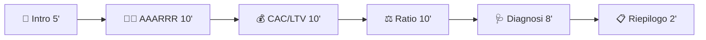

## Funnel e Unit Economics: La Matematica della Sostenibilità — Lezione Completa

Il marketing non è "creatività". È finanza applicata. Se spendi 50€ per acquisire un cliente che te ne porta 30€, non stai facendo business, stai facendo beneficenza. In questa lezione, collegheremo il concetto di Funnel (il percorso del cliente) con le Unit Economics (la redditività del singolo cliente), per capire se il tuo modello di business sta in piedi o è un "Leaky Bucket".

### Obiettivi di Apprendimento

Al termine di questa lezione, lo studente sarà in grado di:
1.  Mappare le 6 fasi del Funnel AAARRR (Pirate Metrics) per il proprio business.
2.  Calcolare il CAC (Customer Acquisition Cost) Blended e per Canale.
3.  Stimare il LTV (Lifetime Value) usando metodi storici e predittivi.
4.  Applicare la "Regola d'Oro" (LTV:CAC > 3:1) per valutare la scalabilità.
5.  Identificare i colli di bottiglia nel funnel analizzando i tassi di conversione intermedi.

### Timeline della Lezione

| Fase | Argomento | Durata |
|------|-----------|--------|
| 1 | Introduzione: Crescita vs Sostenibilità | 5 min |
| 2 | Framework: AAARRR (Pirate Metrics) | 10 min |
| 3 | Matematica: CAC e LTV | 10 min |
| 4 | Strategia: La Regola LTV:CAC | 10 min |
| 5 | Esercizi: Diagnosticare un Business | 8 min |
| 6 | Riepilogo e Domande | 2 min |
| **Totale** | | **45 min** |

### Fase 1 — Introduzione: Crescita vs Sostenibilità (5 min)

La crescita a tutti i costi è finita nel 2021. Oggi gli investitori chiedono "Profittabilità".
Puoi raddoppiare il fatturato domani spendendo il triplo in pubblicità, ma se le tue Unit Economics sono negative, stai solo accelerando verso il muro.
Le Unit Economics sono i "fondamentali": guadagni o perdi soldi su ogni *singola* unità venduta?

### Fase 2 — Framework: AAARRR (Pirate Metrics) (10 min)

Inventato da Dave McClure, è il modello standard per le startup.

1.  **Awareness:** Quanti sanno che esisti? (Traffico, Impression).
2.  **Acquisition:** Quanti lasciano un contatto? (Lead, Signup).
3.  **Activation:** Quanti provano il valore "Aha!"? (Primo uso reale).
4.  **Retention:** Quanti tornano? (La metrica più importante).
5.  **Revenue:** Quanti pagano? (Fatturato).
6.  **Referral:** Quanti portano amici? (Viralità).

Non guardare solo "Ingresso" e "Uscita". Guarda dove il tubo perde (Drop-off).

### Fase 3 — Matematica: CAC e LTV (10 min)

**CAC (Costo Acquisizione Cliente):**
`Spesa Marketing Totale / Nuovi Clienti Paganti`
*   *Esempio:* Spendo 10.000€, acquisisco 100 clienti. CAC = 100€.

**LTV (Lifetime Value):**
Quanto vale un cliente *netto* in tutta la sua vita?
`LTV = (ARPU * Margine Lordo %) / Churn Rate`
*   *ARPU:* 50€/mese.
*   *Margine:* 80%.
*   *Churn:* 5% (Vita media = 20 mesi).
*   *LTV:* (50 * 0.8) / 0.05 = 800€.

### Fase 4 — Strategia: La Regola LTV:CAC (10 min)

Il rapporto magico è **3:1**.
*   **< 1:1 (LTV 100€, CAC 150€):** Fallimento immediato. Stai pagando per lavorare.
*   **1:1 - 3:1:** Purgatorio. Lavori per ripagare le ads. Hai poco margine per stipendi e affitto.
*   **3:1 (LTV 300€, CAC 100€):** Scalabilità. Hai margine per crescere.
*   **> 5:1:** Stai spendendo troppo poco! Spingi sull'acceleratore, lascia spazio ai competitor.

**Payback Period:**
In quanti mesi recuperi il CAC? (Ideale < 12 mesi). Se recuperi in 3 anni, morirai di cash flow prima di diventare ricco.

### Fase 5 — Esercizi: Diagnosticare un Business (8 min)

**Scenario:** E-commerce di calzini.
*   Spesa Ads: 5.000€.
*   Vendite: 200 ordini.
*   AOV (Scontrino Medio): 40€.
*   Margine Lordo: 50%.
*   Clienti Ricorrenti: 0 (Modello "One-shot").

**Calcoli:**
1.  **CAC:** 5.000 / 200 = 25€.
2.  **LTV:** 40€ * 50% = 20€ (Margine netto su 1 ordine).
3.  **Ratio:** 20€ (LTV) vs 25€ (CAC). Ratio 0.8.

*Diagnosi:* Il business perde 5€ a calzino.
*Soluzione:* Alzare il prezzo? (Difficile). Aumentare la Retention (Abbonamento calzini)? Abbassare il CAC (SEO)?

### Fase 6 — Riepilogo e Domande (2 min)

1.  **Mappa il Funnel.** Trova il buco.
2.  **Calcola il CAC.** Non mentire a te stesso (includi le spese di agenzia).
3.  **LTV > CAC.** La legge di gravità del business.
4.  **Payback.** Il cash flow uccide più della mancanza di profitto.

### Domande di Verifica

1.  Qual è la differenza tra "Revenue LTV" e "Margin LTV" e quale dovresti usare per il rapporto LTV:CAC?
2.  Perché un rapporto LTV:CAC di 10:1 potrebbe indicare un problema di gestione?
3.  In che fase del funnel AAARRR si colloca tipicamente l'invio di una email di "Benvenuto"?
4.  Come si calcola il "Payback Period" per un'azienda SaaS?
5.  Se il tuo CAC aumenta nel tempo (blended), cosa potrebbe significare per la tua strategia di canale?

### Riferimenti Bibliografici

-   David Skok, "SaaS Metrics 2.0", ForEntrepreneurs.
-   Dave McClure, "Startup Metrics for Pirates".
-   Andrew Chen, "The Red Flags of Unit Economics".
