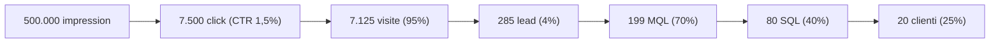

Scenario costruito, con numeri di esempio: un software di fatturazione per studi professionali celebra un costo per lead di 3 euro. Il report è ordinato, il trend è in calo da cinque mesi, e a fine trimestre la cassa è più magra del previsto. Nessuno ha sbagliato un calcolo: il problema è l'unità di analisi. Il lead non paga le fatture, il cliente profittevole sì, e tra i due passano un funnel intero, un ciclo di vendita e un tasso di abbandono mensile.

Sul binario ml-tabellare ogni stadio del funnel si legge come una tabella di tassi, e ogni tasso va collegato al margine che genera a valle. Usiamo CAC fully-loaded, LTV di coorte e payback per decidere se scalare, partendo da perché il costo per lead da solo inganna.

## Il lead non paga le fatture

Il costo per lead si calcola in dieci secondi, ed è la semplicità a renderlo pericoloso. Due campagne con lo stesso CPL possono avere destini opposti: una porta lead che chiudono al 25 per cento e restano due anni, l'altra porta lead che chiudono al 3 per cento e se ne vanno dopo un mese. Il report fotografa lo stesso numero e nasconde un rapporto di otto a uno sulla chiusura.

> **Idea chiave:** Ogni euro di media si valuta per il margine del cliente che produce, quindi ogni tasso del funnel va moltiplicato per i tassi a valle fino al cliente pagante e al suo margine mensile.

C'è poi il costo invisibile. Un canale con CPL di 20 euro che richiede due settimane di lavoro del team può costare più di uno con CPL di 35 che gira in autonomia, perché il tempo del team è un costo di acquisizione anche se non compare nella fattura della piattaforma. E c'è la finestra temporale: i lead di oggi diventano clienti tra trenta, sessanta o novanta giorni, ma il report mensile confronta la spesa di marzo con i clienti di marzo. Per non confondere cause e ritardi ragioniamo per coorti di acquisizione, non per mesi solari.

## Leggere un funnel a stadi

Prendiamo una campagna con 10.000 euro di spesa e un CPM di 20 euro. Dalla spesa otteniamo 10.000 / 20 × 1.000 = 500.000 impression. Con un CTR dell'1,5 per cento arrivano 500.000 × 0,015 = 7.500 click. Il passaggio click-visita del 95 per cento lascia 7.125 visite, perché un 5 per cento di utenti abbandona prima del caricamento. Con un tasso visita-lead del 4 per cento si ottengono 285 lead. Il passaggio lead-MQL al 70 per cento produce circa 199 MQL, e il passaggio MQL-SQL al 40 per cento ne lascia 80, che sono le opportunità aperte. Con un win rate del 25 per cento il risultato è di 20 clienti.



Un funnel è una catena di tassi moltiplicati: un piccolo miglioramento a metà vale quanto un grande aumento di traffico in cima, ma costa molto meno. Se il tasso visita-lead passa dal 4 al 5 per cento, i lead diventano 7.125 × 0,05 = 356, e a parità degli altri tassi i clienti passano da 20 a circa 25, senza un euro in più di spesa. Per ottenere lo stesso risultato con il traffico servono 2.500 euro di media in più, cioè il 25 per cento di budget aggiuntivo.

Per diagnosticare, partiamo dalla tabella degli eventi e non dalla dashboard. Contiamo gli utenti unici per stadio e per canale e deriviamo i tassi sequenziali. Un canale con CTR alto e conversione visita-lead bassa segnala quasi sempre un disallineamento tra la promessa dell'annuncio e la landing page.

```sql
-- Tassi per stadio e canale, su utenti unici
WITH per_stadio AS (
  SELECT
    canale,
    COUNT(DISTINCT CASE WHEN evento = 'view_ad' THEN utente_id END) AS visti,
    COUNT(DISTINCT CASE WHEN evento = 'click_ad' THEN utente_id END) AS click,
    COUNT(DISTINCT CASE WHEN evento = 'visit_landing' THEN utente_id END) AS visite,
    COUNT(DISTINCT CASE WHEN evento = 'submit_form' THEN utente_id END) AS lead
  FROM user_events
  WHERE data_evento BETWEEN '2026-01-01' AND '2026-03-31'
  GROUP BY canale
)
SELECT
  canale,
  ROUND(1.0 * click / NULLIF(visti, 0), 4) AS ctr,
  ROUND(1.0 * visite / NULLIF(click, 0), 4) AS click_to_visit,
  ROUND(1.0 * lead / NULLIF(visite, 0), 4) AS visit_to_lead
FROM per_stadio
ORDER BY lead DESC;
```

La stessa catena letta con occhi diversi dà risposte diverse, e la tabella seguente mostra che cosa rischi di decidere a seconda del livello di aggregazione.

| Lettura | Che cosa vedi | Che cosa rischi di decidere |
| --- | --- | --- |
| Aggregato | CVR totale stabile | Nulla da correggere: scala tutto |
| Per canale | Social con CTR alto e visita-lead bassa | Annuncio e landing non allineati |
| Per device | Mobile con molti add-to-cart e pochi acquisti | Checkout con frizioni su schermi piccoli |
| Per coorte | Lead di gennaio che chiudono ad aprile | Il report mensile sottostima il canale |

### Errore: ottimizzare il tasso totale

Il sintomo è un tasso di conversione aggregato stabile mentre i ricavi calano. Succede perché la media nasconde un canale in crescita con qualità alta e un altro in crollo, che si compensano. Si corregge scomponendo il funnel per stadio, poi per canale, device e coorte prima di qualsiasi decisione di budget.

## CAC fully-loaded, LTV e payback

Il CAC fully-loaded somma la spesa media, la quota di stipendi di growth e sales, i tool, i contenuti, le agenzie e i costi operativi dell'acquisizione. Con 10.000 euro di media e 20 clienti, il CAC apparente è 10.000 / 20 = 500 euro. Aggiungendo 8.000 euro di personale, tecnologia e produzione, il costo totale è 18.000 euro e il CAC reale è 18.000 / 20 = 900 euro. La differenza non è un dettaglio contabile: è la differenza tra scalare e bruciare cassa.

Per tenere il numero pulito attribuiamo i clienti alla coorte di acquisizione, separiamo acquisizione e retention, e ammortizziamo i costi fissi su coorti mensili. Se il CAC fully-loaded è più del doppio di quello da sola spesa media, il collo di bottiglia non è il prezzo dei click ma la macchina operativa.

L'LTV con ricavo, margine e churn costanti si calcola come (ARPA × margine) / churn. Con 150 euro di ARPA mensile, margine lordo dell'80 per cento e churn mensile del 2 per cento, l'LTV è (150 × 0,8) / 0,02 = 6.000 euro. Se il churn passa al 3 per cento, scende a 120 / 0,03 = 4.000 euro: un punto di churn in più toglie un terzo del valore. La formula assume margine, churn e ricavo costanti, e quando non reggono calcoliamo il margine cumulato reale per coorte a 3, 6 e 12 mesi.

Il payback risponde a un'altra domanda: in quanti mesi il margine mensile del cliente ripaga il costo di acquisizione. Con CAC di 900 euro e margine mensile di 150 × 0,8 = 120 euro, il payback è 900 / 120 = 7,5 mesi. Sotto i sei mesi possiamo scalare anche con cassa limitata. Tra sei e dodici dobbiamo pianificare il fabbisogno di cassa. Oltre i dodici-diciotto mesi stiamo scommettendo sul churn.

```python
# Unit economics di una coorte: LTV, LTV:CAC e payback in mesi
arpa = 150.0        # ricavo mensile per account (euro)
margine = 0.80      # margine lordo
churn = 0.02        # churn mensile
cac = 900.0         # CAC fully-loaded (euro)

margine_mensile = arpa * margine
ltv = margine_mensile / churn
print(f"LTV: {ltv:,.0f} euro")                 # 6.000
print(f"LTV:CAC: {ltv / cac:.1f}")             # 6,7
print(f"Payback: {cac / margine_mensile:.1f} mesi")  # 7,5
```

### Errore: un CAC senza personale e un LTV proiettato

Il sintomo è un rapporto LTV:CAC di 8 sul foglio di calcolo e una cassa che si assottiglia. Succede perché il CAC include solo la media e l'LTV si basa su un churn ottimistico stimato sui primi mesi. Si corregge calcolando il CAC fully-loaded e confrontando l'LTV previsto con il margine cumulato osservato sulle coorti mature.

## Il rapporto che decide se scalare

Il rapporto LTV:CAC compatta le due metà in un numero: quanti euro di margine lifetime genera ogni euro speso per acquisire. Con LTV 6.000 e CAC 900 il rapporto è 6.000 / 900 = 6,7. Sopra 3 siamo in una zona generalmente sana, sotto 1,5 in una zona critica.

Il rapporto va letto insieme al payback e alla varianza tra segmenti. Un rapporto medio di 4 può nascondere un canale a 7 e uno a 1,2. Scalare il budget in proporzione al volume esistente amplifica il canale peggiore, perché il canale con rapporto basso ha di solito anche più volume. Si riallocano le risorse verso il segmento con il rapporto migliore a parità di payback, e si verifica che il rapporto tenga quando il volume cresce, perché i primi clienti di un canale sono sempre i più facili.

## Testare stadio per stadio

Ogni test misura l'effetto fino al cliente e al margine, non solo allo stadio testato: una landing che raddoppia i lead dimezzandone la qualità è un peggioramento travestito da successo. Quindi ogni test sopra il fondo ha una metrica primaria di stadio e una metrica di guardia a valle, per esempio la quota di SQL ottenuta dai lead.

Segmentiamo prima di dichiarare vincitori: un checkout semplificato può vincere su mobile e perdere su desktop. L'errore più costoso è testare tutto contro tutto, perché con traffico limitato nessuno stadio ha potenza statistica. Prima ripariamo il collo di bottiglia più grande, poi passiamo al successivo.

Tre casi limite vanno letti con modelli dedicati. Nel freemium il CAC si calcola sui clienti paganti finali, includendo i costi di servire anche gli utenti gratuiti, e la conversione free-to-paid si misura per coorte. La frizione deliberata, come chiedere la carta prima del trial, fa crollare i volumi e migliorare la qualità: sull'LTV:CAC è spesso un miglioramento. Nei cicli lunghi lavoriamo su coorti chiuse e finestre esplicite, e quando i dati non bastano lo dichiariamo.

### Errore: testare tutto contro tutto

Il sintomo è una serie di test contemporanei su banner, landing e checkout senza nessun risultato significativo. Succede perché il traffico viene diviso in troppe celle e nessuna raggiunge il campione necessario. Si corregge con una coda di test ordinata per valore atteso, un collo di bottiglia alla volta.

## Il caso Amazon Prime: la leva a valle

Nel febbraio 2005 Amazon lancia Prime negli Stati Uniti a 79 dollari l'anno, con la spedizione veloce illimitata come promessa centrale. L'abbonamento trasforma clienti occasionali in acquirenti abituali: la frequenza d'ordine sale, il churn scende e il valore lifetime cresce senza toccare il costo di acquisizione. È unit economics in azione. La leva più forte spesso sta a valle del checkout, nella retention che moltiplica ogni euro speso a monte.

Con i numeri della lezione, dimezzare il churn mensile dal 2 all'1 per cento raddoppia l'LTV da 6.000 a 12.000 euro e porta il rapporto LTV:CAC da 6,7 a 13,3 senza spendere un euro in più di traffico. Spingere il traffico in cima a parità di retention aumenta il volume ma non il valore di ciascun cliente.

## Controllo sulle tue unit economics

1. Con 12.000 euro di media, 6.000 euro di costi di personale e tool e 24 clienti acquisiti, quanto valgono CAC apparente e CAC fully-loaded?

<details>
<summary>Mostra risposta</summary>

Il CAC apparente è 12.000 / 24 = 500 euro. Il CAC fully-loaded è (12.000 + 6.000) / 24 = 750 euro.

</details>

2. Con ARPA mensile di 200 euro, margine del 70 per cento e churn mensile del 4 per cento, quanto vale l'LTV?

<details>
<summary>Mostra risposta</summary>

Il margine mensile è 200 × 0,70 = 140 euro; l'LTV è 140 / 0,04 = 3.500 euro.

</details>

3. Con CAC di 750 euro e margine mensile di 125 euro, qual è il payback e come lo interpreti?

<details>
<summary>Mostra risposta</summary>

750 / 125 = 6 mesi. Siamo al confine tra la zona in cui si può scalare anche con cassa limitata e quella in cui serve pianificare il fabbisogno.

</details>

4. Un canale ha rapporto LTV:CAC di 7 e un altro di 1,2, con media complessiva di 4. Perché la media non basta per decidere?

<details>
<summary>Mostra risposta</summary>

Perché nasconde la varianza tra segmenti: scalare in proporzione al volume amplifica anche il canale in zona critica. Si riallocano le risorse verso il segmento migliore e si verifica che il rapporto tenga al crescere del volume.

</details>

5. Perché una landing che raddoppia i lead può essere un peggioramento?

<details>
<summary>Mostra risposta</summary>

Perché può dimezzare la qualità dei lead. Senza una metrica di guardia a valle, come la quota di SQL o i clienti ottenuti, il successo sullo stadio testato nasconde una perdita sul cliente profittevole.

</details>
