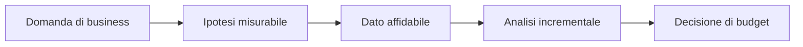

# Funnel marketing e unit economics

Una campagna può generare molti lead a basso costo, ma se non colleghi conversioni, valore del cliente e costo di acquisizione il funnel sembra efficiente solo in apparenza. Il funnel marketing e le unit economics integrano volume, qualità e sostenibilità economica in un'unica analisi operativa.

## Problema reale

Nel marketing analytics il nodo è trasformare budget, canali, creatività e audience in decisioni misurabili, senza confondere volume, attribuzione e incrementalità. Non basta conoscere metriche interessanti. Serve capire quale decisione migliora quando le applichi su dati affidabili e con soglie di errore esplicite. Questa lezione è uno strumento per inquadrare il problema analitico e applicare esempi e metriche a casi reali. Senza collegare il concetto a una scelta concreta, la conoscenza resta decorativa.

## Modello concettuale

Il processo è sequenziale. Parti da una domanda, la traduci in un'ipotesi osservabile, valuti la qualità del dato, esegui un'analisi incrementale e solo alla fine decidi. Saltare passaggi produce analisi eleganti ma fragili.

| Passaggio | Domanda guida | Output atteso |
|---|---|---|
| Framing | Quale decisione deve cambiare? | Una scelta concreta, non una curiosità |
| Misura | Quale segnale rappresenta il fenomeno? | Metrica, fonte e granularità |
| Confronto | Rispetto a quale baseline interpreto il risultato? | Benchmark o controfattuale plausibile |
| Azione | Che cosa faccio se il segnale supera la soglia? | Decisione, owner e prossimo controllo |

## Formalizzazione rigorosa

Il funnel marketing e le unit economics si possono formalizzare come relazione tra cinque elementi. L'unità è la campagna, la coorte, il touchpoint o il segmento cliente. Il segnale è il margine incrementale, il CAC payback, il conversion rate corretto, il lift o la retention generata. La baseline è il periodo precedente, un gruppo holdout, un mercato comparabile o un benchmark storico. La decisione consiste nello spostare risorse, cambiare messaggio, fermare una tattica o scalare un esperimento. Il rischio è confondere correlazione, qualità del dato e causalità decisionale.

| Elemento | Definizione operativa |
|---|---|
| Unità | campagna, coorte, touchpoint o segmento cliente |
| Segnale | margine incrementale, CAC payback, conversion rate corretto, lift o retention generata |
| Baseline | periodo precedente, gruppo holdout, mercato comparabile o benchmark storico |
| Decisione | spostare risorse, cambiare messaggio, fermare tattica o scalare esperimento |
| Rischio | confondere correlazione, qualità del dato e causalità decisionale |

La regola pratica è semplice: una metrica è utile solo se riduce l'incertezza su una decisione specifica. Se non cambia una scelta, è documentazione. Se cambia una scelta senza controlli, è rischio.

## Esempio o caso studio

Prendi un team growth che valuta se aumentare il budget su un canale con CPA basso ma vendite marginali deboli. Applicando il modello costruisce una tabella con tre colonne: cosa sa, cosa assume e quale decisione prende. Così evita di presentare un numero come conclusione autosufficiente.

| Evidenza | Interpretazione prudente | Decisione conseguente |
|---|---|---|
| Segnale positivo ma non isolato | Fenomeno esiste ma causa incerta | Cercare baseline o holdout |
| Segmento con risposta diversa | Effetto medio nasconde eterogeneità | Analizzare coorti o sottogruppi |
| Costo operativo crescente | Valutare sul margine | Applicare soglie economiche |

## La matematica della crescita: decomposizione del funnel di acquisizione

Un funnel di marketing è un modello matematico che descrive il percorso da utente sconosciuto a cliente profittevole. Si scompone in stadi discreti con tassi di conversione intermedi, e il risultato finale è il prodotto di questi tassi.

Un funnel SaaS tipico comprende impression, click, visite, lead, MQL, SQL e clienti, e ogni passaggio ha il suo tasso di conversione (CTR, CVR, Win Rate). Se investi €10.000 con CPM €20 ottieni 500.000 impression. Con un CTR dell'1.5% sono 7.500 click; al 95% di click-to-visit diventano 7.125 visite; con un CVR del 4% hai 285 lead; al 70% di lead-to-MQL restano 199 MQL; al 40% di MQL-to-SQL diventano 80 opportunità; con un Win Rate del 25% chiudi 20 clienti. Un miglioramento del CVR dal 4% al 5% aumenta i clienti del 25% senza costi aggiuntivi.

## Unit economics in azione: dal CAC al rapporto LTV:CAC

Il costo medio di acquisizione cliente (CAC) qui è €500 (€10.000/20). Ma quello che conta è un CAC fully-loaded, che include spese marketing, personale, tecnologia e operativi. Se questi costi aggiuntivi sono €8.000, il CAC reale sale a €900.

Il Lifetime Value (LTV) si calcola come:

LTV = (Average Revenue Per Account per mese × Gross Margin %) ÷ Monthly Churn Rate

Con €150/mese, margine 80% e churn 2%, LTV = (€150 × 0.8) ÷ 0.02 = €6.000. Il rapporto LTV:CAC = 6.000 ÷ 900 ≈ 6.7, un indicatore eccellente che suggerisce di scalare l'investimento.

### Caso di studio: Spotify e la leva del freemium

Spotify usa un funnel biforcato, con utenti Free e conversione a Premium. Il prodotto gratuito, supportato dalla pubblicità, è un canale a basso costo per acquisire clienti Premium. Con 1.4 miliardi di euro in marketing e 489 milioni di utenti, il CAC per un utente Free è circa €2. Se il 10% converte a Premium, il CAC effettivo per Premium via Free è circa €20. Con ARPU €4.50/mese, margine 25% e churn 1.5%, l'LTV Premium è circa €75, per un rapporto LTV:CAC di 3.75, sostenibile e scalabile.

## Diagnostica del funnel via SQL: identificare i colli di bottiglia

Per capire dove il funnel si rompe servono analisi granulari. Una query SQL su una tabella `user_events` con eventi come 'view_ad', 'click_ad', 'visit_landing_page' e 'submit_form', segmentata per canale, calcola i tassi di conversione intermedi. La query con CTE conta gli utenti unici per stadio e canale e ricava CTR, click-to-visit e visit-to-lead. Confrontando i canali emergono i punti critici: per esempio Google con CTR alto ma bassa conversione visita-lead segnala un disallineamento tra annuncio e landing page.

## Strategie di ottimizzazione avanzata e il caso Netflix

L'ottimizzazione del funnel è un processo scientifico basato su A/B test in ogni stadio. In cima al funnel testi creatività, copy, segmenti e call-to-action per massimizzare il CTR. A metà funnel testi landing page, headline, form e offerta per massimizzare il CVR. In fondo testi email nurturing, script di vendita e pricing per massimizzare il Win Rate. L'errore comune è trattare il funnel come monolitico: serve segmentare per canale, device, geografia e coorte per scoprire i pattern nascosti.

### Caso di studio: Netflix e l'ossessione per il funnel di iscrizione

Netflix ha sperimentato ogni variabile della homepage per i non iscritti, misurando non solo i sign-up ma anche la retention al primo mese. Nel 2020 ha eliminato la prova gratuita in molti mercati, riducendo i sign-up ma aumentando la qualità e l'LTV degli iscritti e migliorando il rapporto LTV:CAC. È la prova che aggiungere frizione può migliorare la salute del funnel, filtrando gli utenti a basso intento.

## Dal modello alla pratica: laboratorio di analisi funnel

Immagina di essere Data Analyst in una startup EdTech con dati di eventi utente. Il compito è diagnosticare il funnel di vendita e proporre azioni.

**Esercizio 1: mappatura del funnel di base**

Calcola gli utenti unici per ogni stadio (`view_course_page`, `add_to_cart`, `start_checkout`, `purchase`) e i tassi di conversione sequenziali con Python e pandas. Tipicamente emerge una forte perdita tra visualizzazione pagina e aggiunta al carrello (12%), mentre il checkout è più efficiente.

**Esercizio 2: analisi segmentata per canale e dispositivo**

Ripeti l'analisi raggruppando per `utm_source` e `device_type`. Scoprirai che Facebook su mobile ha un alto tasso di add_to_cart ma bassa conversione finale, mentre il traffico organico su desktop converte poco all'inizio ma ha un checkout efficiente.

**Esercizio 3: ipotesi e raccomandazioni**

L'ipotesi è che il checkout mobile abbia problemi di usabilità o metodi di pagamento non ottimizzati, e che questo causi gli abbandoni degli utenti Facebook. La raccomandazione è avviare un'analisi UX specifica e un A/B test su un checkout semplificato per mobile, misurando l'impatto sul completamento dell'acquisto.

## Lab / esercizio

### Livello base

Scrivi la decisione che questa lezione dovrebbe migliorare, la metrica principale e il rischio da controllare.

### Livello intermedio

Costruisci una tabella con baseline, segnale, interpretazione prudente e azione consigliata.

### Livello research-grade

Trasforma l'esercizio in un memo decisionale con assunzioni, limiti, criterio di stop e controllo successivo.

### Dataset e materiali consigliati

Usa un export reale, un dataset sintetico o una dashboard già esistente. Il materiale deve contenere una domanda, una metrica e una scelta da prendere.

## Errore tipico da evitare

L'errore è trattare il funnel marketing e le unit economics come una definizione da ricordare invece che un protocollo decisionale. Presentare metriche senza baseline, grafici senza ipotesi o raccomandazioni senza il costo dell'errore genera analisi fragili. Un controllo utile è chiedersi: "Se questo risultato fosse falso, quale decisione sbaglierei?". Se la risposta non è chiara, la lezione non l'hai applicata davvero.

## Quiz o checkpoint

1. Qual è la decisione concreta che questa lezione dovrebbe migliorare?
2. Quale baseline rende interpretabile il risultato?
3. Quale assunzione, se sbagliata, cambierebbe la conclusione?
4. Quale controllo minimo useresti prima di presentare la raccomandazione?

## Riepilogo

L'analisi del funnel combinata con le unit economics trasforma il marketing da centro di costo a motore di crescita misurabile. La decomposizione del percorso in stadi misurabili permette di isolare le leve operative e collegare l'investimento al valore. La disciplina sta nel collegare concetto, dato e decisione in modo rigoroso e operativo.

## Laboratorio ed esercizi

### Livello base

Scrivi in cinque righe una decisione reale collegata al funnel marketing e alle unit economics: obiettivo, metrica primaria, baseline, rischio principale e azione prevista. Usa una sola metrica primaria.

### Livello intermedio

Costruisci una tabella con almeno tre segmenti o scenari. Per ciascuno indica segnale, possibile spiegazione alternativa e controllo necessario prima di decidere.

### Livello research-grade

Disegna un piano di validazione: ipotesi, dati necessari, criteri di esclusione, soglia decisionale e controllo post-decisione. Specifica cosa ti farebbe cambiare idea.

### Dataset e materiali consigliati

Usa export campagne, costi media, eventi web/app, CRM, transazioni, survey brand e log di consenso. Se non hai dati reali, crea un dataset sintetico con 200-500 righe, almeno una colonna temporale, una di segmento, una metrica di outcome e una variabile di esposizione.