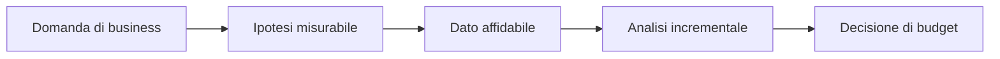

# Funnel marketing e unit economics

Una campagna può generare molti lead a basso costo, ma senza collegare conversioni, valore cliente e costo di acquisizione, il funnel rischia di sembrare efficiente solo in apparenza. **Funnel marketing e unit economics** integra volume, qualità e sostenibilità economica in un'analisi unica e operativa.

## Problema reale

Nel marketing analytics, il vero nodo è trasformare budget, canali, creatività e audience in decisioni misurabili, evitando di confondere volume, attribuzione e incrementalità. Non basta conoscere metriche interessanti: serve capire quale decisione migliora applicandole con dati affidabili e soglie di errore esplicite. Questa lezione è uno strumento operativo per comprendere il problema analitico, applicare esempi concreti e metriche a casi reali. Senza collegare il concetto a una scelta concreta, la conoscenza resta decorativa.

## Modello concettuale

Il processo è sequenziale: si parte da una domanda, la si traduce in un'ipotesi osservabile, si valuta la qualità del dato, si esegue un'analisi incrementale e solo alla fine si decide. Saltare passaggi produce analisi eleganti ma fragili.

| Passaggio | Domanda guida | Output atteso |
|---|---|---|
| Framing | Quale decisione deve cambiare? | Una scelta concreta, non una curiosità |
| Misura | Quale segnale rappresenta il fenomeno? | Metrica, fonte e granularità |
| Confronto | Rispetto a quale baseline interpreto il risultato? | Benchmark o controfattuale plausibile |
| Azione | Che cosa faccio se il segnale supera la soglia? | Decisione, owner e prossimo controllo |

## Formalizzazione rigorosa

Formalizziamo **Funnel marketing e unit economics** come relazione tra quattro elementi chiave:

| Elemento | Definizione operativa |
|---|---|
| Unità | campagna, coorte, touchpoint o segmento cliente |
| Segnale | margine incrementale, CAC payback, conversion rate corretto, lift o retention generata |
| Baseline | periodo precedente, gruppo holdout, mercato comparabile o benchmark storico |
| Decisione | spostare risorse, cambiare messaggio, fermare tattica o scalare esperimento |
| Rischio | confondere correlazione, qualità del dato e causalità decisionale |

La regola pratica è semplice: una metrica è utile solo se riduce l'incertezza su una decisione specifica. Se non cambia una scelta, è solo documentazione; se cambia una scelta senza controlli, è rischio.

## Esempio o caso studio

Consideriamo un team growth che valuta se aumentare il budget su un canale con CPA basso ma vendite marginali deboli. Applicando il modello, costruiscono una tabella con tre colonne: cosa sappiamo, cosa assumiamo e quale decisione prendiamo. Questo evita di presentare un numero come conclusione autosufficiente.

| Evidenza | Interpretazione prudente | Decisione conseguente |
|---|---|---|
| Segnale positivo ma non isolato | Fenomeno esiste ma causa incerta | Cercare baseline o holdout |
| Segmento con risposta diversa | Effetto medio nasconde eterogeneità | Analizzare coorti o sottogruppi |
| Costo operativo crescente | Valutare sul margine | Applicare soglie economiche |

## La Matematica della Crescita: Decomposizione del Funnel di Acquisizione

Un funnel di marketing è un modello matematico che descrive il percorso da utente sconosciuto a cliente profittevole. Si scompone in stadi discreti con tassi di conversione intermedi, e il risultato finale è il prodotto di questi tassi.

Per esempio, un funnel SaaS tipico comprende impression, click, visite, lead, MQL, SQL e clienti. Ogni passaggio ha un tasso di conversione specifico (CTR, CVR, Win Rate).

Se investiamo €10.000 con CPM €20, otteniamo 500.000 impression. Con un CTR 1.5%, 7.500 click; 95% click-to-visit, 7.125 visite; 4% CVR, 285 lead; 70% lead-to-MQL, 199 MQL; 40% MQL-to-SQL, 80 opportunità; 25% Win Rate, 20 clienti.

Un miglioramento del CVR dal 4% al 5% aumenta i clienti del 25% senza costi aggiuntivi.

## Unit Economics in Azione: Dal CAC al LTV:CAC Ratio

Il costo medio di acquisizione cliente (CAC) è €500 (€10.000/20). Ma serve un CAC fully-loaded che include spese marketing, personale, tecnologia e operativi. Se questi costi aggiuntivi sono €8.000, il CAC reale sale a €900.

Il Lifetime Value (LTV) si calcola come:

LTV = (Average Revenue Per Account per mese × Gross Margin %) ÷ Monthly Churn Rate

Con €150/mese, margine 80% e churn 2%, LTV = (€150 × 0.8) ÷ 0.02 = €6.000.

Il rapporto LTV:CAC = 6.000 ÷ 900 ≈ 6.7, un indicatore eccellente che suggerisce di scalare l'investimento.

### Caso di Studio: Spotify e la Leva del Freemium

Spotify usa un funnel biforcato: utenti Free e conversione a Premium. Il prodotto gratuito, supportato da pubblicità, è un canale a basso costo per acquisire clienti Premium.

Con 1.4 miliardi di euro in marketing e 489 milioni di utenti, il CAC per un utente Free è circa €2. Se il 10% converte a Premium, il CAC effettivo per Premium via Free è circa €20.

Con ARPU €4.50/mese, margine 25% e churn 1.5%, LTV Premium è circa €75. Il rapporto LTV:CAC è 3.75, sostenibile e scalabile.

## Diagnostica del Funnel via SQL: Identificare i Colli di Bottiglia

Per capire dove il funnel si rompe, serve analisi granulari. Una query SQL su una tabella `user_events` con eventi come 'view_ad', 'click_ad', 'visit_landing_page', 'submit_form' segmentata per canale aiuta a calcolare tassi di conversione intermedi.

La query con CTEs conta utenti unici per stadio e canale, calcolando CTR, click-to-visit e visit-to-lead. Confrontando canali, si identificano punti critici: ad esempio, Google con alto CTR ma bassa conversione visita-lead indica disallineamento tra annuncio e landing page.

## Strategie di Ottimizzazione Avanzata e il Caso Netflix

L'ottimizzazione del funnel è un processo scientifico basato su A/B test in ogni stadio:

- Top of Funnel: test creatività, copy, segmenti, call-to-action per massimizzare CTR
- Middle of Funnel: test landing page, headline, form, offerta per massimizzare CVR
- Bottom of Funnel: test email nurturing, script vendita, pricing per massimizzare Win Rate

Un errore comune è trattare il funnel come monolitico. Serve segmentare per canale, device, geografia e coorte per scoprire pattern nascosti.

### Caso di Studio: Netflix e l'Ossessione per il Funnel di Iscrizione

Netflix ha sperimentato ogni variabile della homepage per i non iscritti, misurando non solo sign-up ma anche retention al primo mese. Nel 2020 ha eliminato la prova gratuita in molti mercati, riducendo sign-up ma aumentando la qualità e LTV degli iscritti, ottimizzando il rapporto LTV:CAC. Questo dimostra che aggiungere frizione può migliorare la salute del funnel filtrando utenti a basso intento.

## Dal Modello alla Pratica: Laboratorio di Analisi Funnel

Immagina di essere Data Analyst in una startup EdTech con dati di eventi utente. Il compito è diagnosticare il funnel di vendita e proporre azioni.

**Esercizio 1: Mappatura del Funnel di Base**

Calcola utenti unici per ogni stadio (`view_course_page`, `add_to_cart`, `start_checkout`, `purchase`) e i tassi di conversione sequenziali usando Python e pandas. Un esempio mostra una forte perdita tra visualizzazione pagina e aggiunta al carrello (12%), mentre il checkout è più efficiente.

**Esercizio 2: Analisi Segmentata per Canale e Dispositivo**

Ripeti l'analisi raggruppando per `utm_source` e `device_type`. Scopri che Facebook su mobile ha alto tasso add_to_cart ma bassa conversione finale, mentre traffico organico su desktop ha conversioni più basse all'inizio ma checkout efficiente.

**Esercizio 3: Ipotesi e Raccomandazioni**

Ipotesi: il checkout mobile presenta problemi di usabilità o metodi di pagamento non ottimizzati, causando abbandoni su utenti Facebook.

Raccomandazione: avviare analisi UX specifica e A/B test per checkout semplificato su mobile, misurando impatto su completamento acquisto.

## Lab / esercizio

### Livello base

Scrivi la decisione che questa lezione dovrebbe migliorare, la metrica principale e il rischio da controllare.

### Livello intermedio

Costruisci una tabella con baseline, segnale, interpretazione prudente e azione consigliata.

### Livello research-grade

Trasforma l'esercizio in un memo decisionale con assunzioni, limiti, criterio di stop e controllo successivo.

### Dataset e materiali consigliati

Usa un export reale, un dataset sintetico o una dashboard gia esistente. Il materiale deve contenere una domanda, una metrica e una scelta da prendere.

## Errore tipico da evitare

Trattare **Funnel marketing e unit economics** come una definizione da ricordare anziché un protocollo decisionale. Presentare metriche senza baseline, grafici senza ipotesi o raccomandazioni senza costo dell'errore genera analisi fragili. Un controllo utile è chiedersi: "Se questo risultato fosse falso, quale decisione sbaglierei?" Se la risposta non è chiara, la lezione non è stata applicata davvero.

## Quiz o checkpoint

1. Qual è la decisione concreta che questa lezione dovrebbe migliorare?
2. Quale baseline rende interpretabile il risultato?
3. Quale assunzione, se sbagliata, cambierebbe la conclusione?
4. Quale controllo minimo useresti prima di presentare la raccomandazione?

## Riepilogo

L'analisi del funnel combinata con le unit economics trasforma il marketing da centro di costo a motore di crescita scientificamente misurabile. La decomposizione del percorso in stadi misurabili permette di isolare leve operative e collegare investimento a valore. La disciplina consiste nel collegare concetto, dato e decisione in modo rigoroso e operativo.

## Laboratorio ed esercizi

### Livello base

Scrivi in cinque righe una decisione reale collegata a **Funnel marketing e unit economics**: obiettivo, metrica primaria, baseline, rischio principale e azione prevista. Usa una sola metrica primaria.

### Livello intermedio

Costruisci una tabella con almeno tre segmenti o scenari. Per ciascuno indica segnale, possibile spiegazione alternativa e controllo necessario prima di decidere.

### Livello research-grade

Disegna un piano di validazione: ipotesi, dati necessari, criteri di esclusione, soglia decisionale e controllo post-decisione. Specifica cosa ti farebbe cambiare idea.

### Dataset e materiali consigliati

Usa export campagne, costi media, eventi web/app, CRM, transazioni, survey brand e log di consenso. Se non hai dati reali, crea un dataset sintetico con 200-500 righe, almeno una colonna temporale, una di segmento, una metrica di outcome e una variabile di esposizione.
