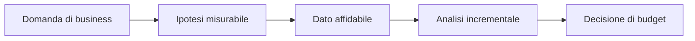

# GA4 avanzato per analisti di marketing


Immagina un team marketing che deve capire cosa ha creato domanda e cosa ha solo intercettato domanda già esistente alla fine di una campagna, quando il budget è stato speso e restano domande scomode. Sul tavolo non c'è un esercizio astratto: c'è la pressione concreta di difendere una lettura onesta di canali, funnel, brand e marginalità. **GA4 avanzato per analisti di marketing** entra qui, nel punto in cui una scelta deve diventare più chiara, più misurabile e più difendibile.

## Una scena da cui partire

La lezione va letta con questo atteggiamento: non collezionare frasi da ricordare, ma cercare il passaggio che trasforma una misura di marketing che regge davanti a finanza e direzione in lavoro reale. Qui non basta capire il concetto: devi vedere come si rompe, come si controlla e come si spiega a chi userà il risultato. Il livello è avanzato: non cercare una ricetta unica, cerca i vincoli che cambiano la risposta.

- **Contesto:** Quale vincolo tecnico decide il disegno?
- **Metodo:** Quale controllo ti direbbe che il risultato è affidabile?
- **Applicazione:** Quale trade-off racconteresti prima di mettere in produzione?

## Dal paradigma della sessione al flusso di eventi: la rivoluzione copernicana di GA4

Comprendere GA4 richiede di abbandonare mentalmente il modello concettuale di Universal Analytics. UA era costruito attorno alla nozione di "sessione", un contenitore temporale di interazioni (hit) come `pageview`, `event`, `transaction`. L'intera architettura era pensata per misurare visite discrete a un sito web. Questo approccio, efficace per un decennio, mostrava i suoi limiti in un mondo multi-dispositivo e orientato alle app. La domanda "quante visite ha ricevuto il sito ieri?" era facile, ma "qual è il percorso completo di un utente che interagisce con il nostro brand su tre piattaforme diverse nell'arco di un mese?" era quasi impossibile da risolvere senza complesse alchimie di data stitching.

GA4 opera una vera e propria rivoluzione copernicana: l'unità atomica dell'analisi non è più la sessione, ma l'**evento**. Ogni singola interazione, da `page_view` a `add_to_cart`, da `scroll` (ora un evento nativo) a `form_submit`, è un evento. Anche l'inizio di una sessione (`session_start`) e la prima visita di un utente (`first_visit`) sono essi stessi eventi. Questo modello event-driven, ispirato alle piattaforme di analytics per mobile come Firebase (che di fatto costituisce il cuore tecnologico di GA4), offre una flessibilità senza precedenti. Ogni evento è arricchito da una serie di **parametri**, coppie chiave-valore che descrivono il contesto dell'azione. Un evento `view_item`, ad esempio, non è solo un contatore; porta con sé parametri come `item_id`, `item_name`, `price`, `currency`.

Questo approccio ha tre implicazioni operative immediate per l'analista. Primo, l'**analisi cross-platform** diventa nativa. Un evento `login` può essere inviato sia dall'app iOS che dal sito web, e GA4 lo riconoscerà come la stessa azione compiuta dallo stesso utente (identificato tramite User-ID), permettendo di costruire journey unificati. Secondo, la **personalizzazione del tracciamento** è enormemente semplificata. Non esistono più le rigide categorie "Category, Action, Label" degli eventi di UA. Si possono definire fino a 25 parametri personalizzati per evento, consentendo di catturare dettagli specifici del proprio business. Per un sito di viaggi, un evento `search` potrebbe includere parametri come `destination_city`, `departure_date`, `number_of_travelers`, dati immediatamente disponibili per la segmentazione. Terzo, il focus si sposta dall'analisi di "cosa è successo durante le visite" all'analisi di "cosa fanno gli utenti nel tempo", abilitando analisi longitudinali e comportamentali molto più sofisticate.

## Le Esplorazioni: il laboratorio analitico per superare i report standard

Se i report standard di GA4 offrono una panoramica di alto livello, il vero lavoro dell'analista si svolge all'interno delle **Esplorazioni** (Explorations). Quest'area è un ambiente di analisi sandbox che consente di interrogare i dati raccolti con una flessibilità che UA offriva solo parzialmente con i report personalizzati. Le esplorazioni superano i limiti dei report predefiniti, come la cardinalità elevata che porta al raggruppamento "(other)", e permettono di costruire visualizzazioni su misura per rispondere a domande di business complesse.

Le principali tecniche di esplorazione includono:
1.  **Forma libera (Free Form)**: È l'equivalente di una tabella pivot potenziata. L'analista può trascinare dimensioni (es. `Source / medium`, `Device category`, `Page path`) e metriche (es. `Users`, `Sessions`, `Conversions`, `Total revenue`) per costruire tabelle e grafici personalizzati. Ad esempio, un analista di marketing potrebbe voler analizzare le performance delle campagne social. Invece di guardare il report aggregato, potrebbe costruire una tabella a forma libera con `Session campaign` come righe, `Device category` come colonne e `Purchase revenue` come valore, filtrando solo per `Session default channel group` uguale a "Paid Social". Questo rivelerebbe immediatamente se una campagna sta performando bene su desktop ma fallendo su mobile, un insight non evidente dai report standard.

2.  **Esplorazione del funnel (Funnel Exploration)**: Questo strumento permette di visualizzare i passaggi che gli utenti compiono per completare un'azione, come un acquisto o un'iscrizione. A differenza dei funnel rigidi e basati su pagine di UA, i funnel di GA4 possono essere basati su qualsiasi sequenza di eventi. Si può costruire un funnel di checkout che includa `view_cart`, `begin_checkout`, `add_shipping_info`, e `purchase`. Lo strumento mostra non solo i tassi di conversione e abbandono per ogni step, ma permette anche di creare istantaneamente un'audience dagli utenti che hanno abbandonato in un punto specifico (es. "utenti che hanno aggiunto info di spedizione ma non hanno acquistato") per campagne di retargeting mirate. Si può anche scegliere tra un funnel "chiuso" (considera solo gli utenti che iniziano dal primo step) o "aperto" (gli utenti possono entrare in qualsiasi punto del funnel).

3.  **Esplorazione del percorso (Path Exploration)**: Risponde alla domanda "cosa fanno gli utenti prima o dopo un certo evento?". Si può partire da un evento iniziale (es. `session_start` con un filtro sulla landing page di una campagna) e visualizzare i percorsi più comuni che gli utenti intraprendono. Oppure, si può lavorare a ritroso partendo da un evento di conversione come `purchase` per scoprire quali sono i percorsi che più frequentemente portano all'acquisto. Un'analisi di questo tipo potrebbe rivelare che gli utenti che visitano la sezione "Recensioni" dopo aver visto una pagina prodotto hanno una probabilità di acquisto doppia rispetto a quelli che non lo fanno, suggerendo di dare maggiore visibilità alle recensioni.

Questi strumenti trasformano l'analista da consumatore passivo di report a investigatore attivo, capace di formulare ipotesi e validarle direttamente all'interno dell'interfaccia.

## BigQuery Export: la porta d'accesso ai dati grezzi per l'analisi avanzata

La funzionalità più potente di GA4, ora disponibile gratuitamente per tutte le property, è l'**esportazione nativa e continua dei dati grezzi a livello di evento verso Google BigQuery**. Questa integrazione rappresenta un salto quantico rispetto a UA, dove tale capacità era un lusso riservato ai clienti della costosa suite 360. Avere accesso ai dati non campionati e non aggregati apre scenari analitici che l'interfaccia di GA4 non può coprire.

Una volta attivato il linking, GA4 invia ogni singolo evento raccolto a un dataset in BigQuery, organizzato in tabelle giornaliere (`events_YYYYMMDD`). La struttura dei dati è nidificata: ogni riga rappresenta un evento, ma i parametri dell'evento e le proprietà dell'utente sono memorizzati in campi `RECORD` (o `STRUCT` in SQL standard) e `ARRAY`. Questo richiede l'uso della funzione `UNNEST` per "appiattire" i dati e renderli utilizzabili nelle query.

Ad esempio, la seguente query SQL calcola il numero di utenti, il valore totale e il valore medio degli acquisti per ogni campagna, estraendo le informazioni necessarie dai parametri nidificati dell'evento `purchase`.

```sql
-- Calcola revenue totale e medio per campagna per il mese di Maggio 2024
SELECT
    traffic_source.name AS campaign_name,
    COUNT(DISTINCT user_pseudo_id) AS distinct_users,
    SUM(ecommerce.purchase_revenue) AS total_purchase_revenue,
    AVG(ecommerce.purchase_revenue) AS average_purchase_revenue
FROM
    `your-project-id.analytics_XXXXXXX.events_*`
WHERE
    _TABLE_SUFFIX BETWEEN '20240501' AND '20240531'
    AND event_name = 'purchase'
GROUP BY
    campaign_name
ORDER BY
    total_purchase_revenue DESC;
```

Questo livello di accesso permette di:
- **Superare ogni limite di campionamento**: Le query in BigQuery operano sul 100% dei dati raccolti.
- **Unire i dati di GA4 con altre fonti**: È qui che si realizza il vero potenziale. Si possono unire i dati comportamentali web/app con i dati del CRM (es. stato di abbonamento, valore storico del cliente), con i dati di costo delle piattaforme pubblicitarie (es. Facebook Ads, LinkedIn Ads) o con i dati transazionali del backend. Questo permette di calcolare metriche olistiche come il vero Return on Ad Spend (ROAS) o il Customer Lifetime Value (CLV) per coorti di acquisizione specifiche.
- **Costruire modelli di attribuzione personalizzati**: Invece di affidarsi ai modelli predefiniti di GA4, si possono costruire modelli di attribuzione data-driven (es. Markov chains, Shapley value) che riflettano meglio la complessità dei customer journey specifici del proprio business.
- **Eseguire analisi predittive**: Utilizzando BigQuery ML o esportando i dati verso ambienti Python/R, si possono costruire modelli per predire il churn, la propensione all'acquisto o segmentare la user base con algoritmi di clustering (es. RFM - Recency, Frequency, Monetary).

**Caso di Studio: Netflix e l'ottimizzazione del percorso di onboarding**
Netflix, pur utilizzando un proprio stack di data collection, affronta problemi analoghi a quelli risolvibili con GA4+BigQuery. Analizzando i dati grezzi a livello di evento del primo utilizzo dell'app da parte di un nuovo utente, il team di prodotto può identificare i "momenti aha". Potrebbero scoprire, ad esempio, che gli utenti che usano la funzione di ricerca, aggiungono almeno 3 titoli alla loro "lista" e guardano un trailer entro la prima sessione hanno un tasso di ritenzione a 30 giorni superiore del 40% rispetto alla media. Armati di questo insight, possono ridisegnare l'interfaccia di onboarding per incoraggiare attivamente questi comportamenti, misurando l'impatto del cambiamento con un A/B test e analizzando i risultati direttamente in BigQuery, unendo i dati di interazione con i dati di abbonamento.

## Costruire segmenti intelligenti: dall'Audience Builder alle metriche predittive

L'obiettivo finale dell'analisi è quasi sempre l'azione. In GA4, l'azione si concretizza spesso nella creazione di **Audience**, ovvero segmenti di utenti definiti da attributi, comportamenti o, ed è questa la novità, previsioni. Queste audience non sono solo strumenti di analisi, ma diventano target attivabili direttamente nelle piattaforme pubblicitarie di Google (Google Ads, Display & Video 360), chiudendo il cerchio tra insight e operatività.

L'Audience Builder di GA4 è estremamente potente. Permette di creare segmenti basati su:
- **Dimensioni demografiche e geografiche**: "Utenti tra i 25-34 anni in Lombardia".
- **Eventi e sequenze di eventi**: "Utenti che hanno visualizzato un prodotto della categoria 'scarpe' (`view_item` con `item_category` = 'scarpe') e successivamente hanno avviato il checkout (`begin_checkout`) negli ultimi 14 giorni, ma non hanno completato l'acquisto (`purchase`)". Questa è una classica audience per retargeting.
- **Parametri di evento**: "Utenti che hanno usato un codice sconto specifico (`coupon` = 'SUMMER20')".
- **Tempistiche**: "Utenti che hanno completato il loro primo acquisto più di 90 giorni fa e non sono più tornati". Audience perfetta per una campagna di riattivazione.

La vera innovazione, però, risiede nelle **audience predittive**. Sfruttando i modelli di machine learning di Google, GA4 calcola per ogni utente attivo delle metriche predittive, a patto che la property abbia un volume di dati sufficiente (es. almeno 1.000 utenti che hanno acquistato e 1.000 che non l'hanno fatto negli ultimi 28 giorni). Le metriche principali sono:
- **Purchase probability**: La probabilità che un utente attivo negli ultimi 28 giorni effettui un acquisto nei prossimi 7 giorni.
- **Churn probability**: La probabilità che un utente attivo di recente non visiti il sito/app nei prossimi 7 giorni.
- **Predicted revenue**: Le entrate previste da tutte le conversioni di acquisto nei prossimi 28 giorni da un utente attivo negli ultimi 28 giorni.

Queste metriche permettono di creare audience proattive. Invece di targhettizzare utenti che *hanno già* abbandonato un carrello, si possono targhettizzare gli "Utenti con alta probabilità di acquisto" che non hanno ancora iniziato il checkout, offrendo loro un incentivo per accelerare la conversione.

**Caso di Studio: Revolut e la riduzione proattiva del churn**
Per un'azienda fintech come Revolut, che opera in un mercato altamente competitivo, la ritenzione degli utenti è vitale. Utilizzando la metrica `Churn probability` di GA4, il team di marketing può costruire un'audience dinamica chiamata "Likely to Churn Users (Next 7 Days)". Questa audience può essere esclusa dalle campagne di acquisizione (per non sprecare budget su utenti in uscita) e, contemporaneamente, può essere usata come target per una campagna di retention proattiva. Attraverso notifiche push, email o messaggi in-app, Revolut potrebbe offrire a questo segmento specifico una guida per utilizzare una funzionalità premium poco conosciuta o un piccolo bonus, come un cashback temporaneo. Monitorando il comportamento di questa coorte dopo l'intervento, potrebbero misurare una riduzione effettiva del churn del 12% rispetto a un gruppo di controllo, traducendo una metrica predittiva in un impatto tangibile sul business.

## Officina Analitica: esercizi pratici su dati GA4

La teoria senza la pratica rimane un esercizio sterile. I seguenti esercizi sono progettati per consolidare i concetti discussi, utilizzando l'account demo di GA4 di Google (Flood-It!), accessibile a chiunque abbia un account Google.

**Esercizio 1: Analisi delle performance dei contenuti (Livello Base)**
Il tuo obiettivo è identificare quali pagine del sito generano il maggior engagement da parte dei nuovi utenti.
1.  Accedi all'account demo di GA4.
2.  Vai nella sezione "Esplora" e crea una nuova esplorazione "Forma libera".
3.  Nelle "Variabili", importa le seguenti dimensioni e metriche:
    *   Dimensioni: `Page title`, `Session default channel group`.
    *   Metriche: `New users`, `Engaged sessions`, `Engagement rate`.
4.  Trascina `Page title` nelle Righe e le tre metriche nei Valori.
5.  Applica un filtro per includere solo `Session default channel group` uguale a "Organic Search".
6.  Ordina la tabella per `New users` in ordine decrescente.
7.  **Domanda di analisi**: Quali sono i 3 titoli di pagina che attirano più nuovi utenti dalla ricerca organica? Il loro tasso di engagement è superiore o inferiore alla media del sito?

**Esercizio 2: Costruzione di un funnel di conversione (Livello Intermedio)**
Il tuo obiettivo è mappare il percorso di gioco e identificare il principale punto di abbandono.
1.  Sempre in "Esplora", crea una nuova "Esplorazione del funnel".
2.  Definisci i seguenti passaggi (Steps) basati su eventi:
    *   Step 1: `session_start`
    *   Step 2: `level_start` (l'utente inizia un livello)
    *   Step 3: `level_end` (l'utente finisce un livello)
3.  Osserva il grafico. Qual è il tasso di abbandono tra l'inizio della sessione e l'inizio del primo livello? E tra l'inizio e la fine di un livello?
4.  Aggiungi una dimensione di "Suddivisione" (Breakdown) per `Device category`.
5.  **Domanda di analisi**: Il comportamento del funnel cambia significativamente tra utenti `desktop` e `mobile`? Dove si concentra l'abbandono per ciascun segmento?

**Esercizio 3: Query su dati grezzi (Livello Avanzato)**
Questo esercizio è concettuale, ma si basa sulla struttura reale dei dati che troveresti in BigQuery. Immagina di avere la tabella `events_*` e di voler trovare gli utenti più fedeli, definiti come quelli con il maggior numero di sessioni in un mese.
1.  Scrivi una query SQL che, per il mese di Giugno 2024, conti il numero di sessioni uniche per ogni `user_pseudo_id`.
    *   *Suggerimento*: una sessione unica è definita dalla combinazione di `user_pseudo_id` e del parametro di evento `ga_session_id`. Dovrai estrarre questo valore dall'array `event_params`.
2.  La struttura per estrarre il `ga_session_id` è: `(SELECT value.int_value FROM UNNEST(event_params) WHERE key = 'ga_session_id')`.
3.  **La tua query dovrebbe**:
    *   Selezionare `user_pseudo_id`.
    *   Contare il numero di `ga_session_id` distinti.
    *   Filtrare per il range di date corretto.
    *   Raggruppare per `user_pseudo_id`.
    *   Ordinare per il conteggio delle sessioni in ordine decrescente.
    *   Limitare ai primi 10 risultati.

## Riepilogo

Il passaggio a Google Analytics 4 segna una discontinuità netta con il passato. Non si tratta di un aggiornamento, ma di una nuova filosofia di misurazione digitale. L'analista di marketing moderno deve interiorizzare il modello event-driven, che pone l'utente e il suo percorso multiforme al centro dell'universo analitico, superando la visione limitata e web-centrica della sessione. La padronanza degli strumenti di Esplorazione trasforma l'analisi da un'attività di reporting a un processo investigativo e iterativo. L'integrazione con BigQuery abbatte le barriere dell'interfaccia, offrendo accesso illimitato ai dati grezzi per analisi complesse, unione con fonti esterne e sviluppo di modelli predittivi personalizzati. Infine, la capacità di tradurre questi insight in audience attivabili, potenziate da metriche predittive basate su machine learning, chiude il ciclo, consentendo di passare dall'osservazione all'azione in modo rapido ed efficace. Padroneggiare GA4 significa, in definitiva, evolvere da analista di "web traffic" a data scientist del customer journey.

## References

-   Braun, M. J., & Moe, W. W. (2013). Online Customer Baskets: A Hierarchical Bayesian Model of Purchase Timing and Content. *Marketing Science*, 32(3), 449–468.
-   Chatterjee, S., Mahbub, A., & Roy, S. (2022). A review on web analytics tools for user behavior analysis. *Journal of Big Data*, 9(1), 1-24.

```

## Problema reale

Nel lavoro su marketing analytics, **GA4 avanzato per analisti di marketing** serve a risolvere un problema concreto: trasformare budget, canali, creativita e audience in decisioni misurabili senza confondere volume, attribuzione e incrementalita. La domanda non e se il concetto sia interessante in astratto, ma quale decisione migliora quando lo applichi con dati affidabili e con una soglia di errore esplicita.

Questa lezione va studiata come uno strumento operativo: entro la fine devi saper Comprendere il problema analitico e il contesto decisionale; Applicare esempi, metriche e controlli a casi reali. Se non riesci a collegare il concetto a una scelta reale, la conoscenza resta decorativa e non diventa competenza.

## Modello concettuale



Il modello mentale e sequenziale: prima si formula la domanda, poi si traduce in unita osservabili, quindi si valuta la qualita del dato e solo alla fine si decide. Saltare un passaggio produce analisi eleganti ma fragili.

| Passaggio | Domanda guida | Output atteso |
|---|---|---|
| Framing | Quale decisione deve cambiare? | Una scelta concreta, non una curiosita |
| Misura | Quale segnale rappresenta il fenomeno? | Metrica, fonte e granularita |
| Confronto | Rispetto a quale baseline interpreto il risultato? | Benchmark o controfattuale plausibile |
| Azione | Che cosa faccio se il segnale supera la soglia? | Decisione, owner e prossimo controllo |

## Formalizzazione rigorosa

Formalizza **GA4 avanzato per analisti di marketing** come una relazione tra quattro elementi: unita di analisi, segnale, baseline e decisione. Nel contesto di questa lezione l'unita principale e **campagna, coorte, touchpoint o segmento cliente**. Il segnale da osservare deve essere collegato a **margine incrementale, CAC payback, conversion rate corretto, lift o retention generata**, mentre la baseline deve essere scelta tra **periodo precedente, gruppo holdout, mercato comparabile o benchmark storico**.

Una formulazione robusta segue questa logica:

| Elemento | Definizione operativa per questa lezione |
|---|---|
| Unita | campagna, coorte, touchpoint o segmento cliente |
| Segnale | margine incrementale, CAC payback, conversion rate corretto, lift o retention generata |
| Baseline | periodo precedente, gruppo holdout, mercato comparabile o benchmark storico |
| Decisione | spostare risorse, cambiare messaggio, fermare una tattica o scalare un esperimento |
| Rischio | Confondere correlazione, qualita del dato e causalita decisionale |

La regola pratica e semplice: una misura e utile solo se riduce l'incertezza su una decisione specifica. Se non cambia una scelta, e documentazione; se cambia una scelta senza controlli, e rischio.

## Esempio o caso studio

Un team growth deve decidere se aumentare il budget su un canale che mostra CPA basso ma vendite marginali deboli. La lezione aiuta a separare il segnale utile dal rumore operativo, collegando metrica, modello mentale e decisione economica.

Applicando **GA4 avanzato per analisti di marketing**, il team costruisce una lettura in tre colonne: cosa sappiamo, cosa assumiamo e quale decisione prendiamo. Questo formato impedisce di presentare un numero come se fosse una conclusione autosufficiente.

| Evidenza | Interpretazione prudente | Decisione conseguente |
|---|---|---|
| Segnale positivo ma non isolato | Il fenomeno esiste, ma la causa e ancora incerta | Cercare baseline o holdout |
| Segmento con risposta diversa | L'effetto medio nasconde eterogeneita | Analizzare coorti o sottogruppi |
| Costo operativo crescente | Il risultato va valutato sul margine | Applicare soglie economiche |

## Lab / esercizio

### Livello base

Prendi una decisione reale collegata a **GA4 avanzato per analisti di marketing** e scrivi in cinque righe: obiettivo, metrica primaria, baseline, rischio principale e azione prevista. Non usare piu di una metrica primaria.

### Livello intermedio

Costruisci una tabella con almeno tre segmenti o scenari. Per ciascuno indica segnale, possibile spiegazione alternativa e controllo necessario prima di decidere.

### Livello research-grade

Disegna un piano di validazione: ipotesi, dati necessari, criterio di esclusione, soglia decisionale e controllo post-decisione. Specifica anche che cosa ti farebbe cambiare idea.

### Dataset e materiali consigliati

Usa export campagne, costi media, eventi web o app, CRM, transazioni, survey brand e log di consenso. Se non hai dati reali, crea un dataset sintetico con 200-500 righe e almeno una colonna temporale, una colonna segmento, una metrica di outcome e una variabile di esposizione.

## Errore tipico da evitare

L'errore piu frequente e trattare **GA4 avanzato per analisti di marketing** come una definizione da ricordare invece che come un protocollo decisionale. In pratica succede quando si presenta una metrica senza baseline, un grafico senza ipotesi, o una raccomandazione senza costo dell'errore.

Un controllo utile e chiedersi: "se questo risultato fosse falso o instabile, quale decisione sbaglierei?". Se la risposta non e chiara, la lezione non e ancora stata applicata davvero.

## Quiz o checkpoint

1. Qual e la decisione concreta che questa lezione dovrebbe migliorare?
2. Quale baseline rende interpretabile il risultato?
3. Quale assunzione, se sbagliata, cambierebbe la conclusione?
4. Quale controllo minimo useresti prima di presentare la raccomandazione?

## Riepilogo operativo

**GA4 avanzato per analisti di marketing** e una competenza utile quando collega concetto, dato e decisione. Studiala partendo da un problema reale, formalizza il segnale, cerca una baseline credibile, costruisci un esempio e chiudi con un controllo pratico. Categoria: Tecnico. Difficolta: advanced. Tempo stimato: 22 min.
