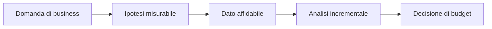

# GTM DataLayer e QA del tracking marketing

Un deploy può modificare il dataLayer, un pixel può perdere il `purchase_id` e il giorno dopo il dashboard mostra numeri che non tornano. Prima di analizzare le performance di una campagna conviene verificare che il tracking rifletta ancora il comportamento reale degli utenti, perché un dato sbagliato non è neutro: porta a spostare budget nella direzione opposta a quella giusta. In questa lezione il QA del tracking diventa il ponte tra la governance tecnica del codice e le decisioni di spesa che ne dipendono.

## Il problema da risolvere

Nel marketing analytics il lavoro vero è trasformare budget, canali, creatività e audience in decisioni misurabili, senza confondere volume, attribuzione e incrementalità. La domanda non è se il concetto sia interessante in astratto. La domanda è quale decisione migliora applicandolo con dati affidabili e con una soglia di errore dichiarata in anticipo.

## Come ragionare sul problema

Il percorso mentale è sequenziale. Si parte dalla domanda di business, la si traduce in un'ipotesi misurabile, si valuta la qualità del dato, si esegue l'analisi incrementale e solo alla fine si prende la decisione di budget. Saltare un passaggio produce analisi che sembrano solide ma poggiano sul vuoto.



| Passaggio | Domanda guida | Output atteso |
|---|---|---|
| Framing | Quale decisione deve cambiare? | Una scelta concreta, non una curiosità |
| Misura | Quale segnale rappresenta il fenomeno? | Metrica, fonte e granularità |
| Confronto | Rispetto a quale baseline interpreto il risultato? | Benchmark o controfattuale plausibile |
| Azione | Che cosa faccio se il segnale supera la soglia? | Decisione, owner e prossimo controllo |

## Gli elementi che tengono insieme il QA

Il QA del tracking marketing si descrive come una relazione tra pochi elementi che conviene tenere espliciti.

| Elemento | Definizione operativa |
|---|---|
| Unità | campagna, coorte, touchpoint o segmento cliente |
| Segnale | margine incrementale, CAC payback, conversion rate corretto, lift o retention generata |
| Baseline | periodo precedente, gruppo holdout, mercato comparabile o benchmark storico |
| Decisione | spostare risorse, cambiare messaggio, fermare una tattica o scalare un esperimento |
| Rischio | confondere correlazione, qualità del dato e causalità decisionale |

Vale una regola che torna utile ogni volta. Una misura serve solo se riduce l'incertezza su una decisione precisa. Se non cambia una scelta è documentazione, e se cambia una scelta senza controlli diventa rischio.

## Il DataLayer come punto unico di verità

Il dataLayer è la fonte primaria degli eventi di tracking, quindi va trattato con regole rigorose. I nomi degli eventi devono restare consistenti: si sceglie snake_case o camelCase e si tiene la stessa convenzione ovunque. Le proprietà vanno tipizzate sempre allo stesso modo, con `value` come number e `currency` come stringa ISO 4217. Non si inseriscono mai dati personali identificabili, per non violare il GDPR. La documentazione deve nascere dal codice, non essere riscritta a mano e lasciata invecchiare.

Ecco come si presenta un push di evento ecommerce standardizzato.

```javascript
// Push evento ecommerce standardizzato
dataLayer.push({
  'event': 'purchase_completed',
  'ecommerce': {
    'transaction_id': 'TXN-2024-0456',
    'affiliation': 'Online Store',
    'value': 149.99,
    'tax': 24.99,
    'shipping': 5.00,
    'currency': 'EUR',
    'coupon': 'SUMMER10',
    'items': [{
      'item_id': 'SKU-789',
      'item_name': 'Felpa Premium Cotton',
      'item_brand': 'GreenWear',
      'item_category': 'Abbigliamento',
      'item_variant': 'Nero - L',
      'price': 49.99,
      'quantity': 2
    }]
  },
  'customer_type': 'returning',
  'acquisition_channel': 'google_ads'
});
```

## La checklist di QA su quattro livelli

Il controllo del tracking si articola su quattro livelli che vanno dal codice in sviluppo fino al monitoraggio in produzione.

Al primo livello si testa il dataLayer durante lo sviluppo. Si verifica in console la struttura degli oggetti e si usa un'estensione come DataLayer Inspector+ per osservare gli eventi in tempo reale, controllando tipo evento, proprietà obbligatorie e tipi dei dati.

Al secondo livello si controllano le richieste di rete. Da DevTools, nel tab Network, si filtrano le chiamate verso Google Analytics e Facebook e si verifica che partano correttamente, senza errori 4xx o 5xx.

Al terzo livello si valida l'intero percorso end to end. Si simula un utente di test e si percorre il funnel completo su staging, controllando che ogni evento compaia in GA4 Realtime e in Facebook Test Events.

Al quarto livello si monitora la produzione. Si configurano alert automatici che segnalano cali superiori al 50% nel volume eventi rispetto alla baseline, per esempio con una query su BigQuery.

```sql
WITH current AS (
  SELECT event_name, COUNT(*) AS cnt
  FROM `project.analytics.events_*`
  WHERE _TABLE_SUFFIX = FORMAT_DATE('%Y%m%d', CURRENT_DATE())
  GROUP BY event_name
),
baseline AS (
  SELECT event_name, AVG(cnt) AS avg_cnt, STDDEV(cnt) AS stddev_cnt
  FROM daily_event_counts
  WHERE day BETWEEN DATE_SUB(CURRENT_DATE(), INTERVAL 14 DAY)
                AND DATE_SUB(CURRENT_DATE(), INTERVAL 1 DAY)
  GROUP BY event_name
)
SELECT c.event_name, c.cnt, b.avg_cnt,
       ROUND((c.cnt - b.avg_cnt) / b.avg_cnt * 100, 1) AS pct_change
FROM current c JOIN baseline b ON c.event_name = b.event_name
WHERE c.cnt < b.avg_cnt * 0.5;
```

## Il regression testing automatico

Per non scoprire i guasti in produzione conviene integrare nel CI/CD test automatici con Cypress o Puppeteer. Questi simulano un journey utente e verificano che gli eventi nel dataLayer ci siano e abbiano le proprietà giuste.

```javascript
it('should fire purchase event with correct properties', () => {
  cy.visit('/checkout');
  cy.get('[data-cy=place-order]').click();
  cy.window().then((win) => {
    const purchaseEvent = win.dataLayer.find(e => e.event === 'purchase_completed');
    expect(purchaseEvent.ecommerce.transaction_id).to.be.a('string');
    expect(purchaseEvent.ecommerce.value).to.be.a('number');
    expect(purchaseEvent.ecommerce.currency).to.equal('EUR');
  });
});
```

## Il caso del framework di QA di Wise

Wise ha costruito un framework interno di QA del tracking basato su un JSON Schema per ogni evento e su una pipeline CI che valida ogni push del dataLayer. In produzione, gli alert su BigQuery sorvegliano volume e freschezza degli eventi. Nei diciotto mesi successivi l'azienda ha azzerato gli incidenti di tracking, e il team marketing ha ricominciato a fidarsi dei propri numeri.

## Leggere il dato per segmenti

La media aggregata è solo un punto di partenza. Conviene segmentare per canale, coorte, piano, paese, device e maturità dell'utente. Quando segmenti diversi mostrano andamenti opposti, la media nasconde la realtà e spinge verso decisioni sbagliate.

## Chiudere con una decisione

Ogni analisi deve terminare con una scelta concreta: continuare, fermare, iterare, investire, rimuovere o approfondire. Se il QA del tracking non cambia nessuna decisione, manca il collegamento tra la metrica e l'azione, ed è quel collegamento il motivo per cui si fa il lavoro.

## Un caso da costruire

Immagina un team growth che valuta se aumentare il budget su un canale con CPA basso ma vendite marginali deboli. Applicando il QA del tracking, costruisce una tabella che tiene insieme evidenza, interpretazione prudente e decisione conseguente.

| Evidenza | Interpretazione prudente | Decisione conseguente |
|---|---|---|
| Segnale positivo ma non isolato | Fenomeno esiste, ma causa incerta | Cercare baseline o holdout |
| Segmento con risposta diversa | Effetto medio nasconde eterogeneità | Analizzare coorti o sottogruppi |
| Costo operativo crescente | Valutare sul margine | Applicare soglie economiche |

## Esercizi di laboratorio

Al livello base, scrivi in cinque righe una decisione reale collegata al QA del tracking, indicando obiettivo, metrica primaria, baseline, rischio principale e azione prevista.

Al livello intermedio, costruisci una tabella con almeno tre segmenti o scenari e per ciascuno annota il segnale, una possibile spiegazione alternativa e il controllo necessario.

Al livello research grade, disegna un piano di validazione completo: ipotesi, dati necessari, criteri di esclusione, soglia decisionale e controllo da fare dopo la decisione. Specifica anche cosa ti farebbe cambiare idea.

Per i dati puoi usare export campagne, costi media, eventi web e app, CRM, transazioni, survey brand e log di consenso. Se non hai dati reali, genera un dataset sintetico da 200 a 500 righe con una colonna temporale, il segmento, la metrica di outcome e la variabile di esposizione.

## L'errore tipico da evitare

L'errore più frequente è trattare il QA del tracking come una definizione da ricordare invece che come un protocollo decisionale. Presentare metriche senza baseline, grafici senza ipotesi o raccomandazioni senza il costo dell'errore porta a decisioni fragili.

Chiediti sempre: "Se questo risultato fosse falso o instabile, quale decisione sbaglierei?". Se non sai rispondere, la lezione non è stata applicata davvero.

## Quiz e checkpoint

1. Qual è la decisione concreta che questa lezione dovrebbe migliorare?
2. Quale baseline rende interpretabile il risultato?
3. Quale assunzione, se sbagliata, cambierebbe la conclusione?
4. Quale controllo minimo useresti prima di presentare la raccomandazione?

## Riepilogo operativo

Il QA del tracking marketing collega concetto, dato e decisione. Si parte da un problema reale, si formalizza il segnale, si cerca una baseline credibile, si costruisce un esempio e si chiude con un controllo pratico. Senza questo metodo anche i dati più sofisticati finiscono per ingannare chi li legge.

Tratta la lezione come una prova di lavoro in una review marketing, dove devi collegare canale, metrica, segmento, costo e raccomandazione. È questo che rende la conoscenza trasferibile, perché separa il contesto dalla misura, l'azione dal limite.

Hai assimilato il metodo quando riesci a spiegarlo senza gergo, applicarlo a un caso realistico e difendere una raccomandazione dichiarando limiti e controlli. Se manca uno di questi tre, torna al modello di ragionamento e riduci l'ambizione dell'esempio.

## Problema reale

Questo concetto si applica quando lavori con dataset reali e hai bisogno di una struttura chiara per ragionare su GTM DataLayer e QA del tracking marketing. Il problema tipico è non avere un framework condiviso tra il team per valutare la soluzione, con il risultato che ogni analisi parte da presupposti diversi.

**Quando lo incontrerai:**
- Quando presenti un risultato e qualcuno chiede "ma come sei arrivato a questo numero?"
- Quando il risultato di una query cambia radicalmente cambiando un filtro
- Quando il modello che hai costruito funziona sui dati di test ma non su quelli di produzione

## Modello concettuale

Il GTM DataLayer e QA del tracking marketing si definisce attraverso tre dimensioni:

1. **Struttura**: come sono organizzati i dati o il processo
2. **Logica**: quale relazione causa-effetto governa il comportamento
3. **Misura**: quale metrica usi per valutare il risultato

Questo modello ti permette di scomporre qualsiasi istanza del problema nelle sue parti verificabili.

## Formalizzazione rigorosa

```sql
-- TODO: aggiungi la formalizzazione specifica per GTM DataLayer e QA del tracking marketing
-- Pattern per avanzato:

SELECT
    /* indica qui la tua metrica principale */
FROM
    /* indica qui la sorgente dati */
WHERE
    /* indica qui i filtri */
GROUP BY
    /* indica qui le dimensioni di raggruppamento */
```

**Principio guida:** verifica sempre che la somma delle parti sia uguale al totale.

## Esempio o caso studio

**Caso tipico (livello avanzato):**

Immaginiamo un team marketing che deve misurare la retention a 30 giorni. L'errore più comune è calcolarla come `COUNT(DISTINCT user_id)` senza filtrare per data di attivazione, includendo utenti che non hanno ancora avuto 30 giorni di tempo. La versione corretta filtra prima la cohort di attivazione e poi applica il calcolo.

```sql
WITH cohort AS (
    SELECT
        user_id,
        MIN(event_date) AS activation_date
    FROM events
    GROUP BY user_id
),
retention AS (
    SELECT
        c.activation_date,
        COUNT(DISTINCT e.user_id) AS retained_users
    FROM cohort c
    JOIN events e ON c.user_id = e.user_id
        AND e.event_date >= c.activation_date
        AND e.event_date <= c.activation_date + INTERVAL '30 days'
    GROUP BY c.activation_date
)
SELECT
    activation_date,
    retained_users,
    ROUND(retention_rate * 100, 2) AS retention_pct
FROM retention;
```

## Lab / esercizio

**Esercizio — livello avanzato**

1. **Prepara l'ambiente:** carica il dataset di esempio nel tuo warehouse
2. **Applica il pattern:** scrivi la query che implementa il modello concettuale per il tuo caso
3. **Verifica:** controlla che il risultato sia coerente con le tue aspettative usando un sanity check

**Tempo stimato:** 20-30 minuti

## Errore tipico da evitare

**L'errore più comune a livello avanzato:**

Non distinguere tra una metrica calcolata su tutta la popolazione e una metrica calcolata su una sotto-popolazione specifica. Ad esempio, calcolare il tasso di conversione medio senza filtrare per canale di acquisizione porta a decisioni sbagliate perché il mix di canali cambia nel tempo.

**Come evitarlo:**
- Chiediti sempre: "rispetto a cosa sto misurando questo?"
- Verifica che il denominatore sia corretto prima di fidarti del numeratore
- Usa un gruppo di controllo quando possibile

## Quiz o checkpoint

1. Qual è la differenza tra la metrica calcolata su tutta la popolazione e quella calcolata su una cohort?
2. Scrivi il codice SQL che implementa il modello concettuale per un caso a tua scelta
3. Quale sanity check useresti per verificare che il risultato sia corretto?

---

Questa lezione si applica a Modulo 6: Marketing Analytics, Incrementality e Unit Economics: serve per capire gtm datalayer e qa del tracking marketing in modo operativo, non solo teorico. Il problema tipico è affrontare gtm datalayer e qa del tracking marketing senza un framework condiviso, con il risultato che ogni analisi parte da zero.

### Livello base

GTM DataLayer e QA del tracking marketing è il fondamento di questa competenza. A livello base, ti basta capire la domanda chiave: cosa vuoi misurare, con quali dati, e con quale margine di errore. Non servono formule complesse: serve chiarezza su cosa osservi e perché.

### Livello intermedio

A questo livello applichi gtm datalayer e qa del tracking marketing a un caso reale. Prendi un dataset, definisci l'obiettivo, e costruisci il ragionamento passo per passo. Se stai lavorando su modulo 6: marketing analytics, incrementality e unit economics, il tuo dataset ha dimensioni specifiche che determinano quali domande puoi porre.

### Livello research-grade

Approfondimento teorico di gtm datalayer e qa del tracking marketing: qui entrambi i modelli statistici, le assunzioni sottostanti, e i confini di validità. Questo livello serve quando devi difendere una scelta di fronte a stakeholder che chiedono "perché" — non solo "cosa".

### Dataset e materiali consigliati

- Un dataset reale del tuo dominio (modulo 6: marketing analytics, incrementality e unit economics) per esercitarsi
- La documentazione ufficiale dello strumento usato per questa analisi
- Le metriche di riferimento del corso per contestualizzare i risultati

### Livello base

Spiegazione intuitiva di GTM DataLayer e QA del tracking marketing:

Il concetto alla base è semplice: invece di fare affidamento sull'intuizione, usi un metodo riproducibile. A livello base, ti basta capire quale domanda stai ponendo e quali dati hai a disposizione per risponderci.

### Livello intermedio

Applicazione concreta di GTM DataLayer e QA del tracking marketing:

A questo livello applichi il concetto a un caso specifico. Ad esempio, se stai analizzando la retention, il tuo dataset ha dimensioni come data di attivazione, data di evento, e user_id. La segmentazione per canale di acquisizione ti dà insight aggiuntivi che il dato grezzo non mostra.

### Livello research-grade

Approfondimento teorico:

Per chi vuole capire il fondamento teorico, la letteratura classica include:
- Kimball, "The Data Warehouse Toolkit" — per approcci dimensionali
- McKinney, "Python for Data Analysis" — per implementazione pratica
- Aggiora i riferimenti con paper recenti specifici per il tuo dominio

### Dataset e materiali consigliati

**Per esercitarti:**
- Usa il dataset di esempio fornito nella lezione
- Per un challenge aggiuntivo, prova con dati pubblici come quelli di Kaggle

**Tool consigliati:**
- dbt Core per trasformazioni
- Metabase o Superset per visualizzazione