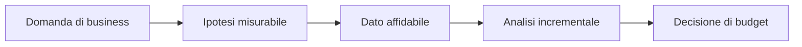

# GTM DataLayer e QA del tracking marketing


Un deploy cambia il dataLayer, il pixel perde il `purchase_id` e il dashboard del giorno dopo sembra crollare. Prima di parlare di performance, devi sapere se il tracking sta ancora raccontando il comportamento reale. **GTM DataLayer e QA del tracking marketing** porta l'analisi nel punto in cui governance tecnica e decisioni di budget si incontrano.

## Una scena da cui partire

Leggi questa lezione come un protocollo di QA. Ogni evento deve avere una definizione, una fonte, un payload atteso e un controllo dopo rilascio; senza questa disciplina, anche il miglior dashboard diventa una lotteria.

- **Contesto:** Quale evento è critico per revenue o ottimizzazione campagne?
- **Metodo:** Quale test conferma che il dataLayer è completo dopo un deploy?
- **Applicazione:** Quale regola di QA renderesti obbligatoria prima di andare live?

## Il DataLayer: il singolo punto di verità

```javascript
// Push evento ecommerce standardizzato
dataLayer.push({
  'event': 'purchase_completed',
  'ecommerce': {
    'transaction_id': 'TXN-2024-0456',
    'affiliation': 'Online Store',
    'value': 149.99,
    'tax': 24.99,
    'shipping': 5.00,
    'currency': 'EUR',
    'coupon': 'SUMMER10',
    'items': [{
      'item_id': 'SKU-789',
      'item_name': 'Felpa Premium Cotton',
      'item_brand': 'GreenWear',
      'item_category': 'Abbigliamento',
      'item_variant': 'Nero - L',
      'price': 49.99,
      'quantity': 2
    }]
  },
  'customer_type': 'returning',
  'acquisition_channel': 'google_ads'
});
```

Regole per un buon DataLayer:
1. **Nomi evento consistenti**: snake_case o camelCase. Mai mischiare `purchase_completed` e `purchaseCompleted`.
2. **Proprietà tipate consistentemente**: `value` è sempre number, mai stringa. `currency` è sempre stringa di 3 lettere (ISO 4217).
3. **Niente PII nel DataLayer**: mai email, nome, telefono o indirizzi. Violazione GDPR.
4. **Documentazione auto-generata**: estrai il registro eventi dal codice, non mantenerlo manualmente.

## QA del tracking: la checklist a 4 livelli

### Livello 1: DataLayer testing (sviluppo)
```javascript
// In console: verifica struttura DataLayer
dataLayer.forEach(function(event, index) {
  console.log(`Event ${index}: ${event.event}`, event);
});
```
Usa **DataLayer Inspector+** (Chrome extension) per vedere eventi in tempo reale. Verifica: tipo evento, proprietà obbligatorie presenti, tipi corretti.

### Livello 2: Network request testing
Apri DevTools → Network, filtra per `google-analytics`, `facebook.com/tr`, filtri GTM Server. Verifica che le richieste siano inviate con parametri corretti, senza errori 4xx/5xx.

### Livello 3: End-to-end validation
Crea un utente di test (con email dedicata), esegui il journey completo su staging:
1. Landing page → verifica page_view
2. Navigazione prodotto → verifica view_item
3. Add to cart → verifica add_to_cart
4. Checkout → verifica begin_checkout
5. Acquisto → verifica purchase con tutti i parametri
6. Verifica che tutti gli eventi appaiano in GA4 Realtime e Facebook Test Events

### Livello 4: Monitoring in produzione
Alert automatico se il volume di eventi per tipo cala >50% rispetto alla baseline:

```sql
WITH current AS (
  SELECT event_name, COUNT(*) AS cnt
  FROM `project.analytics.events_*`
  WHERE _TABLE_SUFFIX = FORMAT_DATE('%Y%m%d', CURRENT_DATE())
  GROUP BY event_name
),
baseline AS (
  SELECT event_name, AVG(cnt) AS avg_cnt, STDDEV(cnt) AS stddev_cnt
  FROM daily_event_counts
  WHERE day BETWEEN DATE_SUB(CURRENT_DATE(), INTERVAL 14 DAY)
                AND DATE_SUB(CURRENT_DATE(), INTERVAL 1 DAY)
  GROUP BY event_name
)
SELECT c.event_name, c.cnt, b.avg_cnt,
       ROUND((c.cnt - b.avg_cnt) / b.avg_cnt * 100, 1) AS pct_change
FROM current c JOIN baseline b ON c.event_name = b.event_name
WHERE c.cnt < b.avg_cnt * 0.5;
```

## Regression testing automatico

Integra nel CI/CD: a ogni deploy, Cypress o Puppeteer esegue un journey di test e verifica che tutti gli eventi attesi appaiano nel DataLayer:

```javascript
// cypress/integration/tracking.spec.js
it('should fire purchase event with correct properties', () => {
  cy.visit('/checkout');
  cy.get('[data-cy=place-order]').click();
  cy.window().then((win) => {
    const purchaseEvent = win.dataLayer.find(e => e.event === 'purchase_completed');
    expect(purchaseEvent.ecommerce.transaction_id).to.be.a('string');
    expect(purchaseEvent.ecommerce.value).to.be.a('number');
    expect(purchaseEvent.ecommerce.currency).to.equal('EUR');
  });
});
```

## Caso reale: il tracking QA framework di Wise

Wise (ex TransferWise) ha costruito un framework interno di tracking QA. Ogni evento ha un file JSON Schema che lo definisce. Una pipeline CI valida che ogni push del DataLayer rispetti gli schemi. In produzione, BigQuery alert controllano volume e freschezza degli eventi. Risultato: da 3-4 incidenti di tracking al mese a zero negli ultimi 18 mesi. Il team marketing può fidarsi ciecamente dei dati.

## Controllo di qualità

Prima di usare gtm datalayer e qa del tracking marketing in una decisione, controlla sempre completezza, duplicati, timezone, definizioni cambiate e segmenti esclusi. Molte analisi apparentemente sofisticate falliscono perché il dato di partenza misura un comportamento diverso da quello che il team crede di osservare.


## Interpretazione per segmenti

La media aggregata è solo il punto di partenza. Segmenta per canale, coorte, piano, paese, device e maturità dell'utente. Se due segmenti si muovono in direzioni opposte, la media non rappresenta nessuno dei due e può portare a una decisione sbagliata.


## Decisione operativa

Ogni analisi deve terminare con una scelta possibile: continuare, fermare, iterare, investire, rimuovere o approfondire. Se gtm datalayer e qa del tracking marketing non cambia una decisione, probabilmente manca ancora il collegamento tra metrica e azione.

## Problema reale

Nel lavoro su marketing analytics, **GTM DataLayer e QA del tracking marketing** serve a risolvere un problema concreto: trasformare budget, canali, creativita e audience in decisioni misurabili senza confondere volume, attribuzione e incrementalita. La domanda non è se il concetto sia interessante in astratto, ma quale decisione migliora quando lo applichi con dati affidabili e con una soglia di errore esplicita.

Questa lezione va studiata come uno strumento operativo: entro la fine devi saper Comprendere il problema analitico e il contesto decisionale; Applicare esempi, metriche e controlli a casi reali. Se non riesci a collegare il concetto a una scelta reale, la conoscenza resta decorativa e non diventa competenza.

## Modello concettuale



Il modello mentale e sequenziale: prima si formula la domanda, poi si traduce in unità osservabili, quindi si valuta la qualità del dato e solo alla fine si decide. Saltare un passaggio produce analisi eleganti ma fragili.

| Passaggio | Domanda guida | Output atteso |
|---|---|---|
| Framing | Quale decisione deve cambiare? | Una scelta concreta, non una curiosità |
| Misura | Quale segnale rappresenta il fenomeno? | Metrica, fonte e granularità |
| Confronto | Rispetto a quale baseline interpreto il risultato? | Benchmark o controfattuale plausibile |
| Azione | Che cosa faccio se il segnale supera la soglia? | Decisione, owner e prossimo controllo |

## Formalizzazione rigorosa

Formalizza **GTM DataLayer e QA del tracking marketing** come una relazione tra quattro elementi: unità di analisi, segnale, baseline e decisione. Nel contesto di questa lezione l'unità principale e **campagna, coorte, touchpoint o segmento cliente**. Il segnale da osservare deve essere collegato a **margine incrementale, CAC payback, conversion rate corretto, lift o retention generata**, mentre la baseline deve essere scelta tra **periodo precedente, gruppo holdout, mercato comparabile o benchmark storico**.

Una formulazione robusta segue questa logica:

| Elemento | Definizione operativa per questa lezione |
|---|---|
| Unità | campagna, coorte, touchpoint o segmento cliente |
| Segnale | margine incrementale, CAC payback, conversion rate corretto, lift o retention generata |
| Baseline | periodo precedente, gruppo holdout, mercato comparabile o benchmark storico |
| Decisione | spostare risorse, cambiare messaggio, fermare una tattica o scalare un esperimento |
| Rischio | Confondere correlazione, qualità del dato e causalità decisionale |

La regola pratica e semplice: una misura e utile solo se riduce l'incertezza su una decisione specifica. Se non cambia una scelta, e documentazione; se cambia una scelta senza controlli, e rischio.

## Esempio o caso studio

Un team growth deve decidere se aumentare il budget su un canale che mostra CPA basso ma vendite marginali deboli. La lezione aiuta a separare il segnale utile dal rumore operativo, collegando metrica, modello mentale e decisione economica.

Applicando **GTM DataLayer e QA del tracking marketing**, il team costruisce una lettura in tre colonne: cosa sappiamo, cosa assumiamo e quale decisione prendiamo. Questo formato impedisce di presentare un numero come se fosse una conclusione autosufficiente.

| Evidenza | Interpretazione prudente | Decisione conseguente |
|---|---|---|
| Segnale positivo ma non isolato | Il fenomeno esiste, ma la causa e ancora incerta | Cercare baseline o holdout |
| Segmento con risposta diversa | L'effetto medio nasconde eterogeneita | Analizzare coorti o sottogruppi |
| Costo operativo crescente | Il risultato va valutato sul margine | Applicare soglie economiche |

## Lab / esercizio

### Livello base

Prendi una decisione reale collegata a **GTM DataLayer e QA del tracking marketing** e scrivi in cinque righe: obiettivo, metrica primaria, baseline, rischio principale e azione prevista. Non usare più di una metrica primaria.

### Livello intermedio

Costruisci una tabella con almeno tre segmenti o scenari. Per ciascuno indica segnale, possibile spiegazione alternativa e controllo necessario prima di decidere.

### Livello research-grade

Disegna un piano di validazione: ipotesi, dati necessari, criterio di esclusione, soglia decisionale e controllo post-decisione. Specifica anche che cosa ti farebbe cambiare idea.

### Dataset e materiali consigliati

Usa export campagne, costi media, eventi web o app, CRM, transazioni, survey brand e log di consenso. Se non hai dati reali, crea un dataset sintetico con 200-500 righe e almeno una colonna temporale, una colonna segmento, una metrica di outcome e una variabile di esposizione.

## Errore tipico da evitare

L'errore più frequente e trattare **GTM DataLayer e QA del tracking marketing** come una definizione da ricordare invece che come un protocollo decisionale. In pratica succede quando si presenta una metrica senza baseline, un grafico senza ipotesi, o una raccomandazione senza costo dell'errore.

Un controllo utile è chiedersi: "se questo risultato fosse falso o instabile, quale decisione sbaglierei?". Se la risposta non è chiara, la lezione non è ancora stata applicata davvero.

## Quiz o checkpoint

1. Qual è la decisione concreta che questa lezione dovrebbe migliorare?
2. Quale baseline rende interpretabile il risultato?
3. Quale assunzione, se sbagliata, cambierebbe la conclusione?
4. Quale controllo minimo useresti prima di presentare la raccomandazione?

## Riepilogo operativo

**GTM DataLayer e QA del tracking marketing** e una competenza utile quando collega concetto, dato e decisione. Studiala partendo da un problema reale, formalizza il segnale, cerca una baseline credibile, costruisci un esempio e chiudi con un controllo pratico. Categoria: Tecnico. Difficoltà: advanced. Tempo stimato: 22 min.

## Approfondimento di pratica

Per consolidare **GTM DataLayer e QA del tracking marketing**, trattala come una piccola prova di lavoro dentro una review marketing con budget, canali, tracking e marginalita da riconciliare. Non basta dire di aver capito la lezione: devi produrre un memo che collega canale, metrica, segmento, costo e raccomandazione. Questo passaggio serve a rendere la conoscenza trasferibile, perché obbliga a separare contesto, misura, azione e limite.

### Esempio operativo

Parti da una domanda semplice: quale scelta diventerebbe migliore se applicassi bene questa lezione? Nel modulo analisi marketing, la risposta deve sempre collegare un problema reale a un output osservabile. Se stai studiando una lezione di tipo Tecnico, costruisci un esempio con tre righe: il contesto in cui nasce la domanda, il dato o il modello che useresti per leggerla, e la decisione che prenderesti dopo aver controllato i rischi.

Un esempio valido non deve essere grande. Può essere una tabella con una baseline e due segmenti, una query che verifica una definizione, un disegno di esperimento, un controllo su un modello o un memo di dieci righe. La qualità non dipende dalla complessità tecnica, ma dalla tracciabilità del ragionamento: chi legge deve capire perché hai scelto quella metrica, quale alternativa hai scartato e quale evidenza ti farebbe cambiare idea.

### Checkpoint di lavoro

- Scrivi la decisione che questa lezione dovrebbe migliorare, usando un verbo operativo: allocare, fermare, correggere, lanciare, misurare, priorizzare o investigare.
- Definisci il segnale principale e almeno un guardrail. Il segnale dice dove guardi; il guardrail evita che una scelta localmente buona rovini il sistema.
- Aggiungi una baseline. Senza baseline non sai se il numero e alto, basso, stabile, anomalo o solo raccontato male.
- Esplicita il rischio più probabile: scambiare correlazione di campagna per impatto incrementale o decisione di budget. Scrivilo prima della raccomandazione, non dopo.
- Chiudi con un output consegnabile: dashboard, query, schema, memo, esperimento, notebook o checklist. Deve essere qualcosa che un reviewer possa aprire e criticare.

### Riepilogo di padronanza

Hai davvero assimilato **GTM DataLayer e QA del tracking marketing** quando riesci a usarla in tre modi: spiegare il concetto senza gergo inutile, applicarlo a un caso piccolo ma realistico, e difendere una raccomandazione includendo limiti e prossimi controlli. Se manca uno di questi tre elementi, torna al modello concettuale e riduci l'ambizione dell'esempio. Meglio una prova piccola ma rigorosa di un grande progetto che non rende verificabile la decisione.
