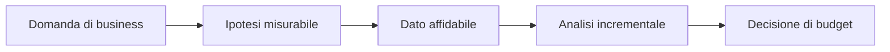

# GTM DataLayer e QA del tracking marketing

Un deploy può modificare il dataLayer, un pixel può perdere il `purchase_id` e il dashboard del giorno dopo può mostrare dati inconsistenti. Prima di analizzare le performance, è fondamentale verificare che il tracking rifletta ancora il comportamento reale degli utenti. Questa lezione collega la governance tecnica con le decisioni di budget, mostrando come il QA del tracking marketing sia una disciplina essenziale per prendere decisioni sotto incertezza.

## Problema reale

Nel marketing analytics, il problema concreto è trasformare budget, canali, creatività e audience in decisioni misurabili senza confondere volume, attribuzione e incrementalità. La domanda non è se il concetto sia interessante in astratto, ma quale decisione migliora applicandolo con dati affidabili e con una soglia di errore esplicita.

## Modello concettuale

Il processo mentale è sequenziale:

- Formulare la domanda di business
- Tradurla in un'ipotesi misurabile
- Valutare la qualità del dato
- Eseguire l'analisi incrementale
- Prendere una decisione di budget



| Passaggio | Domanda guida | Output atteso |
|---|---|---|
| Framing | Quale decisione deve cambiare? | Una scelta concreta, non una curiosità |
| Misura | Quale segnale rappresenta il fenomeno? | Metrica, fonte e granularità |
| Confronto | Rispetto a quale baseline interpreto il risultato? | Benchmark o controfattuale plausibile |
| Azione | Che cosa faccio se il segnale supera la soglia? | Decisione, owner e prossimo controllo |

## Formalizzazione rigorosa

Formalizziamo il QA del tracking marketing come una relazione tra quattro elementi:

| Elemento | Definizione operativa |
|---|---|
| Unità | campagna, coorte, touchpoint o segmento cliente |
| Segnale | margine incrementale, CAC payback, conversion rate corretto, lift o retention generata |
| Baseline | periodo precedente, gruppo holdout, mercato comparabile o benchmark storico |
| Decisione | spostare risorse, cambiare messaggio, fermare una tattica o scalare un esperimento |
| Rischio | confondere correlazione, qualità del dato e causalità decisionale |

Una misura è utile solo se riduce l'incertezza su una decisione specifica. Se non cambia una scelta, è documentazione; se cambia una scelta senza controlli, è rischio.

## Il DataLayer: il singolo punto di verità

Il dataLayer è la fonte primaria degli eventi di tracking e deve rispettare regole rigorose:

1. Nomi evento consistenti: scegliere snake_case o camelCase e mantenerli uniformi.
2. Proprietà tipate coerentemente: `value` sempre number, `currency` sempre stringa ISO 4217.
3. Mai includere dati personali identificabili (PII) per rispettare GDPR.
4. Documentazione auto-generata dal codice, non manuale.

Esempio di push evento ecommerce standardizzato:

```javascript
// Push evento ecommerce standardizzato
dataLayer.push({
  'event': 'purchase_completed',
  'ecommerce': {
    'transaction_id': 'TXN-2024-0456',
    'affiliation': 'Online Store',
    'value': 149.99,
    'tax': 24.99,
    'shipping': 5.00,
    'currency': 'EUR',
    'coupon': 'SUMMER10',
    'items': [{
      'item_id': 'SKU-789',
      'item_name': 'Felpa Premium Cotton',
      'item_brand': 'GreenWear',
      'item_category': 'Abbigliamento',
      'item_variant': 'Nero - L',
      'price': 49.99,
      'quantity': 2
    }]
  },
  'customer_type': 'returning',
  'acquisition_channel': 'google_ads'
});
```

## QA del tracking: la checklist a 4 livelli

### Livello 1: DataLayer testing (sviluppo)

Verifica in console la struttura del dataLayer e usa estensioni come DataLayer Inspector+ per monitorare eventi in tempo reale. Controlla tipo evento, proprietà obbligatorie e tipi dati.

### Livello 2: Network request testing

Con DevTools → Network filtra le richieste verso Google Analytics e Facebook. Verifica che siano inviate correttamente senza errori 4xx o 5xx.

### Livello 3: End-to-end validation

Simula un utente di test e percorri il funnel completo su staging, verificando che tutti gli eventi appaiano correttamente in GA4 Realtime e Facebook Test Events.

### Livello 4: Monitoring in produzione

Implementa alert automatici che segnalino cali >50% nel volume eventi rispetto alla baseline, ad esempio con query SQL su BigQuery:

```sql
WITH current AS (
  SELECT event_name, COUNT(*) AS cnt
  FROM `project.analytics.events_*`
  WHERE _TABLE_SUFFIX = FORMAT_DATE('%Y%m%d', CURRENT_DATE())
  GROUP BY event_name
),
baseline AS (
  SELECT event_name, AVG(cnt) AS avg_cnt, STDDEV(cnt) AS stddev_cnt
  FROM daily_event_counts
  WHERE day BETWEEN DATE_SUB(CURRENT_DATE(), INTERVAL 14 DAY)
                AND DATE_SUB(CURRENT_DATE(), INTERVAL 1 DAY)
  GROUP BY event_name
)
SELECT c.event_name, c.cnt, b.avg_cnt,
       ROUND((c.cnt - b.avg_cnt) / b.avg_cnt * 100, 1) AS pct_change
FROM current c JOIN baseline b ON c.event_name = b.event_name
WHERE c.cnt < b.avg_cnt * 0.5;
```

## Regression testing automatico

Integra nel CI/CD test automatici con Cypress o Puppeteer che simulano un journey e verificano la presenza e correttezza degli eventi nel dataLayer:

```javascript
it('should fire purchase event with correct properties', () => {
  cy.visit('/checkout');
  cy.get('[data-cy=place-order]').click();
  cy.window().then((win) => {
    const purchaseEvent = win.dataLayer.find(e => e.event === 'purchase_completed');
    expect(purchaseEvent.ecommerce.transaction_id).to.be.a('string');
    expect(purchaseEvent.ecommerce.value).to.be.a('number');
    expect(purchaseEvent.ecommerce.currency).to.equal('EUR');
  });
});
```

## Caso reale: il tracking QA framework di Wise

Wise ha sviluppato un framework interno di QA del tracking basato su JSON Schema per ogni evento e pipeline CI che valida ogni push del dataLayer. In produzione, alert su BigQuery monitorano volume e freschezza degli eventi. Il risultato è stato azzerare gli incidenti di tracking negli ultimi 18 mesi, aumentando la fiducia del marketing nei dati.

## Interpretazione per segmenti

La media aggregata è solo un punto di partenza. Segmenta per canale, coorte, piano, paese, device e maturità utente. Se segmenti diversi mostrano trend opposti, la media può fuorviare e portare a decisioni errate.

## Decisione operativa

Ogni analisi deve terminare con una scelta concreta: continuare, fermare, iterare, investire, rimuovere o approfondire. Se il QA del tracking non cambia una decisione, manca il collegamento tra metrica e azione.

## Esempio o caso studio

Un team growth valuta se aumentare budget su un canale con CPA basso ma vendite marginali deboli. Applicando il QA del tracking, costruisce una tabella con evidenza, interpretazione prudente e decisione conseguente:

| Evidenza | Interpretazione prudente | Decisione conseguente |
|---|---|---|
| Segnale positivo ma non isolato | Fenomeno esiste, ma causa incerta | Cercare baseline o holdout |
| Segmento con risposta diversa | Effetto medio nasconde eterogeneità | Analizzare coorti o sottogruppi |
| Costo operativo crescente | Valutare sul margine | Applicare soglie economiche |

## Lab / esercizio

### Livello base

Scrivi in cinque righe una decisione reale collegata al QA del tracking: obiettivo, metrica primaria, baseline, rischio principale e azione prevista.

### Livello intermedio

Costruisci una tabella con almeno tre segmenti o scenari, indicando per ciascuno segnale, possibile spiegazione alternativa e controllo necessario.

### Livello research-grade

Disegna un piano di validazione con ipotesi, dati necessari, criteri di esclusione, soglia decisionale e controllo post-decisione. Specifica cosa ti farebbe cambiare idea.

### Dataset e materiali consigliati

Usa export campagne, costi media, eventi web/app, CRM, transazioni, survey brand e log consenso. Se non hai dati reali, crea un dataset sintetico con 200-500 righe, includendo colonna temporale, segmento, metrica outcome e variabile esposizione.

## Errore tipico da evitare

Trattare il QA del tracking come una definizione da ricordare invece che come protocollo decisionale. Presentare metriche senza baseline, grafici senza ipotesi o raccomandazioni senza costo dell'errore porta a decisioni fragili.

Chiediti sempre: "Se questo risultato fosse falso o instabile, quale decisione sbaglierei?". Se non sai rispondere, la lezione non è stata applicata davvero.

## Quiz o checkpoint

1. Qual è la decisione concreta che questa lezione dovrebbe migliorare?
2. Quale baseline rende interpretabile il risultato?
3. Quale assunzione, se sbagliata, cambierebbe la conclusione?
4. Quale controllo minimo useresti prima di presentare la raccomandazione?

## Riepilogo operativo

Il QA del tracking marketing è una competenza che collega concetto, dato e decisione. Studiala partendo da un problema reale, formalizza il segnale, cerca una baseline credibile, costruisci un esempio e chiudi con un controllo pratico. Senza questo approccio, anche i dati più sofisticati rischiano di ingannare.

## Approfondimento di pratica

Tratta questa lezione come una prova di lavoro in una review marketing: collega canale, metrica, segmento, costo e raccomandazione. Questo rende la conoscenza trasferibile, separando contesto, misura, azione e limite.

### Esempio operativo

Parti da una domanda semplice: quale scelta migliorerebbe applicando bene questa lezione? Costruisci un esempio con tre righe: contesto, dato o modello usato, decisione dopo il controllo dei rischi.

### Checkpoint di lavoro

- Scrivi la decisione che questa lezione dovrebbe migliorare con un verbo operativo.
- Definisci segnale principale e almeno un guardrail.
- Aggiungi una baseline.
- Esplicita il rischio più probabile.
- Chiudi con un output consegnabile (dashboard, query, memo, esperimento, checklist).

### Riepilogo di padronanza

Hai assimilato questa lezione quando riesci a spiegare il concetto senza gergo, applicarlo a un caso realistico e difendere una raccomandazione con limiti e controlli. Se manca uno di questi, torna al modello concettuale e riduci l'ambizione dell'esempio.
