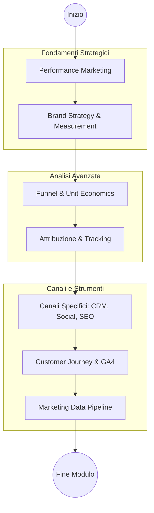

## Panoramica del Modulo

Il modulo **Analisi di Marketing** è progettato per trasformare il modo in cui guardi alle attività promozionali e di crescita. Non si tratta solo di lanciare campagne, ma di capire profondamente *cosa* funziona, *perché* funziona e *come* scalare i risultati in modo sostenibile. Analizzeremo sia l'aspetto tattico del performance marketing sia quello strategico della costruzione del brand, unendo la creatività ai dati rigorosi.

Questo percorso è destinato a marketer, analisti e imprenditori che vogliono padroneggiare gli strumenti analitici moderni (come GA4 e i modelli di attribuzione) per ottimizzare il budget e massimizzare il ROI.

## Obiettivi di Apprendimento

Al termine di questo modulo sarai in grado di:

- **Progettare** strategie di Performance Marketing basate su unit economics solidi (CAC, LTV, ROAS).
- **Misurare** l'efficacia delle campagne di brand awareness, superando i limiti delle metriche di vanità.
- **Applicare** modelli di attribuzione avanzati per allocare correttamente il budget tra i vari canali.
- **Mappare** il Customer Journey completo per identificare i punti di attrito e le opportunità di ottimizzazione.
- **Configurare** e utilizzare Google Analytics 4 (GA4) per analisi comportamentali avanzate.
- **Costruire** pipeline di dati di marketing robuste per automatizzare il reporting.
- **Analizzare** le performance SEO e Social con un approccio quantitativo e orientato al business.

## Prerequisiti

- Conoscenza base dei concetti di marketing digitale (es. cos'è una campagna, un click, una conversione).
- Familiarità elementare con fogli di calcolo (Excel/Google Sheets).
- **Consigliato:** Aver completato il modulo "Metriche Fondamentali" (se disponibile).

## Percorso delle Lezioni

| N° | Lezione | Argomento Principale | Durata | Difficoltà |
| :-- | :--- | :--- | :--- | :--- |
| 1 | **Performance Marketing** | Fondamenti di crescita e acquisizione | 45 min | ⭐ |
| 2 | **Costruire un Brand Forte** | Strategia e posizionamento di marca | 40 min | ⭐⭐ |
| 3 | **Misurare l'Efficacia del Brand** | KPI qualitativi e quantitativi per il brand | 40 min | ⭐⭐ |
| 4 | **Funnel & Unit Economics** | Analisi del funnel, CAC, LTV e payback period | 50 min | ⭐⭐⭐ |
| 5 | **Modelli di Attribuzione** | First click, last click, data-driven e MMM | 55 min | ⭐⭐⭐ |
| 6 | **Analisi End-to-End & UTM** | Tracciamento completo della campagna | 35 min | ⭐⭐ |
| 7 | **CRM & Email Analytics** | Metriche di retention e segmentazione database | 40 min | ⭐⭐ |
| 8 | **Social Media Analytics** | Misurare l'impatto organico e paid sui social | 35 min | ⭐ |
| 9 | **SEO & Content Analytics** | Analisi del traffico organico e performance dei contenuti | 45 min | ⭐⭐ |
| 10 | **Customer Journey Mapping** | Visualizzare l'esperienza utente omnicanale | 50 min | ⭐⭐ |
| 11 | **Google Analytics 4 Avanzato** | Eventi, esplorazioni e integrazione BigQuery | 60 min | ⭐⭐⭐ |
| 12 | **Marketing Data Pipeline** | Automazione del flusso dati di marketing | 50 min | ⭐⭐⭐ |

## Competenze Acquisite

**Competenze Tecniche:**
- Configurazione avanzata di Google Analytics 4 (Eventi, Audience, BigQuery Export).
- Utilizzo corretto dei parametri UTM per il tracciamento delle campagne.
- Implementazione di modelli di attribuzione (Markov, Shapley, Data-Driven).
- Analisi dei dati CRM e segmentazione della customer base.

**Competenze Analitiche:**
- Capacità di distinguere tra correlazione e causalità nelle performance di marketing.
- Pensiero critico nell'allocazione del budget (Budgeting & Forecasting).
- Interpretazione dei segnali di mercato attraverso l'analisi dei dati social e di ricerca.
- Valutazione della sostenibilità economica delle campagne (Unit Economics).

## Tempo Stimato

- **Durata Totale:** Circa 9 ore di studio (lezioni + esercizi).
- **Tempo Consigliato:** 3 settimane (4 lezioni a settimana).

## Come Usare Questo Modulo

Per ottenere il massimo da questo modulo, ti consiglio di non limitarti alla teoria. Apri il tuo account di Google Analytics o il tuo Business Manager mentre segui le lezioni e prova a replicare le analisi mostrate.
Presta particolare attenzione alla lezione sui **Unit Economics**: è lo spartiacque tra chi "fa marketing" e chi "guida la crescita aziendale". Se possibile, lavora su dati reali della tua azienda o di un progetto personale per rendere l'apprendimento concreto.
