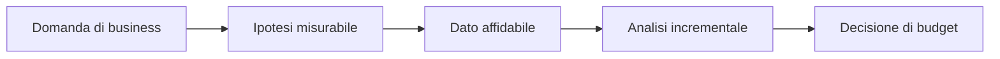

# Lifecycle orchestration multicanale

Nel marketing moderno, è comune che un cliente riceva nello stesso pomeriggio una welcome email, una push, un SMS e un retargeting. Ogni canale agisce per raggiungere il proprio obiettivo, ma il risultato complessivo rischia di diventare un rumore confuso e fastidioso. La **lifecycle orchestration multicanale** nasce per coordinare messaggi, priorità e pause lungo il ciclo di vita del cliente, trasformando questa confusione in un'esperienza coerente e personalizzata.

## Problema reale

Il problema concreto che affrontiamo è trasformare budget, canali, creatività e audience in decisioni misurabili senza confondere volume, attribuzione e incrementalità. Non si tratta di un concetto astratto, ma di uno strumento operativo: capire quale decisione migliora quando applichiamo dati affidabili con una soglia di errore esplicita. Senza questo collegamento, la conoscenza resta decorativa e non diventa competenza.

## Modello concettuale

Il modello mentale è sequenziale: prima si formula la domanda, poi si traduce in unità osservabili, si valuta la qualità del dato e solo alla fine si decide. Saltare un passaggio produce analisi eleganti ma fragili.

| Passaggio | Domanda guida | Output atteso |
|---|---|---|
| Framing | Quale decisione deve cambiare? | Una scelta concreta, non una curiosità |
| Misura | Quale segnale rappresenta il fenomeno? | Metrica, fonte e granularità |
| Confronto | Rispetto a quale baseline interpreto il risultato? | Benchmark o controfattuale plausibile |
| Azione | Che cosa faccio se il segnale supera la soglia? | Decisione, owner e prossimo controllo |

## Formalizzazione rigorosa

La lifecycle orchestration multicanale si formalizza come una relazione tra quattro elementi: unità di analisi, segnale, baseline e decisione. 

| Elemento | Definizione operativa |
|---|---|
| Unità | campagna, coorte, touchpoint o segmento cliente |
| Segnale | margine incrementale, CAC payback, conversion rate corretto, lift o retention generata |
| Baseline | periodo precedente, gruppo holdout, mercato comparabile o benchmark storico |
| Decisione | spostare risorse, cambiare messaggio, fermare una tattica o scalare un esperimento |
| Rischio | confondere correlazione, qualità del dato e causalità decisionale |

La regola pratica è semplice: una misura è utile solo se riduce l'incertezza su una decisione specifica. Se non cambia una scelta, è documentazione; se cambia una scelta senza controlli, è rischio.

## Dal silos alla sinfonia: il paradigma dell'orchestrazione

Per anni, le organizzazioni marketing sono state strutturate per canali separati, ciascuno con i propri KPI e strumenti. Questo approccio "a silos" genera esperienze incoerenti: un cliente che ha appena acquistato può continuare a ricevere annunci per gli stessi prodotti, o un utente che ha segnalato un problema ricevere email inappropriate.

L'orchestrazione sposta l'intelligenza decisionale da ogni singolo canale a un "cervello" centrale, tipicamente nel Data Warehouse. Qui si definisce una fonte unica di verità sul cliente e sulle azioni da intraprendere, con logiche complesse e contestuali che evitano sovrapposizioni e saturazione. 

La differenza tra automazione e orchestrazione è come tra un musicista solista e un direttore d'orchestra: l'automazione esegue singoli segnali, l'orchestrazione coordina tempi, pause e dinamiche per creare un'esperienza armoniosa e coerente.

## Architettura di un motore decisionale centralizzato

Un sistema di orchestrazione efficace si basa su un moderno stack dati e si articola in quattro fasi:

1. **Raccolta dati comportamentali**: strumenti come Segment o Snowplow raccolgono eventi in tempo reale da tutti i touchpoint, affiancati da dati transazionali e di terze parti.

2. **Centralizzazione e modellazione nel Data Warehouse**: i dati grezzi vengono trasformati e modellati in una tabella `customer_360` che offre una visione completa e dinamica del cliente.

3. **Motore decisionale (logic layer)**: una vista SQL centralizza la logica di business per decidere l'azione migliore per ogni cliente, usando strutture `CASE WHEN` che definiscono priorità e canali.

Esempio di vista decisionale:

| Priorità | Condizione | Azione | Canale | Offerta |
|---|---|---|---|---|
| 1 | Cliente a rischio churn alto | Winback | Email | Sconto 25% |
| 2 | Abbandono carrello recente e valore >50€ | Promemoria carrello | Push | Spedizione gratuita |
| 3 | Nuovo utente senza acquisto | Nudge onboarding | Email | Tour guidato |
| 4 | NPS alto recente | Richiesta recensione | In-App | - |
| 5 | Cliente fedele recente | Anteprima esclusiva | Email | Nuova collezione |

4. **Attivazione tramite Reverse ETL**: strumenti come Hightouch sincronizzano le audience e le azioni verso le piattaforme operative, chiudendo il ciclo dal dato all'azione.

## Esempio o caso studio

Un team growth deve decidere se aumentare il budget su un canale con CPA basso ma vendite marginali deboli. Applicando la lifecycle orchestration, si costruisce una lettura articolata in tre colonne: evidenza, interpretazione prudente e decisione conseguente.

| Evidenza | Interpretazione prudente | Decisione |
|---|---|---|
| Segnale positivo ma non isolato | Fenomeno esiste, ma causa incerta | Cercare baseline o holdout |
| Segmento con risposta diversa | Effetto medio nasconde eterogeneità | Analizzare sottogruppi |
| Costo operativo crescente | Valutare sul margine | Applicare soglie economiche |

## Laboratorio / esercizio

### Livello base

Scrivi in cinque righe una decisione reale collegata alla lifecycle orchestration: obiettivo, metrica primaria, baseline, rischio principale e azione prevista.

### Livello intermedio

Costruisci una tabella con almeno tre segmenti o scenari, indicando per ciascuno segnale, possibile spiegazione alternativa e controllo necessario.

### Livello research-grade

Disegna un piano di validazione: ipotesi, dati necessari, criterio di esclusione, soglia decisionale e controllo post-decisione. Specifica cosa ti farebbe cambiare idea.

### Dataset e materiali consigliati

Usa export campagne, costi media, eventi web/app, CRM, transazioni, survey brand e log di consenso. Se non hai dati reali, crea un dataset sintetico con almeno 200 righe, una colonna temporale, una di segmento, una metrica di outcome e una di esposizione.

## Errori tipici da evitare

Il più comune è trattare la lifecycle orchestration come una definizione da ricordare invece che come un protocollo decisionale. Succede quando si presenta una metrica senza baseline, un grafico senza ipotesi o una raccomandazione senza costo dell'errore.

Un controllo utile è chiedersi: "Se questo risultato fosse falso o instabile, quale decisione sbaglierei?" Se la risposta non è chiara, la lezione non è stata applicata davvero.

## Lab / esercizio

### Livello base

Scrivi la decisione che questa lezione dovrebbe migliorare, la metrica principale e il rischio da controllare.

### Livello intermedio

Costruisci una tabella con baseline, segnale, interpretazione prudente e azione consigliata.

### Livello research-grade

Trasforma l'esercizio in un memo decisionale con assunzioni, limiti, criterio di stop e controllo successivo.

### Dataset e materiali consigliati

Usa un export reale, un dataset sintetico o una dashboard gia esistente. Il materiale deve contenere una domanda, una metrica e una scelta da prendere.

## Errore tipico da evitare

L'errore piu comune e trattare il risultato come una verita generale invece che come evidenza condizionata. Prima di agire, controlla baseline, assunzioni e costo dell'errore.

## Quiz o checkpoint

1. Quale decisione concreta questa lezione dovrebbe migliorare?
2. Quale baseline rende interpretabile il risultato?
3. Quale assunzione, se sbagliata, cambierebbe la conclusione?
4. Quale controllo minimo useresti prima di presentare la raccomandazione?

## Riepilogo

La lifecycle orchestration multicanale rappresenta un salto di paradigma rispetto alla tradizionale automazione basata sui silos. Spostando l'intelligenza decisionale in un motore centralizzato nel data warehouse, si creano esperienze coerenti, contestuali e personalizzate su larga scala. La tecnologia moderna, che combina raccolta eventi, modellazione dati e attivazione tramite Reverse ETL, è la base, ma il successo dipende da logiche di business sofisticate e da una misurazione rigorosa dell'impatto incrementale con gruppi di controllo. Casi come Stripe e Revolut dimostrano che questa disciplina è cruciale per decisioni efficaci sotto incertezza.
