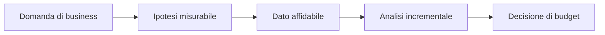

# Lifecycle orchestration multicanale

Nello stesso pomeriggio un cliente riceve una welcome email, una push, un SMS e un retargeting. Ogni canale insegue il proprio obiettivo, ma per chi sta dall'altra parte il risultato è rumore confuso e fastidioso. La lifecycle orchestration multicanale serve proprio a coordinare messaggi, priorità e pause lungo il ciclo di vita del cliente, in modo che quella confusione diventi un'esperienza coerente e personalizzata invece di una raffica scollegata di notifiche.

## Il problema da risolvere

Il lavoro concreto è trasformare budget, canali, creatività e audience in decisioni misurabili, senza confondere volume, attribuzione e incrementalità. Non è un concetto astratto, è uno strumento operativo: capire quale decisione migliora quando applichiamo dati affidabili con una soglia di errore dichiarata. Senza questo legame la conoscenza resta decorativa e non diventa competenza.

## Come ragionare sul problema



Il ragionamento è sequenziale. Prima si formula la domanda, poi la si traduce in unità osservabili, si valuta la qualità del dato e solo alla fine si decide. Saltare un passaggio produce analisi eleganti ma fragili.

| Passaggio | Domanda guida | Output atteso |
|---|---|---|
| Framing | Quale decisione deve cambiare? | Una scelta concreta, non una curiosità |
| Misura | Quale segnale rappresenta il fenomeno? | Metrica, fonte e granularità |
| Confronto | Rispetto a quale baseline interpreto il risultato? | Benchmark o controfattuale plausibile |
| Azione | Che cosa faccio se il segnale supera la soglia? | Decisione, owner e prossimo controllo |

## Gli elementi che tengono insieme l'orchestrazione

La lifecycle orchestration multicanale si descrive come una relazione tra unità di analisi, segnale, baseline e decisione.

| Elemento | Definizione operativa |
|---|---|
| Unità | campagna, coorte, touchpoint o segmento cliente |
| Segnale | margine incrementale, CAC payback, conversion rate corretto, lift o retention generata |
| Baseline | periodo precedente, gruppo holdout, mercato comparabile o benchmark storico |
| Decisione | spostare risorse, cambiare messaggio, fermare una tattica o scalare un esperimento |
| Rischio | confondere correlazione, qualità del dato e causalità decisionale |

La regola pratica è semplice. Una misura serve solo se riduce l'incertezza su una decisione specifica. Se non cambia una scelta è documentazione, e se cambia una scelta senza controlli diventa rischio.

## Dai silos a un'esperienza coordinata

Per anni le organizzazioni marketing sono state strutturate per canali separati, ognuno con i propri KPI e i propri strumenti. Questo approccio a silos genera esperienze incoerenti. Un cliente che ha appena comprato continua a ricevere annunci per gli stessi prodotti, e un utente che ha appena segnalato un problema riceve email del tutto fuori contesto.

L'orchestrazione sposta l'intelligenza decisionale dai singoli canali a un cervello centrale, di solito nel data warehouse. Lì si definisce una fonte unica di verità sul cliente e sulle azioni da intraprendere, con logiche contestuali che evitano sovrapposizioni e saturazione. La differenza rispetto alla semplice automazione è netta: l'automazione esegue il singolo segnale appena scatta, mentre l'orchestrazione decide quale messaggio ha la priorità, quando tacere e su quale canale parlare.

## L'architettura di un motore decisionale centralizzato

Un sistema di orchestrazione efficace poggia su uno stack dati moderno e si articola in quattro fasi.

La prima è la raccolta dei dati comportamentali. Strumenti come Segment o Snowplow raccolgono eventi in tempo reale da tutti i touchpoint, affiancati dai dati transazionali e di terze parti.

La seconda è la centralizzazione e la modellazione nel data warehouse. I dati grezzi vengono trasformati in una tabella `customer_360` che offre una visione completa e aggiornata del cliente.

La terza è il motore decisionale vero e proprio. Una vista SQL centralizza la logica di business e decide l'azione migliore per ogni cliente, di solito con strutture `CASE WHEN` che definiscono priorità e canali. La tabella seguente mostra come potrebbe apparire questa logica.

| Priorità | Condizione | Azione | Canale | Offerta |
|---|---|---|---|---|
| 1 | Cliente a rischio churn alto | Winback | Email | Sconto 25% |
| 2 | Abbandono carrello recente e valore >50€ | Promemoria carrello | Push | Spedizione gratuita |
| 3 | Nuovo utente senza acquisto | Nudge onboarding | Email | Tour guidato |
| 4 | NPS alto recente | Richiesta recensione | In-App | - |
| 5 | Cliente fedele recente | Anteprima esclusiva | Email | Nuova collezione |

La quarta fase è l'attivazione tramite Reverse ETL. Strumenti come Hightouch sincronizzano le audience e le azioni verso le piattaforme operative, chiudendo il ciclo che va dal dato all'azione.

## Un caso da costruire

Immagina un team growth che deve decidere se aumentare il budget su un canale con CPA basso ma vendite marginali deboli. Applicando la lifecycle orchestration, costruisce una lettura articolata su tre colonne: evidenza, interpretazione prudente e decisione conseguente.

| Evidenza | Interpretazione prudente | Decisione |
|---|---|---|
| Segnale positivo ma non isolato | Fenomeno esiste, ma causa incerta | Cercare baseline o holdout |
| Segmento con risposta diversa | Effetto medio nasconde eterogeneità | Analizzare sottogruppi |
| Costo operativo crescente | Valutare sul margine | Applicare soglie economiche |

## Esercizi di laboratorio

Al livello base, scrivi in cinque righe una decisione reale collegata alla lifecycle orchestration, indicando obiettivo, metrica primaria, baseline, rischio principale e azione prevista.

Al livello intermedio, costruisci una tabella con almeno tre segmenti o scenari e per ciascuno annota il segnale, una possibile spiegazione alternativa e il controllo necessario.

Al livello research grade, disegna un piano di validazione completo con ipotesi, dati necessari, criterio di esclusione, soglia decisionale e controllo post decisione. Trasforma poi l'esercizio in un memo decisionale che dichiara assunzioni, limiti, criterio di stop e controllo successivo, e specifica cosa ti farebbe cambiare idea.

Per i dati puoi usare export campagne, costi media, eventi web e app, CRM, transazioni, survey brand e log di consenso. In mancanza di dati reali, genera un dataset sintetico con almeno 200 righe, una colonna temporale, una di segmento, una metrica di outcome e una di esposizione.

## Gli errori tipici da evitare

L'errore più comune è trattare la lifecycle orchestration come una definizione da ricordare invece che come un protocollo decisionale. Succede quando si presenta una metrica senza baseline, un grafico senza ipotesi o una raccomandazione senza il costo dell'errore. C'è poi un secondo errore frequente: trattare il risultato come una verità generale invece che come evidenza valida solo nelle condizioni in cui è stata raccolta. Prima di agire conviene sempre controllare baseline, assunzioni e costo dell'errore.

Un controllo utile è chiedersi: "Se questo risultato fosse falso o instabile, quale decisione sbaglierei?". Se la risposta non è chiara, la lezione non è stata applicata davvero.

## Quiz e checkpoint

1. Quale decisione concreta questa lezione dovrebbe migliorare?
2. Quale baseline rende interpretabile il risultato?
3. Quale assunzione, se sbagliata, cambierebbe la conclusione?
4. Quale controllo minimo useresti prima di presentare la raccomandazione?

## Riepilogo

La lifecycle orchestration multicanale cambia il modo di lavorare rispetto all'automazione tradizionale basata sui silos. Spostando l'intelligenza decisionale in un motore centralizzato nel data warehouse si creano esperienze coerenti e contestuali anche su grandi volumi. La tecnologia che combina raccolta eventi, modellazione dei dati e attivazione tramite Reverse ETL è la base, ma il risultato dipende dalle logiche di business e da una misura rigorosa dell'impatto incrementale con gruppi di controllo. Aziende come Stripe e Revolut usano questa disciplina proprio per decidere meglio quando i dati sono incerti.

## Problema reale

Questo concetto si applica quando lavori con dataset reali e hai bisogno di una struttura chiara per ragionare su Lifecycle orchestration multicanale. Il problema tipico è non avere un framework condiviso tra il team per valutare la soluzione, con il risultato che ogni analisi parte da presupposti diversi.

**Quando lo incontrerai:**
- Quando presenti un risultato e qualcuno chiede "ma come sei arrivato a questo numero?"
- Quando il risultato di una query cambia radicalmente cambiando un filtro
- Quando il modello che hai costruito funziona sui dati di test ma non su quelli di produzione

## Modello concettuale

Il Lifecycle orchestration multicanale si definisce attraverso tre dimensioni:

1. **Struttura**: come sono organizzati i dati o il processo
2. **Logica**: quale relazione causa-effetto governa il comportamento
3. **Misura**: quale metrica usi per valutare il risultato

Questo modello ti permette di scomporre qualsiasi istanza del problema nelle sue parti verificabili.

## Formalizzazione rigorosa

```sql
-- TODO: aggiungi la formalizzazione specifica per Lifecycle orchestration multicanale
-- Pattern per avanzato:

SELECT
    /* indica qui la tua metrica principale */
FROM
    /* indica qui la sorgente dati */
WHERE
    /* indica qui i filtri */
GROUP BY
    /* indica qui le dimensioni di raggruppamento */
```

**Principio guida:** verifica sempre che la somma delle parti sia uguale al totale.

## Esempio o caso studio

**Caso tipico (livello avanzato):**

Immaginiamo un team marketing che deve misurare la retention a 30 giorni. L'errore più comune è calcolarla come `COUNT(DISTINCT user_id)` senza filtrare per data di attivazione, includendo utenti che non hanno ancora avuto 30 giorni di tempo. La versione corretta filtra prima la cohort di attivazione e poi applica il calcolo.

```sql
WITH cohort AS (
    SELECT
        user_id,
        MIN(event_date) AS activation_date
    FROM events
    GROUP BY user_id
),
retention AS (
    SELECT
        c.activation_date,
        COUNT(DISTINCT e.user_id) AS retained_users
    FROM cohort c
    JOIN events e ON c.user_id = e.user_id
        AND e.event_date >= c.activation_date
        AND e.event_date <= c.activation_date + INTERVAL '30 days'
    GROUP BY c.activation_date
)
SELECT
    activation_date,
    retained_users,
    ROUND(retention_rate * 100, 2) AS retention_pct
FROM retention;
```

## Lab / esercizio

**Esercizio — livello avanzato**

1. **Prepara l'ambiente:** carica il dataset di esempio nel tuo warehouse
2. **Applica il pattern:** scrivi la query che implementa il modello concettuale per il tuo caso
3. **Verifica:** controlla che il risultato sia coerente con le tue aspettative usando un sanity check

**Tempo stimato:** 20-30 minuti

## Errore tipico da evitare

**L'errore più comune a livello avanzato:**

Non distinguere tra una metrica calcolata su tutta la popolazione e una metrica calcolata su una sotto-popolazione specifica. Ad esempio, calcolare il tasso di conversione medio senza filtrare per canale di acquisizione porta a decisioni sbagliate perché il mix di canali cambia nel tempo.

**Come evitarlo:**
- Chiediti sempre: "rispetto a cosa sto misurando questo?"
- Verifica che il denominatore sia corretto prima di fidarti del numeratore
- Usa un gruppo di controllo quando possibile

## Quiz o checkpoint

1. Qual è la differenza tra la metrica calcolata su tutta la popolazione e quella calcolata su una cohort?
2. Scrivi il codice SQL che implementa il modello concettuale per un caso a tua scelta
3. Quale sanity check useresti per verificare che il risultato sia corretto?

---

Questa lezione si applica a Modulo 6: Marketing Analytics, Incrementality e Unit Economics: serve per capire lifecycle orchestration multicanale in modo operativo, non solo teorico. Il problema tipico è affrontare lifecycle orchestration multicanale senza un framework condiviso, con il risultato che ogni analisi parte da zero.

### Livello base

Lifecycle orchestration multicanale è il fondamento di questa competenza. A livello base, ti basta capire la domanda chiave: cosa vuoi misurare, con quali dati, e con quale margine di errore. Non servono formule complesse: serve chiarezza su cosa osservi e perché.

### Livello intermedio

A questo livello applichi lifecycle orchestration multicanale a un caso reale. Prendi un dataset, definisci l'obiettivo, e costruisci il ragionamento passo per passo. Se stai lavorando su modulo 6: marketing analytics, incrementality e unit economics, il tuo dataset ha dimensioni specifiche che determinano quali domande puoi porre.

### Livello research-grade

Approfondimento teorico di lifecycle orchestration multicanale: qui entrambi i modelli statistici, le assunzioni sottostanti, e i confini di validità. Questo livello serve quando devi difendere una scelta di fronte a stakeholder che chiedono "perché" — non solo "cosa".

### Dataset e materiali consigliati

- Un dataset reale del tuo dominio (modulo 6: marketing analytics, incrementality e unit economics) per esercitarsi
- La documentazione ufficiale dello strumento usato per questa analisi
- Le metriche di riferimento del corso per contestualizzare i risultati

### Livello base

Spiegazione intuitiva di Lifecycle orchestration multicanale:

Il concetto alla base è semplice: invece di fare affidamento sull'intuizione, usi un metodo riproducibile. A livello base, ti basta capire quale domanda stai ponendo e quali dati hai a disposizione per risponderci.

### Livello intermedio

Applicazione concreta di Lifecycle orchestration multicanale:

A questo livello applichi il concetto a un caso specifico. Ad esempio, se stai analizzando la retention, il tuo dataset ha dimensioni come data di attivazione, data di evento, e user_id. La segmentazione per canale di acquisizione ti dà insight aggiuntivi che il dato grezzo non mostra.

### Livello research-grade

Approfondimento teorico:

Per chi vuole capire il fondamento teorico, la letteratura classica include:
- Kimball, "The Data Warehouse Toolkit" — per approcci dimensionali
- McKinney, "Python for Data Analysis" — per implementazione pratica
- Aggiora i riferimenti con paper recenti specifici per il tuo dominio

### Dataset e materiali consigliati

**Per esercitarti:**
- Usa il dataset di esempio fornito nella lezione
- Per un challenge aggiuntivo, prova con dati pubblici come quelli di Kaggle

**Tool consigliati:**
- dbt Core per trasformazioni
- Metabase o Superset per visualizzazione