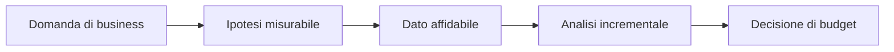

# Lifecycle orchestration multicanale


Una welcome email, una push, un SMS e un retargeting raggiungono lo stesso cliente nello stesso pomeriggio. Ogni canale ottimizza il proprio obiettivo, ma l'esperienza complessiva diventa rumore. **Lifecycle orchestration multicanale** serve a coordinare messaggi, priorità e pause lungo il ciclo di vita.

## Una scena da cui partire

Leggi la lezione come progettazione di una regia, non come somma di automazioni. La metrica giusta non è solo il click del singolo invio, ma il movimento dell'utente verso un esito utile senza saturazione o conflitti tra canali.

- **Contesto:** Quale fase del lifecycle richiede coordinamento tra canali?
- **Metodo:** Quale regola evita sovrapposizioni e pressione eccessiva?
- **Applicazione:** Come misureresti valore incrementale di una journey multicanale?

## Dal Silos alla Sinfonia: Il Paradigma dell'Orchestrazione

Per decenni, le organizzazioni di marketing sono state strutturate per canali. Esisteva il team Email, il team Social, il team Paid Acquisition, e così via. Ognuno con i propri strumenti, i propri KPI e, spesso, la propria visione del cliente. Questo approccio, definito "a silos", genera inevitabilmente esperienze utente incoerenti. Un cliente che ha appena effettuato un acquisto da 300€ potrebbe continuare a vedere per giorni annunci di retargeting per gli stessi prodotti che ha già nel suo armadio. Un utente che ha appena contattato il servizio clienti per un problema potrebbe ricevere un'email allegra che lo invita a lasciare una recensione a cinque stelle. Questi non sono errori isolati, ma sintomi di un'architettura dati e decisionale frammentata.

L'orchestrazione nasce per risolvere questo problema strutturale. Il concetto chiave è spostare l'intelligenza decisionale dai singoli strumenti di canale (come Braze, Mailchimp, o Google Ads) a un "cervello" centrale, che tipicamente risiede nel Data Warehouse (es. Snowflake, BigQuery, Redshift). Invece di avere logiche separate in ogni piattaforma, si definisce un'unica fonte di verità sul cliente e sulle azioni da intraprendere. Questo cervello non si limita ad eseguire trigger semplici (`IF` utente abbandona il carrello `THEN` invia email). Piuttosto, esegue una logica complessa e contestuale: `IF` utente abbandona il carrello `AND` il suo valore è >150€ `AND` non ha ricevuto comunicazioni marketing nelle ultime 48 ore `AND` il suo canale preferito è la notifica push `THEN` invia una notifica push con un'offerta di spedizione gratuita `ELSE IF` ... e così via.

La differenza tra automazione e orchestrazione è analoga alla differenza tra un musicista solista e un direttore d'orchestra. L'automazione permette a ogni strumento di suonare la sua parte quando scatta un segnale. L'orchestrazione assicura che tutti gli strumenti suonino in armonia, rispettando tempi, pause e dinamiche per creare una melodia coerente. Questo approccio centralizzato permette di implementare regole globali che trascendono i singoli canali, come il *frequency capping* (non contattare un utente più di X volte a settimana, indipendentemente dal canale) o la *priority hierarchy* (un messaggio di recupero churn ha sempre la precedenza su una newsletter promozionale). Il risultato è una comunicazione che percepisce il cliente come un individuo unico che attraversa un percorso, non come un insieme di ID disconnessi su piattaforme diverse.

## Architettura di un Motore Decisionale Centralizzato

Costruire un sistema di orchestrazione efficace richiede un'architettura dati moderna, comunemente basata sul Modern Data Stack. Il flusso logico dei dati e delle decisioni si articola in quattro fasi principali.

1.  **Raccolta Eventi e Dati Comportamentali**: Tutto inizia con la raccolta di dati granulari da ogni touchpoint. Strumenti come Segment o Snowplow catturano eventi in tempo reale dal sito web e dall'app mobile (es. `product_viewed`, `add_to_cart`, `session_started`). Questi dati si affiancano ai dati transazionali dal database di produzione (ordini, pagamenti) e ai dati da piattaforme di terze parti (CRM, helpdesk come Zendesk).

2.  **Centralizzazione e Modellazione nel Data Warehouse**: Tutti questi dati grezzi vengono caricati nel Data Warehouse. Qui, il team di Data Engineering e Analytics Engineering utilizza strumenti come dbt (Data Build Tool) per trasformare, pulire e modellare i dati. L'obiettivo è creare una tabella o una vista unificata, spesso chiamata `customer_360`, che rappresenti la visione più completa possibile di ogni cliente. Questa tabella contiene non solo attributi statici (nome, email), ma anche metriche dinamiche calcolate: LTV (Lifetime Value), giorni dall'ultimo acquisto, categoria di prodotto preferita, punteggio di propensione al churn, e così via.

3.  **Il Motore Decisionale (Logic Layer)**: Questo è il cuore dell'orchestrazione. Si tratta, nella sua forma più comune, di una vista SQL costruita sopra la `customer_360`. Questa vista implementa la logica di business per decidere quale azione (se presente) intraprendere per ogni cliente in un dato momento. La logica è tipicamente espressa attraverso una complessa istruzione `CASE WHEN`. Questo approccio è potente perché tutta la logica è centralizzata, versionabile tramite Git (se si usa dbt) e facilmente comprensibile da analisti e data scientist.

Ecco un esempio funzionante e più robusto di una vista per il motore decisionale, scritta in SQL per un data warehouse come Snowflake o BigQuery:

```sql
CREATE OR REPLACE VIEW marketing.customer_next_best_action AS
WITH customer_state AS (
  -- Calcola lo stato attuale di ogni cliente
  SELECT
    customer_id,
    first_name,
    email,
    days_since_signup,
    days_since_last_order,
    ltv,
    churn_risk_score,
    last_viewed_product_id,
    abandoned_cart_value,
    hours_since_cart_abandonment,
    nps_score,
    days_since_nps_submission
  FROM
    analytics.customer_360
),

action_priority AS (
  -- Definisce una serie di possibili azioni e la loro priorità (1 = massima)
  SELECT
    *,
    CASE
      -- PRIORITÀ 1: Recupero Churn (la più critica)
      WHEN days_since_last_order > 60 AND churn_risk_score > 0.75 THEN
        STRUCT('winback_high_value' AS action_name, 1 AS priority, 'email' AS channel, '25% discount' AS offer)
      
      -- PRIORITÀ 2: Abbandono Carrello Recente
      WHEN hours_since_cart_abandonment BETWEEN 2 AND 24 AND abandoned_cart_value > 50 THEN
        STRUCT('cart_abandonment_reminder' AS action_name, 2 AS priority, 'push' AS channel, 'free shipping' AS offer)

      -- PRIORITÀ 3: Attivazione Nuovi Utenti
      WHEN days_since_signup BETWEEN 3 AND 5 AND days_since_last_order IS NULL THEN
        STRUCT('onboarding_nudge' AS action_name, 3 AS priority, 'email' AS channel, 'guided tour' AS offer)

      -- PRIORITÀ 4: Richiesta di Recensione
      WHEN nps_score >= 9 AND days_since_nps_submission BETWEEN 2 AND 4 THEN
        STRUCT('ask_for_review' AS action_name, 4 AS priority, 'in_app' AS channel, NULL AS offer)

      -- PRIORITÀ 5: Engagement Utenti Fedeli
      WHEN ltv > 1000 AND days_since_last_order < 30 THEN
        STRUCT('loyalty_exclusive_preview' AS action_name, 5 AS priority, 'email' AS channel, 'new collection' AS offer)

      ELSE
        STRUCT('no_action' AS action_name, 99 AS priority, NULL AS channel, NULL AS offer)
    END AS recommended_action
  FROM
    customer_state
),

final_selection AS (
  -- Seleziona solo l'azione con la priorità più alta per ogni cliente
  SELECT
    *,
    ROW_NUMBER() OVER(PARTITION BY customer_id ORDER BY recommended_action.priority ASC) as rn
  FROM
    action_priority
)

SELECT
  customer_id,
  email,
  first_name,
  last_viewed_product_id,
  recommended_action.action_name,
  recommended_action.channel AS recommended_channel,
  recommended_action.offer AS recommended_offer
FROM
  final_selection
WHERE
  rn = 1 AND recommended_action.action_name != 'no_action';
```

4.  **Attivazione tramite Reverse ETL**: Una volta che la vista `customer_next_best_action` è pronta nel warehouse, entra in gioco il Reverse ETL (con strumenti come Hightouch o Census). Questo servizio legge i risultati della vista a intervalli regolari (es. ogni 15 minuti) e "sincronizza" le audience e i dati verso gli strumenti operativi. Per esempio, tutti i clienti con `action_name = 'winback_high_value'` vengono aggiunti a una specifica audience in Braze, e i loro attributi (come `recommended_offer`) vengono passati come campi di personalizzazione. Braze, a sua volta, è configurato per inviare una campagna predefinita a chiunque entri in quell'audience. Il ciclo è completo: dal comportamento all'insight, dall'insight alla decisione, dalla decisione all'azione.

### Mettiamoci all'opera: Laboratorio di Orchestrazione

Dopo aver compreso l'architettura, proviamo a estenderla. Questo laboratorio progressivo vi guiderà nella definizione, implementazione e misurazione di una nuova logica di orchestrazione.

*   **Esercizio 1: Definizione di un Nuovo Trigger di Engagement.**
    Immaginate di lavorare per un servizio di streaming musicale. Volete identificare gli utenti che stanno diventando "super fan" di un artista per invitarli a un evento esclusivo online. Definite i criteri comportamentali che qualificano un utente come "super fan". Siate specifici. Ad esempio:
    *   L'utente ha ascoltato più di 20 canzoni di un singolo artista negli ultimi 14 giorni.
    *   L'utente ha salvato almeno 3 canzoni di quell'artista nella sua libreria.
    *   L'utente non ha ricevuto comunicazioni promozionali negli ultimi 7 giorni.
    *   L'LTV dell'utente è superiore a 50€.

*   **Esercizio 2: Implementazione della Logica SQL.**
    Aggiungete una nuova clausola `WHEN` al blocco `action_priority` del codice SQL visto sopra per implementare la logica definita nell'Esercizio 1. Assegnate a questa azione una priorità appropriata (es. `6`, meno critica di un win-back ma più di una newsletter generica). La vostra clausola potrebbe iniziare così: `WHEN songs_by_artist_last_14d >20 AND saved_songs_by_artist >= 3 AND ... THEN STRUCT('superfan_event_invite' AS action_name, 6 AS priority, ...)`

*   **Esercizio 3: Progettazione dell'Esperimento di Misura.**
    Lanciare la campagna non basta; bisogna misurarne l'impatto. Progettate un A/B test per validare l'efficacia di questo nuovo messaggio.
    *   **Ipotesi**: L'invio di un invito esclusivo a un evento online per i "super fan" aumenterà il loro engagement a 30 giorni e il loro tasso di ritenzione.
    *   **Gruppi**: Come dividereste l'audience target (tutti i "super fan" identificati)? La soluzione standard è un 50% *Treatment* (riceve l'invito) e un 50% *Control* (non riceve nulla). Potreste anche considerare un terzo gruppo, *Treatment B*, che riceve un invito su un canale diverso (es. push vs. email).
    *   **KPI Primario**: Qual è la metrica singola che definisce il successo? Potrebbe essere il "Tasso di partecipazione all'evento" o, più a lungo termine, la "Retention a 30 giorni" del segmento.
    *   **KPI Secondari**: Quali altre metriche monitorereste? Esempi: numero di canzoni ascoltate nella settimana successiva, tasso di unsubscribe, condivisioni sui social.

## Caso di Studio Avanzato: L'Ecosistema di Engagement di Stripe

Stripe, la piattaforma di pagamenti per business online, affronta una sfida di orchestrazione B2B particolarmente complessa. Il loro "cliente" non è un singolo individuo, ma un'organizzazione con più utenti (sviluppatori, product manager, responsabili finanziari) che interagiscono con prodotti diversi (Payments, Billing, Radar, Atlas). Un'orchestrazione efficace per Stripe non può basarsi solo su segnali di un singolo utente, ma deve comprendere lo stato di salute dell'intero account.

Nel 2021, Stripe ha potenziato il suo motore di orchestrazione per guidare l'adozione di nuovi prodotti. L'obiettivo era aumentare il *revenue expansion rate* (la crescita del fatturato da clienti esistenti) suggerendo prodotti pertinenti al momento giusto. La loro architettura centralizzata, basata su un data warehouse interno, analizza segnali a livello di account. Per esempio, se un account che usa Stripe Payments inizia a registrare un aumento significativo di transazioni internazionali (es. >20% del volume da valute diverse), il sistema lo identifica come un candidato ideale per Stripe Atlas (per la costituzione di società all'estero) o per ottimizzazioni sui tassi di cambio.

La sequenza orchestrata potrebbe essere la seguente:
1.  **Trigger**: Il volume di pagamenti cross-border di un account supera una soglia predefinita per due settimane consecutive.
2.  **Azione 1 (Contesto Tecnico)**: Il sistema invia un'email tecnica allo sviluppatore registrato sull'account, evidenziando le API di Stripe per la gestione multi-valuta e linkando alla documentazione. L'obiettivo è educare e risolvere un potenziale problema tecnico.
3.  **Azione 2 (Contesto Business, 7 giorni dopo)**: Se l'account non ha ancora implementato le funzionalità multi-valuta, il sistema invia un'email al contatto business/finanziario. Questa email non parla di API, ma di "ottimizzazione dei costi di conversione" e "miglioramento dell'esperienza utente globale", con un link a un case study di un'azienda simile.
4.  **Azione 3 (Contesto Sales, 14 giorni dopo)**: Se non c'è ancora stata adozione, l'azione finale è creare un task nel CRM (Salesforce) per l'Account Manager responsabile, con una nota che riassume i segnali rilevati ("Account X mostra un forte potenziale per l'adozione di Atlas/multi-valuta. Volume cross-border aumentato del 35% MoM").

Questo approccio ha permesso a Stripe di ottenere un aumento stimato di 12 punti percentuali nell'adozione di prodotti secondari da parte di account esistenti nel primo anno di implementazione, dimostrando come l'orchestrazione possa andare oltre il marketing B2C e diventare un motore di crescita strategico anche nel B2B.

## Misurare l'Impatto: Metriche di Efficacia e Gruppi di Controllo

L'eleganza di un'architettura di orchestrazione può facilmente diventare una trappola se il suo impatto reale sul business non viene misurato con rigore scientifico. Le metriche operative, come i tassi di apertura delle email o i click-through rate, sono insufficienti. Dobbiamo misurare l'**uplift incrementale**, ovvero l'impatto causale della nostra strategia di orchestrazione. L'unico modo affidabile per farlo è attraverso l'uso sistematico di gruppi di controllo (o *holdout groups*).

Un **gruppo di controllo globale** è la pratica più pura: una piccola porzione della base utenti totale (es. 1-5%) viene permanentemente esclusa da *tutte* le comunicazioni di marketing orchestrate. Questi utenti ricevono solo messaggi transazionali (conferme d'ordine, reset password). Confrontando i KPI di business (es. LTV, retention, purchase frequency) di questo gruppo con quelli della popolazione generale (*treatment group*), si può misurare l'impatto aggregato dell'intero programma di marketing. Se dopo 6 mesi, il gruppo di controllo ha una retention del 25% e il gruppo trattato ha una retention del 30%, l'uplift incrementale del vostro programma è di 5 punti percentuali.

Oltre a quello globale, si usano **gruppi di controllo a livello di campagna**. Come visto nell'esercizio di laboratorio, ogni nuova sequenza orchestrata dovrebbe essere testata su un sottogruppo di utenti idonei, tenendone un altro come controllo. Questo permette di isolare l'impatto di una specifica iniziativa.

Le metriche chiave per valutare un sistema di orchestrazione includono:

*   **Orchestration Uplift**: La variazione percentuale di un KPI primario (es. CVR, Retention) nel gruppo di trattamento rispetto al gruppo di controllo. Questa è la metrica più importante.
*   **Cannibalizzazione di Canale**: L'orchestrazione potrebbe aumentare l'engagement su un canale (es. push) a scapito di un altro (es. email). È un problema? Non necessariamente, se il risultato complessivo è positivo. Si misura analizzando la variazione del CVR per canale tra gruppo di trattamento e di controllo.
*   **Customer Journey Velocity**: Il tempo medio che un utente impiega per passare da uno stadio del lifecycle al successivo (es. da `activated` a `first_purchase`). Un'orchestrazione efficace dovrebbe ridurre questo tempo.
*   **Message Fatigue Score**: Un indice composito che può includere tassi di unsubscribe, tassi di notifiche push disattivate e report di spam. L'obiettivo dell'orchestrazione è mantenere questo punteggio basso, massimizzando al contempo l'impatto.

Un esempio pratico viene da **Revolut**, la neobank globale. Durante il loro processo di onboarding, l'obiettivo è portare l'utente a completare la verifica dell'identità (KYC) e a ordinare una carta fisica. Invece di bombardare l'utente su tutti i canali, hanno testato sequenze orchestrate. Un test ha confrontato una sequenza Email -> Push -> In-App (Gruppo A) con una sequenza solo Email (Gruppo B) e un gruppo di controllo senza comunicazioni proattive (Gruppo C). I risultati hanno mostrato che il Gruppo A aveva un tasso di completamento del KYC del 18% superiore al Gruppo C, mentre il Gruppo B solo del 7%. Questo ha provato l'efficacia della sequenza multicanale, ma ha anche permesso di quantificarne l'esatto valore incrementale, giustificando l'investimento tecnologico.

## Riepilogo

L'orchestrazione multicanale del ciclo di vita del cliente rappresenta un salto di paradigma rispetto alla tradizionale automazione di marketing basata sui silos. Spostando l'intelligenza decisionale in un motore centralizzato, tipicamente implementato come una vista logica all'interno del data warehouse, le aziende possono creare esperienze cliente coerenti, contestuali e personalizzate su larga scala. L'architettura moderna, che combina la raccolta di eventi, la modellazione dei dati nel warehouse e l'attivazione tramite Reverse ETL, fornisce le fondamenta tecnologiche per questa strategia. Tuttavia, la tecnologia da sola non è sufficiente. Il successo dipende dalla progettazione di logiche di business sofisticate che tengano conto di priorità, frequenza e preferenze del canale, e soprattutto, da una misurazione rigorosa dell'impatto incrementale attraverso l'uso sistematico di gruppi di controllo. Casi studio come quelli di Stripe e Revolut dimostrano che

## Laboratorio ed esercizi

Metti in pratica quanto appreso con esercizi a difficoltà crescente. Lavora su un dataset reale — se non hai accesso al tuo data warehouse aziendale, usa dataset pubblici come Google Analytics Sample su BigQuery o il dataset E-Commerce di Kaggle.

**Esercizio 1 — Implementazione base.** Riproduci la query o il modello descritto nella lezione, adattandolo al tuo dataset. Verifica che i risultati siano coerenti con le metriche attese: se il totale non quadra con una query di controllo, c'è un problema di grain.

**Esercizio 2 — Estensione.** Aggiungi una dimensione di analisi non coperta nella lezione: segmenta per paese, per device, per fascia oraria o per coorte. Dove emergono pattern inattesi? Cosa implicano per le decisioni operative?

**Esercizio 3 — Automazione.** Trasforma la query in una vista o in un modello dbt con test di integrità (unique, not_null) e documenta le colonne. Se il tuo stack lo permette, configura un alert che notifichi quando la metrica esce da 2 deviazioni standard dalla media mobile.

## Errori frequenti e come evitarli

Anche gli analisti esperti cadono in trappole prevedibili quando lavorano con questo tipo di analisi. Conoscerle in anticipo riduce il tempo di debugging e aumenta la fiducia nei risultati.

**Errore 1 — Confondere correlazione e causalità.** Solo perché due metriche si muovono insieme non significa che una causi l'altra. Un A/B test o un'analisi controfattuale sono l'unico modo per stabilire causalità. Qualsiasi dashboard di correlazione va presentata con un disclaimer esplicito.

**Errore 2 — Ignorare la stagionalità.** Confrontare novembre con dicembre senza correggere per l'effetto festività produce insight fuorvianti. Usa sempre un confronto anno-su-anno o una media mobile destagionalizzata quando la metrica ha componenti stagionali note.

**Errore 3 — Non validare il grain della query.** La causa più comune di risultati errati è un grain sbagliato: un JOIN che duplica righe, un filtro applicato troppo tardi, una finestra definita sul dataset sbagliato. Prima di interpretare qualsiasi numero, verifica il conteggio delle righe a ogni step della query.

## Problema reale

Nel lavoro su marketing analytics, **Lifecycle orchestration multicanale** serve a risolvere un problema concreto: trasformare budget, canali, creativita e audience in decisioni misurabili senza confondere volume, attribuzione e incrementalita. La domanda non è se il concetto sia interessante in astratto, ma quale decisione migliora quando lo applichi con dati affidabili e con una soglia di errore esplicita.

Questa lezione va studiata come uno strumento operativo: entro la fine devi saper Comprendere il problema analitico e il contesto decisionale; Applicare esempi, metriche e controlli a casi reali. Se non riesci a collegare il concetto a una scelta reale, la conoscenza resta decorativa e non diventa competenza.

## Modello concettuale



Il modello mentale e sequenziale: prima si formula la domanda, poi si traduce in unità osservabili, quindi si valuta la qualità del dato e solo alla fine si decide. Saltare un passaggio produce analisi eleganti ma fragili.

| Passaggio | Domanda guida | Output atteso |
|---|---|---|
| Framing | Quale decisione deve cambiare? | Una scelta concreta, non una curiosità |
| Misura | Quale segnale rappresenta il fenomeno? | Metrica, fonte e granularità |
| Confronto | Rispetto a quale baseline interpreto il risultato? | Benchmark o controfattuale plausibile |
| Azione | Che cosa faccio se il segnale supera la soglia? | Decisione, owner e prossimo controllo |

## Formalizzazione rigorosa

Formalizza **Lifecycle orchestration multicanale** come una relazione tra quattro elementi: unità di analisi, segnale, baseline e decisione. Nel contesto di questa lezione l'unità principale e **campagna, coorte, touchpoint o segmento cliente**. Il segnale da osservare deve essere collegato a **margine incrementale, CAC payback, conversion rate corretto, lift o retention generata**, mentre la baseline deve essere scelta tra **periodo precedente, gruppo holdout, mercato comparabile o benchmark storico**.

Una formulazione robusta segue questa logica:

| Elemento | Definizione operativa per questa lezione |
|---|---|
| Unità | campagna, coorte, touchpoint o segmento cliente |
| Segnale | margine incrementale, CAC payback, conversion rate corretto, lift o retention generata |
| Baseline | periodo precedente, gruppo holdout, mercato comparabile o benchmark storico |
| Decisione | spostare risorse, cambiare messaggio, fermare una tattica o scalare un esperimento |
| Rischio | Confondere correlazione, qualità del dato e causalità decisionale |

La regola pratica e semplice: una misura e utile solo se riduce l'incertezza su una decisione specifica. Se non cambia una scelta, e documentazione; se cambia una scelta senza controlli, e rischio.

## Esempio o caso studio

Un team growth deve decidere se aumentare il budget su un canale che mostra CPA basso ma vendite marginali deboli. La lezione aiuta a separare il segnale utile dal rumore operativo, collegando metrica, modello mentale e decisione economica.

Applicando **Lifecycle orchestration multicanale**, il team costruisce una lettura in tre colonne: cosa sappiamo, cosa assumiamo e quale decisione prendiamo. Questo formato impedisce di presentare un numero come se fosse una conclusione autosufficiente.

| Evidenza | Interpretazione prudente | Decisione conseguente |
|---|---|---|
| Segnale positivo ma non isolato | Il fenomeno esiste, ma la causa e ancora incerta | Cercare baseline o holdout |
| Segmento con risposta diversa | L'effetto medio nasconde eterogeneita | Analizzare coorti o sottogruppi |
| Costo operativo crescente | Il risultato va valutato sul margine | Applicare soglie economiche |

## Lab / esercizio

### Livello base

Prendi una decisione reale collegata a **Lifecycle orchestration multicanale** e scrivi in cinque righe: obiettivo, metrica primaria, baseline, rischio principale e azione prevista. Non usare più di una metrica primaria.

### Livello intermedio

Costruisci una tabella con almeno tre segmenti o scenari. Per ciascuno indica segnale, possibile spiegazione alternativa e controllo necessario prima di decidere.

### Livello research-grade

Disegna un piano di validazione: ipotesi, dati necessari, criterio di esclusione, soglia decisionale e controllo post-decisione. Specifica anche che cosa ti farebbe cambiare idea.

### Dataset e materiali consigliati

Usa export campagne, costi media, eventi web o app, CRM, transazioni, survey brand e log di consenso. Se non hai dati reali, crea un dataset sintetico con 200-500 righe e almeno una colonna temporale, una colonna segmento, una metrica di outcome e una variabile di esposizione.

## Errore tipico da evitare

L'errore più frequente e trattare **Lifecycle orchestration multicanale** come una definizione da ricordare invece che come un protocollo decisionale. In pratica succede quando si presenta una metrica senza baseline, un grafico senza ipotesi, o una raccomandazione senza costo dell'errore.

Un controllo utile è chiedersi: "se questo risultato fosse falso o instabile, quale decisione sbaglierei?". Se la risposta non è chiara, la lezione non è ancora stata applicata davvero.

## Quiz o checkpoint

1. Qual è la decisione concreta che questa lezione dovrebbe migliorare?
2. Quale baseline rende interpretabile il risultato?
3. Quale assunzione, se sbagliata, cambierebbe la conclusione?
4. Quale controllo minimo useresti prima di presentare la raccomandazione?

## Riepilogo operativo

**Lifecycle orchestration multicanale** e una competenza utile quando collega concetto, dato e decisione. Studiala partendo da un problema reale, formalizza il segnale, cerca una baseline credibile, costruisci un esempio e chiudi con un controllo pratico. Categoria: Decisione. Difficoltà: advanced. Tempo stimato: 22 min.
