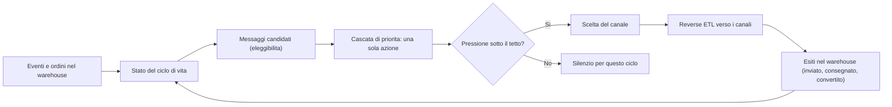

Scenario costruito con numeri di esempio: Marta compra un paio di scarpe da un negozio online alle 9 del mattino. Alle 11 riceve la email di benvenuto, alle 13 una notifica push con il codice sconto di primo acquisto, alle 15 un SMS che le ripropone le stesse scarpe con il 10% di sconto e la sera un annuncio di retargeting con il prodotto appena pagato. Ogni canale ha rispettato le proprie regole e ha raggiunto i propri indicatori. Il risultato complessivo è un cliente che ha appena speso 89 euro e riceve in un giorno quattro messaggi che sembrano ignorarla, e che nel prossimo trimestre si disiscrive a un tasso doppio rispetto a un cliente che ne riceve uno.

Il problema non è la mancanza di dati ma l'assenza di un arbitro. L'orchestrazione del ciclo di vita è lo strato decisionale che valuta tutti i messaggi candidati per un utente, ne sceglie al massimo uno oppure decide il silenzio, e lo assegna al canale con la migliore probabilità di recapito e conversione.

> **Idea chiave:** l'automazione esegue una regola per canale, l'orchestrazione sceglie una sola azione per utente tra tutte le candidate. Il silenzio è una decisione legittima, e ogni flusso si giustifica solo con un margine incrementale misurato.

## L'arbitro unico tra automazione e orchestrazione

Una piattaforma di email, una di notifiche push e un gestore di pubblici pubblicitari reagiscono ciascuna allo stesso evento con tempi propri: la email parte dopo un'ora, la notifica dopo venti minuti, il pubblico di retargeting si aggiorna a mezzanotte. Nessuna conosce le altre due. Ottimizzano ciascuna i propri indicatori, tassi di apertura, di click, di conversione per canale, e nessuna risponde del margine per utente.

L'orchestrazione sposta la decisione in un punto solo, il data warehouse, e ogni ciclo risponde a tre domande. L'utente è eleggibile adesso? Quale messaggio ha la priorità più alta tra quelli eleggibili? Quale canale offre la migliore probabilità di recapito e conversione per lui? Il silenzio, cioè nessun messaggio, è una risposta valida alla seconda domanda, e spesso quella corretta.



## Stati del ciclo di vita e regole di ingresso

Definire gli stati è un lavoro analitico prima che creativo. «Cliente a rischio» non può restare un'etichetta vaga: è chi aveva una cadenza mediana di acquisto di 40 giorni e ne ha superati 60 senza ordini, oppure chi ha un punteggio di rischio di abbandono superiore a 0,6. Ogni stato ha una regola di ingresso scritta, una di uscita e un obiettivo unico per il messaggio.

| Stato | Regola di ingresso | Obiettivo del messaggio |
| --- | --- | --- |
| Nuovo senza acquisto | registrato da meno di 14 giorni, zero ordini | Far completare il primo ordine |
| Nuovo cliente | primo ordine negli ultimi 30 giorni | Secondo acquisto e onboarding |
| Attivo | almeno un ordine negli ultimi 60 giorni | Aumentare frequenza e scontrino |
| In raffreddamento | tra 61 e 120 giorni senza ordini | Riattivare con contenuto rilevante |
| A rischio | oltre 120 giorni o rischio di abbandono alto | Offerta di rientro mirata |
| Ex cliente | oltre 365 giorni senza ordini | Riconquista solo con margine positivo |

Si parte con pochi stati misurabili e si raffina solo quando i dati mostrano risposte diverse ai messaggi. Moltiplicare gli stati oltre la capacità del team di scrivere contenuti per ciascuno produce una matrice ingestibile in cui metà delle celle resta vuota. Il margine atteso per utente entra come vincolo di eleggibilità: un cliente con alto margine storico giustifica un canale costoso come l'SMS, uno con scontrino basso no.

## La cascata di priorità in SQL

L'intelligenza risiede nel warehouse, non dentro gli strumenti di invio. La vista è una cascata di `CASE WHEN` ordinata per priorità commerciale: la prima condizione vera vince e le altre vengono scartate. Il cliente riceve così al massimo un messaggio per ciclo, anche se risulta eleggibile per cinque campagne.

```sql
-- Una sola azione candidata e un solo canale per utente e per ciclo
SELECT
  c.user_id,
  CASE
    WHEN c.ordini_ultime_24h > 0 THEN 'nessuna_azione'          -- gia convertito: soppresso
    WHEN c.pressione_7g >= 3 THEN 'nessuna_azione'              -- tetto di frequenza raggiunto
    WHEN c.carrello_abbandonato_euro > 50
     AND c.ore_da_abbandono < 24 THEN 'recupero_carrello'
    WHEN c.giorni_da_ultimo_acquisto BETWEEN 45 AND 90
     AND c.probabilita_abbandono > 0.6 THEN 'riconquista_25'
    WHEN c.stato = 'nuovo_senza_acquisto' THEN 'onboarding_nudge'
    ELSE 'nessuna_azione'                                       -- il silenzio e una decisione
  END AS azione_candidata,
  CASE
    WHEN c.consenso_email AND NOT c.email_bounced THEN 'email'
    WHEN c.consenso_push AND c.push_attivo THEN 'push'
    ELSE 'nessun_canale'
  END AS canale_proposto
FROM customer_360 AS c;
```

Le prime due condizioni valgono quanto il resto: sopprimere chi ha appena convertito e chi ha raggiunto il tetto di pressione elimina gli errori più visibili, come quello di Marta. La vista deve quindi conoscere la pressione recente, cioè quanti messaggi commerciali l'utente ha ricevuto negli ultimi 7 e 30 giorni su tutti i canali. Senza queste colonne il motore decide alla cieca e ripete l'errore dei silos.

Ogni messaggio ha un rango scritto: prima i messaggi di servizio e transazionali, poi i recuperi ad alto intento come il carrello abbandonato, poi onboarding e riconquista, infine i contenuti editoriali e le campagne batch. Quando due messaggi collidono vince il rango più alto, e il perdente slitta al ciclo successivo o decade. Senza un ordine scritto la collisione si risolve nel modo peggiore: partono entrambi.

## Il tetto di frequenza: la pressione si misura per utente

La pressione è una proprietà dell'utente, non della campagna. Una campagna con tasso di disiscrizione dello 0,3% sembra innocua, ma la stessa persona può ricevere cinque campagne, ognuna innocua per conto proprio. Il tetto si fissa guardando come cambia la disiscrizione con il numero di messaggi commerciali settimanali. In un esempio con numeri di esempio su 200.000 utenti il tasso di disiscrizione mensile è 0,4% con un messaggio a settimana, 0,6% con due, 0,9% con tre e 1,5% con quattro o più.

Il passaggio da due a tre messaggi settimanali aumenta di 0,3 punti il tasso di uscita, cioè 600 persone su 200.000 per ogni mese. Se un cliente attivo vale 85 euro di margine annuo, il costo di quelle uscite è 600 × 85 = 51.000 euro all'anno. Il terzo messaggio deve generare più di 51.000 euro di margine incrementale per giustificarsi. La stessa logica vale per i canali: un tetto globale per utente, con sottotetti per canale, evita che si sommino tre soglie locali.

## Misurare l'effetto: holdout e margine per mille invii

Il rischio più costoso è scambiare l'attribuzione per causalità. Un flusso di recupero carrello che converte al 12% sembra un successo, ma una parte di quegli utenti avrebbe comprato comunque. Lo strumento di misura è l'holdout: una quota stabile del 5-10% degli eleggibili esclusa dall'azione. L'assegnazione deve essere deterministica e stabile, così lo stesso utente resta nel controllo per tutta la durata del flusso.

```sql
-- Assegnazione stabile al gruppo di controllo e lift del flusso (BigQuery)
WITH eleggibili AS (
  SELECT user_id,
         MOD(ABS(FARM_FINGERPRINT(CONCAT(user_id, 'recupero_carrello_v1'))), 100) < 10 AS holdout
  FROM customer_360
  WHERE azione_candidata = 'recupero_carrello'
)
SELECT
  e.holdout,
  COUNT(*) AS utenti,
  COUNTIF(o.user_id IS NOT NULL) AS convertiti,
  SAFE_DIVIDE(COUNTIF(o.user_id IS NOT NULL), COUNT(*)) AS tasso_conversione   -- confronto trattati e controllo
FROM eleggibili AS e
LEFT JOIN ordini_7g AS o USING (user_id)
GROUP BY e.holdout;
```

Calcoliamo un esempio completo. Un flusso di recupero carrello ha 20.000 utenti eleggibili. Il 10% va in holdout, quindi 2.000 utenti, e 18.000 ricevono il messaggio. I trattati convertono al 12% (2.160 ordini), il controllo al 9% (180 ordini). Il lift relativo è (0,12 − 0,09) / 0,09 = 33%, pari a 3 punti assoluti. Se i 18.000 trattati avessero convertito come il controllo avremmo avuto 18.000 × 9% = 1.620 ordini: gli ordini incrementali sono 2.160 − 1.620 = 540.

Il margine di un ordine prima dello sconto è 42 euro e il codice offre 7 euro di sconto, quindi l'ordine incrementale rende 35 euro. Il margine incrementale lordo è 540 × 35 = 18.900 euro. Lo sconto va però pagato anche ai 1.620 utenti che avrebbero comprato comunque: 1.620 × 7 = 11.340 euro. Con un costo di invio di 0,012 euro per messaggio, 18.000 × 0,012 = 216 euro, il risultato netto è 18.900 − 11.340 − 216 = 7.344 euro. Per mille invii sono 7.344 / 18 = 408 euro. Il flusso resta acceso. Con uno sconto di 15 euro lo stesso flusso avrebbe un costo da sconto di 1.620 × 15 = 24.300 euro e un margine per ordine incrementale di 27 euro (540 × 27 = 14.580): il risultato diventa negativo e lo spegneremmo.

L'holdout resta attivo su ogni flusso principale, non solo nei test iniziali. Un onboarding con lift del 40% al lancio può scendere al 10% dopo sei mesi, quando il pubblico si è saturato, senza che nessun cruscotto lo segnali.

## Attivazione, freschezza e il caso Spotify

Una decisione che rimane nel warehouse non sposta fatturato. Gli strumenti di Reverse ETL sincronizzano audience e azioni verso fornitori di email, notifiche, pubblici pubblicitari e CRM. I trigger ad alto intento sincronizzano ogni 15-30 minuti, il resto in batch orario o giornaliero. Ogni input critico porta un controllo di freschezza che blocca la sincronizzazione oltre tolleranza: meglio saltare un ciclo che inviare a decine di migliaia di persone su dati scaduti.

Spotify gestisce uno dei cicli di vita più osservabili dell'abbonamento digitale, con utenti gratuiti, in prova, abbonati e usciti raggiunti in modo coordinato da email, notifiche e messaggi in app. Per il quarto trimestre 2023, comunicato a febbraio 2024, la società dichiara 602 milioni di utenti attivi mensili e 236 milioni di abbonati premium. A questa scala la sovraesposizione è un costo misurabile in disiscrizioni, e ogni messaggio compete per un budget di attenzione finito. Priorità scritte, soppressione dei già convertiti e tetti di frequenza valgono più di un nuovo canale.

## Errori tipici nell'orchestrazione

### Aggiungere un canale senza arbitro

Il sintomo è un aumento di fatturato attribuito accompagnato da più disiscrizioni e da cali di apertura. Succede perché il nuovo canale parte con le sue regole e si somma agli altri, quindi la pressione cresce senza che nessuno la misuri. Il rimedio è inserire ogni nuovo canale come candidato nella cascata, con rango e sottotetto, mai come automazione indipendente.

### Un holdout solo nel test iniziale

Il sintomo è un lift che al lancio valeva 40% e a sei mesi non è più verificabile. Il controllo sparisce a fine test perché sembra uno spreco, ma il flusso invecchia, il pubblico cambia e nessuno sa se funzioni ancora. Il rimedio è mantenere il 5-10% di holdout permanente e rileggere il margine per mille invii ogni trimestre.

### Partire con troppi stati e troppi flussi

Il sintomo è un progetto di sei stati, dieci flussi e tre canali che non va mai in produzione. Il rimedio è iniziare da un solo flusso ad alto intento, recupero carrello o onboarding, con holdout dal primo giorno, una tabella `customer_360` minima e due o tre regole. Le campagne batch si spostano poi nel motore come messaggi a priorità bassa, inviate solo a chi non ha ricevuto altro in settimana.

## Verifica sul motore di orchestrazione

1. Un flusso ha 10.000 eleggibili, 10% di holdout. I trattati convertono al 15% e il controllo al 12%. Quanti sono gli ordini incrementali?

<details>
<summary>Mostra risposta</summary>

I trattati sono 9.000 e generano 1.350 ordini. Con il tasso del controllo ne avremmo avuti 9.000 × 12% = 1.080. Gli ordini incrementali sono 1.350 − 1.080 = 270, pari a un lift relativo del 25% (3 punti su 12).

</details>

2. Un messaggio promozionale e un recupero carrello sono entrambi eleggibili per lo stesso utente. Quale parte e perché?

<details>
<summary>Mostra risposta</summary>

Parte il recupero carrello, che ha rango più alto perché legato a un intento recente di acquisto. Il messaggio promozionale slitta al ciclo successivo, a meno che nel frattempo l'utente non converta, e in quel caso decade.

</details>

3. Passare da due a tre messaggi settimanali porta la disiscrizione dallo 0,6% allo 0,9% su 100.000 utenti, con margine annuo di 85 euro per cliente. Quanto costa l'aumento di frequenza?

<details>
<summary>Mostra risposta</summary>

L'uscita aggiuntiva è 0,3% di 100.000, cioè 300 persone. Il margine perso è 300 × 85 = 25.500 euro all'anno. Il terzo messaggio deve generare più di 25.500 euro di margine incrementale per giustificarsi.

</details>

4. Perché la pressione si misura per utente e non per campagna?

<details>
<summary>Mostra risposta</summary>

Perché l'utente reagisce alla somma dei messaggi che riceve, non a ciascuna campagna. Cinque campagne con tasso di disiscrizione basso possono sommarsi in un carico alto sulla stessa persona. Un contatore unificato con soglia globale intercetta quello che le soglie locali non vedono.

</details>
