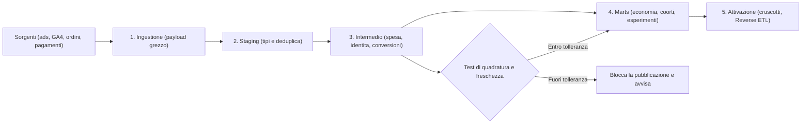

Caso ricostruito con numeri di esempio: il lunedì mattina il responsabile performance di un negozio online apre tre cruscotti e trova tre verità. Meta dichiara 412 conversioni per la settimana appena chiusa, GA4 ne attribuisce 289 e il backend degli ordini ne fattura 247. Nessuno ha letto male: ogni sistema ha misurato uno stadio diverso della stessa storia, con finestre, definizioni e ritardi propri. Discutere quale sia il numero giusto occupa la prima ora della riunione e non produce nessuna decisione di budget.

Una pipeline dati per il marketing risolve questo problema in modo strutturale. È il sistema versionato che porta spesa, eventi e ordini dalle sorgenti ai marts decisionali e dichiara, per ogni numero, da dove viene, quanto è fresco e con quali limiti si può confrontare con altri.

> **Idea chiave:** i numeri del marketing non coincidono perché misurano oggetti diversi. La pipeline non li forza a coincidere: li rende confrontabili esplicitando definizione, fuso orario, valuta e anzianità di ciascuno, con controlli automatici di quadratura.

## Perché le fonti non tornano mai

Le versioni concorrenti dello stesso indicatore sono la norma e hanno quattro cause strutturali. La prima è la frammentazione delle sorgenti, ciascuna con il proprio orologio: l'interfaccia di Meta può stornare conversioni fino a 28 giorni dopo l'evento, GA4 consolida i dati con ore di ritardo e il gestore dei pagamenti regola i rimborsi giorni più tardi. La seconda è la divergenza semantica: «conversione» in Google Ads, in GA4 e nel backend sono tre definizioni legittime con tre totali diversi. La terza è l'identità frammentata, perché la stessa persona conta come tre utenti in tre sistemi. La quarta è il cambiamento silenzioso degli schemi: un campo `spend` che diventa `ad_spend` rompe un join e gonfia o dimezza i totali senza segnalare errori.

Nel caso d'apertura il rapporto tra le conversioni dichiarate da Meta e gli ordini del backend è 412 / 247 = 1,67, mentre per GA4 è 289 / 247 = 1,17. Meta conta anche i view-through, cioè conversioni di chi ha visto un annuncio senza cliccare, mentre GA4 in last click vede soprattutto sessioni con tracciamento riuscito. La differenza tra i tre numeri misura quanto un canale vive di domanda già presente, e perciò ha un valore informativo, purché i tre numeri convivano nello stesso modello dati.

| Sorgente | Ritardo tipico del dato | Cosa può cambiare dopo |
| --- | --- | --- |
| Piattaforme pubblicitarie | spesa in poche ore | conversioni stornate fino a 28 giorni |
| GA4 | ore o un giorno | attribuzioni ricalcolate, campionamento |
| Backend ordini | tempo reale | annullamenti e resi |
| Gestore pagamenti | giorni | rimborsi e contestazioni |

## I cinque strati della pipeline

Saltare uno strato sposta il problema più avanti, dove costa di più. I cinque strati si leggono dall'origine all'uso: ingestione, staging, intermedio, marts e attivazione.

L'ingestione conserva il payload originale così com'è, con la data di arrivo. Quando Meta storna una conversione di tre settimane prima, solo il dato grezzo permette di ricostruire che cosa sapevamo e quando lo sapevamo. Lo staging rinomina, tipizza e deduplica senza applicare logica di business. Lo strato intermedio unifica: una tabella di spesa con un vocabolario unico, una tabella di identità, una tabella di conversioni con la definizione scelta. I marts sono tabelle larghe e denormalizzate, pensate per rispondere in secondi senza join complessi. L'attivazione riporta i risultati verso i canali tramite Reverse ETL, ogni destinazione con il proprio SLA: il cruscotto tollera sei ore di ritardo, un pubblico di retargeting da un milione di euro al mese no.



## Spesa unificata: valuta, fuso e quadratura

Il cuore della pipeline è la tabella di spesa unificata. Google chiama `cost` ciò che Meta chiama `spend` e TikTok `stat_cost`: la normalizzazione impone un dizionario unico. Un'azienda con account in euro, dollari e sterline non può sommare importi nativi. Ogni riga si converte al tasso del giorno di spesa, da una tabella di cambi versionata, conservando sia l'importo originale sia quello convertito. Così un audit condotto sei mesi dopo usa i cambi di sei mesi prima e riproduce gli stessi totali. Il giorno si fissa in UTC per evitare che la stessa spesa cada in due date diverse a seconda del fuso dell'account.

```sql
-- Normalizzazione giornaliera della spesa Meta in euro (BigQuery)
SELECT
  CAST(raw.date_start AS DATE) AS date_day,                         -- giorno fissato in UTC
  raw.campaign_id,
  SUM(CAST(raw.spend AS NUMERIC)) AS spend_usd,
  SUM(CAST(raw.spend AS NUMERIC)) * ANY_VALUE(fx.rate_to_eur) AS spend_eur,   -- cambio del giorno
  SUM(CAST(raw.inline_link_clicks AS INT64)) AS clicks,
  'meta' AS platform
FROM stg_meta_ads__insights AS raw
LEFT JOIN seed_fx_rates AS fx
  ON fx.date_day = CAST(raw.date_start AS DATE) AND fx.currency = 'USD'
GROUP BY date_day, raw.campaign_id;
```

Un esempio svolto su un giorno. Meta spende 10.000 dollari con cambio 0,92 euro per dollaro, quindi 10.000 × 0,92 = 9.200 euro. Google spende 6.000 euro nativi e TikTok 2.000 sterline con cambio 1,17, cioè 2.340 euro. La spesa unificata è 9.200 + 6.000 + 2.340 = 17.540 euro. Il test di quadratura confronta il totale unificato per piattaforma con quello dichiarato dalla piattaforma nella propria valuta di fatturazione. Per Meta il totale nativo è 9.230 euro, scostamento (9.230 − 9.200) / 9.230 = 0,33%, dentro la tolleranza del 2%. Per Google il totale nativo è 6.210 euro e il nostro 6.000: lo scostamento è 210 / 6.210 = 3,38%, oltre soglia. La pubblicazione del mart si blocca e parte un avviso, perché il difetto probabile è una campagna mancante o un'estrazione incompleta.

```sql
-- Quadratura: spesa unificata contro totale nativo, tolleranza del 2%
WITH q AS (
  SELECT date_day, platform,
         SUM(spend_eur) AS unified_spend,
         MAX(native_spend_eur) AS native_spend
  FROM int_marketing_spend_daily
  GROUP BY date_day, platform
)
SELECT *, ABS(unified_spend - native_spend) / NULLIF(native_spend, 0) AS gap_ratio
FROM q
WHERE ABS(unified_spend - native_spend) / NULLIF(native_spend, 0) > 0.02;   -- sopra soglia: indaga prima di pubblicare
```

## Identità e attribuzione dichiarate

La risoluzione dell'identità risponde alla domanda su quante persone reali ci siano dietro gli eventi. È deterministica dove esiste un login e probabilistica, con finestre di osservazione dichiarate, dove manca. Il tasso di matching è la quota di conversioni del backend collegabile a un click noto. Se su 247 ordini ne colleghiamo 173, il tasso è 173 / 247 = 70,0%. Un negozio con acquisti autenticati supera facilmente il 70%, un sito senza login può fermarsi al 30%. Entrambi i valori sono accettabili, purché dichiarati accanto a ogni stima basata sul collegamento.

L'attribuzione risponde a quale tocco riceva il merito. Ogni modello è una convenzione contabile e la pipeline ne calcola almeno due in parallelo, per esempio last click e position based, mostrando lo scostamento. Quando due modelli concordano sul valore di un canale la conclusione è solida, quando divergono il canale merita un esperimento. Quale modello sia quello ufficiale resta una decisione umana, documentata e datata.

## Freschezza, riconciliazione e osservabilità

Ogni tabella finale porta un contratto di freschezza: quando la sorgente ha spedito il dato, quando è stato trasformato e fino a che giorno è completo. Il giorno corrente è sempre parziale, ieri si consolida alle otto di mattina e il confronto settimana su settimana parte da dati con almeno 72 ore di anzianità. Ogni mattina un job riconcilia tre totali: la spesa unificata contro le interfacce native, gli eventi web contro gli ordini del backend, gli ordini del backend contro il gestore dei pagamenti. Ciò che esce dalla tolleranza blocca la pubblicazione e genera un avviso, non un numero silenzioso.

La data di competenza è la regola che tiene insieme numeratore e denominatore del ROAS. Un ordine del 3 marzo attribuito il 5 marzo appartiene al 3 marzo, e si divide per la spesa del 3 marzo, non per quella del giorno di estrazione. Con questa regola il ROAS di una settimana si ricalcola quando arrivano gli storni e non resta congelato su un valore provvisorio.

## Dal dato alla decisione: payback corretto per margine

I marts sono il punto in cui la pipeline smette di descrivere il passato e orienta il budget. Tre tabelle coprono la maggior parte delle domande: il mart di economia per canale, con CAC, ROAS e margine di contribuzione per riga, il mart di coorte, con la spesa dei clienti a 1, 3 e 12 mesi, e il mart degli esperimenti, con holdout, lift e intervallo. La metrica che li lega è il payback corretto per margine: `CAC / (ARPU mensile × margine di contribuzione)`.

Confrontiamo due canali. Il primo ha CPA di 25 euro e porta clienti con ricavo medio mensile (ARPU) di 8 euro e margine del 60%: il payback è 25 / (8 × 0,60) = 25 / 4,8 = 5,2 mesi. Il secondo ha CPA di 40 euro, ARPU di 20 euro e margine del 70%: 40 / (20 × 0,70) = 40 / 14 = 2,9 mesi. Il canale più costoso restituisce il budget quasi due volte più in fretta. Ordinare i canali per CPA avrebbe premiato il primo. Quando si apre un canale nuovo o il mix cambia in modo marcato, il payback va completato con un'incrementalità misurata con holdout o con geo-esperimenti.

Amazon ha chiuso il 2023 con 46,9 miliardi di dollari di ricavi pubblicitari, comunicati a febbraio 2024, e inserzionisti e analisti confrontano quei numeri con quelli di Google e Meta. A questa scala la riconciliazione pesa: finestre di attribuzione diverse, storni tardivi e rimborsi spostano i totali di milioni tra un rapporto e l'altro. Da automatizzare senza esitazione sono ingestione, normalizzazione, test e riconciliazioni quotidiane. Da tenere umani sono il modello di attribuzione ufficiale, la soglia di payback e la decisione di scalare un canale su un test.

## Errori tipici di architettura

### Buttare il dato grezzo dopo la trasformazione

Il sintomo è l'impossibilità di spiegare perché un numero di tre settimane fa sia cambiato. Si scarta il grezzo per risparmiare spazio, ma senza di esso ogni storno diventa una discrepanza inspiegabile. Il rimedio è conservare il payload originale con la data di arrivo, anche su archiviazione economica.

### Sommare spesa in valute diverse o a date diverse

Il sintomo è un ROAS che cambia di qualche punto quando cambia il cambio di riferimento o il fuso dell'account. Succede perché si converte tutto al tasso di oggi oppure si assegna la stessa spesa a due giorni diversi. Il rimedio è la tabella di cambi versionata al giorno di spesa, il fuso UTC e il test di quadratura sopra il 2%.

### Decidere il budget sul CPA di piattaforma

Il sintomo è un portafoglio ordinato per CPA che scivola verso canali con clienti poco redditizi. Il CPA di piattaforma descrive soltanto l'asta e non il valore dei clienti. Il rimedio è decidere sul payback corretto per margine e per coorte, con un contratto di freschezza esposto accanto al numero.

## Verifica sulla pipeline

1. Una piattaforma dichiara 5.000 euro di spesa e la tabella unificata ne contiene 4.880. Con tolleranza del 2% si pubblica il mart?

<details>
<summary>Mostra risposta</summary>

Lo scostamento è (5.000 − 4.880) / 5.000 = 2,4%, superiore al 2%. Il mart non si pubblica: si indaga su campagne mancanti, fuso orario o estrazione incompleta e si rilancia il controllo.

</details>

2. Con quale cambio converti 3.000 sterline spese il 12 marzo, se il cambio del 12 marzo è 1,16 e quello odierno è 1,20?

<details>
<summary>Mostra risposta</summary>

Si usa il cambio del giorno di spesa: 3.000 × 1,16 = 3.480 euro. Con il cambio odierno otterremmo 3.600 euro, un valore diverso che renderebbe non riproducibile un audit sulle date passate.

</details>

3. CAC 60 euro, ARPU mensile 15 euro, margine di contribuzione 50%. Quanto vale il payback?

<details>
<summary>Mostra risposta</summary>

Il margine mensile per cliente è 15 × 0,50 = 7,50 euro. Il payback è 60 / 7,50 = 8 mesi. Senza correzione per il margine sembrerebbero 4 mesi, un errore di un fattore due.

</details>

4. A quale data appartiene un ordine del 3 marzo attribuito il 5 marzo, e perché?

<details>
<summary>Mostra risposta</summary>

Appartiene al 3 marzo, la data di competenza. Numeratore e denominatore del ROAS devono riferirsi alla stessa data, altrimenti un ordine verrebbe confrontato con la spesa di un giorno diverso e il rapporto cambierebbe con i ritardi di attribuzione.

</details>
