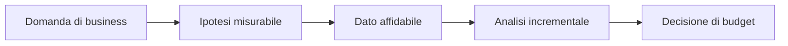

# Martech dashboard e analytics operativi

Un dashboard con decine di KPI rischia di diventare solo rumore visivo se non è progettato per supportare decisioni concrete. Un buon dashboard non mostra tutto. Distingue la salute del sistema dalle anomalie, e le priorità dalle azioni ricorrenti. È questo il cuore delle dashboard operative del marketing: organizzare la superficie di lavoro per ridurre l'incertezza nelle scelte di ogni giorno, non per riempire uno schermo di grafici.

## Il problema da risolvere

Il problema centrale è trasformare dati sparsi tra budget, canali, creatività e audience in decisioni misurabili. Non basta sapere se un numero è salito o sceso. Serve capire quale decisione cambia grazie a quell'informazione. Senza una soglia esplicita di errore e una baseline di confronto, i dati restano decorativi invece che operativi.

## Come ragionare sul problema

Il ragionamento è sequenziale. Si parte da una domanda di business concreta, la si traduce in un'ipotesi misurabile, si verifica la qualità e l'affidabilità del dato, si conduce un'analisi incrementale e si arriva a una decisione di budget o di strategia.

| Passaggio | Domanda guida | Output atteso |
|---|---|---|
| Framing | Quale decisione deve cambiare? | Scelta concreta, non curiosità |
| Misura | Quale segnale rappresenta il fenomeno? | Metrica, fonte, granularità |
| Confronto | Rispetto a quale baseline interpreto il risultato? | Benchmark o controfattuale |
| Azione | Che cosa faccio se il segnale supera la soglia? | Decisione, owner, prossimo controllo |

## Gli elementi che tengono insieme l'analisi

La dashboard e l'analisi operativa poggiano su quattro elementi che conviene tenere espliciti.

| Elemento | Definizione operativa |
|---|---|
| Unità di analisi | Campagna, coorte, touchpoint o segmento cliente |
| Segnale | Margine incrementale, CAC payback, conversion rate corretto, lift o retention generata |
| Baseline | Periodo precedente, gruppo holdout, mercato comparabile o benchmark storico |
| Decisione | Spostare risorse, cambiare messaggio, fermare tattica o scalare esperimento |

Una metrica serve solo se riduce l'incertezza su una decisione precisa. Senza questo legame resta documentazione, oppure diventa rischio.

## Un caso da costruire

Immagina un team growth che valuta se aumentare il budget su un canale con CPA basso ma vendite marginali deboli. Con questo approccio costruisce una lettura articolata invece di fermarsi al numero.

| Evidenza | Interpretazione prudente | Decisione |
|---|---|---|
| Segnale positivo ma isolato | Fenomeno reale ma causa incerta | Cercare baseline o holdout |
| Risposta segmentata | Effetto medio nasconde eterogeneità | Analizzare coorti o sottogruppi |
| Costo operativo crescente | Valutare sul margine, non solo volume | Applicare soglie economiche |

Questo formato evita di presentare un numero come se fosse già una conclusione.

## Esercizi di laboratorio

Al livello base, scrivi in cinque righe una decisione reale legata a una dashboard martech, indicando obiettivo, metrica primaria, baseline, rischio e azione prevista.

Al livello intermedio, costruisci una tabella con almeno tre segmenti o scenari e per ciascuno annota il segnale, una possibile spiegazione alternativa e il controllo necessario.

Al livello research grade, progetta un piano di validazione con ipotesi, dati necessari, criteri di esclusione, soglia decisionale e controlli post decisione, e specifica cosa ti farebbe cambiare idea.

Per i dati puoi usare campagne, costi media, eventi web e app, CRM, transazioni, survey brand e log di consenso. In mancanza di dati reali, genera un dataset sintetico con almeno 200 righe, una colonna temporale, una di segmento, una metrica di outcome e una variabile di esposizione.

## Gli errori tipici da evitare

Il primo errore è aggregare i dati troppo presto, nascondendo segmenti che si comportano in modo opposto. Il secondo è non controllare la qualità del dato, lasciando passare duplicati, tracking incompleto o timezone incoerenti. Il terzo è confondere correlazione e causalità, perché un'associazione non dimostra che una feature causi la conversione. C'è poi un quarto errore più sottile: trattare il risultato come una verità generale invece che come evidenza valida solo nelle condizioni in cui è stata raccolta. Prima di agire conviene sempre controllare baseline, assunzioni e costo dell'errore.

Un controllo pratico è chiedersi: "se questo risultato fosse falso, quale decisione sbaglierei?". Se la risposta non è chiara, l'analisi è incompleta.

## Quiz e checkpoint

1. Quale decisione concreta migliora questa lezione?
2. Quale baseline rende interpretabile il risultato?
3. Quale assunzione, se errata, cambia la conclusione?
4. Quale controllo minimo useresti prima di raccomandare un'azione?

## Riepilogo

Le dashboard e gli analytics operativi sono strumenti decisionali che collegano problema, dati, metrica, segmentazione e azione. Non basta osservare un numero che sale o scende. Serve una raccomandazione operativa chiara, con un livello di confidenza dichiarato e una metrica per valutare nel tempo se la decisione era giusta.
