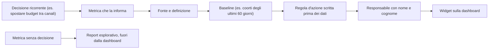

Scenario costruito con numeri di esempio: la dashboard di marketing di un e-commerce ha quarantadue widget distribuiti su tre schede, e i semafori verdi non li guarda più nessuno. Il CPA sembra sceso e il ROAS sembra salito. Lunedì il direttore chiede se spostare cinquemila euro dalla ricerca ai social sia una buona idea, e nessuno nella stanza riesce a rispondere guardando lo schermo. I dati non mancano: manca il progetto che lega ogni numero a una decisione.

Una dashboard operativa è la superficie minima di segnali, baseline e soglie che riduce l'incertezza su una decisione che si ripete. Non serve a raccontare tutto quello che succede, ma a far decidere in pochi minuti, ogni volta, la stessa classe di scelte.

> **Idea chiave:** ogni widget risponde a una frase decisionale del tipo «devo decidere X entro Y guardando Z rispetto a W». Un numero senza decisione, soglia e responsabile appartiene a un report esplorativo, non alla dashboard operativa.

## Perché le dashboard con troppi widget smettono di servire

Una dashboard che mostra tutto tratta ogni metrica come ugualmente urgente, e il team impara a ignorarle tutte. Il marketing vive inoltre su orizzonti diversi: l'offerta di oggi, la coorte della settimana, il payback a novanta giorni. Mettere questi tempi sullo stesso asse produce confronti fra numeri maturi e numeri acerbi. Un calo del tasso di conversione di ieri può essere rumore di tracciamento, un fine settimana lungo o una creatività esaurita: tre fenomeni che chiedono tre reazioni opposte.

Il test che ogni indicatore operativo deve superare è semplice: se domani fosse rosso, chi fa che cosa entro quando? Se la risposta è vaga, l'indicatore appartiene a un'analisi esplorativa e va tenuto in un posto separato, aperto quando serve e non ogni mattina. Separare operatività ed esplorazione in due luoghi è la prima misura di igiene.



## Dalla domanda alla regola d'azione

Il caso d'apertura si trasforma in un widget con cinque parti. La domanda: se alzare del 30% il budget su un canale con CPA basso e scontrini in calo. La metrica: margine incrementale per coorte, non il CPA. La baseline: il margine delle coorti dello stesso canale negli ultimi sessanta giorni. La regola: se il payback resta sotto i 90 giorni si scala a scaglioni del 15%, altrimenti si congela. Il responsabile: una persona con nome e cognome, che risponde di definizione, freschezza e soglie.

La soglia si concorda quando il numero ancora non si conosce. Decidere dopo aver visto il grafico equivale a spostare la porta dopo il tiro: ogni risultato trova una spiegazione che lo giustifica. Una soglia scritta prima rende la dashboard falsificabile, cioè capace di dire di no.

| Orizzonte | Domanda tipica | Indicatore guida | Ritmo di lettura |
| --- | --- | --- | --- |
| Giornaliero | Il traffico e la spesa sono sani? | Quota di traffico tracciato, anomalie | Dieci minuti ogni mattina |
| Settimanale | Dove spostiamo budget? | Coorti maturate, margine incrementale | Revisione di quarantacinque minuti |
| Mensile | Le decisioni passate hanno funzionato? | Confronto decisioni ed esiti | Retrospettiva |

## Architettura dei dati sotto la dashboard

Web, app, CRM e piattaforme pubblicitarie descrivono lo stesso utente con dialetti diversi: cookie, identificativo utente, indirizzo email. Senza una tabella di corrispondenza con precedenze e finestre dichiarate la dashboard somma elementi incompatibili. La spesa pubblicitaria arriva quasi in tempo reale, le conversioni lato server dopo alcune ore e i rimborsi dopo giorni. Confrontare la spesa di oggi con il ricavo di oggi oppone un numero maturo a uno acerbo e produce falsi allarmi ogni lunedì.

La soluzione è separare due viste. La vista a breve termine, per l'operatività, mostra spesa, traffico tracciato e anomalie e non pretende di dire il ritorno. La vista a coorte si legge soltanto a finestra chiusa e risponde a payback e margine. Quando una migrazione alla Conversions API sposta il 12% delle conversioni da un giorno all'altro, un banner datato sul grafico vale più di tre settimane di discussioni sul presunto crollo della domanda. Ogni cambio di misura o di definizione porta una nota con la data.

## Dal volume al margine incrementale

Le metriche si dispongono su tre livelli. Quelle di salute, cioè margine, payback e quota di traffico tracciato, dicono se il sistema funziona. Quelle diagnostiche, cioè CAC marginale, conversione e scontrino, spiegano perché qualcosa è cambiato. Quelle precoci, come CTR, CPC e aggiunte al carrello, anticipano senza decidere. L'errore classico è trattare le precoci come verdetti: un CTR in salita con payback in peggioramento non è una buona notizia, è una creatività che attira il pubblico sbagliato.

Il CAC payback merita un posto fisso nella vista di salute. Con CAC di 45 euro e margine mensile per cliente di 15 euro il payback è 45 / 15 = 3 mesi. Si mostra per coorte e mai come tasso senza denominatore: un tasso di conversione del 4% su un traffico dimezzato è un allarme, non un successo.

Il ROAS osservato, inoltre, mescola conversioni che sarebbero avvenute comunque con quelle generate dalla spesa. Un holdout geografico lo corregge. Supponiamo di spendere 20.000 euro nelle regioni di test. Le regioni di test generano 1.260 conversioni, mentre le regioni di controllo, riscalate alla stessa dimensione, ne generano 1.000. Il lift è (1.260 − 1.000) / 1.000 = 26% e le conversioni incrementali sono 260. Il CAC osservato è 20.000 / 1.260 = 15,9 euro, quello incrementale 20.000 / 260 = 76,9 euro. Con margine mensile di 15 euro il payback osservato sarebbe poco più di un mese, quello incrementale 76,9 / 15 = 5,1 mesi. Se non esiste un esperimento, il widget porta la dicitura «ROAS osservato, non incrementale».

## Alert con bande dinamiche

Le soglie statiche funzionano solo su volumi grandi e stabili. Negli altri casi servono bande dinamiche: una media mobile a 7 o 28 giorni, più o meno un multiplo della deviazione standard, con conferma su due o tre punti consecutivi fuori banda. Calcoliamo un esempio. Le conversioni giornaliere hanno media a 28 giorni di 400 e deviazione standard di 20. Con k = 2,5 la banda va da 400 − 2,5 × 20 = 350 a 400 + 2,5 × 20 = 450. Un giorno a 340 conversioni è fuori banda ma da solo non fa scattare l'allarme. Se anche il giorno dopo cade sotto 350, per esempio a 335, l'allarme parte. La conferma elimina la maggior parte dei falsi positivi dovuti a un singolo giorno anomalo.

```python
import pandas as pd

def bande_alert(serie: pd.Series, finestra: int = 28, k: float = 2.5) -> pd.DataFrame:
    # media e deviazione su finestra mobile, spostate di 1 per escludere il giorno corrente
    media = serie.rolling(finestra).mean().shift(1)
    dev = serie.rolling(finestra).std().shift(1)
    out = pd.DataFrame({"valore": serie, "media": media})
    out["banda_inf"] = media - k * dev
    out["banda_sup"] = media + k * dev
    out["fuori_banda"] = (serie < out["banda_inf"]) | (serie > out["banda_sup"])
    # allarme solo con due giorni consecutivi fuori banda
    out["allarme"] = out["fuori_banda"] & out["fuori_banda"].shift(1, fill_value=False)
    return out
```

Ogni alert porta il contesto per decidere in un minuto: valore contro banda, causa nota come festività o rilascio del sito, collegamento al segmento interessato e azione con il suo responsabile. Un alert senza contesto genera una discussione, uno con contesto genera un'azione.

## Medie aggregate e paradosso di Simpson

Le medie aggregate sono il modo più elegante di sbagliare. Nel paradosso di Simpson il tasso complessivo sale mentre peggiora in ogni segmento, perché cresce il peso del segmento che converte di più. Un esempio con numeri di esempio: nella settimana 1 il mobile ha 8.000 sessioni con tasso 2,0% (160 conversioni) e il desktop 2.000 sessioni con 5,0% (100 conversioni), per un totale di 260 conversioni su 10.000 sessioni, cioè 2,6%. Nella settimana 2 il mobile ha 2.000 sessioni con 1,8% (36 conversioni) e il desktop 8.000 con 4,8% (384 conversioni): il totale è 420 su 10.000, cioè 4,2%. Entrambi i segmenti sono peggiorati di 0,2 punti, eppure il tasso complessivo è salito di 1,6 punti, perché il traffico si è spostato verso il desktop.

La dashboard deve quindi mostrare tasso e mix insieme: una riga per segmento più il totale, con la numerosità accanto alla percentuale. Un brand che sposta budget sul retargeting vede scendere il CPA medio anche se ogni canale peggiora, per lo stesso motivo.

## Routine, responsabili e il caso Meta

Una dashboard senza routine decade in poche settimane. Il controllo giornaliero dura dieci minuti e guarda solo salute e alert. La revisione settimanale, quarantacinque minuti, legge le coorti maturate e decide i movimenti di budget, uno per canale al massimo. La retrospettiva mensile confronta decisioni ed esiti, e dice se le regole scritte hanno funzionato.

A febbraio 2022 Meta ha stimato in circa 10 miliardi di dollari il vento contrario sui ricavi pubblicitari attesi per il 2022, dopo la richiesta di consenso al tracciamento introdotta da Apple con iOS 14.5. Gli inserzionisti hanno scoperto che cosa significa misurare con una copertura ridotta. Se la quota di traffico tracciato scende dall'85% al 70%, le conversioni osservate calano del 17,6% (70 / 85 = 0,824) senza che la domanda sia cambiata. Il caso fissa la gerarchia della dashboard: prima la quota di traffico tracciato come metrica di salute, poi i tassi letti dentro quella copertura.

## Errori tipici di una dashboard operativa

### Quarantadue widget in un'unica schermata

Il sintomo è un cruscotto aperto da tutti e consultato da nessuno. Ogni richiesta di aggiungere una metrica sembra ragionevole, ma la somma sovrasta il segnale. Il rimedio è applicare il test del semaforo rosso a ogni indicatore e spostare in un'area esplorativa tutto ciò che non ha responsabile e soglia.

### Confrontare il speso di oggi con il ricavo di oggi

Il sintomo è un falso allarme il lunedì e un ritorno sovrastimato il venerdì. La spesa è già completa, il ricavo ancora no, e il rapporto è sistematicamente basso nei giorni recenti. Il rimedio è leggere il ritorno solo a finestra chiusa, per coorte, e riservare alla vista a breve termine la salute operativa.

### Scalare sul CTR

Il sintomo è un click costoso di traffico che non ripaga. Un CTR in aumento fa pensare a un annuncio efficace, ma se il payback peggiora l'annuncio attira persone che non comprano. Il rimedio è considerare il CTR una metrica precoce e ammettere uno scale-up solo se margine incrementale e payback reggono.

## Controllo sulle tue dashboard

1. Con CAC di 90 euro e margine mensile per cliente di 18 euro, qual è il payback? Cosa decidi se la soglia è 4 mesi?

<details>
<summary>Mostra risposta</summary>

Il payback è 90 / 18 = 5 mesi, sopra la soglia di 4. La regola scritta dice di congelare lo scale-up del canale e di cercare dove il CAC marginale cresce di più, per esempio in una keyword o in un segmento.

</details>

2. Una serie ha media a 28 giorni di 500 e deviazione standard di 25. Con k = 2 qual è la banda? Il valore 440 fa scattare l'allarme?

<details>
<summary>Mostra risposta</summary>

La banda va da 500 − 2 × 25 = 450 a 500 + 2 × 25 = 550. Il valore 440 è fuori banda, ma con la regola dei due giorni consecutivi l'allarme parte solo se anche il giorno successivo resta fuori. Un solo punto fuori banda viene segnalato come anomalia da osservare.

</details>

3. Un test geografico con spesa di 12.000 euro produce 600 conversioni nelle regioni di test e 480 nel controllo riscalato. Quanto vale il CAC incrementale?

<details>
<summary>Mostra risposta</summary>

Le conversioni incrementali sono 600 − 480 = 120 e il CAC incrementale è 12.000 / 120 = 100 euro. Il CAC osservato sarebbe 12.000 / 600 = 20 euro: cinque volte inferiore, perché include 480 conversioni che sarebbero avvenute comunque.

</details>

4. Il tasso di conversione complessivo sale dal 3% al 4% mentre scende in ogni segmento. Qual è la causa più probabile e che cosa mostri nella dashboard?

<details>
<summary>Mostra risposta</summary>

È un paradosso di Simpson: il traffico si è spostato verso il segmento che converte di più. Nella dashboard si mostrano il tasso per segmento, il totale e il peso di ciascun segmento sul traffico, con la numerosità accanto alla percentuale.

</details>
