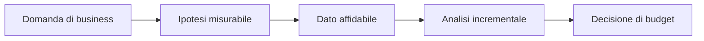

# Modelli di attribuzione marketing

L'attribuzione marketing non è una formula magica, ma una disciplina che aiuta a distribuire in modo trasparente e consapevole il credito tra i diversi canali che contribuiscono a una conversione. Last click premia solo chi chiude la vendita, first click riconosce chi ha fatto scoprire il prodotto, mentre spesso il team brand resta invisibile perché ha creato domanda prima del tracciamento. Il punto non è trovare il modello perfetto, ma capire cosa stiamo premiando e quali decisioni possiamo prendere con quella informazione.

## Problema reale

Nel marketing analytics, il problema concreto è trasformare dati su budget, canali, creatività e audience in decisioni misurabili, evitando di confondere volume, attribuzione e incrementalità. La domanda chiave è: quale decisione migliora grazie a questo modello di attribuzione? Senza una risposta chiara, l'analisi resta decorativa e non diventa competenza.

## Modello concettuale

Il processo mentale per usare un modello di attribuzione efficace segue questi passaggi:

1. Domanda di business: quale decisione deve cambiare?
2. Ipotesi misurabile: quale segnale rappresenta il fenomeno?
3. Dato affidabile: i dati sono sufficientemente validi e completi?
4. Analisi incrementale: il segnale riduce l'incertezza decisionale?
5. Decisione di budget: quali azioni concrete prenderemo?



| Passaggio | Domanda guida | Output atteso |
|---|---|---|
| Framing | Quale decisione deve cambiare? | Scelta concreta |
| Misura | Quale segnale rappresenta il fenomeno? | Metrica e granularità |
| Confronto | Rispetto a quale baseline interpreto il risultato? | Benchmark o gruppo di controllo |
| Azione | Che cosa faccio se il segnale supera la soglia? | Decisione e controllo |

## Formalizzazione rigorosa

Un modello di attribuzione si definisce come una relazione tra quattro elementi:

| Elemento | Definizione operativa |
|---|---|
| Unità di analisi | campagna, coorte, touchpoint o segmento cliente |
| Segnale | margine incrementale, CAC payback, conversion rate corretto, lift o retention generata |
| Baseline | periodo precedente, gruppo holdout, mercato comparabile o benchmark storico |
| Decisione | spostare risorse, cambiare messaggio, fermare una tattica o scalare un esperimento |

La regola pratica è che una metrica è utile solo se riduce l'incertezza su una decisione specifica. Altrimenti è solo documentazione o rischio.

## I modelli classici di attribuzione

| Modello | Come attribuisce | Pregi | Difetti |
|---------|-----------------|-------|---------|
| Last-click | 100% all'ultimo touchpoint | Semplice, verificabile | Ignora il percorso di awareness |
| First-click | 100% al primo touchpoint | Riconosce la scoperta | Ignora nurturing e conversione finale |
| Linear | Equamente diviso tra tutti i touchpoint | Equo, semplice | Non distingue touchpoint più influenti |
| Time Decay | Più peso ai touchpoint recenti | Realistico per acquisti impulsivi | Arbitrario nel decay rate |
| Position-based (U-shaped) | 40% primo, 40% ultimo, 20% tra gli altri | Bilancia scoperta e conversione | Arbitrario nel split |

## Data-driven attribution e Shapley values

L'approccio moderno usa i valori di Shapley dalla teoria dei giochi cooperativi. Calcola il contributo marginale di ogni canale in tutte le possibili combinazioni, assegnando credito proporzionale all'aumento della probabilità di conversione.

```sql
-- Conversion rate per combinazione di canali
SELECT STRING_AGG(channel, '+' ORDER BY channel) AS channel_combo,
       COUNT(*) AS users,
       SUM(converted) AS conversions,
       ROUND(SUM(converted)*100.0/COUNT(*),1) AS conversion_rate
FROM user_journeys GROUP BY user_id;
```

### Caso reale: Booking.com

Passando da last-click a Shapley, Booking.com ha ridistribuito il 18% del budget tra canali e aumentato il ROAS del 7%. Canali top of funnel come display e video, prima ignorati, si sono rivelati essenziali per generare domanda.

## Approfondimento operativo: modelli di attribuzione come sistema

Un modello di attribuzione non vive isolato. È parte di un sistema che include decisioni, dati, vincoli tecnici e incentivi organizzativi. Il rischio è imparare formule senza capire il problema che risolvono. La prima domanda deve essere: quale decisione cambierà grazie a questa analisi?

Un buon approccio è:

1. Definire il problema in linguaggio business
2. Identificare l'unità di analisi corretta
3. Verificare la qualità e la pertinenza dei dati
4. Costruire una metrica interpretabile
5. Segmentare per evitare medie fuorvianti
6. Trasformare il risultato in una raccomandazione verificabile

## Esempio o caso studio

Questa query crea una base analitica con metrica, segmento e finestra temporale per confrontare periodi e gruppi senza riscrivere la logica.

```sql
WITH base_events AS (
  SELECT
    user_id,
    account_id,
    event_type,
    event_time,
    DATE_TRUNC('week', event_time) AS week,
    source,
    device_type
  FROM events
  WHERE event_time >= CURRENT_DATE - INTERVAL '180 days'
    AND user_id IS NOT NULL
),
weekly_user_metrics AS (
  SELECT
    week,
    user_id,
    COALESCE(source, 'unknown') AS source,
    COALESCE(device_type, 'unknown') AS device_type,
    COUNT(*) AS total_events,
    COUNT(DISTINCT DATE(event_time)) AS active_days,
    COUNT(DISTINCT event_type) AS event_diversity,
    MAX(CASE WHEN event_type IN ('purchase', 'subscribe', 'activation') THEN 1 ELSE 0 END) AS reached_key_outcome
  FROM base_events
  GROUP BY week, user_id, source, device_type
)
SELECT
  week,
  source,
  device_type,
  COUNT(DISTINCT user_id) AS users,
  ROUND(AVG(active_days), 2) AS avg_active_days,
  ROUND(AVG(event_diversity), 2) AS avg_event_diversity,
  ROUND(AVG(reached_key_outcome) * 100, 2) AS key_outcome_rate
FROM weekly_user_metrics
GROUP BY week, source, device_type
ORDER BY week, source, device_type;
```

Questa base permette di osservare trend, segmenti e variazioni nel tempo per formulare ipotesi più precise.

## Esempio Python: controllare stabilità e anomalie

Una metrica utile deve essere stabile e sensibile. Questo script individua variazioni anomale settimana su settimana.

```python
import pandas as pd

# df contiene: week, segment, users, key_outcome_rate (in percentuale)

df = df.sort_values(['segment', 'week']).copy()
df['previous_rate'] = df.groupby('segment')['key_outcome_rate'].shift(1)
df['wow_change_pp'] = df['key_outcome_rate'] - df['previous_rate']
df['rolling_mean'] = df.groupby('segment')['key_outcome_rate'].transform(
    lambda s: s.rolling(4, min_periods=2).mean()
)
df['rolling_std'] = df.groupby('segment')['key_outcome_rate'].transform(
    lambda s: s.rolling(4, min_periods=2).std()
)
df['z_score'] = (df['key_outcome_rate'] - df['rolling_mean']) / df['rolling_std']

anomalies = df[df['z_score'].abs() >= 2].sort_values('z_score')
print(anomalies[['week', 'segment', 'key_outcome_rate', 'wow_change_pp', 'z_score']])
```

Questo aiuta a evitare reazioni a oscillazioni casuali e a focalizzarsi su variazioni significative.

## Caso reale: Netflix e la disciplina delle metriche

Netflix costruisce decisioni di prodotto su segnali comportamentali osservabili, come completamento episodi o tempo di ricerca. Misura non solo click immediati ma anche qualità e soddisfazione implicita. Questo approccio impedisce di ottimizzare metriche vane che danneggiano il valore nel lungo periodo. Lo stesso principio vale per l'attribuzione marketing: senza un outcome chiaro, l'analisi è incompleta.

## Errori tipici da evitare

1. Aggregare dati troppo presto, nascondendo pattern opposti
2. Non controllare la qualità dei dati (duplicati, tracking incompleto, timezone incoerenti)
3. Confondere correlazione con causalità

Per ridurre i rischi, ogni analisi deve avere una definizione esplicita della metrica, confronto per segmento e verifica contro baseline o gruppo di controllo.

## Lab / esercizio

### Livello base

Scrivi in cinque righe una decisione reale collegata a modelli di attribuzione: obiettivo, metrica primaria, baseline, rischio principale e azione prevista.

### Livello intermedio

Costruisci una tabella con almeno tre segmenti o scenari, indicando per ciascuno segnale, possibile spiegazione alternativa e controllo necessario.

### Livello research-grade

Disegna un piano di validazione: ipotesi, dati necessari, criteri di esclusione, soglia decisionale e controllo post-decisione. Specifica cosa ti farebbe cambiare idea.

### Dataset e materiali consigliati

Usa dati reali o sintetici con almeno 200-500 righe, includendo una colonna temporale, una di segmento, una metrica di outcome e una variabile di esposizione.

## Errore tipico da evitare

L'errore piu comune e trattare il risultato come una verita generale invece che come evidenza condizionata. Prima di agire, controlla baseline, assunzioni e costo dell'errore.

## Quiz o checkpoint

1. Quale decisione concreta questa lezione aiuta a migliorare?
2. Quale baseline rende interpretabile il risultato?
3. Quale assunzione, se sbagliata, cambierebbe la conclusione?
4. Quale controllo minimo useresti prima di presentare la raccomandazione?

## Riepilogo

I modelli di attribuzione marketing sono uno strumento decisionale che collega problema, dati, metrica, segmentazione e azione. Il valore nasce quando l'analisi termina con una decisione operativa, un livello di confidenza e un piano per verificare se avevamo ragione. Senza questo, resta solo un esercizio teorico.
