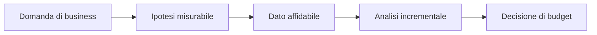

# Modelli di attribuzione marketing

L'attribuzione marketing non è una formula magica, è una disciplina che distribuisce in modo trasparente il credito tra i canali che contribuiscono a una conversione. Il last click premia solo chi chiude la vendita, il first click riconosce chi ha fatto scoprire il prodotto, e intanto il team brand resta spesso invisibile perché ha creato domanda prima ancora che il tracciamento la registrasse. Il punto non è trovare il modello perfetto, ma capire cosa stai premiando e quali decisioni puoi prendere con quell'informazione.

## Problema reale

Il problema concreto è trasformare i dati su budget, canali, creatività e audience in decisioni misurabili, senza confondere volume, attribuzione e incrementalità. La domanda è una sola: quale decisione migliora grazie a questo modello di attribuzione? Senza una risposta chiara, l'analisi resta decorativa e non diventa competenza.

## Modello concettuale

Per usare bene un modello di attribuzione conviene seguire una sequenza precisa. Parti dalla domanda di business e chiediti quale decisione deve cambiare. Traducila in un'ipotesi misurabile, individuando il segnale che rappresenta il fenomeno. Verifica poi che i dati siano abbastanza validi e completi. A quel punto chiediti se il segnale riduce davvero l'incertezza decisionale, e infine decidi quali azioni concrete prendere sul budget.



| Passaggio | Domanda guida | Output atteso |
|---|---|---|
| Framing | Quale decisione deve cambiare? | Scelta concreta |
| Misura | Quale segnale rappresenta il fenomeno? | Metrica e granularità |
| Confronto | Rispetto a quale baseline interpreto il risultato? | Benchmark o gruppo di controllo |
| Azione | Che cosa faccio se il segnale supera la soglia? | Decisione e controllo |

## Formalizzazione rigorosa

Un modello di attribuzione è una relazione tra quattro elementi.

| Elemento | Definizione operativa |
|---|---|
| Unità di analisi | campagna, coorte, touchpoint o segmento cliente |
| Segnale | margine incrementale, CAC payback, conversion rate corretto, lift o retention generata |
| Baseline | periodo precedente, gruppo holdout, mercato comparabile o benchmark storico |
| Decisione | spostare risorse, cambiare messaggio, fermare una tattica o scalare un esperimento |

La regola pratica è che una metrica serve a qualcosa solo se riduce l'incertezza su una decisione precisa. Altrimenti è solo documentazione, o un rischio.

## I modelli classici di attribuzione

| Modello | Come attribuisce | Pregi | Difetti |
|---------|-----------------|-------|---------|
| Last-click | 100% all'ultimo touchpoint | Semplice, verificabile | Ignora il percorso di awareness |
| First-click | 100% al primo touchpoint | Riconosce la scoperta | Ignora nurturing e conversione finale |
| Linear | Equamente diviso tra tutti i touchpoint | Equo, semplice | Non distingue touchpoint più influenti |
| Time Decay | Più peso ai touchpoint recenti | Realistico per acquisti impulsivi | Arbitrario nel decay rate |
| Position-based (U-shaped) | 40% primo, 40% ultimo, 20% tra gli altri | Bilancia scoperta e conversione | Arbitrario nello split |

## Data-driven attribution e Shapley values

L'approccio moderno usa i valori di Shapley, presi dalla teoria dei giochi cooperativi. Calcola il contributo marginale di ogni canale in tutte le combinazioni possibili e assegna il credito in proporzione all'aumento della probabilità di conversione.

```sql
-- Conversion rate per combinazione di canali
SELECT STRING_AGG(channel, '+' ORDER BY channel) AS channel_combo,
       COUNT(*) AS users,
       SUM(converted) AS conversions,
       ROUND(SUM(converted)*100.0/COUNT(*),1) AS conversion_rate
FROM user_journeys GROUP BY user_id;
```

### Caso reale: Booking.com

Passando dal last-click allo Shapley, Booking.com ha ridistribuito il 18% del budget tra i canali e ha aumentato il ROAS del 7%. I canali top of funnel come display e video, prima ignorati, si sono rivelati essenziali per generare domanda.

## Approfondimento operativo: il modello come sistema

Un modello di attribuzione non vive isolato. Fa parte di un sistema che comprende decisioni, dati, vincoli tecnici e incentivi organizzativi. Il rischio è imparare le formule senza capire il problema che risolvono, e la prima domanda da porsi resta quale decisione cambierà grazie a questa analisi.

Un buon flusso di lavoro definisce il problema in linguaggio business, individua l'unità di analisi corretta, verifica la qualità e la pertinenza dei dati, costruisce una metrica interpretabile, segmenta per evitare medie fuorvianti e infine trasforma il risultato in una raccomandazione verificabile.

## Esempio o caso studio

Questa query crea una base analitica con metrica, segmento e finestra temporale, così puoi confrontare periodi e gruppi senza riscrivere ogni volta la logica.

```sql
WITH base_events AS (
  SELECT
    user_id,
    account_id,
    event_type,
    event_time,
    DATE_TRUNC('week', event_time) AS week,
    source,
    device_type
  FROM events
  WHERE event_time >= CURRENT_DATE - INTERVAL '180 days'
    AND user_id IS NOT NULL
),
weekly_user_metrics AS (
  SELECT
    week,
    user_id,
    COALESCE(source, 'unknown') AS source,
    COALESCE(device_type, 'unknown') AS device_type,
    COUNT(*) AS total_events,
    COUNT(DISTINCT DATE(event_time)) AS active_days,
    COUNT(DISTINCT event_type) AS event_diversity,
    MAX(CASE WHEN event_type IN ('purchase', 'subscribe', 'activation') THEN 1 ELSE 0 END) AS reached_key_outcome
  FROM base_events
  GROUP BY week, user_id, source, device_type
)
SELECT
  week,
  source,
  device_type,
  COUNT(DISTINCT user_id) AS users,
  ROUND(AVG(active_days), 2) AS avg_active_days,
  ROUND(AVG(event_diversity), 2) AS avg_event_diversity,
  ROUND(AVG(reached_key_outcome) * 100, 2) AS key_outcome_rate
FROM weekly_user_metrics
GROUP BY week, source, device_type
ORDER BY week, source, device_type;
```

Da questa base puoi osservare trend, segmenti e variazioni nel tempo, e formulare ipotesi più precise.

## Esempio Python: controllare stabilità e anomalie

Una metrica utile deve essere stabile e sensibile insieme. Questo script individua le variazioni anomale settimana su settimana.

```python
import pandas as pd

# df contiene: week, segment, users, key_outcome_rate (in percentuale)

df = df.sort_values(['segment', 'week']).copy()
df['previous_rate'] = df.groupby('segment')['key_outcome_rate'].shift(1)
df['wow_change_pp'] = df['key_outcome_rate'] - df['previous_rate']
df['rolling_mean'] = df.groupby('segment')['key_outcome_rate'].transform(
    lambda s: s.rolling(4, min_periods=2).mean()
)
df['rolling_std'] = df.groupby('segment')['key_outcome_rate'].transform(
    lambda s: s.rolling(4, min_periods=2).std()
)
df['z_score'] = (df['key_outcome_rate'] - df['rolling_mean']) / df['rolling_std']

anomalies = df[df['z_score'].abs() >= 2].sort_values('z_score')
print(anomalies[['week', 'segment', 'key_outcome_rate', 'wow_change_pp', 'z_score']])
```

Così eviti di reagire a oscillazioni casuali e ti concentri sulle variazioni che contano davvero.

## Caso reale: Netflix e la disciplina delle metriche

Netflix costruisce le decisioni di prodotto su segnali comportamentali osservabili, come il completamento degli episodi o il tempo di ricerca. Non misura solo il click immediato, ma anche la qualità e la soddisfazione implicita. In questo modo evita di ottimizzare metriche vane che a lungo termine erodono il valore. Lo stesso vale per l'attribuzione marketing: senza un outcome chiaro, l'analisi resta incompleta.

## Errori tipici da evitare

Il primo errore è aggregare i dati troppo presto, perché così nascondi pattern opposti che si annullano nella media. Il secondo è non controllare la qualità dei dati, lasciando passare duplicati, tracking incompleto e timezone incoerenti. Il terzo è confondere correlazione e causalità. Per ridurre questi rischi, ogni analisi deve avere una definizione esplicita della metrica, un confronto per segmento e una verifica contro baseline o gruppo di controllo.

## Lab / esercizio

### Livello base

Scrivi in cinque righe una decisione reale collegata ai modelli di attribuzione: obiettivo, metrica primaria, baseline, rischio principale e azione prevista.

### Livello intermedio

Costruisci una tabella con almeno tre segmenti o scenari, indicando per ciascuno il segnale, una possibile spiegazione alternativa e il controllo necessario.

### Livello research-grade

Disegna un piano di validazione: ipotesi, dati necessari, criteri di esclusione, soglia decisionale e controllo post-decisione. Specifica cosa ti farebbe cambiare idea.

### Dataset e materiali consigliati

Usa dati reali o sintetici con almeno 200-500 righe, includendo una colonna temporale, una di segmento, una metrica di outcome e una variabile di esposizione.

## Errore tipico da evitare

L'errore più comune è trattare il risultato come una verità generale invece che come evidenza condizionata. Prima di agire, controlla baseline, assunzioni e costo dell'errore.

## Quiz o checkpoint

1. Quale decisione concreta questa lezione aiuta a migliorare?
2. Quale baseline rende interpretabile il risultato?
3. Quale assunzione, se sbagliata, cambierebbe la conclusione?
4. Quale controllo minimo useresti prima di presentare la raccomandazione?

## Riepilogo

I modelli di attribuzione marketing sono uno strumento decisionale che collega problema, dati, metrica, segmentazione e azione. Il valore nasce quando l'analisi finisce con una decisione operativa, un livello di confidenza e un piano per verificare se avevamo ragione. Senza questo, resta solo un esercizio teorico.
