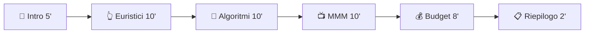
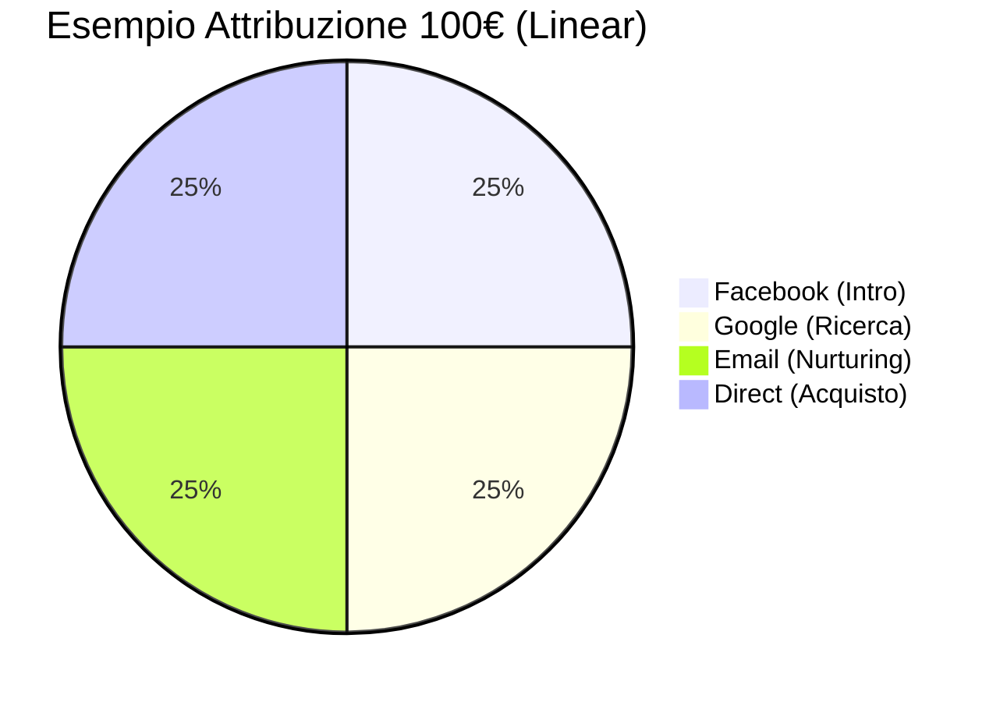

## Attribution Modeling: Chi merita il credito? — Lezione Completa

Il cliente vede un annuncio su Facebook (lun), cerca il brand su Google (mar), clicca su una mail (gio) e compra (ven). A chi diamo i 100€ di fatturato? Facebook dirà "A me!", Google dirà "A me!". Se sommi i report delle piattaforme, hai venduto il 300% del reale. L'Attribution Modeling è l'arte (imperfetta) di assegnare il giusto valore a ogni punto di contatto (Touchpoint) per capire dove investire il prossimo euro.

### Obiettivi di Apprendimento

Al termine di questa lezione, lo studente sarà in grado di:
1.  Confrontare i modelli di attribuzione euristici (Last Click, First Click, Linear, Time Decay).
2.  Comprendere i limiti del tracciamento (Cookie, ITP, iOS14) e come impattano l'attribuzione.
3.  Implementare modelli algoritmici avanzati come le Catene di Markov e lo Shapley Value.
4.  Utilizzare il Marketing Mix Modeling (MMM) per misurare l'impatto dei canali offline (TV, Radio).
5.  Costruire una strategia di attribuzione ibrida per il budget allocation.

### Timeline della Lezione

| Fase | Argomento | Durata |
|------|-----------|--------|
| 1 | Introduzione: Il dilemma dell'attribuzione | 5 min |
| 2 | Teoria: Modelli Euristici (Single-Touch vs Multi-Touch) | 10 min |
| 3 | Avanzato: Modelli Algoritmici (Markov & Shapley) | 10 min |
| 4 | Strategia: Marketing Mix Modeling (MMM) | 10 min |
| 5 | Esercizi: Budget Allocation Game | 8 min |
| 6 | Riepilogo e Domande | 2 min |
| **Totale** | | **45 min** |

### Fase 1 — Introduzione: Il dilemma dell'attribuzione (5 min)

"Metà dei soldi che spendo in pubblicità è sprecata; il problema è che non so quale metà." (John Wanamaker, 1800).
Oggi abbiamo i dati, ma il problema persiste perché il Customer Journey è frammentato su 5 dispositivi e 20 canali.

L'attribuzione serve a rispondere a una domanda finanziaria: **Se tolgo 10.000€ da Facebook e li metto su YouTube, le vendite totali saliranno o scenderanno?**

### Fase 2 — Teoria: Modelli Euristici (Single-Touch vs Multi-Touch) (10 min)

Sono regole fisse decise dall'uomo. Semplici, ma spesso sbagliate.

1.  **Last Click (Single-Touch):**
    *   *Regola:* Il 100% del merito va all'ultimo canale prima dell'acquisto.
    *   *Pro:* Facile, standard di Google Analytics (fino a poco fa).
    *   *Contro:* Ignora tutto il lavoro di branding. Uccide la Discovery (YouTube, Social). Favorisce il Remarketing e il Brand Search (che avrebbero convertito comunque).

2.  **First Click (Single-Touch):**
    *   *Regola:* Il 100% al primo canale che ha portato l'utente.
    *   *Pro:* Valorizza l'acquisizione di nuovi utenti.
    *   *Contro:* Ignora il contributo della persuasione successiva (Email, Retargeting).

3.  **Linear (Multi-Touch):**
    *   *Regola:* Divide il merito equamente (es. 25% a ciascuno dei 4 touchpoint).
    *   *Pro:* Democratico.
    *   *Contro:* Irrealistico. Una visita di 3 secondi vale quanto una di 10 minuti?

4.  **Time Decay (Multi-Touch):**
    *   *Regola:* Più merito ai canali vicini alla conversione (es. dimezza il valore ogni 7 giorni).
    *   *Pro:* Riconosce che l'impatto della memoria svanisce.
    *   *Contro:* Ancora arbitrario.

### Fase 3 — Avanzato: Modelli Algoritmici (Markov & Shapley) (10 min)

Qui lasciamo decidere alla matematica. Usiamo i dati storici di *tutti* i percorsi (anche quelli che NON hanno convertito) per calcolare la probabilità.

**1. Catene di Markov (Markov Chains)**
Immagina il journey come un grafo. Calcoliamo la probabilità di passare da uno stato all'altro.
*   *Removal Effect:* Se rimuoviamo Facebook dal grafo, quante conversioni perdiamo?
*   Se togliendo Facebook le conversioni crollano del 40%, Facebook merita il 40% del credito.
*   È ottimo per valutare canali "ponte" (assist).

**2. Shapley Value (Game Theory)**
Premio Nobel per l'economia. Considera i canali come giocatori in una squadra.
Calcola il contributo marginale di ogni giocatore in tutte le possibili coalizioni.
*   *Squadra A:* FB + Google = 100 vendite.
*   *Squadra B:* Google da solo = 20 vendite.
*   *Contributo FB:* 80 vendite.
Richiede molta potenza di calcolo ma è il metodo più "equo" matematicamente.

### Fase 4 — Strategia: Marketing Mix Modeling (MMM) (10 min)

Con la fine dei cookie di terze parti (iOS14, GDPR), tracciare il singolo utente è impossibile per il 30-50% del traffico. L'attribuzione "User-Level" sta morendo.

Il **MMM (Marketing Mix Modeling)** torna di moda. È un approccio econometrico (Top-Down).
Non guarda l'utente, guarda le serie temporali aggregate.

*Formula Semplificata:*
`Vendite_Settimana = Base + (β1 * Spesa_TV) + (β2 * Spesa_FB) + (β3 * Meteo) + Errore`

*   Analizza 2-3 anni di dati storici.
*   Correlazione tra picchi di spesa e picchi di vendita.
*   Include variabili esterne (Stagionalità, Prezzi, Competitor, COVID).
*   *Pro:* Privacy-safe (non usa cookie). Misura l'offline (TV, Radio, Cartelloni).
*   *Contro:* Lento (risultati trimestrali, non real-time). Non dice "chi" ha comprato.

La soluzione moderna è la **Triangolazione**: Usa l'attribuzione (MTA) per l'ottimizzazione tattica giornaliera e il MMM per il budget strategico trimestrale.

### Fase 5 — Esercizi: Budget Allocation Game (8 min)

**Scenario:** Hai 10.000€ extra. Dove li metti?
Dati attuali (Last Click):
*   Google Ads (Brand): ROAS 10x. (Spendi 1k, incassi 10k).
*   Facebook Ads (Prospecting): ROAS 2x. (Spendi 1k, incassi 2k).

*Intuizione:* Metto tutto su Google!
*   *Errore:* Google Ads Brand cattura domanda *già esistente*. Se sposti budget lì, stai pagando per utenti che ti cercavano già. Il ROAS marginale sarà 0.
*   Facebook crea nuova domanda. Se togli budget, tra un mese nessuno cercherà il tuo brand su Google.

*Soluzione:* Usa un modello Markov o Shapley.
Se Markov dice che Facebook ha un "Removal Effect" alto (es. assiste il 50% delle conversioni Google), investi su Facebook anche se il ROAS diretto sembra basso.

### Fase 6 — Riepilogo e Domande (2 min)

1.  **Nessun modello è vero.** Tutti sono utili (se sai i limiti).
2.  **Last Click è pericoloso.** Sottostima la crescita.
3.  **Privacy.** Preparati a un mondo senza cookie usando MMM.
4.  **Esperimenti (Incrementality).** L'unico vero giudice è spegnere un canale (Geo-Lift Test) e vedere cosa succede.

### Domande di Verifica

1.  Perché il modello "Last Click" tende a sovrastimare i canali di Retargeting e Branded Search?
2.  Spiega il concetto di "Removal Effect" nelle Catene di Markov.
3.  Qual è la differenza fondamentale tra l'attribuzione Multi-Touch (MTA) e il Marketing Mix Modeling (MMM)?
4.  In che modo le restrizioni sulla privacy (es. iOS14) hanno reso meno affidabili i modelli di attribuzione user-level?
5.  Perché un canale con ROAS basso (es. YouTube) potrebbe essere fondamentale per la strategia complessiva?

### Riferimenti Bibliografici

-   Avinash Kaushik, "Web Analytics 2.0", Sybex, 2009.
-   Google Marketing Platform, "Attribution Modeling Guide".
-   Meta (Facebook), "Robyn" (Open Source MMM Package in R).
-   Google, "Meridian" (Open Source MMM).
