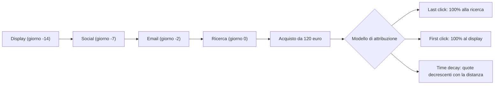

Scenario costruito con numeri di esempio: una compagnia assicurativa online spende ogni mese 40.000 euro in display e 25.000 euro in ricerca a pagamento. Nel report last click la ricerca raccoglie quasi tutte le vendite e il display ne mostra pochissime, così il responsabile propone di spegnere il display. Tre settimane dopo lo spegnimento le richieste di preventivo dalla ricerca calano del 18%. Il dato non era sbagliato: la regola con cui il report assegnava il credito premiava l'ultimo canale toccato e rendeva invisibile quello che aveva fatto nascere l'interesse.

Un modello di attribuzione è proprio questa regola. Prende una conversione di valore noto e la ripartisce tra i punti di contatto che l'hanno preceduta. Ogni decisione di budget usa un modello, anche quando nessuno lo dichiara, e la scelta tra i modelli sposta quote di merito anche del 40-50% tra i canali.

> **Idea chiave:** l'attribuzione divide un merito osservato, non misura un effetto causale. Per sapere quante conversioni scomparirebbero spegnendo un canale serve un gruppo di controllo.

## Come si distribuisce il credito di una conversione

Una conversione da 120 euro è preceduta da quattro tocchi: un annuncio display 14 giorni prima, un post sponsorizzato sui social 7 giorni prima, una email 2 giorni prima e una ricerca a pagamento il giorno stesso. Il modello decide quanti dei 120 euro vanno a ciascun canale. Il vincolo di coerenza è che la somma delle quote ricostruisca il valore della conversione: se il totale attribuito supera 120 euro, il ROAS di ogni canale diventa un'invenzione contabile.

Ogni modello è definito da quattro scelte: l'unità distribuita, cioè conversioni o ricavo, la finestra di osservazione, il criterio di ripartizione e la baseline contro cui si legge il risultato. Cambiare la finestra da 30 a 90 giorni sposta il credito verso i canali di apertura, mentre cambiare il criterio sposta il credito tra apertura e chiusura. Per questo un report senza modello e finestra dichiarati non è confrontabile con quello del trimestre precedente.



## Calcolo passo-passo sullo stesso percorso

Applichiamo cinque regole al percorso display, social, email, ricerca con valore di 120 euro.

| Modello | Display | Social | Email | Ricerca | Totale (euro) |
| --- | --- | --- | --- | --- | --- |
| Last click | 0 | 0 | 0 | 120 | 120 |
| First click | 120 | 0 | 0 | 0 | 120 |
| Lineare | 30 | 30 | 30 | 30 | 120 |
| Position based 40/20/40 | 48 | 12 | 12 | 48 | 120 |
| Time decay con lambda 0,1 | 11,55 | 23,26 | 38,35 | 46,84 | 120 |

Le prime due righe sono ovvie. Nel lineare ogni tocco riceve 120 / 4 = 30 euro. Nel position based il primo e l'ultimo tocco ricevono il 40% ciascuno, cioè 48 euro, e il 20% restante, 24 euro, si divide fra i due intermedi, 12 euro ciascuno.

Il time decay richiede un calcolo. Il peso di un tocco è exp(−lambda × d), con d i giorni che lo separano dalla conversione. Con lambda 0,1 i pesi sono 0,2466 per il display (d = 14), 0,4966 per il social (d = 7), 0,8187 per la email (d = 2) e 1 per la ricerca (d = 0). La somma dei pesi è 2,5619. La quota del display è 0,2466 / 2,5619 = 9,63%, cioè 11,55 euro. Quella del social è 19,38%, cioè 23,26 euro, quella della email 31,96%, cioè 38,35 euro, e quella della ricerca 39,03%, cioè 46,84 euro. La somma 11,55 + 23,26 + 38,35 + 46,84 è 120,00 euro, quindi la quadratura regge.

La lettura è chiara: il display vale 0 euro nel last click e 120 nel first click, con una differenza di 120 euro dallo stesso identico percorso. Con lambda 0,3 i pesi scendono a 0,015 per il display e il suo credito tocca l'1% circa. Due analisti con gli stessi dati e due lambda producono due verità incompatibili: scegliere lambda significa scegliere il risultato e va documentato come una decisione, non come un parametro tecnico.

```python
import math

# numeri di esempio: tocchi con giorni di distanza dalla conversione
tocchi = {"display": 14, "social": 7, "email": 2, "ricerca": 0}
valore = 120.0

def time_decay(tocchi, valore, lam):
    # peso esponenziale: i tocchi vicini alla conversione pesano di piu
    pesi = {c: math.exp(-lam * d) for c, d in tocchi.items()}
    totale = sum(pesi.values())
    return {c: valore * p / totale for c, p in pesi.items()}

quote = time_decay(tocchi, valore, lam=0.1)
print({c: round(v, 2) for c, v in quote.items()})
assert abs(sum(quote.values()) - valore) < 1e-9   # la somma deve tornare a 120
```

## Modelli euristici: quando bastano e quando ingannano

Last click e first click sono semplici da spiegare e verificabili riga per riga. Il last click premia chi chiude: ricerca di marca, retargeting, email di carrello abbandonato. Sovrastima i canali che catturano domanda già esistente e azzera chi la genera, quindi un negozio con molto riacquisto vede gonfiarsi il ROAS della retention. Il first click ha il difetto speculare: un video visto quattro mesi prima si prende tutto il merito di una vendita costruita nel frattempo da comparatori e recensioni.

Il lineare e il position based hanno un vantaggio organizzativo prima che analitico: nessun canale resta a zero, quindi i team accettano il modello più volentieri. Il limite è che i pesi sono convenzioni, non stime. Il 40/20/40 non deriva da alcun dato, è un accordo.

Questo non rende gli euristici inutili. Il loro uso corretto è diagnostico: se last click, lineare e position based raccontano la stessa storia su un canale, la conclusione è robusta. Se invece un canale vale zero nel last click e il 40% nel position based, il canale lavora nelle fasi alte del percorso e va testato con un esperimento, non giudicato sul report quotidiano.

## Markov e Shapley: attribuzione guidata dai dati

L'attribuzione data driven abbandona i pesi fissi e osserva come cambia la probabilità di conversione quando un canale è presente o assente. Servono percorsi ricostruiti con identità stabile, volumi sufficienti per le transizioni rare e una gestione esplicita del traffico diretto e non tracciato. Con meno di qualche migliaio di conversioni al mese le stime sono instabili: un euristico trasparente batte un modello data driven rumoroso.

Per l'effetto rimozione di Markov usiamo 1.000 percorsi di esempio. Sessanta percorsi seguono display, ricerca, acquisto. Novanta seguono ricerca, acquisto. Quattrocento terminano dopo il solo display senza acquisto e 450 dopo la sola ricerca senza acquisto. Le conversioni sono 60 + 90 = 150, quindi la probabilità di conversione di base è 150 / 1.000 = 15%. Se rimuoviamo il display, i 60 percorsi che lo attraversavano e convertivano si interrompono e restano 90 conversioni, cioè 9%: l'effetto rimozione è (15 − 9) / 15 = 40%. Se rimuoviamo la ricerca, cadono tutti i percorsi che convertono, 60 + 90, e l'effetto è 100%. Normalizziamo dividendo per la somma, 140%: il display ottiene 28,6% del credito e la ricerca 71,4%. Sulle 150 conversioni sono 42,9 al display e 107,1 alla ricerca, contro le 150 della ricerca nel last click.

I valori di Shapley, presi dalla teoria dei giochi cooperativi, rispondono a una domanda precisa: di quanto aumenta in media la probabilità di conversione quando un canale si aggiunge a una combinazione che non lo contiene. Con due canali le probabilità osservate sono 2% senza esposizione, 3% con il solo display, 6% con la sola ricerca e 10% con entrambi. Il contributo del display è la media dei suoi incrementi, 3 − 2 = 1 punto senza ricerca e 10 − 6 = 4 punti con la ricerca, cioè 2,5 punti. Quello della ricerca è la media di 6 − 2 = 4 e 10 − 3 = 7, cioè 5,5 punti. La somma 2,5 + 5,5 = 8 punti coincide con l'incremento totale 10 − 2, e questa proprietà di efficienza garantisce che il credito si chiuda senza resti.

Su 10.000 utenti esposti a entrambi i canali le conversioni sono 1.000, di cui 200 sarebbero arrivate comunque. Le 800 incrementali si dividono in 250 al display (31,25%) e 550 alla ricerca (68,75%), pari a 30.000 e 66.000 euro con un valore di 120 euro per conversione. Con cinque canali le combinazioni sono 32 e con otto 256, molte con poche decine di utenti: i tassi grezzi oscillano. Tre accorgimenti aiutano: raggruppare i canali, regolarizzare le combinazioni piccole verso la media globale e pubblicare sempre gli intervalli di confidenza ottenuti con il bootstrap.

## Dal merito osservato all'incrementalità

L'attribuzione lavora su dati osservazionali: chi vede un annuncio e poi compra potrebbe aver comprato comunque. L'incrementalità richiede un controfattuale, e lo strumento più semplice è l'holdout. Il caso tipico è la ricerca di marca, che nei report mostra ROAS altissimi perché intercetta persone che cercano già il nome del prodotto.

Supponiamo un test su 400.000 utenti, metà con gli annunci di marca attivi e metà senza. Il gruppo esposto genera 6.000 conversioni (3,0%), il gruppo di controllo 5.100 (2,55%). Le conversioni incrementali sono 6.000 − 5.100 = 900, quindi solo il 15% di quelle attribuite. Con una spesa di 18.000 euro e 120 euro per conversione il ROAS attribuito è 6.000 × 120 / 18.000 = 40, mentre quello incrementale è 900 × 120 / 18.000 = 6. Il CPA attribuito è 3 euro e quello incrementale 20 euro. Il ROAS attribuito era reale come ripartizione e fuorviante come guida all'investimento marginale. Quando il rapporto tra ROAS incrementale e attribuito scende sotto 0,5 per un canale di chiusura, quasi sempre c'è cannibalizzazione dell'organico.

## Errori tipici nel passaggio in produzione

### Scegliere il modello in base al risultato che piace

Il sintomo è un cambio di modello a ogni trimestre che sposta il merito verso il canale di chi presenta il report. Succede perché ogni modello ha un vincitore e un perdente diversi, e quindi un incentivo. Il rimedio è fissare modello, finestra e lambda prima di guardare i numeri e documentarli accanto a ogni report.

### Usare un modello data driven con pochi dati

Il sintomo è una quota che oscilla di dieci punti da un mese all'altro senza cause di business. Con poche conversioni le combinazioni rare hanno tassi instabili e il modello amplifica il rumore. Il rimedio è restare su un euristico con test di robustezza finché i volumi non reggono gli intervalli di confidenza.

### Confondere la quota attribuita con il ritorno marginale

Il sintomo è un canale con quota alta che, scalato, non produce fatturato aggiuntivo. Nel 2017 Procter & Gamble ha tagliato, secondo i resoconti pubblici, circa 140 milioni di dollari di spesa digitale dopo aver rilevato quote rilevanti di traffico non visibile o non umano, e nei trimestri seguenti non è emerso un contraccolpo sulle vendite attribuibile al taglio. Il rimedio è un audit periodico che riconcilia spesa, sessioni e ordini, insieme a un holdout prima di ogni aumento rilevante.

## Verifica sulle quote di attribuzione

1. Una conversione da 200 euro ha tre tocchi con pesi time decay 0,5, 0,75 e 1. Quanti euro riceve il primo tocco?

<details>
<summary>Mostra risposta</summary>

La somma dei pesi è 0,5 + 0,75 + 1 = 2,25. Il primo tocco riceve 200 × 0,5 / 2,25 = 44,44 euro, il secondo 66,67 euro e il terzo 88,89 euro. La somma è 200 euro.

</details>

2. In un test di holdout il gruppo esposto converte il 4% su 50.000 utenti e il controllo il 3,2% su 50.000. Quante sono le conversioni incrementali?

<details>
<summary>Mostra risposta</summary>

Il gruppo esposto genera 2.000 conversioni e il controllo 1.600. Le incrementali sono 400, cioè il 20% di quelle attribuite. Con 120 euro per conversione il ricavo incrementale è 48.000 euro, da confrontare con la spesa per ottenere il ROAS incrementale.

</details>

3. In una catena con 200 conversioni su 1.000 percorsi, rimuovendo il canale X restano 150 conversioni. Qual è l'effetto rimozione di X?

<details>
<summary>Mostra risposta</summary>

La probabilità di base è 200 / 1.000 = 20% e quella senza X è 150 / 1.000 = 15%. L'effetto rimozione è (20 − 15) / 20 = 25%. Per ottenere la quota di credito si divide per la somma degli effetti di tutti i canali.

</details>

4. Perché con otto canali i valori di Shapley esatti diventano instabili?

<details>
<summary>Mostra risposta</summary>

Le combinazioni possibili sono 2 elevato a 8, cioè 256, e molte contengono poche decine di utenti. Il tasso di conversione di una combinazione piccola oscilla molto e il valore di Shapley eredita quel rumore. Si raggruppano i canali, si regolarizzano le combinazioni piccole e si pubblicano gli intervalli con bootstrap.

</details>
